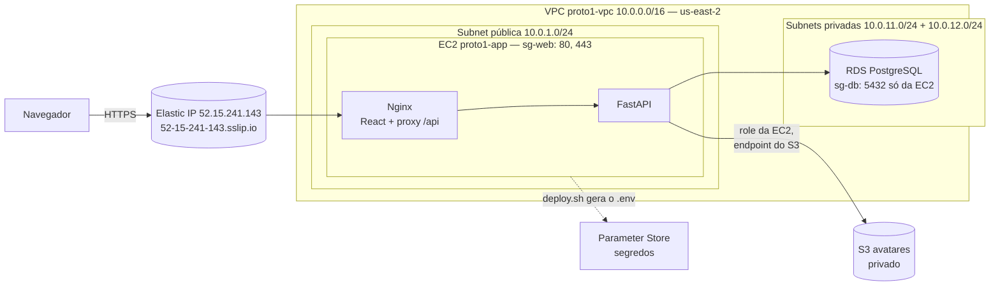

# Protótipo 1 — Aplicação Web na AWS

[](https://github.com/vickminari/aws-prototype/actions/workflows/ci.yml)

Protótipo da disciplina **Tópicos em Engenharia de Software (Engenharia de Software aplicada à AWS)** — UFPI.

Aplicação web com cadastro de usuários, login/logout, dashboard e edição de perfil (com foto armazenada no S3), hospedada na AWS em uma VPC própria com EC2, Elastic IP, RDS PostgreSQL e S3, servida por HTTPS.

**Produção:** **<https://52-15-241-143.sslip.io>** (região `us-east-2`). O endereço depende da EC2 e do RDS ligados; depois do teardown (report 08) ele deixa de responder.

## Sumário

- [Sprint 2 (em andamento)](#sprint-2-em-andamento)
- [Funcionalidades](#funcionalidades)
- [Arquitetura](#arquitetura)
- [Stack](#stack)
- [Como rodar localmente](#como-rodar-localmente)
- [Como rodar os testes](#como-rodar-os-testes)
- [Deploy na AWS](#deploy-na-aws)
- [Reports da AWS](#reports-da-aws)
- [Documentação](#documentação)
- [Equipe e responsabilidades](#equipe-e-responsabilidades)

## Sprint 2 (em andamento)

De 26/11 a 09/12/2026 o protótipo vira um **Sistema de Gerenciamento Multimídia (SGM)**: um "drive" onde cada usuário envia, organiza, pesquisa e visualiza imagens, áudios e vídeos, com cota de 100 MB. As propriedades de cada arquivo são extraídas automaticamente (EXIF das imagens, duração e codecs de áudio e vídeo) e os vídeos ganham versões 1080p, 720p e 480p.

Na AWS, a aplicação passa a rodar atrás de **CloudFront** (HTTPS) e de um **Application Load Balancer**, num **Auto Scaling group** que escala por CPU e memória. O processamento de áudio e vídeo vai para uma **fila SQS** consumida por **workers** com Auto Scaling próprio, que escala pelo tamanho da fila. Autenticação, perfil, VPC e RDS da sprint 1 continuam.

| Marco | Período | O que fica pronto |
|---|---|---|
| M4 — Fundação | 26–27/11 | Documentos, modelo de dados e contratos da API, imagens no GHCR, layout do drive |
| M5 — Mídia, processamento e infraestrutura | 27/11–03/12 | Upload, pesquisa, processamento das três mídias, worker, telas e recursos AWS (bucket, fila, roles, SGs, ALB, CloudFront) |
| M6 — Escala e deploy | 01–05/12 | Auto Scaling do app e dos workers, deploy por instance refresh, desligamento da EC2 da sprint 1 |
| M7 — Entrega | 06–09/12 | Teste de carga, validação em produção, documentos finais e apresentação |

- Requisitos: [`docs/REQUISITOS.md`](docs/REQUISITOS.md). Arquitetura e decisões: [`docs/ARQUITETURA.md`](docs/ARQUITETURA.md) (ADR-019 a ADR-030).
- Tarefas: [issues #62 a #91](https://github.com/vickminari/aws-prototype/milestones), com responsáveis, dependências e critérios de aceite. Regras de tags e reports da sprint 2: [`CONTRIBUTING.md`](CONTRIBUTING.md#8-sprint-2-milestones-labels-e-reports).

O restante deste README descreve a sprint 1 e é reescrito no fim da sprint 2 (#90).

## Funcionalidades

| Área | O que faz |
|---|---|
| Cadastro | Nome completo, username, email, senha (mín. 8 caracteres, com letra e número) e descrição; email e username únicos |
| Login e logout | Login por username **ou** email; sessão em cookie `HttpOnly` com JWT de 60 min; logout revoga o token no servidor |
| Dashboard | Rota protegida com menu lateral (Início, Meu perfil, Alterar senha, Sair), que vira menu por botão no celular |
| Perfil | Edição de nome, username, email e descrição; data de criação da conta |
| Foto de perfil | Upload com pré-visualização, JPEG/PNG/WebP de até 2 MB (tipo conferido pelo conteúdo do arquivo), guardada num bucket S3 privado e exibida por URL pré-assinada; remoção da foto |
| Senha | Troca com a senha atual e regras de força conferidas ao vivo |
| Segurança | Senhas com Argon2id, proteção CSRF em todas as escritas, HTTPS com certificado Let's Encrypt, banco em subnet privada |
| Interface | Tema claro/escuro e transições suaves entre telas |

## Arquitetura



O diagrama completo (subnets, tabelas de rotas, IDs, role, certbot, Session Manager), o fluxo de uma requisição autenticada e o fluxo do deploy estão na [§2 da ARQUITETURA.md](docs/ARQUITETURA.md#2-visão-geral-da-arquitetura).

O backend segue **MVC + Service**: schemas Pydantic (View), controllers finos, services com as regras de negócio e models SQLAlchemy ([§5](docs/ARQUITETURA.md#5-backend)). Frontend e API ficam na mesma origem: o Nginx serve o React e encaminha `/api/` para a API, sem CORS.

## Stack

| Camada | Tecnologia |
|---|---|
| Backend | Python 3.12, FastAPI, SQLAlchemy 2, Alembic, Pydantic v2, JWT (PyJWT), Argon2 (pwdlib), boto3 |
| Frontend | React 19, TypeScript, Vite, React Router 7, Tailwind CSS 4, React Hook Form + Zod, Axios |
| Banco | PostgreSQL 16 (Amazon RDS); SQLite em memória nos testes |
| Infraestrutura | AWS `us-east-2`: VPC, subnets, route tables, security groups, EC2, Elastic IP, RDS, S3 + VPC endpoint, IAM role, Parameter Store, Session Manager, Budgets |
| Deploy | Docker Compose na EC2 (Nginx, API e certbot), HTTPS com Let's Encrypt |
| Qualidade | pytest + cobertura, ruff, Vitest + Testing Library, ESLint, Prettier, GitHub Actions |

## Como rodar localmente

Pré-requisitos: **Docker** (com Compose) e **Node 22**. Python 3.12 só é necessário para rodar o backend fora do Docker.

```bash
git clone https://github.com/vickminari/aws-prototype.git
cd aws-prototype
```

1. **API + PostgreSQL**, na raiz do repositório:

   ```bash
   docker compose up --build
   ```

   API em <http://localhost:8000/api/health> e Swagger em <http://localhost:8000/api/docs>. As migrações rodam ao subir o container. Nenhum `.env` é necessário: os valores de desenvolvimento já funcionam (veja [`backend/.env.example`](backend/.env.example)).

2. **Frontend**, em outro terminal:

   ```bash
   cd frontend
   npm install
   npm run dev
   ```

   Abra <http://localhost:5173>. O Vite encaminha `/api` para a API na porta 8000.

Em desenvolvimento a sessão usa o cookie `access_token` sem `Secure` (funciona em HTTP) e as fotos ficam em `backend/media/`. Detalhes, como rodar a API sem Docker e como criar migrações: [backend/README.md](backend/README.md) e [frontend/README.md](frontend/README.md).

## Como rodar os testes

```bash
cd backend
pip install -e ".[dev]"         # ou: uv sync --extra dev
pytest --cov=app                # testes + cobertura (mínimo exigido: 70%)
ruff check . && ruff format --check .
```

```bash
cd frontend
npm ci
npm run test -- --run           # Vitest
npm run lint && npm run format:check && npm run build
```

Os testes do backend não precisam de PostgreSQL (SQLite em memória). Resultado na `main` em 2026-11-15: **backend com 400 testes e 96% de cobertura**; **frontend com 30 testes em 10 arquivos**.

O CI ([`.github/workflows/ci.yml`](.github/workflows/ci.yml)) roda os mesmos comandos em todo PR e em todo push na `main` e na `dev`, nos jobs **Backend** e **Frontend**. O backend foi feito com TDD: em cada funcionalidade, os commits `test(...)` vêm antes dos `feat(...)` ([§6](docs/ARQUITETURA.md#6-estratégia-de-testes-tdd-simplificado)).

## Deploy na AWS

A infraestrutura foi criada com os scripts AWS CLI de [`infra/scripts/`](infra/scripts/) (executados no CloudShell) ou pelo console, sempre documentada nos reports abaixo. A aplicação roda na EC2 com o [`docker-compose.prod.yml`](docker-compose.prod.yml): containers `web` (Nginx + React), `api` (FastAPI) e `certbot` (renovação do certificado).

Para atualizar a produção depois de um merge na `main`, abra um terminal na EC2 pelo **Session Manager** (console → EC2 → `proto1-app` → Conectar) e rode:

```bash
sudo -i
cd /opt/proto1 && ./infra/ec2/deploy.sh
```

O [`deploy.sh`](infra/ec2/deploy.sh) atualiza o código, gera o `.env` a partir do Parameter Store ([`load-env.sh`](infra/ec2/load-env.sh)), reconstrói e sobe os containers, emite o certificado HTTPS no primeiro deploy e testa o `/api/health` por HTTP e HTTPS. Passo a passo, verificações e troubleshooting: [report 07](docs/aws/report_07_deploy.md).

## Reports da AWS

Cada recurso tem um report com objetivo, decisões, passo a passo, script equivalente, verificação, custos, problemas encontrados e como desfazer ([template](docs/aws/TEMPLATE_report.md)). Nenhum report ou print contém senhas, chaves ou valores do Parameter Store.

| Report | Tema | Script | Issue | Responsável |
|---|---|---|---|---|
| [00](docs/aws/report_00_conta_equipe_custos.md) | Conta, equipe (AWS Settings) e orçamento | — (console) | #2 | José Victor |
| [01](docs/aws/report_01_vpc_rede.md) | VPC, subnets, Internet Gateway, tabelas de rotas e endpoint do S3 | [`01_vpc.sh`](infra/scripts/01_vpc.sh) | #17 | Gabriel Lopes |
| [02](docs/aws/report_02_security_groups.md) | Security groups | [`02_security_groups.sh`](infra/scripts/02_security_groups.sh) | #18 | Thalys Yago |
| [03](docs/aws/report_03_s3_iam_role.md) | Bucket S3 e IAM role da EC2 | [`03_s3_iam_role.sh`](infra/scripts/03_s3_iam_role.sh) | #19 | Pedro Emanuel |
| [04](docs/aws/report_04_rds.md) | RDS PostgreSQL | [`04_rds.sh`](infra/scripts/04_rds.sh) | #20 | José Victor |
| [05](docs/aws/report_05_ssm_parameters.md) | Segredos no Parameter Store | [`05_ssm_parameters.sh`](infra/scripts/05_ssm_parameters.sh) | #21 | Pedro Emanuel |
| [06](docs/aws/report_06_ec2_elastic_ip.md) | EC2, Elastic IP e Session Manager | [`06_ec2.sh`](infra/scripts/06_ec2.sh) | #22 | Jailson Zarur |
| [07](docs/aws/report_07_deploy.md) | Deploy em produção, HTTPS e atualização | [`deploy.sh`](infra/ec2/deploy.sh) | #23 | Jailson Zarur |
| 08 | Teardown e custos | — | #26 | Gabriel Lopes (em andamento) |

A validação do fluxo completo em produção (cadastro, foto, perfil, senha, logout) está no [checklist de validação](docs/checklist_validacao.md) (#24, Pedro Emanuel).

## Documentação

| Documento | Conteúdo |
|---|---|
| [ARQUITETURA.md](docs/ARQUITETURA.md) | Fonte da verdade: requisitos, diagramas, camadas, endpoints, modelo de dados, AWS, deploy, segurança, custos e as decisões (ADRs) |
| [REQUISITOS.md](docs/REQUISITOS.md) | Requisitos da sprint 2 (SGM): funcionais, regras de negócio, não funcionais mensuráveis e rastreabilidade |
| [Decisão de autenticação](docs/DECISAO_AUTENTICACAO.md) | JWT em cookie `HttpOnly` com proteção CSRF (ADR-010) |
| [backend/README.md](backend/README.md) | Como rodar e testar a API, fixtures, camadas, migrações e variáveis |
| [frontend/README.md](frontend/README.md) | Como rodar e testar o frontend, rotas, sessão, formulários e tema |
| [CONTRIBUTING.md](CONTRIBUTING.md) | Fluxo de git, commits, TDD e checklist do PR |
| [Swagger](https://52-15-241-143.sslip.io/api/docs) | Documentação interativa da API (em produção; localmente em `/api/docs`) |
| [Issues](https://github.com/vickminari/aws-prototype/issues) | Tarefas, responsáveis e critérios de aceite |

## Equipe e responsabilidades

| Membro | Responsabilidades | Issues | GitHub |
|---|---|---|---|
| José Victor | Setup do repositório e governança, tech lead do backend (esqueleto, banco), conta AWS e equipe, RDS, README e diagramas, apresentação | #1, #2, #3, #5, #20, #25, #27 | [@vickminari](https://github.com/vickminari) |
| Gabriel Lopes | Autenticação (hash, JWT, registro, login, logout, cookie e CSRF), VPC e rede, teardown | #7, #8, #9, #17, #26 | [@G4brielLB](https://github.com/G4brielLB) |
| Pedro Emanuel | Perfil, troca de senha e upload de imagem, S3 e role da EC2, Parameter Store, validação em produção | #10, #11, #19, #21, #24 | [@PedroEmanuelMoreiraCarvalho](https://github.com/PedroEmanuelMoreiraCarvalho) |
| Thalys Yago | Frontend base, camada de API e sessão, login, cadastro e perfil, security groups, modo escuro e transições | #4, #12, #13, #15, #18, #37, #53 | [@ThalysYago](https://github.com/ThalysYago) |
| Jailson Zarur | CI, dashboard e logout, alteração de senha, EC2 e Elastic IP, deploy e HTTPS | #6, #14, #16, #22, #23 | [@jailsonzarur](https://github.com/jailsonzarur) |

Cada issue foi feita numa branch própria e entrou na `main` por PR revisado, com merge commit (sem squash), para preservar a autoria e a sequência dos commits. A tabela de contribuições detalhada fica no [roteiro da apresentação](docs/apresentacao/roteiro.md#tabela-de-contribuições) (#27).
