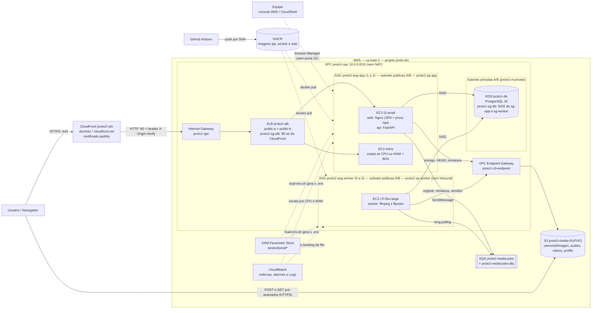
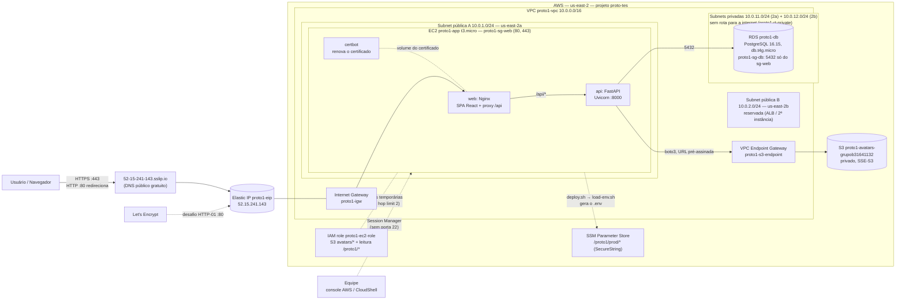
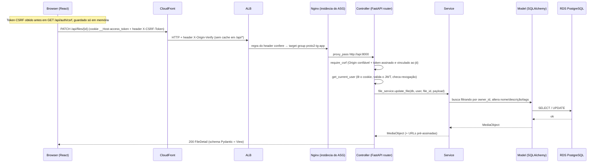
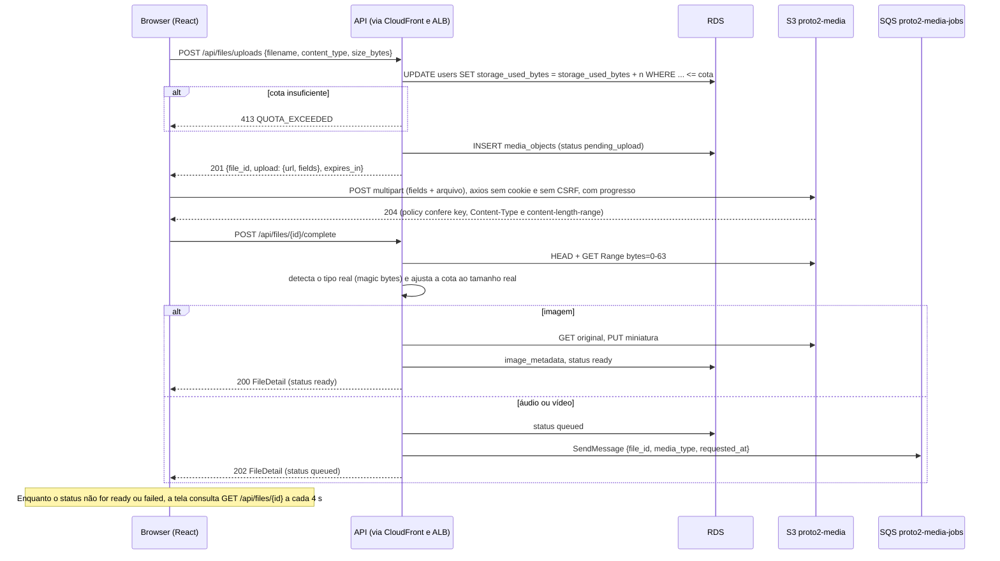
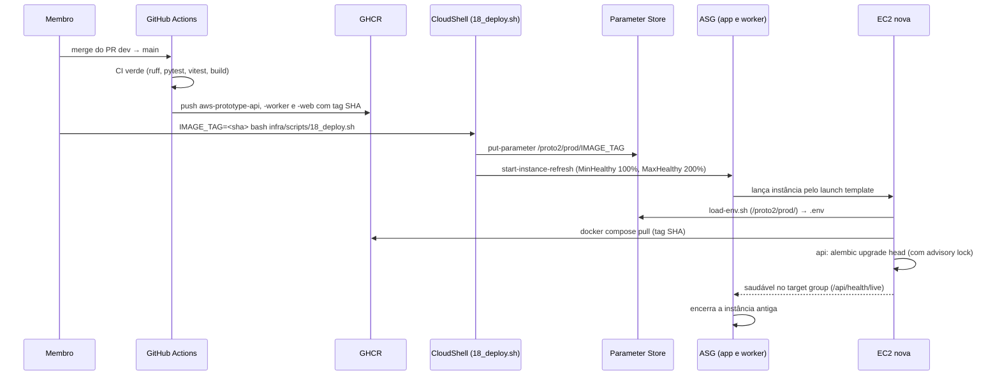
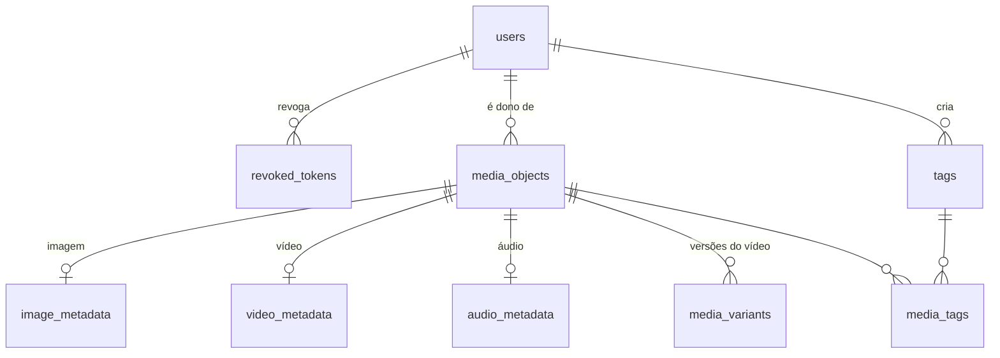

# Arquitetura e Decisões Técnicas — Protótipos 1 e 2 (Sistema de Gerenciamento Multimídia)

> **Disciplina:** Tópicos em Engenharia de Software (Engenharia de Software aplicada à AWS) — UFPI
> **Equipe:** 5 integrantes (nomes e responsabilidades no `README.md`; tarefas nas [issues](https://github.com/vickminari/aws-prototype/issues)). Responsável pelo setup do repositório, pela conta AWS e pelo IAM: Victor.
> **Prazos:** sprint 1 (1º protótipo: autenticação e perfil) entregue em 2026-11-16; **sprint 2** (2º protótipo: Sistema de Gerenciamento Multimídia, SGM) de **26/11 a 09/12/2026**, 14 dias corridos, com apresentação em 09/12. Ver seções 1.5 e 1.6.
> **Status deste documento:** fonte da verdade do projeto. Toda decisão nova ou alterada deve ser registrada aqui (seção 15) **no mesmo PR** que a implementa.
> **Situação:** a sprint 1 foi conferida com o código, os scripts e os reports na revisão final (#25, 2026-11-15). A **sprint 2 está em andamento**: o que ainda não foi implementado aparece marcado como **(planejado, #n)**, com o número da issue responsável. Quando a issue for concluída, a marcação sai no mesmo PR.

---

## Sumário

1. Escopo e requisitos
2. Visão geral da arquitetura
3. Registro de decisões (resumo)
4. Estrutura do repositório
5. Backend
6. Estratégia de testes (TDD simplificado)
7. Frontend
8. Infraestrutura AWS
9. Deploy
10. Documentação do projeto (padrão comum, código, AWS)
11. Fluxo de trabalho Git e rastreabilidade
12. Segurança
13. Custos e cuidados com a conta
14. Fora do escopo / evoluções futuras
15. Log de decisões (ADRs)

---

## 1. Escopo e requisitos

O projeto evolui em duas etapas no **mesmo repositório e na mesma conta AWS** (ADR-019):

- **Protótipo 1 (sprint 1):** autenticação, dashboard e perfil do usuário, numa EC2 com Docker, RDS, S3 e HTTPS. Entregue.
- **Protótipo 2 (sprint 2):** **Sistema de Gerenciamento Multimídia (SGM)**, uma aplicação no estilo "Google Drive" em que cada usuário guarda, organiza e reproduz as próprias imagens, áudios e vídeos. Reaproveita todo o protótipo 1 e acrescenta balanceador de carga, Auto Scaling, fila de processamento e workers de vídeo.

### 1.1 Requisitos do 1º protótipo → como foram atendidos

| # | Requisito (especificação) | Solução |
|---|---|---|
| A1 | Login/Logout, autenticação e autorização | JWT em cookie `HttpOnly` + proteção CSRF (ADR-010) + hash Argon2 nas senhas; logout com revogação do token no servidor (tabela `revoked_tokens`) |
| A1 | Registro de novos usuários | `POST /api/auth/register` + página de cadastro |
| A2 | Dashboard para usuário autenticado | SPA React com rota protegida e menu lateral (na sprint 2 o dashboard vira o "Meu Drive", seção 7) |
| A2 | Edição de perfil e troca de senha | `PATCH /api/users/me`, `PUT /api/users/me/password`, `POST` e `DELETE /api/users/me/avatar` |
| A2 | Propriedades: nome completo, username, password, email, imagem, descrição, data de criação | Modelo `User` (seção 5.4); imagem no **S3** |
| B | VPC | VPC própria `10.0.0.0/16` com subnets públicas e privadas em 2 AZs |
| B | EC2 para hospedar a aplicação | 1 instância `t3.micro` (Amazon Linux 2023) rodando Docker Compose; substituída na sprint 2 pelo Auto Scaling Group `proto2-asg-app` (seção 8.17) |
| B | Grupos de segurança | `proto1-sg-web` (EC2) e `proto1-sg-db` (RDS, aceita só a EC2) |
| B | Tabela de rotas | Tabela pública (rota `0.0.0.0/0` → Internet Gateway) e tabela privada (só rota local + endpoint S3) |
| B | IP público | Elastic IP associado à EC2 (liberado no cutover da sprint 2, #87) |
| C | Repositório Git documentado | Monorepo no GitHub, README, este documento, `docs/aws/report_*.md`, scripts em `infra/` |
| C | Contribuição individual visível | Issues atribuídas, branches por issue, PRs revisados, merge que preserva commits, login individual na AWS (Builder ID de cada membro) + CloudTrail |

### 1.2 Requisitos do 2º protótipo (ERS do SGM) → solução

A especificação completa, com prioridade e critério de aceite de cada requisito, está em [`REQUISITOS.md`](REQUISITOS.md) (#62). Resumo de onde cada requisito é atendido:

| Requisito | Resumo | Solução | Issues |
|---|---|---|---|
| RF-1.1, RF-1.2 | Registro e login (username e senha) | Entregues na sprint 1 (`/api/auth/*`) | — |
| RF-1.3 | Gerenciar o perfil (editar dados, trocar senha) | Entregue na sprint 1; a imagem de perfil passa para `users/{uid}/profile/` no bucket de mídia | #67, #79 |
| RF-2.1 | Upload de imagens (JPEG, PNG, GIF, SVG, WebP), áudios (MP3, WAV, OGG, FLAC) e vídeos (MP4, AVI, MOV, WebM) | Upload direto ao S3 com **POST pré-assinado** em 3 passos, tipo real conferido por magic bytes, **cota de 100 MB** por usuário (seções 5.7, 5.12, 7.8) | #64, #67, #69, #76 |
| RF-2.2 | Armazenamento seguro | Bucket privado (Block Public Access, SSE-S3), chaves por usuário, URLs pré-assinadas de no máximo 1 h, roles de mínimo privilégio | #79, #81 |
| RF-2.3 | Visualizar objetos existentes | `GET /api/files/{id}` + página de visualização | #70, #77 |
| RF-2.4 | Editar informações e conteúdo (renomear, descrição, tags) | `PATCH /api/files/{id}` (nome, descrição, tags, gênero); trocar o conteúdo = excluir e enviar de novo (ADR-029) | #70, #77 |
| RF-2.5 | Excluir objetos | `DELETE /api/files/{id}` apaga original, miniatura e versões e devolve a cota | #70, #77 |
| RF-2.6, RF-2.7 | Miniatura automática da imagem, usada nas listagens | Pillow, gerada na conclusão do upload (ADR-024) | #68, #69, #75 |
| Propriedades da imagem | Nome, tamanho, data de upload, MIME, dimensões, profundidade de cor, DPI, EXIF (câmera, exposição, data, GPS), descrição, tags | Tabelas `media_objects` + `image_metadata` (seção 5.4) | #64, #68 |
| RF-2.8, RF-2.9 | Miniatura do vídeo a partir do 1º quadro | `ffmpeg` no worker | #72, #73 |
| RF-2.10 | Versões 1080p, 720p e 480p | Worker com `ffmpeg`, sem upscale (ADR-023) | #72, #73, #86 |
| RF-2.11 | Versões associadas ao original, seleção da qualidade na reprodução, padrão 1080p | Tabela `media_variants` + player com seletor de qualidade | #73, #78 |
| Propriedades do vídeo | Duração, resolução, fps, codecs de vídeo e áudio, taxa de bits, local da miniatura, versões geradas e locais, descrição, tags, gênero | `video_metadata` + `media_variants` + `media_objects` | #64, #73 |
| Propriedades do áudio | Duração, taxa de bits, taxa de amostragem, canais, descrição, tags, gênero | `audio_metadata` (ffprobe no worker) | #64, #74 |
| RF-3.1, RF-3.2 | Pesquisa por palavras-chave na descrição, no nome e nas tags | Coluna `search_text` normalizada (minúsculas, sem acento) e parâmetro `q` | #70, #75 |
| RF-4.1 a RF-4.3 | Listar todos, por tipo e combinando com a pesquisa | `GET /api/files?type=&q=&tag=&sort=&page=`; "todos" = todos os objetos **do usuário logado** (ADR-029) | #70, #75 |
| RF-5.1, RF-5.2 | Selecionar um objeto e exibir conteúdo e detalhes conforme o tipo | Página de visualização com ``, `<audio>` e `<video>` | #77, #78 |

### 1.3 Requisitos não funcionais mensuráveis

Os RNFs da ERS ("tempos aceitáveis a definir com o cliente") foram transformados em critérios testáveis. Detalhes e método de medição em [`REQUISITOS.md`](REQUISITOS.md) e [`TESTES.md`](TESTES.md) (#89).

| ID | Categoria | Critério | Como é verificado |
|---|---|---|---|
| RNF-01 | Desempenho | p95 de `GET /api/files` (50 itens) < 1 s com 20 usuários simultâneos | Locust (#88) |
| RNF-02 | Desempenho | p95 de `POST /api/files/uploads` < 300 ms | Locust (#88) |
| RNF-03 | Desempenho | Imagem com miniatura pronta na resposta do `complete` (< 5 s para imagem de até 10 MB) | Teste de integração + validação em produção (#89) |
| RNF-04 | Desempenho | Vídeo de 1 min em 1080p com versões prontas em < 3 min com worker ligado | Validação em produção (#89) |
| RNF-05 | Escalabilidade | Com CPU ou RAM > 80% por 3 min, o ASG do app lança instância; a nova instância fica InService em < 5 min | Locust + CloudWatch (#88) |
| RNF-06 | Escalabilidade | Com mensagens na fila, o ASG de workers sai de 0 para 1 em < 5 min e volta a 0 após 10 min de fila vazia | CloudWatch (#88) |
| RNF-07 | Segurança | 0 acessos a objetos de outro usuário nos testes (API → 404; S3 direto → `AccessDenied`) | Testes de IDOR (#70) + validação (#89) |
| RNF-08 | Segurança | Bucket sem acesso público; URLs pré-assinadas de no máximo 1 h; HTTPS obrigatório | Validação em produção (#89) |
| RNF-09 | Usabilidade | Interface responsiva (360 px a 1440 px), estados de carregando, erro e vazio em toda tela | Testes de frontend + checklist (#89) |
| RNF-10 | Capacidade | Cota de 100 MB por usuário (99 MB usados + arquivo de 2 MB → recusado com mensagem clara) | Teste automatizado (#69) + validação (#89) |

### 1.4 Serviços AWS utilizados

| Situação | Serviços |
|---|---|
| Obrigatórios (sprint 1) | **VPC** (subnets, IGW, route tables, security groups), **EC2**, **Elastic IP** |
| Obrigatórios (sprint 2, arquitetura de referência do professor) | **Elastic Load Balancing (ALB)**, **EC2 Auto Scaling** (launch templates + Auto Scaling Groups), **S3**, **RDS** |
| Adicionais (decisão da equipe) | **CloudFront** (HTTPS, ADR-020), **SQS** (fila de processamento + DLQ, ADR-021), **CloudWatch** (métricas, CloudWatch Agent para RAM, alarmes e CloudWatch Logs), **IAM** (roles das instâncias), **SSM Parameter Store** (segredos), **Systems Manager Session Manager** (acesso sem SSH), **VPC Gateway Endpoint para S3**, **AWS Budgets** e **CloudTrail** |
| Fora da AWS (gratuitos) | **GitHub Actions** (CI e build das imagens) e **GitHub Container Registry (GHCR)** (imagens Docker públicas, ADR-025). Na sprint 1 também **Let's Encrypt** e **sslip.io** (ADR-012), aposentados no cutover da sprint 2 (#87) |

### 1.5 Sprint 1: prazo, priorização e resultado (registro)

A sprint 1 teve 1 semana. Os princípios adotados continuam valendo na sprint 2: **contratos primeiro** (endpoints e schemas definidos antes do código), **dependências quebradas por stubs** (`get_current_user` sobrescrito por fixture), **deploy cedo** ("walking skeleton"), **feature freeze** antes da entrega e **PRs pequenos com revisão em até 4 h**.

| Situação | Itens |
|---|---|
| Entregue | Todo o escopo obrigatório e todo o planejado |
| Entregue além do plano | HTTPS com certificado confiável (ADR-012); JWT em cookie `HttpOnly` com proteção CSRF no lugar do `localStorage` (ADR-010); menu responsivo (botão no celular); modo escuro (#37) e transições entre telas (#53); 10 arquivos de teste no frontend em vez de 3 |
| Pendente | Report 08 de teardown (#26), reescopado na sprint 2 para cobrir os dois protótipos; prints do CloudTrail; `99_teardown.sh` |

Nenhum plano B foi acionado: o RDS (report 04) e o S3 com a role da EC2 (reports 03 e 07) funcionaram, e o swap de 2 GB bastou para o build do frontend na EC2 (report 06).

### 1.6 Sprint 2: prazo, priorização, plano B e lista de corte

**Calendário (marcos):**

| Milestone | Período | Conteúdo |
|---|---|---|
| `M4 — Fundação da sprint 2` | 26–27/11 (D1–D2) | Planejamento, custos, modelo de dados e contratos, imagens no GHCR, layout "Drive" (#62–#66) |
| `M5 — Mídia, processamento e infraestrutura` | 27/11–03/12 (D2–D8) | Storage v2, upload, CRUD, fila, worker, processamento, telas, S3, SQS, IAM, SGs, ALB, CloudFront (#67–#84) |
| `M6 — Escala e deploy` | 01–05/12 (D6–D10) | Auto Scaling do app e dos workers, deploy por instance refresh, cutover (#85–#87). **Feature freeze no fim de 05/12** |
| `M7 — Entrega da sprint 2` | 06–09/12 (D11–D14) | Teste de carga, documento de testes, README, apresentação em 09/12, teardown depois da nota (#88–#91, #26) |

**Princípios para caber no prazo:**

1. **Contratos primeiro.** Endpoints, schemas (seção 5.5), mensagem da fila (seção 5.10), chaves do S3 e status do processamento estão definidos aqui desde o D1. Backend, frontend e infraestrutura começam em paralelo.
2. **Stubs no lugar de dependências.** Os services de processamento (`services/processing/`) são funções puras (caminho do arquivo → dados extraídos e arquivos gerados), testáveis sem AWS e sem banco. A fila tem implementação em memória (`QUEUE_BACKEND=memory`) e o storage tem implementação local, inclusive para o upload pré-assinado. O frontend trabalha contra o contrato com os services mockados.
3. **Infraestrutura em paralelo ao código.** S3, SQS, IAM, SGs e ALB não dependem do código novo; a CloudFront é validada primeiro na frente da `proto1-app` (#84).
4. **Walking skeleton na infra nova** assim que ALB, launch template e ASG do app existirem (#83–#85): a `main` atual servida por CloudFront → ALB → ASG. Daí em diante, cada PR `dev → main` vai para produção por instance refresh (seção 9).
5. **Feature freeze no fim de 05/12.** Depois disso, só correções, testes, documentação e ensaio.

**Classificação do escopo:**

| Prioridade | Itens |
|---|---|
| **Obrigatório** (ERS e arquitetura de referência) | RF-1 a RF-5; miniaturas; versões 1080p/720p/480p; processamento em segundo plano; ALB + Auto Scaling por CPU/RAM; S3 privado com prefixos por usuário e URLs pré-assinadas; RDS; documentos de requisitos, arquitetura e testes; teste de carga |
| **Planejado** (decisão da equipe) | CloudFront com HTTPS; SQS + DLQ; ASG de workers escalando pelo backlog; upload direto ao S3; cota de 100 MB; imagens no GHCR + instance refresh; CloudWatch Agent; logs no CloudWatch Logs; teste de IDOR; teardown por script |
| **Lista de corte** (sai primeiro se faltar tempo) | Reprocessar arquivo com falha; capa embutida do áudio; visualização em lista (fica só a grade); autocomplete de tags |

**Plano B:**

| Risco | Gatilho | Plano B |
|---|---|---|
| Plano gratuito bloquear ALB, ASG, SQS, CloudFront ou o tipo de instância | Report 09 (#63) | Trocar o tipo de instância por outro elegível (ex.: `t3.small` também nos workers, mais lento); registrar no report 09 |
| Cookie `__Host-`/CSRF não funcionarem atrás da CloudFront | PoC do #84 falhando até o D4 | Domínio próprio barato + certificado ACM no listener HTTPS do ALB (sem CloudFront); registrar em ADR |
| Auto Scaling atrasar | ASG do app sem instância saudável até o D8 | Apresentação da aplicação na `proto1-app` (worker no mesmo Compose) e do ALB/ASG separadamente, com o walking skeleton |
| Transcodificação lenta | Vídeo de 1 min passando de 3 min | `-preset ultrafast`, vídeos curtos na demo e ação agendada com 1 worker ligado |
| Internet ruim na apresentação | — | Prints dos reports e do checklist de validação |

---

## 2. Visão geral da arquitetura

### 2.1 Diagrama da infraestrutura (sprint 2, alvo)

Recursos da sprint 2 em construção (reports 09 a 18); o que foi reaproveitado da sprint 1 mantém o nome `proto1-*`. Endereço público: **`https://<dist>.cloudfront.net`**, definido quando a distribuição for criada (#84).



| Requisito de infraestrutura | Onde aparece no diagrama |
|---|---|
| Balanceador de carga | `proto2-alb` nas duas subnets públicas, alcançável só pela CloudFront (SG por prefix list + header secreto) |
| Auto Scaling da aplicação | `proto2-asg-app`, 1 a 3 instâncias, escala se CPU ou RAM > 80% (RAM pelo CloudWatch Agent) |
| Processamento em segundo plano | `proto2-media-jobs` (SQS) consumida por `proto2-asg-worker`, que escala pelo número de mensagens na fila (ADR-021) |
| S3 com prefixos por usuário | `proto2-media-<sufixo>`, chaves `users/{uid}/...`, acesso só por URL pré-assinada |
| RDS | `proto1-db` reaproveitado; o SG passa a aceitar os SGs do app e do worker |
| Aplicação sem estado | Sessão em cookie JWT validado em qualquer instância; arquivos no S3; fila no SQS; nada fica no disco da instância |

### 2.2 Infraestrutura da sprint 1 (registro, em produção até o cutover)

Recursos criados nos reports 01 a 07. A `proto1-app`, o Elastic IP, o certbot e o `proto1-sg-web` são aposentados no cutover (#87, seção 9.5); VPC, subnets, route tables, endpoint S3 e RDS continuam em uso na sprint 2.



### 2.3 Fluxo de uma requisição autenticada

Sessão em cookie `HttpOnly` com proteção CSRF (ADR-010). O exemplo é uma escrita (`PATCH`); uma leitura (`GET`) só dispensa o header CSRF. Na sprint 2 a requisição passa por CloudFront e ALB antes do Nginx; o cookie `__Host-access_token` fica vinculado ao domínio `<dist>.cloudfront.net` (ADR-020).



### 2.4 Upload em 3 passos (planejado, #67, #69, #76)

O arquivo vai do navegador **direto para o S3** por um POST pré-assinado (ADR-022); a API só autoriza, reserva a cota e confere o resultado.



### 2.5 Processamento de vídeo pelo worker (planejado, #72, #73, #86)

```mermaid
sequenceDiagram
    participant Q as SQS proto2-media-jobs
    participant W as Worker (proto2-asg-worker)
    participant DB as RDS
    participant S3 as S3 proto2-media
    participant DLQ as proto2-media-jobs-dlq

    W->>Q: ReceiveMessage (long polling de 20 s, 1 mensagem)
    Q-->>W: {file_id, media_type: video}
    W->>DB: UPDATE status = processing, attempts + 1 WHERE status IN (queued, processing)
    W->>S3: GET original → arquivo temporário
    W->>W: ffprobe (propriedades); duração > 10 min → failed VIDEO_TOO_LONG
    loop a cada 10 min enquanto processa
        W->>Q: ChangeMessageVisibility (heartbeat)
    end
    W->>W: ffmpeg: miniatura do 1º quadro + versões (decodifica uma vez, filtro split)
    W->>S3: PUT thumb.jpg, 1080p.mp4, 720p.mp4, 480p.mp4 (chaves determinísticas)
    W->>DB: video_metadata, media_variants, status ready
    W->>Q: DeleteMessage
    Note over Q,DLQ: Erro transitório: a mensagem não é apagada e volta após o visibility timeout.<br/>No 3º recebimento com falha o objeto fica failed (PROCESSING_ERROR) e a mensagem vai para a DLQ.
```

### 2.6 Fluxo do deploy (planejado, #65, #87)

Imagens imutáveis no GHCR, com tag = SHA do commit; o Auto Scaling troca as instâncias (ADR-025). Detalhes na seção 9.4.



---

## 3. Registro de decisões (resumo)

| Tema | Decisão | Alternativas consideradas | Motivo |
|---|---|---|---|
| Repositório | Monorepo (`backend/`, `frontend/`, `infra/`, `docs/`), o mesmo nas duas sprints | Repositório novo para o SGM | Reaproveita autenticação, perfil, infraestrutura e histórico (ADR-019) |
| Backend | FastAPI (Python 3.12) | Django, Flask | Pedido da equipe; tipagem, OpenAPI automático, ótimo suporte a testes |
| Arquitetura do código | MVC + Service (View–Controller–Service–Model) + worker como ponto de entrada fino | Clean Architecture completa | Separa regra de negócio sem burocracia excessiva; o worker reaproveita os mesmos services e models |
| Banco | **RDS PostgreSQL** + SQLAlchemy 2 + Alembic | DynamoDB, SQLite | Dados relacionais com unicidade; SQLite nos testes; RDS exercita subnets privadas e SG (ADR-001) |
| Autenticação | JWT HS256 em cookie `HttpOnly` com proteção CSRF (ADR-010) | Bearer em `localStorage`, sessão no servidor | Stateless (qualquer instância do ASG valida); o cookie `HttpOnly` impede que um XSS leia o token |
| Logout | Revogação no servidor (lista de `jti` revogados) | Apenas apagar token no cliente | Logout "de verdade"; a tabela fica no RDS, compartilhada pelas instâncias |
| Hash de senha | Argon2id via `pwdlib` | bcrypt via passlib | `passlib` sem manutenção |
| Arquivos | S3 privado + URLs pré-assinadas; chaves `users/{uid}/...` | Bucket público, disco da EC2 | Segurança e aplicação sem estado |
| Upload | **POST pré-assinado direto ao S3** em 3 passos, com reserva atômica de cota (ADR-022) | Upload passando pela API | O S3 impõe o tamanho; sem limites de corpo e timeout de CloudFront, ALB e Nginx; a API não carrega 100 MB na memória |
| Cota | 100 MB por usuário, só os originais contam (ADR-022) | Contar também miniaturas e versões | O usuário sabe o tamanho antes de enviar; versões não podem estourar a cota depois |
| Processamento | Imagem na conclusão do upload; áudio e vídeo no **worker** via SQS (ADR-021, ADR-024) | Tudo síncrono na API; AWS MediaConvert | Vídeo leva minutos e não pode prender uma requisição; MediaConvert é pago por minuto e esconderia o ASG de processamento |
| Fila | **SQS** standard + DLQ; workers por *pull*, sem balanceador (ADR-021) | RabbitMQ numa EC2; um 2º ALB na frente dos workers | Serviço gerenciado; a fila já distribui o trabalho e segura picos |
| Ferramentas de mídia | **Pillow** (EXIF nativo), **defusedxml** (SVG), **filetype** (magic bytes), **FFmpeg/ffprobe** por `subprocess` | pyvips, PyAV, ImageMagick | Padrão da indústria, sugeridos pelo professor; pyvips só compensa em imagens enormes; PyAV exigiria escrever o laço de codificação |
| Vídeo | Original compatível e ≤ 1080 é a versão de topo; incompatível vira MP4 H.264/AAC; sem upscale (ADR-023) | "1080p é sempre o original" | AVI e codecs antigos não tocam no navegador; não faz sentido "aumentar" um vídeo de 480p |
| Credenciais AWS nas instâncias | IAM Role (instance profile), uma por função (app e worker) | Access keys no `.env` | Nunca existem chaves em arquivo; mínimo privilégio por função |
| Segredos da aplicação | SSM Parameter Store (SecureString), caminho `/proto2/prod/` | Secrets Manager, `.env` commitado | Parameter Store padrão é gratuito |
| Frontend | React + TypeScript + Vite, interface no estilo "Drive" | CRA, Next.js | SPA simples; layout conhecido pelos usuários |
| HTTPS | **CloudFront** com certificado padrão `*.cloudfront.net` na frente do ALB (ADR-020) | ALB + ACM com domínio próprio; Let's Encrypt atrás do ALB | Sem domínio comprado e sem custo; mantém o cookie `Secure` |
| Balanceamento e escala | ALB + ASG do app por CPU e RAM (80%); ASG de workers pelo backlog da fila (ADR-021, ADR-028) | Uma EC2 maior; escalar workers por CPU | Exigência da especificação; um job de vídeo já usa 100% da CPU, então CPU não indica demanda |
| Deploy | Imagens no **GHCR** por SHA + **instance refresh** do ASG (ADR-025) | Build na EC2 (sprint 1, ADR-015); ECR | Instância nova sobe em minutos e na mesma versão das outras; GHCR é gratuito para repositório público e dispensa credencial AWS no CI |
| Rede das instâncias | App e workers em subnets públicas, sem inbound da internet (ADR-026) | Subnets privadas com NAT ou VPC endpoints de interface | NAT custa ~US$ 32/mês e cada endpoint de interface ~US$ 7/mês por AZ |
| Infra como código | Reports `.md` + scripts AWS CLI lineares | Terraform, só console | Equilíbrio entre aprendizado do console e reprodutibilidade |
| Região | `us-east-2` (Ohio) | — | **Imposta pela AWS** (ADR-008) |
| Acesso às instâncias | SSM Session Manager (porta 22 fechada, sem key pair) | SSH com chave | Sem porta aberta e com registro no CloudTrail (ADR-004) |
| Acesso humano à AWS | Página **Equipe** do AWS Settings, cada membro com seu AWS Builder ID; CLI no **CloudShell** | IAM users | Modelo da nova experiência; nenhuma chave pode vazar (ADR-006) |
| Visibilidade do repositório | Público | Privado | As instâncias clonam e o GHCR publica sem credenciais; por design não há segredos no repo (ADR-007) |
| Branches | `dev` recebe os PRs das issues (1 aprovação); `main` = produção, só recebe `dev → main` (2 aprovações) (ADR-031) | Só a `main` (GitHub Flow, sprint 1) | Merge do dia a dia não dispara deploy; a versão em produção é decidida pela equipe |
| Marcação dos recursos | Novos com prefixo `proto2-` e `Project=proto2`; modificados recebem `Project=proto2` + `PreviousProject=proto1`; intocados continuam `proto1` (ADR-019) | Renomear tudo para `proto2` | Mostra o que mudou entre os protótipos e permite um teardown por tag |

---

## 4. Estrutura do repositório

Itens marcados com **(sprint 2)** são criados ou substancialmente alterados na sprint 2; os demais vêm da sprint 1.

```
.
├── README.md                     # visão geral, como rodar local, como fazer deploy, equipe
├── CONTRIBUTING.md               # fluxo git, padrão de commits, regra de tags da AWS, como abrir PR
├── .gitattributes                # finais de linha LF (scripts .sh funcionam vindos do Windows)
├── docs/
│   ├── ARQUITETURA.md            # este documento
│   ├── REQUISITOS.md             # (sprint 2) RF e RNF do SGM, prioridade, critérios de aceite (#62)
│   ├── TESTES.md                 # (sprint 2) estratégia, rastreabilidade RF→teste, RNFs, resultados (#89)
│   ├── DECISAO_AUTENTICACAO.md   # contrato do JWT em cookie HttpOnly + CSRF (ADR-010)
│   ├── checklist_validacao.md    # testes manuais em produção (#24; ampliado na #89)
│   ├── aws/
│   │   ├── TEMPLATE_report.md
│   │   ├── report_00 … report_07 # sprint 1 (conta, VPC, SGs, S3/role, RDS, SSM, EC2, deploy)
│   │   ├── report_08_teardown.md # teardown dos dois protótipos (#26, reescopada)
│   │   ├── report_09_plano_custos_sprint2.md   # (sprint 2) #63
│   │   ├── report_10_s3_media.md               # (sprint 2) #79
│   │   ├── report_11_sqs.md                    # (sprint 2) #80
│   │   ├── report_12_iam_ssm.md                # (sprint 2) #81
│   │   ├── report_13_security_groups_proto2.md # (sprint 2) #82
│   │   ├── report_14_alb.md                    # (sprint 2) #83
│   │   ├── report_15_cloudfront.md             # (sprint 2) #84
│   │   ├── report_16_asg_app.md                # (sprint 2) #85
│   │   ├── report_17_asg_worker.md             # (sprint 2) #86
│   │   ├── report_18_deploy_proto2.md          # (sprint 2) #87
│   │   └── img/                  # prints (report_XX_descricao.png)
│   └── apresentacao/             # roteiro.md (sprint 1, #27) e roteiro da sprint 2 (#91)
├── backend/
│   ├── app/
│   │   ├── main.py               # cria o app, registra routers e handlers de erro
│   │   ├── core/
│   │   │   ├── config.py         # Settings (pydantic-settings) e validações de produção (variáveis novas na sprint 2)
│   │   │   ├── database.py       # engine (pool configurável), SessionLocal, Base, tipo UTCDateTime
│   │   │   ├── security.py       # hash de senha e JWT (funções puras)
│   │   │   ├── csrf.py           # tokens CSRF assinados (HMAC), sem camada HTTP
│   │   │   ├── origins.py        # normalização de origens (CSRF e CORS)
│   │   │   └── exceptions.py     # exceções de domínio (novas na sprint 2)
│   │   ├── models/               # MODEL: entidades SQLAlchemy
│   │   │   ├── user.py           # + storage_used_bytes (sprint 2)
│   │   │   ├── revoked_token.py
│   │   │   └── media.py          # (sprint 2) MediaObject, metadados por tipo, MediaVariant, Tag, media_tags
│   │   ├── schemas/              # VIEW: contratos de entrada/saída (Pydantic)
│   │   │   ├── auth.py, user.py, health.py, error.py
│   │   │   └── file.py           # (sprint 2) UploadInit, UploadTicket, FileSummary, FileDetail, FilePage, ...
│   │   ├── services/             # SERVICE: regras de negócio
│   │   │   ├── auth_service.py, user_service.py, health_service.py
│   │   │   ├── file_service.py   # (sprint 2) listar, pesquisar, detalhar, editar, excluir, uso da cota
│   │   │   ├── upload_service.py # (sprint 2) iniciar, concluir, reservar cota, uploads abandonados
│   │   │   ├── media_types.py    # (sprint 2) tipos aceitos e detecção por magic bytes (filetype + SVG)
│   │   │   ├── processing/       # (sprint 2) funções puras: caminho → dados extraídos + arquivos gerados
│   │   │   │   ├── images.py     # Pillow, EXIF, miniatura, SVG
│   │   │   │   ├── video.py      # regras de versões, miniatura do 1º quadro
│   │   │   │   ├── audio.py      # propriedades do áudio
│   │   │   │   └── ffmpeg.py     # chamadas a ffmpeg/ffprobe (subprocess, timeout)
│   │   │   ├── queue/            # (sprint 2) QueueService: base.py, sqs.py, memory.py, __init__.py (fábrica)
│   │   │   └── storage/          # (sprint 2: v2) base.py, local.py, s3.py: POST pré-assinado, HEAD, range, ...
│   │   ├── controllers/          # CONTROLLER: routers FastAPI (finos)
│   │   │   ├── auth_controller.py, user_controller.py, health_controller.py
│   │   │   ├── file_controller.py # (sprint 2) rotas /api/files
│   │   │   ├── auth_cookies.py, auth_session.py, csrf_http.py
│   │   ├── worker/               # (sprint 2) ponto de entrada do worker: python -m app.worker
│   │   │   ├── __main__.py       # lê config, instala o tratamento de SIGTERM, chama o runner
│   │   │   └── runner.py         # laço de consumo: receber, despachar ao service, apagar a mensagem
│   │   └── dependencies.py       # get_db, get_current_user, get_storage, get_queue (sprint 2), require_csrf
│   ├── alembic/                  # migrações (env.py com advisory lock no PostgreSQL, sprint 2)
│   ├── tests/
│   │   ├── conftest.py
│   │   ├── fixtures/             # (sprint 2) amostras pequenas: imagem com EXIF, SVG, áudio, vídeo gerado
│   │   ├── load/                 # (sprint 2) locustfile.py do teste de carga (#88)
│   │   ├── unit/
│   │   └── integration/
│   ├── Dockerfile                # (sprint 2) multi-target: api e worker (= api + ffmpeg)
│   ├── entrypoint.sh             # alembic upgrade head (se RUN_MIGRATIONS=1) e uvicorn
│   ├── pyproject.toml
│   ├── uv.lock
│   ├── README.md
│   └── .env.example
├── frontend/
│   ├── src/                      # ver seção 7 (Meu Drive, upload, visualização e player na sprint 2)
│   ├── Dockerfile                # build multi-stage → Nginx
│   ├── nginx/                    # app.conf + http.conf (sprint 2: só HTTP em produção; HTTPS sai no #87)
│   ├── vite.config.ts            # proxy /api → localhost:8000 em dev
│   ├── package.json
│   ├── README.md
│   └── .env.example
├── infra/
│   ├── scripts/
│   │   ├── 00_env.sh             # variáveis comuns; PROJECT configurável (sprint 2, #63)
│   │   ├── lib.sh                # log, tags padrão, IDs em infra/.state/; retag_as_proto2 (sprint 2, #63)
│   │   ├── 01_vpc.sh … 06_ec2.sh # sprint 1
│   │   ├── 10_s3_media.sh        # (sprint 2) #79
│   │   ├── 11_sqs.sh             # (sprint 2) #80
│   │   ├── 12_iam_ssm.sh         # (sprint 2) #81
│   │   ├── 13_security_groups.sh # (sprint 2) #82
│   │   ├── 14_alb.sh             # (sprint 2) #83
│   │   ├── 15_cloudfront.sh      # (sprint 2) #84
│   │   ├── 16_asg_app.sh         # (sprint 2) #85
│   │   ├── 17_asg_worker.sh      # (sprint 2) #86
│   │   ├── 18_deploy.sh          # (sprint 2) #87: grava IMAGE_TAG e dispara o instance refresh
│   │   └── 99_teardown.sh        # (sprint 2) #26: lista e apaga por tag, com dry-run
│   ├── ec2/
│   │   ├── user-data.sh          # bootstrap da proto1-app (sprint 1)
│   │   ├── user-data-app.sh      # (sprint 2) bootstrap das instâncias do ASG do app
│   │   ├── user-data-worker.sh   # (sprint 2) bootstrap das instâncias do ASG de workers
│   │   ├── cloudwatch-agent.json # (sprint 2) métrica mem_used_percent por ASG
│   │   ├── load-env.sh           # lê o Parameter Store → gera .env; PARAM_PATH configurável (sprint 2, #81)
│   │   └── deploy.sh             # deploy da proto1-app (sprint 1; removido depois do cutover)
│   ├── dev/
│   │   └── elasticmq.conf        # (sprint 2) filas locais compatíveis com SQS
│   └── policies/
│       ├── ec2-trust-policy.json # quem pode assumir as roles (ec2.amazonaws.com), usado pelas três roles
│       ├── ec2-app-policy.json   # role da sprint 1
│       ├── app-role-policy.json  # (sprint 2) proto2-app-role
│       └── worker-role-policy.json # (sprint 2) proto2-worker-role
├── docker-compose.yml            # dev local: db, api, elasticmq e worker (sprint 2)
├── docker-compose.app.yml        # (sprint 2) produção nas instâncias do app: api + web, imagens do GHCR
├── docker-compose.worker.yml     # (sprint 2) produção nas instâncias de worker
├── docker-compose.prod.yml       # produção da sprint 1 (api + web + certbot); removido no cutover (#87)
├── .github/
│   ├── workflows/
│   │   ├── ci.yml                # lint, testes e build (ffmpeg instalado no job do backend na sprint 2)
│   │   └── images.yml            # (sprint 2) build e push no GHCR por SHA (#65)
│   ├── ISSUE_TEMPLATE/
│   │   ├── feature.md
│   │   ├── aws_report.md
│   │   └── bug.md
│   └── pull_request_template.md
├── .gitignore
└── .editorconfig
```

---

## 5. Backend

### 5.1 Stack

| Item | Escolha |
|---|---|
| Linguagem | Python 3.12 |
| Framework | FastAPI + Uvicorn |
| ORM / migrações | SQLAlchemy 2.x (estilo `Mapped[]`) + Alembic |
| Driver PostgreSQL | `psycopg[binary]` (psycopg 3) |
| Validação / config | Pydantic v2, `pydantic-settings`, `email-validator` |
| Senha | `pwdlib[argon2]` |
| JWT | `PyJWT` |
| AWS | `boto3` (S3 e, na sprint 2, SQS) |
| Upload | `python-multipart` (avatar e emulação local do POST pré-assinado) |
| Imagens (sprint 2) | `Pillow` (miniatura, propriedades, EXIF nativo via `getexif`/`get_ifd`) |
| SVG (sprint 2) | `defusedxml` (leitura segura do XML: bloqueia entidades externas e expansão exponencial) |
| Tipo real do arquivo (sprint 2) | `filetype` (magic bytes, puro Python, sem `libmagic`) + checagem própria de SVG |
| Vídeo e áudio (sprint 2) | FFmpeg e ffprobe, chamados por `subprocess` com lista de argumentos e timeout; instalados **só** na imagem do worker |
| Testes | `pytest`, `pytest-cov`, `httpx2`, `moto[s3,sqs]` |
| Qualidade | `ruff` (lint + format) |
| Gerenciador | `uv` (com `pyproject.toml` e `uv.lock`; o CI usa `uv sync --locked`) |

### 5.2 Camadas e responsabilidades

A API não renderiza HTML; por isso a **View** do backend é a camada de **schemas Pydantic** (o que entra e o que sai da API), e a interface visual é o frontend React. Na sprint 2 surge um segundo ponto de entrada, o **worker**, que tem o mesmo papel de um controller: recebe a mensagem, chama um service e responde (aqui, apagando ou devolvendo a mensagem à fila).

| Camada | Pasta | Pode | Não pode |
|---|---|---|---|
| **View** | `schemas/` | Definir formato e validação de entrada/saída (tamanhos, regex, `EmailStr`), serializar respostas | Acessar banco, conter regra de negócio |
| **Controller** | `controllers/` | Declarar rota, receber dependências (`db`, `current_user`, `storage`, `queue`), chamar **um** método de service, devolver schema e status HTTP | Fazer query, fazer hash, chamar boto3, ter `if` de regra de negócio. Meta: cada handler com ≤ 10 linhas |
| **Worker** (sprint 2) | `worker/` | Laço de consumo da fila, abrir a sessão do banco, chamar **um** service por mensagem, apagar ou devolver a mensagem, tratar `SIGTERM` | Regra de negócio, SQL, chamar FFmpeg diretamente |
| **Service** | `services/` | Regras de negócio (unicidade, cota, upload, revogação), orquestrar models, storage e fila, lançar exceções de domínio | Importar `fastapi` (exceção do avatar no ADR-016, encerrada para os services novos pelo ADR-030), conhecer `Request`/`HTTPException`/status HTTP |
| **Processamento** (sprint 2) | `services/processing/` | Funções puras: recebem o caminho de um arquivo local e devolvem um dataclass com as propriedades + os arquivos gerados (miniatura, versões) num diretório informado | Acessar banco, S3 ou SQS; conhecer o usuário |
| **Model** | `models/` | Entidades SQLAlchemy, colunas, constraints, relacionamentos | Regra de negócio, chamadas externas |
| Core | `core/` | Config, conexão com banco, funções puras de segurança, normalização de texto, exceções | Depender de controllers/services |

**Regras de dependência:** `controllers → services → models`; `worker → services`; `services → services/processing`, `services/storage`, `services/queue` e `core`; `schemas` são usados por controllers (e podem ser recebidos por services como DTO). Nunca no sentido contrário.

**Quem orquestra o processamento** (planejado, #72): `services/processing_service.py` recebe `(db, storage, file_id)`, baixa o original para um diretório temporário, chama `processing/video.py` ou `processing/audio.py`, envia miniatura e versões ao storage, grava metadados e variantes e atualiza o status. O worker só chama `processing_service.process_job(...)`. A imagem é orquestrada pelo `upload_service.complete_upload` (#69), que chama `processing/images.py`.

**Acesso a dados:** não há camada Repository separada; os services usam a `Session` do SQLAlchemy diretamente. Se um service crescer demais, extrair queries para `models/` como métodos de classe.

**Exceções de domínio → HTTP:** services lançam exceções de `core/exceptions.py`; o handler global em `main.py` (`DOMAIN_ERROR_STATUS`) converte:

| Exceção | `code` | HTTP |
|---|---|---|
| `EmailAlreadyExistsError`, `UsernameAlreadyExistsError` | `EMAIL_ALREADY_EXISTS`, `USERNAME_ALREADY_EXISTS` | 409 |
| `InvalidCredentialsError` | `INVALID_CREDENTIALS` | 401 |
| `InvalidTokenError` | `INVALID_TOKEN` | 401 |
| `InvalidCsrfTokenError` | `CSRF_INVALID` | 403 |
| `WrongPasswordError` (senha atual incorreta) | `WRONG_PASSWORD` | 400 |
| `InvalidPasswordError` (nova senha inválida) | `INVALID_PASSWORD` | 422 |
| `InvalidImageError` (avatar: tipo/tamanho) | `INVALID_IMAGE` | 422 |
| `NotFoundError` (inclusive arquivo de **outro** usuário, ADR-029) | `NOT_FOUND` | 404 |
| `DatabaseUnavailableError` (health com banco fora, ADR-009) | `DATABASE_UNAVAILABLE` | 503 |
| `QuotaExceededError` (planejado, #64) | `QUOTA_EXCEEDED` | 413 |
| `FileTooLargeError` (acima de `MAX_UPLOAD_BYTES`, planejado, #64) | `FILE_TOO_LARGE` | 422 |
| `UnsupportedFileError` (tipo declarado não aceito ou magic bytes diferentes, planejado, #64) | `UNSUPPORTED_FILE` | 422 |
| `UploadNotPendingError` (`complete` de arquivo que não está `pending_upload`, planejado, #64) | `UPLOAD_NOT_PENDING` | 409 |
| `UploadMissingError` (`complete` sem o objeto no S3, planejado, #64) | `UPLOAD_MISSING` | 409 |

Os códigos acima são os que o frontend usa para mostrar a mensagem certa. Formato padrão de erro: `{"detail": "mensagem legível", "code": "QUOTA_EXCEEDED"}`. Todo 401 traz `WWW-Authenticate: Cookie realm="api"` (ADR-010).

### 5.3 Exemplo do padrão (referência para implementação)

```python
# controllers/user_controller.py — fino
@router.put("/me/password", status_code=204)
def change_password(
    payload: PasswordChange,
    current_user: User = Depends(get_current_user),
    db: Session = Depends(get_db),
):
    user_service.change_password(db, current_user, payload.current_password, payload.new_password)

# services/user_service.py — regra de negócio
def change_password(db: Session, user: User, current: str, new: str) -> None:
    if not security.verify_password(current, user.hashed_password):
        raise WrongPasswordError()
    user.hashed_password = security.hash_password(new)
    db.commit()
```

O mesmo vale para o upload (planejado, #69): o controller de `POST /api/files/uploads` só chama `upload_service.start_upload(db, storage, current_user, payload)` e devolve `UploadTicket` com 201.

### 5.4 Modelo de dados

Apenas tipos genéricos do SQLAlchemy (inclusive `JSON` e `BigInteger`), para os testes continuarem em SQLite. Datas no tipo `UTCDateTime` (ADR-009).



**Tabela `users`** (sprint 1; uma coluna nova na sprint 2)

| Coluna | Tipo | Regras |
|---|---|---|
| `id` | UUID (`sqlalchemy.Uuid`) | PK, gerado na aplicação (`uuid4`) |
| `full_name` | `String(120)` | obrigatório |
| `username` | `String(30)` | obrigatório, **único**, indexado, salvo em minúsculas (a entrada aceita `^[a-zA-Z0-9_.]{3,30}$`) |
| `email` | `String(254)` | obrigatório, **único**, indexado, salvo em minúsculas |
| `hashed_password` | `String(255)` | obrigatório; **nunca** retornado pela API |
| `profile_image_key` | `String(512)` | opcional; chave do objeto no S3 (não a URL) |
| `description` | `String(500)` | opcional |
| `is_active` | `Boolean` | default `true` |
| `storage_used_bytes` | `BigInteger` | **(planejado, #64)** default 0, nunca negativo; soma dos originais (inclui reservas de uploads em andamento); a imagem de perfil não entra |
| `created_at` | `DateTime(timezone=True)` | default `now()` UTC; imutável |
| `updated_at` | `DateTime(timezone=True)` | atualizado a cada alteração |

**Tabela `revoked_tokens`** (sprint 1, sem mudanças)

| Coluna | Tipo | Regras |
|---|---|---|
| `jti` | `String(36)` | PK |
| `user_id` | UUID | FK → `users.id` |
| `expires_at` | `DateTime(timezone=True)` | expiração original do token |
| `revoked_at` | `DateTime(timezone=True)` | default `now()` |

**Tabela `media_objects`** (planejado, #64): um registro por arquivo enviado.

| Coluna | Tipo | Regras |
|---|---|---|
| `id` | UUID | PK; também é o `file_id` das rotas e das chaves do S3 |
| `owner_id` | UUID | FK → `users.id`, indexado; **toda consulta filtra por ele** |
| `media_type` | `String(10)` | `image`, `audio` ou `video` (CHECK) |
| `name` | `String(255)` | nome exibido, editável; começa igual a `original_filename` |
| `original_filename` | `String(255)` | nome do arquivo enviado |
| `extension` | `String(10)` | extensão normalizada (`jpg`, `mp4`, ...) |
| `mime_type` | `String(100)` | tipo MIME confirmado pelos magic bytes |
| `size_bytes` | `BigInteger` | tamanho declarado na iniciação; ajustado ao tamanho real no `complete` |
| `storage_key` | `String(512)` | chave do original no S3, única |
| `thumbnail_key` | `String(512)` | opcional; miniatura (no SVG, a própria chave do original) |
| `status` | `String(20)` | `pending_upload` → `queued` → `processing` → `ready` \| `failed` (CHECK); imagem vai de `pending_upload` direto para `ready` ou `failed` |
| `error_code` | `String(50)` | opcional: `VIDEO_TOO_LONG`, `INVALID_MEDIA`, `PROCESSING_ERROR` |
| `attempts` | `Integer` | default 0; incrementado a cada tentativa do worker |
| `description` | `String(2000)` | opcional, definida pelo usuário |
| `genre` | `String(50)` | opcional, só para vídeo e áudio |
| `search_text` | `String(3000)` | nome + descrição + tags em minúsculas e sem acento, mantido pelo service (`core/text.py`, #70) |
| `created_at` | `DateTime(timezone=True)` | **data de upload** (iniciação) |
| `updated_at` | `DateTime(timezone=True)` | a cada alteração |
| `processed_at` | `DateTime(timezone=True)` | opcional; quando ficou `ready` |

Índices: `(owner_id, media_type, created_at)` para a listagem e `(owner_id, status)` para a limpeza de uploads abandonados.

**Tabela `image_metadata`** (planejado, #64/#68), 1:1 com `media_objects` (`media_id` é PK e FK)

| Coluna | Tipo | Observação |
|---|---|---|
| `width`, `height` | `Integer` | dimensões em pixels |
| `color_depth_bits` | `Integer` | pelo modo do Pillow (`1`→1, `L`/`P`→8, `RGB`→24, `RGBA`/`CMYK`→32, `I;16`→16); nulo no SVG |
| `dpi_x`, `dpi_y` | `Float` | de `info["dpi"]`; nulos se ausentes ou no SVG |
| `format` | `String(10)` | `JPEG`, `PNG`, `GIF`, `WEBP`, `SVG` |
| `is_animated` | `Boolean` | GIF/WebP animados (a miniatura usa o 1º quadro) |
| `exif` | `JSON` | tags EXIF legíveis (sem `MakerNote` nem valores binários); nulo sem EXIF |
| `camera_make`, `camera_model` | `String(100)` | do EXIF |
| `taken_at` | `DateTime(timezone=True)` | `DateTimeOriginal` |
| `exposure_time` | `String(20)` | ex.: `1/250` |
| `f_number` | `Float` | ex.: 1.8 |
| `iso` | `Integer` | |
| `gps_lat`, `gps_lon` | `Float` | convertidos de graus/minutos/segundos para decimal; visíveis só para o dono |

**Tabela `video_metadata`** (planejado, #64/#73), 1:1

| Coluna | Tipo | Observação |
|---|---|---|
| `duration_seconds` | `Float` | |
| `width`, `height` | `Integer` | resolução do original |
| `fps` | `Float` | de `avg_frame_rate` |
| `video_codec` | `String(30)` | ex.: `h264`, `vp9` |
| `audio_codec` | `String(30)` | nulo se não houver áudio |
| `bitrate` | `Integer` | bits por segundo (áudio + vídeo) |
| `container` | `String(30)` | `format_name` do ffprobe |

**Tabela `audio_metadata`** (planejado, #64/#74), 1:1

| Coluna | Tipo | Observação |
|---|---|---|
| `duration_seconds` | `Float` | |
| `bitrate` | `Integer` | bits por segundo |
| `sample_rate` | `Integer` | Hz |
| `channels` | `Integer` | 1 = mono, 2 = estéreo |
| `codec` | `String(30)` | `mp3`, `pcm_s16le`, `vorbis`, `flac`, ... |

**Tabela `media_variants`** (planejado, #64/#73): versões de vídeo.

| Coluna | Tipo | Observação |
|---|---|---|
| `id` | UUID | PK |
| `media_id` | UUID | FK → `media_objects.id` |
| `label` | `String(10)` | `1080p`, `720p`, `480p` ou `<n>p` (vídeo menor que 480p) |
| `width`, `height` | `Integer` | |
| `size_bytes` | `BigInteger` | não conta na cota |
| `storage_key` | `String(512)` | `.../1080p.mp4` etc., ou a chave do original |
| `is_original` | `Boolean` | `true` quando a versão é o próprio arquivo enviado (sem cópia) |

Restrição: `UNIQUE(media_id, label)`, para o worker poder repetir um job sem duplicar versões.

**Tabelas `tags` e `media_tags`** (planejado, #64/#70)

| Tabela | Colunas | Regras |
|---|---|---|
| `tags` | `id` (UUID, PK), `owner_id` (FK), `name` (`String(40)`, minúsculas) | `UNIQUE(owner_id, name)`: cada usuário tem o próprio vocabulário |
| `media_tags` | `media_id` (FK), `tag_id` (FK) | PK composta; até 10 tags por arquivo |

### 5.5 Endpoints

Prefixo global: `/api`. Documentação automática em `/api/docs` (Swagger) e `/api/openapi.json`.

Toda escrita (`POST`, `PUT`, `PATCH`, `DELETE`), inclusive cadastro e login, exige o header `X-CSRF-Token` e uma origem confiável; sem isso a resposta é **403** `CSRF_INVALID` (ADR-010). A única exceção é a rota de desenvolvimento `/api/files/_local-upload`, protegida por um token assinado (seção 5.7). "Auth = sim" significa o cookie de sessão `HttpOnly`.

| Método | Rota | Auth | Entrada | Saída | Códigos |
|---|---|---|---|---|---|
| GET | `/api/health` | não | — | `{"status":"ok","db":"ok"}` | 200, 503 |
| GET | `/api/health/live` | não | — | `{"status":"ok"}` (não consulta o banco; usado pelo ALB, ADR-027) **(planejado, #64)** | 200 |
| GET | `/api/auth/csrf` | não | — | `CsrfRead` + cookie de pré-sessão | 200 |
| POST | `/api/auth/register` | não | `UserCreate` (JSON) | `UserRead` | 201, 403, 409, 422 |
| POST | `/api/auth/login` | não | form `username` + `password` | `{"detail": "Login realizado"}` + `Set-Cookie` | 200, 401, 403, 422 |
| POST | `/api/auth/logout` | sim | — | — (remove os cookies) | 204, 403 |
| GET | `/api/users/me` | sim | — | `UserProfileRead` | 200, 401 |
| PATCH | `/api/users/me` | sim | `UserUpdate` (parcial) | `UserProfileRead` | 200, 401, 403, 409, 422 |
| PUT | `/api/users/me/password` | sim | `PasswordChange` | — | 204, 400, 401, 403, 422 |
| POST | `/api/users/me/avatar` | sim | multipart `file` | `UserProfileRead` | 200, 401, 403, 422 |
| DELETE | `/api/users/me/avatar` | sim | — | `UserProfileRead` | 200, 401, 403 |
| GET | `/api/users/me/storage` | sim | — | `StorageUsageRead` **(planejado, #70)** | 200, 401 |
| POST | `/api/files/uploads` | sim | `UploadInit` (JSON) | `UploadTicket` **(planejado, #69)** | 201, 401, 403, 413, 422 |
| POST | `/api/files/{id}/complete` | sim | — | `FileDetail` **(planejado, #69)** | 200 (imagem), 202 (áudio/vídeo), 401, 403, 404, 409, 422 |
| GET | `/api/files` | sim | query `type`, `q`, `tag`, `sort`, `page`, `page_size` | `FilePage` **(planejado, #70)** | 200, 401, 422 |
| GET | `/api/files/{id}` | sim | — | `FileDetail` **(planejado, #70)** | 200, 401, 404 |
| PATCH | `/api/files/{id}` | sim | `FileUpdate` (parcial) | `FileDetail` **(planejado, #70)** | 200, 401, 403, 404, 422 |
| DELETE | `/api/files/{id}` | sim | — | — **(planejado, #70)** | 204, 401, 403, 404 |
| POST | `/api/files/_local-upload` | não (token assinado no formulário) | multipart: `fields` do ticket + `file` | — **(planejado, #67; só com `STORAGE_BACKEND=local`)** | 204, 403, 413 |

**Parâmetros de `GET /api/files`:** `type` (`image` \| `audio` \| `video`; omitido = todos), `q` (até 100 caracteres; procurado no `search_text`, sem acento e sem diferenciar maiúsculas), `tag` (nome exato), `sort` (`recent` padrão, `name`, `size`), `page` (≥ 1, padrão 1), `page_size` (1 a 50, padrão 24). Arquivos `pending_upload` não aparecem.

**Schemas (View):**

- `UserCreate`, `UserUpdate`, `UserRead`, `UserProfileRead`, `CsrfRead`, `LoginResponse`, `PasswordChange`: como na sprint 1 (ver `docs/DECISAO_AUTENTICACAO.md` e o Swagger).
- `UploadInit` (planejado, #64): `filename` (1–255), `size_bytes` (1 a `MAX_UPLOAD_BYTES`), `content_type` (um dos tipos aceitos, seção 5.11).
- `UploadTicket`: `file_id`, `upload` (`url` + `fields`, o formulário que o navegador envia ao S3), `expires_in` (segundos).
- `FileSummary`: `id`, `name`, `media_type`, `mime_type`, `size_bytes`, `status`, `thumbnail_url` (pré-assinada ou `null`), `duration_seconds` (vídeo/áudio), `tags`, `created_at`.
- `FileDetail`: `FileSummary` + `original_filename`, `description`, `genre`, `error_code`, `updated_at`, `processed_at`, `view_url` (inline), `download_url` (attachment, com o nome original), `image` \| `video` \| `audio` (metadados do tipo, os outros `null`), `variants` (lista de `VariantRead`), `default_variant` (rótulo da maior versão ≤ 1080 ou `null`).
- `VariantRead`: `label`, `width`, `height`, `size_bytes`, `url`, `is_original`.
- `FilePage`: `items` (lista de `FileSummary`), `total`, `page`, `page_size`.
- `FileUpdate`: todos opcionais: `name` (1–255), `description` (≤ 2000), `tags` (≤ 10, cada uma 1–40 caracteres, normalizadas para minúsculas e sem repetição; substitui a lista inteira), `genre` (≤ 50; ignorado em imagens).
- `StorageUsageRead`: `used_bytes`, `quota_bytes`.

### 5.6 Autenticação e autorização

Contrato completo em [`docs/DECISAO_AUTENTICACAO.md`](DECISAO_AUTENTICACAO.md) (ADR-010). Nada muda no mecanismo na sprint 2.

- **Hash:** `pwdlib` com Argon2id (`PasswordHash.recommended()`). Funções `hash_password` e `verify_password` em `core/security.py`.
- **JWT:** HS256, segredo `JWT_SECRET` (mín. 32 caracteres aleatórios, vindo do Parameter Store). Claims: `sub`, `jti`, `iat`, `exp` (`JWT_EXPIRE_MINUTES`, padrão 60). Sem refresh token.
- **Transporte:** cookie `HttpOnly`, `SameSite=Lax`, `Path=/`, sem `Domain`. Em produção, `__Host-access_token` com `Secure` (só HTTPS); em dev HTTP local, `access_token` sem `Secure`. Na sprint 2 o cookie fica vinculado ao host `<dist>.cloudfront.net` (ADR-020).
- **CSRF:** double-submit assinado (HMAC-SHA256, segredo `CSRF_SECRET`), vinculado à pré-sessão ou ao `jti`. `require_csrf` é dependência global: valida `Origin` (ou `Referer`) contra `CSRF_TRUSTED_ORIGINS` e o header `X-CSRF-Token`. Na sprint 2, `CSRF_TRUSTED_ORIGINS=https://<dist>.cloudfront.net`; a CloudFront encaminha `Cookie`, `Origin` e `X-CSRF-Token` à origem (política `AllViewerExceptHostHeader`, seção 8.16). A rota `/api/files/_local-upload` (só dev) fica fora do `require_csrf`.
- **`get_current_user`:** lê o cookie, decodifica o JWT, rejeita token expirado, revogado ou de usuário inexistente/inativo → 401.
- **Logout:** insere o `jti` em `revoked_tokens` e remove os cookies. Como a tabela está no RDS, a revogação vale em todas as instâncias do ASG.
- **Autorização dos arquivos (planejado, #70):** toda consulta a `media_objects` filtra por `owner_id = current_user.id`. Um `file_id` de outro usuário responde **404 `NOT_FOUND`**, igual a um inexistente, para não revelar que ele existe (ADR-029). As URLs pré-assinadas são geradas só depois dessa checagem.
- **Mensagens de erro de login** genéricas, sem revelar se o usuário existe.

### 5.7 Armazenamento (storage v2, planejado, #67)

- **Bucket:** `proto2-media-<sufixo>` (seção 8.11), selecionado por `STORAGE_BACKEND=local|s3` e `S3_BUCKET`. O cliente boto3 é criado uma vez por processo (na sprint 1, era recriado a cada requisição).
- **Interface `StorageService`** (`services/storage/base.py`). Os métodos novos recebem `BinaryIO` ou caminho, não `UploadFile` (ADR-030):

| Método | O que faz |
|---|---|
| `create_upload(key, content_type, max_bytes, expires_in) -> UploadForm` | POST pré-assinado com condições: `key` exata, `Content-Type` exato e `content-length-range` `[1, max_bytes]` |
| `head(key) -> ObjectInfo \| None` | Tamanho e tipo do objeto; `None` se não existir |
| `read_range(key, start, end) -> bytes` | Leitura parcial (magic bytes: bytes 0–63) |
| `download_to(key, path)` / `upload_file(key, path, content_type)` | Usados no processamento (imagem no `complete`, vídeo e áudio no worker) |
| `upload_fileobj(key, fileobj, content_type)` | Avatar |
| `delete(key)` / `delete_many(keys)` | Exclusão de um arquivo e de todos os derivados |
| `get_url(key, *, download_name=None, expires_in=3600)` | GET pré-assinado: `inline` para visualizar, `attachment; filename=...` quando há `download_name`. SVG sempre como `attachment` no "baixar" |

- **Chaves:**

| Objeto | Chave |
|---|---|
| Original | `users/{uid}/{images\|audios\|videos}/{file_id}/original.{ext}` |
| Miniatura de imagem | `users/{uid}/images/{file_id}/thumb.webp` (WebP preserva a transparência de PNG/GIF) |
| Miniatura de vídeo (e capa de áudio, se houver) | `users/{uid}/{videos\|audios}/{file_id}/thumb.jpg` |
| Versões de vídeo | `users/{uid}/videos/{file_id}/1080p.mp4`, `720p.mp4`, `480p.mp4` |
| Imagem de perfil | `users/{uid}/profile/{uuid}.{ext}` (as antigas, copiadas na #79, mantêm a chave `avatars/{uid}/...`) |

- **`LocalStorageService` (dev/testes):** grava em `backend/media/`, serve leituras em `/api/media` e emula o POST pré-assinado. O `create_upload` devolve `url = /api/files/_local-upload` e, nos `fields`, a chave, o tipo, o tamanho máximo e a expiração **assinados com HMAC** (segredo derivado de `CSRF_SECRET`). A rota confere a assinatura, a expiração e o tamanho e grava o arquivo. Assim o frontend usa exatamente o mesmo fluxo em dev e em produção, na mesma origem e sem CORS.
- **`S3StorageService` (produção):** `boto3` com as credenciais da role da instância. O presign é feito com as credenciais temporárias da role, por isso a role do app precisa de `s3:PutObject` no prefixo (seção 8.13).
- **Avatar:** mesmas regras da sprint 1 (JPEG, PNG ou WebP, magic bytes, até 2 MB, a anterior é apagada), agora gravado em `users/{uid}/profile/`. Não conta na cota.
- **Testes:** `S3StorageService` com `moto` (POST pré-assinado, HEAD, leitura parcial, `delete_many`, URLs), lacuna que ficou aberta na sprint 1.

### 5.8 Configuração (variáveis de ambiente)

| Variável | Exemplo (dev) | Produção |
|---|---|---|
| `ENVIRONMENT` | `dev` | `prod` (fixado no compose de produção) |
| `DATABASE_URL` | `postgresql+psycopg://app:app@db:5432/app` | endpoint do RDS (SSM) |
| `JWT_SECRET` | `troque-me-...` | SSM SecureString; em `prod` a API recusa o padrão de dev ou menos de 32 caracteres |
| `JWT_EXPIRE_MINUTES` | `60` | `60` |
| `CSRF_SECRET` | omitido (padrão local) | SSM SecureString; ≥ 32 caracteres e diferente do `JWT_SECRET` |
| `CSRF_TRUSTED_ORIGINS` | `http://localhost:5173,http://127.0.0.1:5173` | sprint 1: `https://52-15-241-143.sslip.io`; sprint 2: `https://<dist>.cloudfront.net` |
| `CSRF_EXPIRE_MINUTES` | `60` | `60` |
| `STORAGE_BACKEND` | `local` | `s3` |
| `S3_BUCKET` | — | sprint 1: `proto1-avatars-grupob31641132`; sprint 2: `proto2-media-grupob31641132` |
| `AWS_REGION` | `us-east-2` | `us-east-2` |
| `CORS_ORIGINS` | `http://localhost:5173` | vazio (mesma origem) |
| `LOG_LEVEL` | `DEBUG` | `INFO` |
| `PUBLIC_HOST` | — | só na sprint 1 (`deploy.sh` da `proto1-app`); sai na sprint 2 |
| `USER_QUOTA_BYTES` | `104857600` | `104857600` (100 MB) **(planejado, #64)** |
| `MAX_UPLOAD_BYTES` | `104857600` | `104857600` (limite por arquivo) **(planejado, #64)** |
| `UPLOAD_URL_EXPIRE_SECONDS` | `900` | `900` (validade do POST pré-assinado) **(planejado, #64)** |
| `PENDING_UPLOAD_TTL_MINUTES` | `60` | `60` (depois disso o upload não concluído é liberado) **(planejado, #64)** |
| `QUEUE_BACKEND` | `memory` (testes) ou `sqs` (compose de dev, com ElasticMQ) | `sqs` **(planejado, #71)** |
| `SQS_QUEUE_URL` | `http://elasticmq:9324/000000000000/proto2-media-jobs` | URL da `proto2-media-jobs` (SSM) **(planejado, #71)** |
| `AWS_ENDPOINT_URL` | `http://elasticmq:9324` (só o SQS do dev) | não definida **(planejado, #71)** |
| `RUN_MIGRATIONS` | `1` | `1` no app, `0` no worker **(planejado, #64)** |
| `DB_POOL_SIZE` / `DB_MAX_OVERFLOW` | `3` / `2` | `3` / `2` (o `db.t4g.micro` aceita ~80 conexões) **(planejado, #64)** |
| `VIDEO_MAX_DURATION_SECONDS` | `600` | `600` **(planejado, #64)** |
| `IMAGE_TAG` | — | SHA do commit; lido só pelos compose de produção para escolher a imagem do GHCR **(planejado, #87)** |

`.env` **nunca** é commitado; `.env.example` sim. Na sprint 2 o `.env` das instâncias é gerado pelo `infra/ec2/load-env.sh` a partir de `/proto2/prod/` (`PARAM_PATH`, seção 8.14), no boot de cada instância.

### 5.9 Outros padrões

- **Migrações:** toda mudança de modelo gera migração Alembic (`alembic revision --autogenerate -m "..."`), revisada à mão. O container do app roda `alembic upgrade head` ao iniciar se `RUN_MIGRATIONS=1`; o worker usa `RUN_MIGRATIONS=0`.
- **Várias instâncias (planejado, #64, ADR-027):** o `alembic/env.py` pega um `pg_advisory_lock` antes de migrar (ignorado no SQLite), para duas instâncias subindo juntas não aplicarem a mesma migração. As migrações seguem o padrão *expand/contract*: durante o instance refresh, a versão antiga e a nova convivem, então uma migração nunca remove nem renomeia coluna que a versão anterior ainda usa.
- **Logs:** módulo `logging` em texto simples, nível pela env. Nunca logar senha, token, hash, URL pré-assinada nem o conteúdo de `fields` do upload. Na sprint 2 os logs dos containers vão para o CloudWatch Logs (seção 8.19).
- Datas sempre em UTC no banco; o frontend formata para `America/Fortaleza`.
- Estilo: `ruff check` e `ruff format` sem erros (o CI bloqueia).

### 5.10 Fila de processamento e worker (planejado, #71 e #72)

**Interface `QueueService`** (`services/queue/base.py`), no mesmo padrão do storage:

| Método | O que faz |
|---|---|
| `publish(message: dict) -> None` | Envia um job (JSON) |
| `receive(max_messages=1, wait_seconds=20) -> list[QueueMessage]` | Long polling; `QueueMessage` tem `id`, `receipt`, `body` e `receive_count` |
| `delete(message) -> None` | Confirma o job |
| `extend_visibility(message, seconds) -> None` | Heartbeat durante um job longo; `seconds=0` devolve a mensagem na hora |

Implementações: `SqsQueueService` (boto3; usa `AWS_ENDPOINT_URL` para falar com o ElasticMQ no dev) e `InMemoryQueueService` (testes). `create_queue(settings)` escolhe por `QUEUE_BACKEND`, e `get_queue` é a dependência dos controllers.

**Mensagem** (contrato entre o upload e o worker):

```json
{"file_id": "<uuid>", "media_type": "video", "requested_at": "2026-11-27T14:00:00Z"}
```

`media_type` é `video` ou `audio` (imagens não passam pela fila). A mensagem não carrega dados do usuário nem chaves do S3: o worker lê tudo do banco a partir do `file_id`.

**Worker** (`python -m app.worker`):

1. Laço de long polling (20 s), uma mensagem por vez.
2. Para cada mensagem: abre uma sessão do banco e chama `processing_service.process_job(db, storage, file_id)`.
3. **Idempotência:** o service só processa se `UPDATE ... SET status = 'processing', attempts = attempts + 1 WHERE id = :id AND status IN ('queued', 'processing')` afetar uma linha; arquivo já `ready`, `failed` ou excluído → a mensagem é apagada sem fazer nada. Chaves do S3 determinísticas e `UNIQUE(media_id, label)` permitem repetir um job sem duplicar nada.
4. **Heartbeat:** a cada 10 min de processamento, `extend_visibility` (o visibility timeout da fila é de 30 min, seção 8.12).
5. **Sucesso:** status `ready`, `processed_at`, e a mensagem é apagada.
6. **Erro permanente** (arquivo corrompido → `INVALID_MEDIA`; vídeo longo demais → `VIDEO_TOO_LONG`): status `failed` e a mensagem é apagada, sem retentativa.
7. **Erro transitório** (S3, banco, timeout): a mensagem **não** é apagada e volta após o visibility timeout. Quando `receive_count` chega a 3, o worker marca `failed` (`PROCESSING_ERROR`) antes de desistir; a política de redrive move a mensagem para a `proto2-media-jobs-dlq`.
8. **`SIGTERM`** (scale-in do ASG ou deploy): para de receber mensagens; se houver um job em andamento, chama `extend_visibility(msg, 0)` para devolvê-lo à fila na hora e encerra. O próximo worker refaz o job do início.
9. Diretório temporário por job, sempre apagado no fim; processo como usuário sem privilégios no container.

**Dev local:** o `docker-compose.yml` ganha `elasticmq` (`softwaremill/elasticmq-native`, filas declaradas em `infra/dev/elasticmq.conf`), o serviço `worker` (mesma imagem do target `worker`) e um volume `media` compartilhado entre `api` e `worker` (storage local).

### 5.11 Processamento de mídia por tipo (planejado, #68, #73 e #74)

**Tipos aceitos** (`services/media_types.py`, conferidos pelos magic bytes com `filetype`; o SVG, que é texto, é reconhecido pelo XML com raiz `<svg>`):

| Tipo | Formatos | MIME confirmado |
|---|---|---|
| Imagem | JPEG, PNG, GIF, SVG, WebP | `image/jpeg`, `image/png`, `image/gif`, `image/svg+xml`, `image/webp` |
| Áudio | MP3, WAV, OGG, FLAC | `audio/mpeg`, `audio/wav`, `audio/ogg`, `audio/flac` |
| Vídeo | MP4, AVI, MOV, WebM | `video/mp4`, `video/x-msvideo`, `video/quicktime`, `video/webm` |

O tipo declarado na iniciação precisa bater com o detectado no `complete`; o MIME gravado é sempre o detectado.

**Imagem — no `complete`, dentro da API (ADR-024, #68):**

- `Image.MAX_IMAGE_PIXELS = 50_000_000` (proteção contra bomba de descompressão) e `draft()` em JPEG grandes.
- `ImageOps.exif_transpose` antes de gerar a miniatura (foto de celular não fica deitada).
- Miniatura de no máximo 320 px no maior lado, em WebP, **sem** EXIF; GIF/WebP animados usam o 1º quadro.
- Propriedades: dimensões, profundidade de cor (pelo modo), DPI, formato, animação.
- EXIF: `getexif()` + `get_ifd(0x8769)` (câmera, exposição, abertura, ISO, data) + `get_ifd(0x8825)` (GPS, convertido para decimal). Nenhuma biblioteca extra.
- **SVG:** lido com `defusedxml`; dimensões por `width`/`height` ou `viewBox`. Não é rasterizado: a miniatura é o próprio arquivo, exibido sempre em `` (onde scripts não executam). Profundidade de cor, DPI e EXIF ficam nulos. No "baixar", o SVG vai como `attachment`.
- Imagem ilegível → 422 `UNSUPPORTED_FILE`, objeto apagado e cota devolvida.

**Vídeo — no worker (ADR-023, #73):**

| Regra | Detalhe |
|---|---|
| Propriedades | `ffprobe -print_format json -show_format -show_streams`: duração, resolução, fps, codecs, bitrate, contêiner |
| Limite | Duração > `VIDEO_MAX_DURATION_SECONDS` (600 s) → `failed` com `VIDEO_TOO_LONG`, sem retentativa |
| Miniatura | 1º quadro: `-frames:v 1 -vf scale=320:-2` → `thumb.jpg` |
| Medida da resolução | `s = min(largura, altura)`: um vídeo vertical 1080×1920 conta como 1080p |
| Compatível com o navegador | Contêiner MP4, MOV ou WebM; vídeo H.264, VP8, VP9 ou AV1 em `yuv420p`; áudio ausente ou AAC, MP3, Opus ou Vorbis |
| Versão de topo (`s` ≤ 1080) | Compatível: aponta para o próprio original (`is_original = true`, rótulo `{s}p` arredondado para 1080/720/480 quando bate). Incompatível (AVI, HEVC, ProRes...): `{s}p.mp4` transcodificado sem mudar a resolução |
| Versões menores | Para cada alvo `t` ∈ {1080, 720, 480} com `t < s`: `{t}p.mp4`, escalado pelo lado menor, mantendo a proporção e dimensões pares. **Sem upscale** |
| Original acima de 1080p | Fica só para download; as versões vêm da linha acima (1080p, 720p, 480p) |
| Original abaixo de 480p | Uma versão só, na resolução original |
| Parâmetros de codificação | Decodifica uma vez com `-filter_complex "split=N"`; `-c:v libx264 -preset veryfast -crf 23 -pix_fmt yuv420p -c:a aac -b:a 128k -movflags +faststart`; `-map 0:v:0 -map 0:a:0?` (vídeo sem áudio funciona) |
| Padrão de reprodução | `default_variant` = maior versão ≤ 1080 (RF-2.11) |
| Cota | Versões e miniatura não contam (ADR-022) |

O `+faststart` põe o índice do MP4 no início do arquivo: o `<video>` começa a tocar enquanto baixa pela URL pré-assinada (download progressivo, sem streaming adaptativo).

**Áudio — no worker (#74):** `ffprobe` → duração, bitrate, taxa de amostragem, canais e codec. A reprodução usa o próprio original (sem conversão). OGG/Vorbis tem suporte limitado no Safari: limitação conhecida, registrada no `docs/TESTES.md`. Capa embutida → `thumb.jpg` (lista de corte); sem capa, o frontend mostra um ícone.

**Chamadas ao FFmpeg** (`processing/ffmpeg.py`): `subprocess.run` com lista de argumentos (nunca `shell=True`), timeout (ffprobe 30 s; transcodificação 900 s), stderr capturado e resumido no log, entrada lida só do diretório temporário do job.

### 5.12 Cota de armazenamento (planejado, #64 e #69, ADR-022)

- **Limite:** `USER_QUOTA_BYTES` = 104 857 600 bytes (100 MB) por usuário. Cada arquivo também respeita `MAX_UPLOAD_BYTES` (100 MB).
- **O que conta:** só o **original** enviado. Miniaturas, versões de vídeo e a imagem de perfil não contam.
- **Reserva na iniciação, atômica e portátil (PostgreSQL e SQLite):**

  ```sql
  UPDATE users SET storage_used_bytes = storage_used_bytes + :n
  WHERE id = :id AND storage_used_bytes + :n <= :quota
  ```

  Nenhuma linha afetada → `QuotaExceededError` (413), com a mensagem "Cota de 100 MB excedida: você tem X MB livres". Dois uploads simultâneos não conseguem passar juntos do limite.
- **Ajuste no `complete`:** o tamanho real (HEAD) nunca é maior que o declarado, porque o POST pré-assinado tem `content-length-range [1, size_bytes]`; a diferença é devolvida.
- **Devolução:** na exclusão, na falha de validação do `complete` e nos uploads abandonados (`pending_upload` há mais de `PENDING_UPLOAD_TTL_MINUTES`). A limpeza dos abandonados é feita de forma preguiçosa, na próxima iniciação ou consulta de uso do mesmo usuário: apaga o objeto, se existir, e o registro.
- **Exemplo do RNF-10:** com 99 MB usados, `POST /api/files/uploads` com `size_bytes` de 2 MB → 413 `QUOTA_EXCEEDED`, sem nada enviado ao S3.

---

## 6. Estratégia de testes (TDD simplificado)

### 6.1 Ciclo obrigatório por funcionalidade

1. **Red:** escrever os testes da funcionalidade (caminho feliz + erros previstos nos critérios de aceite da issue). Rodar e ver falhar. Commit: `test(files): adiciona testes da iniciação de upload`.
2. **Green:** implementar o mínimo para passar. Commit: `feat(files): implementa iniciação de upload com reserva de cota`.
3. **Refactor:** melhorar o código com os testes verdes. Commit: `refactor(files): extrai cálculo da cota livre`.

Essa sequência de commits fica visível no histórico (por isso o merge **não** pode ser squash — seção 11) e serve como evidência do processo na apresentação.

### 6.2 O que testar em cada camada

| Camada | Tipo | Como |
|---|---|---|
| `core/security.py`, `core/csrf.py`, `core/origins.py`, `core/config.py` | Unitário | Como na sprint 1 (hash, JWT, CSRF, origens, validações de produção) |
| `core/text.py` (sprint 2) | Unitário | Normalização sem acento e em minúsculas ("Férias" ≡ "ferias") |
| `services/` | Unitário com banco | SQLite em memória; regras de negócio e exceções de domínio |
| `services/media_types.py` (sprint 2) | Unitário | Um cabeçalho real de cada formato aceito; `.txt` renomeado para `.png` → recusado; SVG com e sem raiz `<svg>` |
| `services/processing/images.py` (sprint 2) | Unitário | Imagens geradas com Pillow dentro do teste (PNG com transparência, JPEG com EXIF e GPS sintéticos, GIF animado); SVG com entidade externa → recusado; imagem acima do limite de pixels → recusada |
| `services/processing/video.py` e `audio.py` (sprint 2) | Unitário | Clipes gerados no próprio teste com `ffmpeg -f lavfi -i testsrc` / `sine` (vertical, 480p, sem áudio, AVI); conferem regras de versões, sem upscale, compatibilidade e limite de duração. Marcados `@pytest.mark.ffmpeg` e pulados se o FFmpeg não estiver instalado; o CI instala o FFmpeg |
| `services/storage/s3.py`, `services/queue/sqs.py` (sprint 2) | Unitário | `moto[s3,sqs]`: POST pré-assinado, HEAD, leitura parcial, `delete_many`, URLs; publicar, receber, apagar, estender visibilidade |
| `upload_service` (sprint 2) | Unitário com banco | 99 MB + 2 MB → `QuotaExceededError`; reserva e devolução; magic bytes diferentes do declarado → `UnsupportedFileError` e cota devolvida; `complete` repetido → `UploadNotPendingError`; objeto ausente → `UploadMissingError`; abandonados liberados |
| `file_service` (sprint 2) | Unitário com banco | Pesquisa sem acento em nome, descrição e tags; filtro por tipo; combinação tipo + texto; paginação e ordenação; exclusão apaga derivados e devolve a cota |
| `worker/runner.py` + `processing_service` (sprint 2) | Unitário | Com `InMemoryQueueService` e storage falso: sucesso apaga a mensagem; erro transitório não apaga; 3º recebimento → `failed`; `VIDEO_TOO_LONG` não volta à fila; job repetido não duplica versões; `SIGTERM` devolve a mensagem |
| `controllers/` | Integração | `TestClient` + override de `get_db`, `get_storage` e `get_queue`; status HTTP, formato da resposta, autenticação, cookies e CSRF |
| Isolamento entre usuários (sprint 2) | Integração | Usuário B tenta `GET`, `PATCH`, `DELETE` e `complete` de um arquivo do usuário A → **404**; a listagem de B nunca mostra itens de A (RNF-07) |
| Fluxo de sessão | Integração | Pré-sessão CSRF → login real (cookie) → `/me` → escritas → logout → cookie copiado rejeitado |
| Fluxo do upload (sprint 2) | Integração | Iniciar → enviar ao `/api/files/_local-upload` → concluir → listar → detalhar → editar → excluir, com storage local e fila em memória |

O fluxo completo em produção é validado manualmente na #89 (`docs/checklist_validacao.md`).

### 6.3 Infraestrutura de testes

- `tests/conftest.py` com as fixtures da sprint 1: `engine` (SQLite em memória com `StaticPool`, recriado a cada teste, ADR-009), `db_session`, `app`, `client`, `csrf_client`, `user_factory`, `logged_user`/`logged_client` e `auth_user`.
- Fixtures novas (planejado, #64, #67, #71): `local_storage` (em `tmp_path`), `memory_queue`, `media_factory` (cria `MediaObject` com metadados) e `other_user` (para os testes de isolamento). Nenhuma mídia grande é commitada: as amostras são geradas pelos próprios testes.
- Nomes: `test_<acao>_<cenario>_<resultado esperado>`, ex.: `test_start_upload_over_quota_returns_413`.
- Cobertura mínima: **70%** no backend (`pytest --cov=app --cov-fail-under=70`), mantida na sprint 2.
- CI (`.github/workflows/ci.yml`): **Backend** (`ruff check`, `ruff format --check`, `pytest` com cobertura; FFmpeg instalado por `apt` a partir da #73) e **Frontend** (ESLint, Prettier, Vitest, `tsc` + build). PR com CI vermelho não é mergeado.

### 6.4 Teste de carga e RNFs (planejado, #88)

- **Ferramenta:** Locust, em `backend/tests/load/locustfile.py` (Python, a mesma linguagem do backend; fora do `pytest`, porque o arquivo não segue o padrão `test_*`).
- **Cenário:** cada usuário virtual obtém o CSRF, faz login por cookie, lista arquivos (`GET /api/files?page_size=50`), abre detalhes e inicia/conclui uploads pequenos. Os usuários e arquivos de teste são criados antes, por script, para não depender de cliques.
- **Metas:** RNF-01 e RNF-02 (p95), com 20 usuários simultâneos contra `https://<dist>.cloudfront.net`.
- **Escala:** para o RNF-05, a carga sobe até a CPU média do ASG passar de 80%; se o app não chegar lá, `stress-ng` via SSM Run Command numa instância comprova o gatilho de CPU e RAM. Para o RNF-06, um lote de vídeos curtos é enviado e o CloudWatch mostra o ASG de workers indo de 0 a N e voltando a 0.
- **Cuidados de custo:** o teste não baixa vídeos (tráfego de saída) e dura poucos minutos por rodada.
- **Evidências:** relatório HTML do Locust e prints dos gráficos do CloudWatch em `docs/TESTES.md` (#89).

### 6.5 Validação em produção (planejado, #89)

`docs/checklist_validacao.md` ganha uma seção da sprint 2 (passo, esperado, obtido, print): upload de cada tipo; cota (99 MB + 2 MB); tipo falso; SVG com script exibido sem executar; pesquisa e filtros; edição e exclusão; vídeo AVI reproduzindo pela versão MP4; troca de qualidade; acesso a arquivo de outro usuário (404); URL direta do S3 sem assinatura (`AccessDenied`); acesso direto ao ALB sem o header (403). Falhas viram issues `bug`.

---

## 7. Frontend

### 7.1 Stack

| Item | Escolha | Por quê |
|---|---|---|
| Base | React 19 + TypeScript + Vite | Padrão atual; TypeScript pega erros cedo |
| Rotas | React Router v7 (modo biblioteca) | Rotas públicas/protegidas |
| HTTP | Axios: uma instância para a API (com interceptors) e, na sprint 2, uma **separada** para o S3 | A instância da API injeta o header CSRF; a do S3 não pode levar cookie nem CSRF |
| Formulários | React Hook Form + Zod | Validação declarativa espelhando as regras do backend |
| Estilo | Tailwind CSS v4 | Produtivo e consistente; tema claro/escuro |
| Notificações | `sonner` (toasts) | Feedback de sucesso/erro |
| Testes | Vitest + React Testing Library | Integração nativa com Vite |
| Qualidade | ESLint + Prettier | CI bloqueia erros |

Nenhuma dependência nova é obrigatória na sprint 2: ícones em SVG inline, players nativos (`<audio>`, `<video>`) e polling com `setInterval`.

### 7.2 Estrutura

Itens marcados com **(sprint 2)** são planejados; os nomes podem ser ajustados no PR da issue, mantendo a separação por pasta.

```
frontend/src/
├── main.tsx
├── App.tsx                    # providers (AuthProvider, UploadProvider, Toaster) + router
├── index.css                  # Tailwind + variáveis do tema claro/escuro
├── routes/
│   ├── router.tsx             # definição das rotas
│   ├── ProtectedRoute.tsx
│   └── PublicOnlyRoute.tsx
├── pages/
│   ├── LoginPage.tsx, RegisterPage.tsx, ProfilePage.tsx, ChangePasswordPage.tsx, NotFoundPage.tsx
│   ├── DrivePage.tsx          # (sprint 2, #75) "Meu Drive": substitui a DashboardHomePage
│   └── FileViewPage.tsx       # (sprint 2, #77) visualização, propriedades, edição e exclusão
├── layouts/
│   ├── AuthLayout.tsx
│   └── DashboardLayout.tsx    # (sprint 2, #66) sidebar do Drive + topbar com busca + barra de cota
├── components/
│   ├── ui/                    # Button, Input, Card, Spinner, Avatar; ConfirmDialog (sprint 2, #77)
│   ├── forms/, profile/       # sprint 1
│   ├── drive/                 # (sprint 2, #75) FileGrid, FileCard, StatusBadge, SearchBox, EmptyState
│   ├── upload/                # (sprint 2, #76) NewButton, UploadDropzone, UploadPanel
│   ├── file/                  # (sprint 2, #77/#78) FilePreview, FileProperties, FileEditForm, TagInput, VideoPlayer
│   ├── StorageBar.tsx         # (sprint 2, #66) "X MB de 100 MB usados"
│   ├── ThemeToggle.tsx
│   └── PageLoader.tsx
├── contexts/
│   ├── AuthContext.tsx
│   └── UploadContext.tsx      # (sprint 2, #76) fila de envios exibida no painel "Enviando N itens"
├── hooks/
│   ├── useAuth.ts, useTheme.ts
│   ├── useFiles.ts            # (sprint 2, #75) lista + polling enquanto houver item em processamento
│   └── useStorageUsage.ts     # (sprint 2, #66)
├── services/
│   ├── api.ts                 # axios da API + interceptors (CSRF, 401, 403 CSRF_INVALID)
│   ├── authService.ts, userService.ts
│   └── mediaService.ts        # (sprint 2, #66) arquivos, uso da cota e s3Upload (axios separado)
├── schemas/                   # Zod; fileSchemas.ts (sprint 2, #77)
├── types/
│   ├── user.ts
│   └── media.ts               # (sprint 2, #66) espelha os schemas da seção 5.5
├── test/
└── utils/
    ├── apiError.ts, formatDate.ts
    ├── formatBytes.ts         # (sprint 2, #66)
    └── formatDuration.ts      # (sprint 2, #75)
```

### 7.3 Rotas

| Rota | Acesso | Página |
|---|---|---|
| `/login`, `/register` | só deslogado | Login e cadastro |
| `/dashboard` | protegida | **Meu Drive** (sprint 2): todos os arquivos; filtros por query `?type=image\|audio\|video&q=texto` |
| `/dashboard/files/:id` | protegida | Visualização do arquivo (sprint 2) |
| `/dashboard/profile` | protegida | Ver/editar dados + trocar imagem |
| `/dashboard/password` | protegida | Alterar senha |
| `/` | — | redireciona para `/dashboard` ou `/login` |
| `*` | — | 404 |

**Layout (planejado, #66):** marca "SGM"; botão **Novo** (abre o seletor de arquivos); sidebar com **Meu Drive**, **Imagens**, **Áudios**, **Vídeos** e, separados, **Meu perfil**, **Alterar senha**, **Sair**; barra de uso da cota no rodapé da sidebar; campo de busca na topbar (atualiza `?q=`). No celular, a sidebar vira menu por botão, como na sprint 1.

### 7.4 Fluxo de autenticação no cliente

A sessão é um cookie `HttpOnly`: o frontend **nunca** lê, guarda ou envia o JWT (ADR-010). O fluxo é o mesmo da sprint 1:

1. Antes da primeira escrita, `api.ts` busca `GET /api/auth/csrf` e guarda o token **só em memória**; o interceptor o envia no header `X-CSRF-Token` em todo `POST`/`PUT`/`PATCH`/`DELETE` para a API.
2. Login chama `POST /api/auth/login`; o `AuthContext` descarta o token CSRF antigo e carrega `/api/users/me`.
3. Em **403 `CSRF_INVALID`**, busca um token novo e repete uma vez; em **401**, zera o contexto e mostra "Sessão expirada".
4. Ao abrir a aplicação, `/me` decide se há sessão (spinner enquanto isso).
5. Logout chama `POST /api/auth/logout` e limpa usuário e CSRF.

Continua proibido usar `dangerouslySetInnerHTML`. O único dado em `localStorage` é a preferência de tema (`proto1.theme`).

### 7.5 Comunicação com a API

- `baseURL` = `/api` (mesma origem). Em dev, o Vite faz proxy de `/api` para `http://localhost:8000`; em produção, CloudFront → ALB → Nginx. A mesma origem é o que permite o cookie `SameSite=Lax` e a validação de `Origin` do CSRF.
- Login usa `application/x-www-form-urlencoded`; avatar usa `multipart/form-data`; o resto JSON.
- Erros da API exibem `detail` no toast ou embaixo do campo; o `code` decide o tratamento (`QUOTA_EXCEEDED`, `UNSUPPORTED_FILE`, `FILE_TOO_LARGE`, ...).
- **URLs pré-assinadas** (miniaturas, visualização, download, versões) valem 1 h: a tela pede a lista ou o detalhe de novo ao ser reaberta, em vez de guardar URLs.
- **Polling (planejado, #75 e #78):** enquanto algum item visível estiver `queued` ou `processing`, a tela consulta `GET /api/files/{id}` (ou a lista) a cada 4 s; para quando todos ficam `ready` ou `failed`, ou quando a aba fica oculta (`document.visibilityState`).

### 7.6 Boas práticas a seguir

- Componentes pequenos e de função única; páginas compõem componentes.
- Nenhuma chamada HTTP dentro de componentes de UI: sempre via `services/`.
- Estados de **carregando**, **erro** e **vazio** em toda tela que busca dados (RNF-09); no Drive vazio, um convite para enviar o primeiro arquivo.
- Botões de submit desabilitados durante o envio.
- Acessibilidade básica: `label` em todo input, `alt` nas miniaturas (nome do arquivo), foco visível, navegação por teclado na grade e no player.
- Layout responsivo de 360 px a 1440 px; a grade de cards se ajusta ao número de colunas.
- Miniaturas com `loading="lazy"`; SVG só dentro de ``, nunca inline nem em `<object>`/`<iframe>`.
- Validação também no cliente: tipos aceitos (seção 5.11), tamanho ≤ min(100 MB, cota livre) e, no avatar, 2 MB.
- Sem segredos no frontend; variáveis `VITE_*` são públicas.
- Tema claro/escuro (#37) e transições entre telas (#53), respeitando `prefers-reduced-motion`.

### 7.7 Testes do frontend

Os 10 arquivos da sprint 1 continuam no CI (`ProtectedRoute`, `LoginPage`, `RegisterPage`, `router`, `DashboardLayout`, `ProfilePage`, `ChangePasswordPage`, `ThemeToggle`, `formatDate` e a página inicial, que dá lugar ao `DrivePage`). Na sprint 2, com os services mockados por `vi.mock` (planejado):

- `DrivePage.test.tsx` (#75): renderiza cards, filtra por tipo pela URL, mostra vazio e erro, faz polling só enquanto há item em processamento.
- `UploadPanel.test.tsx` e `mediaService.test.ts` (#76): recusa tipo e tamanho inválidos; mostra progresso; trata `QUOTA_EXCEEDED`; o `s3Upload` **não** envia `X-CSRF-Token` nem cookies.
- `FileViewPage.test.tsx` (#77): propriedades por tipo, edição de tags, confirmação antes de excluir.
- `VideoPlayer.test.tsx` (#78): abre na `default_variant`; ao trocar a qualidade mantém a posição.
- `DashboardLayout.test.tsx` (#66): itens do Drive e barra de cota.

### 7.8 Upload direto ao S3 no cliente (planejado, #66 e #76)

1. Usuário escolhe arquivos pelo botão **Novo** ou arrasta para a área do Drive (`UploadDropzone`).
2. Validação local (tipo, tamanho, cota livre vinda de `/api/users/me/storage`). Arquivo recusado aparece no painel com o motivo.
3. `mediaService.startUpload` → `POST /api/files/uploads` (instância `api`, com CSRF).
4. `mediaService.s3Upload(ticket, file, onProgress)`: **instância axios separada**, criada sem interceptors e com `withCredentials: false`. Monta um `FormData` com todos os `fields` do ticket na ordem recebida e o arquivo por **último** (exigência do POST do S3), e acompanha `onUploadProgress`. Em dev, a mesma função envia para `/api/files/_local-upload`.
5. `mediaService.completeUpload` → `POST /api/files/{id}/complete` (instância `api`). 200 = pronto (imagem); 202 = em processamento (áudio/vídeo).
6. O painel "Enviando N itens" (`UploadPanel`, como no Drive) mostra o progresso de cada arquivo, permite fechar e atualiza a lista e a barra de cota ao final.
7. Erros: 413 `QUOTA_EXCEEDED` (mensagem com o espaço livre), 422 `UNSUPPORTED_FILE`/`FILE_TOO_LARGE`, 403 do S3 (formulário expirado ou tamanho fora do permitido → "tente de novo").

### 7.9 Meu Drive, visualização e player (planejado, #75, #77 e #78)

- **Meu Drive:** grade de cards com miniatura (ou ícone do tipo), nome, tamanho, data e, em vídeo/áudio, duração; selo de status para `queued`/`processing` ("Processando…") e `failed` (com o motivo). Busca e filtros combinam (RF-4.3). Paginação por "Carregar mais" (`page_size` 24).
- **Visualização** (`/dashboard/files/:id`): prévia conforme o tipo (RF-5.2): imagem em ``, áudio em `<audio controls>`, vídeo no `VideoPlayer`. Painel de propriedades por tipo (dimensões, profundidade de cor, DPI e EXIF/GPS na imagem; duração, resolução, fps, codecs e bitrate no vídeo; duração, taxa de amostragem e canais no áudio). Formulário de edição de nome, descrição, tags (chips) e gênero; botões **Baixar** (`download_url`) e **Excluir** (com confirmação).
- **Player de vídeo:** `<video controls preload="metadata">` com pôster = miniatura; seletor com as versões de `variants`, começando pela `default_variant` (padrão 1080p, ou a maior disponível). Ao trocar de qualidade, guarda `currentTime`, troca o `src` e retoma do mesmo ponto. "Baixar original" sempre disponível.

---

## 8. Infraestrutura AWS

As subseções 8.2 a 8.10 descrevem a infraestrutura da sprint 1 (com notas do que muda na sprint 2); as 8.11 a 8.19, os recursos da sprint 2.

### 8.1 Convenções

- **Região:** `us-east-2` (Ohio), atribuída pela AWS (ADR-008). **AZs:** `us-east-2a` e `us-east-2b`.
- **Tipo de conta:** nova experiência da AWS, plano gratuito. Os serviços novos da sprint 2 (ELB, EC2 Auto Scaling, SQS, CloudFront, CloudWatch) e os tipos de instância escolhidos têm a disponibilidade no plano conferida no report 09 (#63).
- **Projeto no AWS Settings:** `proto-tes`, o mesmo nas duas sprints (ADR-019).
- **Prefixo de nomes e tags (ADR-019):**

| Situação do recurso | Nome | Tags |
|---|---|---|
| **Novo** na sprint 2 | prefixo `proto2-` (ex.: `proto2-alb`) | `Project=proto2`, `Owner=<membro>` |
| **Modificado** na sprint 2 | mantém o nome original | `Project=proto2`, `PreviousProject=proto1`, `Owner=<membro que modificou>` |
| **Intocado** | não muda | continua `Project=proto1`, `Owner=<membro da sprint 1>` |

"Modificado" é qualquer mudança de configuração no próprio recurso (ex.: regra nova no `proto1-sg-db`); usar um recurso sem alterá-lo (o ALB nas subnets públicas) não conta. Nos scripts, `00_env.sh` passa a ter `PROJECT="${PROJECT:-proto1}"`; os scripts novos fazem `export PROJECT=proto2` antes do `source`, e `lib.sh` ganha `retag_as_proto2` para os modificados (#63).

**Situação de cada recurso na sprint 2:**

| Situação | Recursos |
|---|---|
| **Novos** | `proto2-budget`; bucket `proto2-media-<sufixo>`; filas `proto2-media-jobs` e `proto2-media-jobs-dlq`; roles `proto2-app-role` e `proto2-worker-role`; parâmetros `/proto2/prod/*` e `/proto2/infra/ORIGIN_VERIFY_SECRET`; SGs `proto2-sg-alb`, `proto2-sg-app` e `proto2-sg-worker`; `proto2-alb` e `proto2-tg-app`; distribuição `proto2-cdn`; launch templates `proto2-lt-app` e `proto2-lt-worker`; ASGs `proto2-asg-app` e `proto2-asg-worker`; alarmes `proto2-worker-backlog-high` e `proto2-worker-backlog-empty`; log groups `/proto2/app` e `/proto2/worker` |
| **Modificados** | `proto1-sg-db` (5432 a partir de `proto2-sg-app` e `proto2-sg-worker`); `/proto1/prod/CSRF_TRUSTED_ORIGINS` (só durante o PoC da CloudFront, #84) |
| **Intocados** | `proto1-vpc`, as quatro subnets, `proto1-igw`, as route tables, `proto1-s3-endpoint`, `proto1-db` e `proto1-db-subnets`, bucket `proto1-avatars-grupob31641132` (só lido para copiar os avatares), `/proto1/rds/MASTER_PASSWORD` |
| **Aposentados no cutover (#87)** | `proto1-app` (parada; encerrada no teardown, #26), `proto1-eip` (liberado), regra do `proto1-sg-web` no `proto1-sg-db` (removida). `proto1-sg-web`, `proto1-ec2-role` e `/proto1/prod/*` ficam até o teardown |

- Ninguém usa o usuário **root** no dia a dia (seção 8.8).

### 8.2 Rede (VPC)

Criada por Gabriel Lopes na #17 ([report 01](aws/report_01_vpc_rede.md)). **Intocada na sprint 2.**

| Recurso | Nome | Valor | ID |
|---|---|---|---|
| VPC | `proto1-vpc` | `10.0.0.0/16`, DNS hostnames e DNS resolution habilitados | `vpc-0e3944afb658f063f` |
| Subnet pública A | `proto1-public-a` | `10.0.1.0/24` — `us-east-2a` — auto-assign public IP **ligado** (ADR-011) | `subnet-020460f423e4aa900` |
| Subnet pública B | `proto1-public-b` | `10.0.2.0/24` — `us-east-2b` — auto-assign ligado; na sprint 2 recebe o ALB e instâncias dos ASGs | `subnet-030019050f42c15e0` |
| Subnet privada A | `proto1-private-a` | `10.0.11.0/24` — `us-east-2a` | `subnet-023892d705296676b` |
| Subnet privada B | `proto1-private-b` | `10.0.12.0/24` — `us-east-2b` | `subnet-020a8aef6f5f3e5bd` |
| Internet Gateway | `proto1-igw` | anexado à VPC | `igw-032cab57d8414bfdf` |
| VPC Endpoint | `proto1-s3-endpoint` | Gateway endpoint `com.amazonaws.us-east-2.s3`, associado às duas route tables | `vpce-017bafa392c655d53` |

> O RDS exige um *DB subnet group* com subnets em **pelo menos 2 AZs**, por isso existem duas subnets privadas.
> **Sem NAT Gateway** (custo fixo por hora + tráfego). Na sprint 2, app e workers precisam alcançar SQS, SSM, CloudWatch e GHCR; sem NAT, ficam nas subnets públicas, sem nenhuma porta aberta para a internet (ADR-026). O tráfego com o S3 continua pelo endpoint gateway.

### 8.3 Tabelas de rotas

**Intocadas na sprint 2.**

| Tabela | Associada a | Rotas | ID |
|---|---|---|---|
| `proto1-rt-public` | `proto1-public-a`, `proto1-public-b` | `10.0.0.0/16 → local`; `0.0.0.0/0 → proto1-igw`; prefix list do S3 → endpoint | `rtb-082bbb531f4610e34` |
| `proto1-rt-private` | `proto1-private-a`, `proto1-private-b` | `10.0.0.0/16 → local`; prefix list do S3 → endpoint | `rtb-07c5cdf3e21c65d60` |
| `proto1-rt-main` (principal) | nenhuma | só `10.0.0.0/16 → local` | `rtb-02f51ef46ad431509` |

A tabela principal (main) da VPC fica sem associação explícita e sem rota para a internet (subnet nova sem associação nunca fica pública por acidente).

### 8.4 Security Groups

**Sprint 1** — criados por Thalys Yago na #18 ([report 02](aws/report_02_security_groups.md)).

**`proto1-sg-web`** (EC2 `proto1-app`) — `sg-09b1318a081965dfc`. **Sem uso depois do cutover (#87)**; apagado no teardown.

| Direção | Protocolo/porta | Origem/destino | Motivo |
|---|---|---|---|
| Entrada | TCP 80 | `0.0.0.0/0` | HTTP: redireciona para HTTPS e atende o desafio do Let's Encrypt |
| Entrada | TCP 443 | `0.0.0.0/0` | HTTPS (ADR-012) |
| Saída | Todos | `0.0.0.0/0` | atualizações, Docker Hub, GitHub, SSM, S3 |

**`proto1-sg-db`** (RDS) — `sg-035eab28e4158d2d8`. **Modificado na sprint 2** (`Project=proto2`, `PreviousProject=proto1`).

| Direção | Protocolo/porta | Origem | Motivo |
|---|---|---|---|
| Entrada | TCP 5432 | `proto1-sg-web` | Sprint 1: só a `proto1-app`. **Removida no cutover (#87)** |
| Entrada | TCP 5432 | **`proto2-sg-app`** | (planejado, #82) instâncias do app |
| Entrada | TCP 5432 | **`proto2-sg-worker`** | (planejado, #82) workers gravam metadados e status |
| Saída | — | padrão | — |

**Sprint 2** (planejado, #82, [report 13](aws/report_13_security_groups_proto2.md)):

**`proto2-sg-alb`** (ALB)

| Direção | Protocolo/porta | Origem/destino | Motivo |
|---|---|---|---|
| Entrada | TCP 80 | prefix list gerenciada `com.amazonaws.global.cloudfront.origin-facing` | Só a CloudFront alcança o ALB. A prefix list "pesa" ~55 regras na cota do SG, por isso este SG não tem outras regras de entrada |
| Saída | TCP 80 | `proto2-sg-app` | Encaminhar para as instâncias |

**`proto2-sg-app`** (instâncias do ASG do app)

| Direção | Protocolo/porta | Origem/destino | Motivo |
|---|---|---|---|
| Entrada | TCP 80 | **`proto2-sg-alb`** | Só o ALB fala com o Nginx |
| Saída | Todos | `0.0.0.0/0` | GHCR, GitHub, SQS, SSM, CloudWatch, S3 (endpoint) e RDS |

**`proto2-sg-worker`** (instâncias do ASG de workers)

| Direção | Protocolo/porta | Origem/destino | Motivo |
|---|---|---|---|
| Entrada | — | — | **Nenhuma**: o worker só faz conexões de saída (pull da fila) |
| Saída | Todos | `0.0.0.0/0` | SQS, S3 (endpoint), RDS, GHCR, SSM, CloudWatch |

O projeto usa só security groups (stateful); a NACL padrão da VPC não foi alterada. Porta 22 continua fechada em todos (ADR-004).

### 8.5 EC2 da sprint 1 (`proto1-app`)

**Aposentada no cutover (#87):** parada antes da primeira migração da sprint 2 chegar ao RDS (seção 9.5) e encerrada no teardown (#26). Na sprint 2, as instâncias vêm dos launch templates (seções 8.17 e 8.18).

| Item | Valor |
|---|---|
| Nome | `proto1-app` (`i-0aef26cfc5b4bbb7f`), criada por Jailson Zarur na #22 ([report 06](aws/report_06_ec2_elastic_ip.md)) |
| AMI | Amazon Linux 2023 (x86_64) |
| Tipo | `t3.micro`, CPU credits **`standard`** (ADR-013) |
| Subnet / SG | `proto1-public-a` / `proto1-sg-web` |
| Key pair | **nenhum** (Session Manager, ADR-004) |
| Disco | 20 GB gp3, criptografado |
| IAM instance profile | `proto1-ec2-role` (seção 8.8) |
| IMDS | v2 obrigatório, **hop limit 2** (ADR-013) |
| User data | `infra/ec2/user-data.sh`: Docker, git, Compose/Buildx, swap de 2 GB, clone em `/opt/proto1` |
| IP público | **Elastic IP** `proto1-eip` = `52.15.241.143` (`eipalloc-0bb1bc42c86ae9f31`); **liberado no cutover** |

### 8.6 RDS PostgreSQL

**Intocado na sprint 2** (só o SG muda, seção 8.4).

| Item | Valor |
|---|---|
| Identificador | `proto1-db`, criado por José Victor na #20 ([report 04](aws/report_04_rds.md)) |
| Engine | PostgreSQL 16.15 |
| Classe | `db.t4g.micro` (~80 conexões simultâneas; por isso o pool reduzido da seção 5.8) |
| AZ | `us-east-2a` |
| Armazenamento | 20 GB gp3, criptografado, autoscaling desligado |
| Multi-AZ | Não |
| DB subnet group | `proto1-db-subnets` (private-a + private-b) |
| Acesso público | Não |
| SG | `proto1-sg-db` |
| Banco inicial / usuário | `proto1` / `proto1_admin` |
| Senha | em `/proto1/rds/MASTER_PASSWORD` (ADR-014) |
| Backup automático | 1 dia de retenção |
| Proteção contra exclusão | desligada (facilita o teardown) |

As tabelas da sprint 2 entram no mesmo banco por migração Alembic (seção 5.9). Para administrar: Session Manager numa instância do app e `docker run --rm -it postgres:16 psql "<DATABASE_URL>"`.

### 8.7 S3 da sprint 1

| Item | Valor |
|---|---|
| Bucket | `proto1-avatars-grupob31641132`, criado por Pedro Emanuel na #19 ([report 03](aws/report_03_s3_iam_role.md)) |
| Block Public Access | todos ligados |
| Object Ownership | Bucket owner enforced |
| Criptografia | SSE-S3 |
| Prefixo usado | `avatars/` |
| Acesso | somente pela `proto1-ec2-role`; leitura por URL pré-assinada |

**Sprint 2:** intocado. Os avatares existentes são copiados para o bucket de mídia com as mesmas chaves `avatars/...` (#79), sem mudar o banco; o bucket antigo é esvaziado e apagado no teardown (#26). O bucket da sprint 2 está na seção 8.11.

### 8.8 IAM

A conta usa a **nova experiência da AWS**, em que as pessoas **não** são IAM users. O acesso humano é feito pela página **Equipe** do AWS Settings (`https://settings.aws.com/team`). Ficam então duas coisas: o acesso das pessoas (pela Equipe) e as roles das instâncias (no IAM).

**Pessoas — como funciona a Equipe:**

| Item | Como é |
|---|---|
| Proprietário | Victor (dono da conta). Único que vê faturamento, créditos e limites de gasto, e único que convida ou remove membros |
| Projeto | `proto-tes`. Um projeto da nova experiência é uma conta AWS gerenciada pela AWS; todos os recursos ficam nele |
| Convite | Settings → **Equipe** → *Convidar um novo membro* → email + projeto `proto-tes` |
| Login dos membros | Cada membro cria o próprio **AWS Builder ID** e ativa MFA nele |
| Permissões dos membros | **Administrador do projeto**, definido pela AWS e sem como restringir; **não** veem faturamento nem convidam pessoas |
| IAM users e access keys | **Nenhum.** A AWS CLI roda no **CloudShell**; `aws login` gera credenciais temporárias de 12 h |
| "Recursos avançados" | **Não ativar** (irreversível) |

Todos serem administradores do projeto é imposição do modelo da AWS. A regra da equipe compensa isso: cada um só mexe nos recursos da própria frente (tag `Owner`), e o CloudTrail registra quem fez o quê (seção 8.10).

**Role da sprint 1 — `proto1-ec2-role`** (instance profile de mesmo nome), usada pela `proto1-app` até o cutover e apagada no teardown:

| Item | Configuração |
|---|---|
| Quem pode assumir (trust) | `ec2.amazonaws.com` (`infra/policies/ec2-trust-policy.json`) |
| Policy gerenciada | `AmazonSSMManagedInstanceCore` |
| Policy inline `proto1-ec2-app` | `s3:PutObject/GetObject/DeleteObject` em `proto1-avatars-SUFIXO/avatars/*` e `ssm:GetParametersByPath/GetParameter` em `parameter/proto1/*` (`infra/policies/ec2-app-policy.json`) |

As roles da sprint 2 estão na seção 8.13. Não é preciso permissão de KMS: SecureStrings com a chave padrão `aws/ssm` são decifradas por quem pode ler o parâmetro, e a fila usa SSE-SQS (chave gerenciada pelo próprio SQS).

### 8.9 Segredos da sprint 1 — SSM Parameter Store `/proto1/`

Criados por Pedro Emanuel na #21 ([report 05](aws/report_05_ssm_parameters.md)), exceto os do RDS (#20). Todos `SecureString` (ADR-014). Usados pela `proto1-app` até o cutover e apagados no teardown; os segredos (`DATABASE_URL`, `JWT_SECRET`, `CSRF_SECRET`) são **copiados** para `/proto2/prod/` sem serem impressos (seção 8.14).

| Parâmetro | Origem do valor |
|---|---|
| `/proto1/prod/DATABASE_URL` | `04_rds.sh` (#20) |
| `/proto1/prod/JWT_SECRET`, `/proto1/prod/CSRF_SECRET` | `openssl rand -hex 32` |
| `/proto1/prod/CSRF_TRUSTED_ORIGINS` | `https://52-15-241-143.sslip.io` (no PoC da #84, acrescida a origem da CloudFront; parâmetro marcado como modificado) |
| `/proto1/prod/S3_BUCKET`, `STORAGE_BACKEND`, `AWS_REGION`, `LOG_LEVEL`, `PUBLIC_HOST` | valores da sprint 1 |
| `/proto1/rds/MASTER_PASSWORD` | `04_rds.sh`; fora de `/proto1/prod/` de propósito (ADR-014) |

### 8.10 Auditoria e evidência de contribuição na AWS

- Cada integrante opera com o **próprio login (Builder ID)**. O **CloudTrail Event history** já vem ligado (gratuito, 90 dias). Cada evento traz `onBehalfOf` com o `userId` de quem agiu; para descobrir o nome:

  ```bash
  aws sso-admin list-instances --region us-east-1   # anota o IdentityStoreId
  aws identitystore describe-user --region us-east-1 \
    --identity-store-id <IdentityStoreId> --user-id <userId>   # mostra nome e email
  ```

  (Se der erro, trocar `--region us-east-1` por `us-east-2`.) Um print de um evento com o nome resolvido entra no report como evidência.
- Tag `Owner` em cada recurso indica o responsável; `Project`/`PreviousProject` indicam a sprint (seção 8.1).
- Cada report é commitado por quem fez o trabalho → o GitHub registra a autoria.

### 8.11 Bucket de mídia `proto2-media-<sufixo>` (planejado, #79)

[Report 10](aws/report_10_s3_media.md), script `infra/scripts/10_s3_media.sh`, responsável Pedro Emanuel.

| Item | Valor |
|---|---|
| Bucket | `proto2-media-grupob31641132` (mesmo sufixo da sprint 1) |
| Block Public Access | **todos ligados** |
| Object Ownership | Bucket owner enforced (ACLs desabilitadas) |
| Criptografia | SSE-S3 (padrão) |
| Versionamento | desligado |
| Prefixos | `users/{uid}/{profile,images,audios,videos}/...` (seção 5.7) e `avatars/` (cópia da sprint 1) |
| Lifecycle | `AbortIncompleteMultipartUpload` após 1 dia |
| Acesso | só pelas roles `proto2-app-role` e `proto2-worker-role`; navegador lê e envia por URLs/formulários pré-assinados |
| CORS | necessário, porque o navegador envia o arquivo direto ao bucket (ADR-022) |

```json
[
  {
    "AllowedOrigins": ["https://<dist>.cloudfront.net", "http://localhost:5173"],
    "AllowedMethods": ["POST", "GET", "HEAD"],
    "AllowedHeaders": ["*"],
    "ExposeHeaders": ["ETag"],
    "MaxAgeSeconds": 3000
  }
]
```

A origem da CloudFront só existe depois da #84; o CORS é criado com `localhost` e atualizado em seguida (registrado no report 10). Cópia dos avatares: `aws s3 sync s3://proto1-avatars-grupob31641132/avatars/ s3://proto2-media-grupob31641132/avatars/`.

### 8.12 Fila SQS (planejado, #80)

[Report 11](aws/report_11_sqs.md), script `infra/scripts/11_sqs.sh`, responsável Gabriel Lopes.

| Item | `proto2-media-jobs` | `proto2-media-jobs-dlq` |
|---|---|---|
| Tipo | Standard (entrega *at-least-once*; o worker é idempotente, seção 5.10) | Standard |
| Criptografia | SSE-SQS | SSE-SQS |
| Visibility timeout | 1800 s (acima da pior transcodificação; o worker ainda estende a cada 10 min) | padrão |
| Long polling (`ReceiveMessageWaitTimeSeconds`) | 20 s | — |
| Retenção | 4 dias | 14 dias |
| Redrive | `maxReceiveCount = 3` → DLQ | — |

Mensagens na DLQ indicam jobs que falharam três vezes; ficam para análise e não são reprocessadas automaticamente (reprocessar é item da lista de corte).

### 8.13 IAM — roles da sprint 2 (planejado, #81)

[Report 12](aws/report_12_iam_ssm.md), script `infra/scripts/12_iam_ssm.sh`, responsável Pedro Emanuel. As duas roles usam a mesma trust policy da sprint 1 (`ec2.amazonaws.com`) e as policies gerenciadas `AmazonSSMManagedInstanceCore` (Session Manager) e `CloudWatchAgentServerPolicy` (métricas do CloudWatch Agent e envio de logs). Cada uma tem um instance profile de mesmo nome.

**`proto2-app-role`** — policy inline em `infra/policies/app-role-policy.json`:

```json
{
  "Version": "2012-10-17",
  "Statement": [
    {
      "Sid": "MidiaNoBucket",
      "Effect": "Allow",
      "Action": ["s3:PutObject", "s3:GetObject", "s3:DeleteObject"],
      "Resource": [
        "arn:aws:s3:::proto2-media-SUFIXO/users/*",
        "arn:aws:s3:::proto2-media-SUFIXO/avatars/*"
      ]
    },
    {
      "Sid": "HeadDistingueObjetoInexistente",
      "Effect": "Allow",
      "Action": "s3:ListBucket",
      "Resource": "arn:aws:s3:::proto2-media-SUFIXO"
    },
    {
      "Sid": "PublicarJobs",
      "Effect": "Allow",
      "Action": ["sqs:SendMessage", "sqs:GetQueueAttributes"],
      "Resource": "arn:aws:sqs:REGION:ACCOUNT_ID:proto2-media-jobs"
    },
    {
      "Sid": "LerSegredosDaAplicacao",
      "Effect": "Allow",
      "Action": ["ssm:GetParametersByPath", "ssm:GetParameter"],
      "Resource": "arn:aws:ssm:REGION:ACCOUNT_ID:parameter/proto2/prod*"
    }
  ]
}
```

**`proto2-worker-role`** — policy inline em `infra/policies/worker-role-policy.json`:

```json
{
  "Version": "2012-10-17",
  "Statement": [
    {
      "Sid": "MidiaNoBucket",
      "Effect": "Allow",
      "Action": ["s3:GetObject", "s3:PutObject", "s3:DeleteObject"],
      "Resource": "arn:aws:s3:::proto2-media-SUFIXO/users/*"
    },
    {
      "Sid": "HeadDistingueObjetoInexistente",
      "Effect": "Allow",
      "Action": "s3:ListBucket",
      "Resource": "arn:aws:s3:::proto2-media-SUFIXO"
    },
    {
      "Sid": "ConsumirJobs",
      "Effect": "Allow",
      "Action": [
        "sqs:ReceiveMessage",
        "sqs:DeleteMessage",
        "sqs:ChangeMessageVisibility",
        "sqs:GetQueueAttributes"
      ],
      "Resource": "arn:aws:sqs:REGION:ACCOUNT_ID:proto2-media-jobs"
    },
    {
      "Sid": "LerSegredosDaAplicacao",
      "Effect": "Allow",
      "Action": ["ssm:GetParametersByPath", "ssm:GetParameter"],
      "Resource": "arn:aws:ssm:REGION:ACCOUNT_ID:parameter/proto2/prod*"
    }
  ]
}
```

Notas:

- **Por que `PutObject` no app**, se quem envia o arquivo é o navegador: o POST pré-assinado é assinado com as credenciais temporárias da role, e o S3 confere a permissão de quem assinou.
- **Por que `s3:ListBucket`:** sem ela, o `HEAD` de uma chave inexistente devolve 403 em vez de 404, e o `complete` não conseguiria distinguir "upload não feito" (`UPLOAD_MISSING`) de erro de permissão. A permissão só lista chaves do próprio bucket.
- `parameter/proto2/prod*` cobre o caminho e os parâmetros abaixo dele, mas **não** `/proto2/infra/`: o segredo do header de origem não chega às instâncias.
- `SUFIXO`, `REGION` e `ACCOUNT_ID` são substituídos pelo script (`grupob31641132`, `us-east-2`).

### 8.14 Segredos e configuração da sprint 2 — `/proto2/` (planejado, #81)

Todos `SecureString` (mesmo motivo do ADR-014). O `infra/ec2/load-env.sh` ganha `PARAM_PATH` (padrão `/proto2/prod/`) e é executado pelo user data de cada instância.

| Parâmetro | Origem do valor |
|---|---|
| `/proto2/prod/DATABASE_URL`, `/proto2/prod/JWT_SECRET`, `/proto2/prod/CSRF_SECRET` | Copiados de `/proto1/prod/` pelo `12_iam_ssm.sh` com `get-parameter --with-decryption` → `put-parameter`, sem imprimir os valores (os usuários continuam logando com a mesma sessão e o mesmo banco) |
| `/proto2/prod/CSRF_TRUSTED_ORIGINS` | `https://<dist>.cloudfront.net`, gravado depois da criação da distribuição (#84) |
| `/proto2/prod/S3_BUCKET` | `proto2-media-grupob31641132` |
| `/proto2/prod/STORAGE_BACKEND` | `s3` |
| `/proto2/prod/AWS_REGION` | `us-east-2` |
| `/proto2/prod/LOG_LEVEL` | `INFO` |
| `/proto2/prod/QUEUE_BACKEND` | `sqs` |
| `/proto2/prod/SQS_QUEUE_URL` | URL da `proto2-media-jobs` (#80) |
| `/proto2/prod/USER_QUOTA_BYTES` | `104857600` |
| `/proto2/prod/IMAGE_TAG` | SHA da versão em produção; atualizado pelo `18_deploy.sh` (#87) |
| `/proto2/infra/ORIGIN_VERIFY_SECRET` | `openssl rand -hex 32`. Criado pelo `12_iam_ssm.sh` (#81); o `14_alb.sh` (#83) o cria se ainda não existir. Lido só pelos scripts do ALB e da CloudFront, nunca pelas instâncias |

### 8.15 Application Load Balancer (planejado, #83)

[Report 14](aws/report_14_alb.md), script `infra/scripts/14_alb.sh`, responsável Thalys Yago.

| Item | Valor |
|---|---|
| Nome | `proto2-alb`, internet-facing, IPv4 |
| Subnets | `proto1-public-a` e `proto1-public-b` (o ALB exige 2 AZs) |
| SG | `proto2-sg-alb` |
| Listener | HTTP :80. Regra de prioridade 1: header `X-Origin-Verify` igual ao segredo → *forward* para `proto2-tg-app`. Ação padrão: resposta fixa **403** ("acesso direto não permitido") |
| Target group | `proto2-tg-app`: HTTP :80, tipo `instance`, health check `GET /api/health/live` (intervalo 15 s, 2 sucessos, 3 falhas, código 200), deregistration delay 30 s, sem stickiness |
| Idle timeout | 60 s (padrão; o upload não passa pelo ALB) |

O ALB só aceita a CloudFront por duas barreiras: o SG (prefix list) e o header secreto. O SG sozinho deixaria qualquer distribuição CloudFront, inclusive de terceiros, chegar ao ALB; o header garante que é a **nossa**.

### 8.16 CloudFront (planejado, #84)

[Report 15](aws/report_15_cloudfront.md), script `infra/scripts/15_cloudfront.sh`, responsável Gabriel Lopes. Feito em duas etapas:

1. **PoC na frente da `proto1-app`:** origem `52-15-241-143.sslip.io` (HTTPS, certificado Let's Encrypt), `https://<dist>.cloudfront.net` acrescentada a `/proto1/prod/CSRF_TRUSTED_ORIGINS` e deploy da `proto1-app`. Valida cadastro, login, CSRF e cookie `__Host-` pelo domínio da CloudFront antes de existir ALB.
2. **Versão final na frente do ALB** (depois da #83).

| Item | Valor |
|---|---|
| Comentário / tags | `proto2-cdn`, `Project=proto2` |
| Domínio | `<dist>.cloudfront.net` com o certificado padrão da CloudFront (ADR-020) |
| Origem | DNS do `proto2-alb`, **HTTP only**, porta 80, header customizado `X-Origin-Verify: <segredo>` |
| Behavior `/api/*` | todos os métodos (GET, HEAD, OPTIONS, PUT, POST, PATCH, DELETE); cache policy `CachingDisabled`; origin request policy **`AllViewerExceptHostHeader`** (encaminha cookies, query strings e cabeçalhos como `Origin` e `X-CSRF-Token`, mas não o `Host`) |
| Behavior `/assets/*` | `CachingOptimized` (arquivos do build do Vite têm hash no nome) |
| Behavior padrão (`index.html` e rotas da SPA) | `CachingDisabled` + `AllViewerExceptHostHeader` |
| Viewer protocol | redirect HTTP → HTTPS |
| Response headers policy | `SecurityHeadersPolicy` gerenciada (HSTS, `X-Content-Type-Options`, `X-Frame-Options`, `Referrer-Policy`); o HSTS sai do Nginx |
| Price class | `PriceClass_100` (América do Norte e Europa; mais barata) |
| Origin response timeout | 30 s (padrão; o upload não passa pela CloudFront) |

**Por que `AllViewerExceptHostHeader`:** no PoC a origem é HTTPS, e encaminhar o `Host` da CloudFront faria a CloudFront validar o certificado da origem contra `<dist>.cloudfront.net`, o que falha. A API não usa o `Host` (o CSRF compara só o `Origin`), então a mesma política serve às duas etapas.

### 8.17 Auto Scaling do app (planejado, #85)

[Report 16](aws/report_16_asg_app.md), script `infra/scripts/16_asg_app.sh`, responsável Jailson Zarur.

**Launch template `proto2-lt-app`:**

| Item | Valor |
|---|---|
| AMI | Amazon Linux 2023 (x86_64), a mais recente (via parâmetro público do SSM) |
| Tipo | `t3.small` (2 vCPU, 2 GB), CPU credits **`unlimited`** (ADR-028) |
| SG | `proto2-sg-app` |
| IAM instance profile | `proto2-app-role` |
| IMDS | v2 obrigatório, hop limit 2 (a API em container recebe as credenciais da role, ADR-013) |
| Disco | 20 GB gp3, criptografado, apagado com a instância |
| Key pair | nenhum (Session Manager) |
| User data | `infra/ec2/user-data-app.sh`: instala Docker e o plugin Compose e o CloudWatch Agent (`infra/ec2/cloudwatch-agent.json`); clona o repositório público em `/opt/proto2`; roda `load-env.sh` (`PARAM_PATH=/proto2/prod/`); faz checkout do SHA de `IMAGE_TAG`; `docker compose -f docker-compose.app.yml pull` e `up -d` |

**Grupo `proto2-asg-app`:**

| Item | Valor |
|---|---|
| Capacidade | mínima 1, desejada 1, máxima 3 |
| Subnets | `proto1-public-a` e `proto1-public-b` |
| Target group | `proto2-tg-app` |
| Health check | tipo **ELB** (usa o `/api/health/live`), grace period 300 s |
| Política 1 | target tracking em `ASGAverageCPUUtilization` = **80%** |
| Política 2 | target tracking em métrica customizada `CWAgent / mem_used_percent` (agregada por `AutoScalingGroupName`) = **80%** |
| Warm-up | 300 s |
| Ações agendadas (opcional, custo) | desejada 0 de madrugada e 1 de manhã nos dias sem uso (seção 13) |

O gatilho de RAM exige o CloudWatch Agent: a AWS só mede CPU sem ele. A métrica é publicada com a dimensão `AutoScalingGroupName`, para a política enxergar a média do grupo.

### 8.18 Auto Scaling dos workers (planejado, #86)

[Report 17](aws/report_17_asg_worker.md), script `infra/scripts/17_asg_worker.sh`, responsável José Victor.

**Launch template `proto2-lt-worker`:** igual ao do app, exceto tipo **`c7i-flex.large`** (2 vCPU, 4 GB, sem crédito de CPU limitando a transcodificação, ADR-028), SG `proto2-sg-worker`, instance profile `proto2-worker-role` e user data `infra/ec2/user-data-worker.sh` (sobe o `docker-compose.worker.yml`, com `RUN_MIGRATIONS=0`).

**Grupo `proto2-asg-worker`:**

| Item | Valor |
|---|---|
| Capacidade | mínima **0**, máxima 3 |
| Subnets | `proto1-public-a` e `proto1-public-b` |
| Health check | tipo EC2 (o worker não recebe tráfego) |
| Scale-out | alarme `proto2-worker-backlog-high` em `ApproximateNumberOfMessagesVisible` da `proto2-media-jobs` (métrica de 1 min) → step scaling com capacidade exata: ≥ 1 mensagem → 1 instância; ≥ 4 → 2; ≥ 8 → 3 |
| Scale-in | alarme `proto2-worker-backlog-empty`: `ApproximateNumberOfMessagesVisible + ApproximateNumberOfMessagesNotVisible = 0` (metric math) por 10 min → capacidade 0. Contar as "não visíveis" evita desligar um worker no meio de um job |
| Ação agendada | mínimo 1 durante a apresentação e o teste de carga (evita a partida a frio de ~3–4 min) |

Por que não escalar pela CPU: um único job de FFmpeg já leva a CPU a 100% e criaria instâncias sem demanda; e, com mínimo 0, não há instância para medir CPU (ADR-021). No scale-in, o `SIGTERM` devolve à fila qualquer job em andamento (seção 5.10).

### 8.19 CloudWatch (planejado, #85 e #86)

| Item | Uso |
|---|---|
| Métricas padrão | CPU das instâncias, métricas do ALB (requisições, latência, 5xx, targets saudáveis), métricas do SQS (mensagens visíveis e em processamento) |
| CloudWatch Agent | `mem_used_percent` por `AutoScalingGroupName` (RAM para o gatilho de 80%) |
| Alarmes | os das políticas de target tracking (criados pelo próprio Auto Scaling), `proto2-worker-backlog-high` e `proto2-worker-backlog-empty` |
| Logs | containers com o driver `awslogs` do Docker: `/proto2/app` (api e web) e `/proto2/worker`, retenção de **7 dias**. As instâncias de ASG são efêmeras: sem isso, os logs somem quando a instância é encerrada |
| Evidências | gráficos de CPU, RAM, capacidade dos ASGs e backlog da fila durante o teste de carga (#88) |

---

## 9. Deploy

### 9.1 Containers

**Imagens (planejado, #65):** o workflow `.github/workflows/images.yml` constrói e publica no GHCR, a cada push na `main` e na `dev` (ADR-031), três imagens com a tag = **SHA do commit** (nunca `latest`, ADR-025):

| Imagem | Origem | Conteúdo |
|---|---|---|
| `ghcr.io/vickminari/aws-prototype-api` | `backend/Dockerfile`, target `api` | Python 3.12, usuário sem privilégios, `entrypoint.sh` (Alembic se `RUN_MIGRATIONS=1` + Uvicorn) |
| `ghcr.io/vickminari/aws-prototype-worker` | `backend/Dockerfile`, target `worker` | a imagem da API + FFmpeg; comando `python -m app.worker` |
| `ghcr.io/vickminari/aws-prototype-web` | `frontend/Dockerfile` | build do Vite servido pelo Nginx (só HTTP) |

O workflow usa o `GITHUB_TOKEN` com `packages: write`; nenhuma credencial AWS fica no GitHub. Os pacotes são públicos, como o repositório (ADR-007): as instâncias fazem `docker pull` sem login.

**Arquivos Compose:**

| Arquivo | Onde | Serviços |
|---|---|---|
| `docker-compose.yml` | dev local | `db` (postgres:16), `api` (build, hot reload, porta 8000), `elasticmq` (porta 9324) e `worker` (build do target `worker`), com volume `media` compartilhado (sprint 2, #71). O frontend roda com `npm run dev` |
| `docker-compose.app.yml` | instâncias do ASG do app (planejado, #87) | `api` e `web` com `image: ...:${IMAGE_TAG}` (sem `build`), `env_file: .env`, `ENVIRONMENT=prod` fixo, `restart: unless-stopped`, healthcheck, logs `awslogs` em `/proto2/app`; `web` publica a porta 80 |
| `docker-compose.worker.yml` | instâncias do ASG de workers (planejado, #87) | `worker` com `RUN_MIGRATIONS=0`, `stop_grace_period` de 60 s (tempo para devolver o job à fila), logs `awslogs` em `/proto2/worker` |
| `docker-compose.prod.yml` | `proto1-app` (sprint 1) | `api`, `web` e `certbot`; **removido do repositório depois do cutover** (#87) |

**Nginx na sprint 2 (planejado, #87):** só HTTP na porta 80 (TLS termina na CloudFront). Saem `https.conf`, `http-redirect.conf`, `40-https.sh` e o serviço `certbot`. O `app.conf` mantém SPA (`try_files $uri /index.html`), proxy de `/api/` para `http://api:8000`, gzip e os headers `X-Content-Type-Options`, `X-Frame-Options` e `Referrer-Policy`. Passa a enviar `X-Forwarded-Proto: https` à API, para que URLs e redirects gerados pelo FastAPI saiam em HTTPS. O `client_max_body_size 3m` continua: só o avatar passa pela API; a mídia vai direto ao S3.

### 9.2 Deploy da sprint 1 (registro)

Detalhes no [report 07](aws/report_07_deploy.md) (ADR-015). Na `proto1-app`, pelo Session Manager: `sudo -i`, `cd /opt/proto1 && ./infra/ec2/deploy.sh`, que faz `git pull --ff-only`, roda o `load-env.sh` (`/proto1/prod/`), `docker compose -f docker-compose.prod.yml up -d --build --wait`, emite o certificado no primeiro deploy, limpa imagens e testa `/api/health` por HTTP e HTTPS. Continua valendo até o cutover (seção 9.5).

### 9.3 Walking skeleton da sprint 2 (planejado, #83–#85)

Assim que existirem o ALB (#83), a CloudFront final (#84) e o ASG do app (#85), a `main` do momento (ainda sem as funcionalidades da sprint 2) é servida por CloudFront → ALB → ASG, com as imagens publicadas pela #65. Isso valida cedo rede, SGs, roles, Parameter Store, GHCR, health check e cookie/CSRF no domínio novo. Daí em diante, o ambiente roda commits da `dev` para testes de integração e, depois do freeze, só da `main` (seção 9.4).

### 9.4 Deploy da sprint 2: imagens no GHCR + instance refresh (planejado, #87)

Detalhes no [report 18](aws/report_18_deploy_proto2.md) (ADR-025).

1. Push na `dev` ou na `main` → CI verde → `images.yml` publica `api`, `worker` e `web` com a tag = SHA.
2. No CloudShell: `IMAGE_TAG=<sha> bash infra/scripts/18_deploy.sh`, que:
   1. grava `/proto2/prod/IMAGE_TAG`;
   2. dispara `aws autoscaling start-instance-refresh` em `proto2-asg-app` (`MinHealthyPercentage=100`, `MaxHealthyPercentage=200`: sobe a instância nova antes de tirar a antiga) e em `proto2-asg-worker` (se houver instâncias);
   3. acompanha o refresh até terminar.
3. Cada instância nova roda o user data: Docker + CloudWatch Agent → `load-env.sh` → checkout do SHA → `docker compose pull` → `up -d`. No app, o Alembic aplica migrações pendentes com advisory lock (ADR-027).
4. O ASG só encerra a instância antiga depois que a nova passa no health check do ALB (`/api/health/live`).
5. Smoke test: `curl -s https://<dist>.cloudfront.net/api/health` → `{"status":"ok","db":"ok"}` e um upload pela interface.

Instâncias criadas por scale-out leem o mesmo `IMAGE_TAG`, então o grupo inteiro roda sempre a mesma versão. **Rollback:** rodar o `18_deploy.sh` com o SHA anterior (desde que a migração do meio seja compatível, por isso o *expand/contract* da seção 5.9).

**Qual commit roda na AWS (ADR-031):** há um só ambiente; o que está no ar é o SHA gravado em `IMAGE_TAG`.

- **Até o feature freeze (05/12):** pode rodar commits da `dev`, para testar a integração com CloudFront, ALB, S3, SQS e workers. Quem implanta avisa a equipe.
- **Depois do freeze:** só commits da `main` (apresentação, teste de carga e validação).
- **Migrações:** um SHA que já aplicou migração no RDS não pode ser trocado por um SHA mais antigo, que não conhece a revisão nova (o Alembic falha na subida). Por isso, depois de implantar a `dev`, só se volta a implantar a `main` quando ela já contém esse commit, ou seja, depois do PR `dev → main`.

### 9.5 Cutover da `proto1-app` (planejado, #87)

O RDS é compartilhado. Se a `proto1-app` reiniciar depois que uma migração da sprint 2 chegar ao banco, o Alembic dela (versão antiga) não reconhece a revisão nova e o container entra em loop de reinício. Por isso a ordem é:

1. Walking skeleton da sprint 2 validado por `https://<dist>.cloudfront.net` (seção 9.3).
2. **Parar a `proto1-app`** antes do primeiro deploy que traga migração da sprint 2 (a #64 é a primeira).
3. **Liberar o Elastic IP** `proto1-eip` (cobra por hora mesmo com a instância parada).
4. Remover do `proto1-sg-db` a regra que aceita o `proto1-sg-web`.
5. Registrar no report 18 o novo endereço público e o que foi aposentado.

A instância parada, o `proto1-sg-web`, a `proto1-ec2-role` e os parâmetros `/proto1/prod/*` são apagados no teardown (#26), depois da nota. O endereço `52-15-241-143.sslip.io` deixa de responder no cutover.

---

## 10. Documentação do projeto

A documentação é responsabilidade de **todos**, em **toda** issue, e é escrita **junto** com o trabalho (no mesmo PR), nunca deixada para o fim. Ela tem três camadas:

| Camada | Responde | Onde |
|---|---|---|
| **O que foi feito e por quê** (por entrega) | O que mudou, por que, como testar, evidências | Descrição do PR (template abaixo) + mensagens de commit |
| **Como funciona** (permanente) | Como o sistema/infra funciona e como usar | READMEs, docstrings, Swagger, reports AWS, ADRs, `REQUISITOS.md`, `TESTES.md` |
| **Como a equipe trabalhou** (processo) | Passos executados, dia a dia, quem fez o quê | Commits, PRs, issues e reports (seção 10.6) |

### 10.1 Definição de Pronto (DoD) — vale para todas as issues

Uma issue só é fechada quando:

- [ ] O trabalho está feito e os critérios de aceite da issue foram cumpridos.
- [ ] Testes escritos e passando (issues de código) / verificação colada no report (issues AWS).
- [ ] A documentação permanente foi atualizada no lugar certo (tabela da seção 10.2).
- [ ] O PR tem o template preenchido, incluindo evidências.
- [ ] Decisão nova ou mudança de decisão registrada como ADR (seção 15).
- [ ] Nenhum segredo em código, docs ou prints.
- [ ] Outro membro revisou e aprovou.

**Template de PR** (`.github/pull_request_template.md`):

```markdown
Closes #

## O que foi feito
<!-- 2 a 5 itens objetivos -->

## Como testar
<!-- comandos ou passos para o revisor reproduzir -->

## Evidências
<!-- saída dos testes, prints da tela ou do console AWS (sem segredos!) -->

## Checklist
- [ ] Critérios de aceite da issue cumpridos
- [ ] Testes passando / verificação colada no report
- [ ] README ou report atualizado (se aplicável)
- [ ] Nenhum segredo em código, docs ou prints
```

Decisões e alternativas descartadas vão no corpo do PR quando houver; decisões de arquitetura viram ADR (seção 15).

### 10.2 Onde documentar cada tipo de mudança

| Mudança | Onde documentar |
|---|---|
| Endpoint novo ou alterado | `summary`, `description` e `responses` na rota (Swagger `/api/docs`) + exemplos no schema Pydantic (`json_schema_extra`) + tabela da seção 5.5 |
| Regra de negócio | Docstring do método no service |
| Regra de processamento de mídia | Docstring em `services/processing/` + seção 5.11 |
| Formato da mensagem da fila | Seção 5.10 (contrato entre upload e worker) |
| Variável de ambiente | `.env.example` + tabela da seção 5.8 (+ parâmetro na seção 8.14, se for de produção) |
| Como rodar, testar, estrutura de pastas do backend (inclusive worker e ElasticMQ) | `backend/README.md` |
| Como rodar, testar, estrutura de pastas do frontend | `frontend/README.md` |
| Componente, hook ou service do frontend não óbvio | Comentário JSDoc curto no topo |
| Recurso AWS criado ou alterado | Report `docs/aws/report_XX_*.md` + script (seção 10.4), com as tags da seção 8.1 |
| Requisito novo ou alterado | `docs/REQUISITOS.md` |
| Critério de teste, resultado do teste de carga | `docs/TESTES.md` |
| Decisão de arquitetura | ADR na seção 15 |
| Visão geral, deploy, equipe | `README.md` da raiz |

### 10.3 Documentação no código

- **Idioma:** português nos docs e comentários; nomes de código em inglês.
- **Docstrings** (estilo Google, curtas) são obrigatórias nos **services** (inclusive `services/processing/`) e nas funções de `core/`. Exemplo:

  ```python
  def start_upload(db: Session, storage: StorageService, user: User, data: UploadInit) -> UploadTicket:
      """Reserva a cota e devolve o formulário pré-assinado para o navegador enviar ao S3.

      Raises:
          UnsupportedFileError: se o tipo declarado não for aceito.
          QuotaExceededError: se o arquivo não couber na cota do usuário.
      """
  ```

- **Controllers** não precisam de docstring: a documentação deles é o `summary`/`responses` da rota.
- **Comentários** explicam o **porquê**, não o quê (ex.: `# o S3 exige o arquivo como último campo do formulário`).
- **Frontend:** os tipos TypeScript são a principal documentação; JSDoc de 1–2 linhas em `services/`, `hooks/` e `contexts/`.
- **READMEs de módulo** com: pré-requisitos, como rodar, como rodar os testes, estrutura de pastas com 1 linha por pasta, comandos úteis.

### 10.4 Documentação da AWS (reports + scripts)

Como o GitHub não "vê" o console da AWS, cada recurso criado gera **evidência versionada**:

1. **Report** `docs/aws/report_XX_<tema>.md` (seguindo o template abaixo);
2. **Script** `infra/scripts/XX_<tema>.sh` com os comandos AWS CLI equivalentes;
3. **Prints** em `docs/aws/img/` referenciados no report;
4. **Saídas de verificação** (comandos `aws ... describe-*` e o resultado esperado) coladas no report.

**Reports da sprint 2:**

| Report | Tema | Script | Issue | Responsável |
|---|---|---|---|---|
| 09 | Plano gratuito, créditos e orçamento da sprint 2 | `00_env.sh`/`lib.sh` atualizados (Budget pelo console) | #63 | José Victor |
| 10 | Bucket de mídia proto2 (CORS e lifecycle) | `10_s3_media.sh` | #79 | Pedro Emanuel |
| 11 | Fila SQS de processamento e DLQ | `11_sqs.sh` | #80 | Gabriel Lopes |
| 12 | Roles da aplicação e do worker e parâmetros `/proto2` | `12_iam_ssm.sh` | #81 | Pedro Emanuel |
| 13 | Security groups da sprint 2 e acesso ao RDS | `13_security_groups.sh` | #82 | Thalys Yago |
| 14 | Application Load Balancer e target group | `14_alb.sh` | #83 | Thalys Yago |
| 15 | CloudFront com HTTPS | `15_cloudfront.sh` | #84 | Gabriel Lopes |
| 16 | Launch template e Auto Scaling da aplicação | `16_asg_app.sh` | #85 | Jailson Zarur |
| 17 | Auto Scaling dos workers pela fila | `17_asg_worker.sh` | #86 | José Victor |
| 18 | Deploy por instance refresh e cutover da proto1 | `18_deploy.sh` | #87 | Jailson Zarur |
| 08 | Teardown e custos (proto1 + proto2) | `99_teardown.sh` | #26 | Gabriel Lopes |

**Template de report** (`docs/aws/TEMPLATE_report.md`):

```markdown
# Report XX — <Tema>

| Campo | Valor |
|---|---|
| Responsável | <nome> |
| Issue | #<n> |
| Data | AAAA-MM-DD |
| Script relacionado | `infra/scripts/XX_<tema>.sh` |

## 1. Objetivo
O que este recurso resolve na arquitetura.

## 2. Pré-requisitos
Recursos/reports que precisam existir antes.

## 3. Decisões e configurações
Tabela com cada configuração escolhida e o porquê.

## 4. Passo a passo
Passos numerados (console ou script), com prints (``).

## 5. Equivalente via AWS CLI
Como rodar o script e o que ele faz.

## 6. Recursos criados
| Recurso | Nome | ID |
|---|---|---|

## 7. Verificação
Comandos de teste e saída esperada (ex.: `aws ec2 describe-route-tables ...`).

## 8. Como conectar / integrar
Como outros componentes usam este recurso.

## 9. Custos
Estimativa e o que está coberto pelo free tier/créditos.

## 10. Problemas encontrados e soluções

## 11. Como desfazer
Ordem de exclusão (a ordem completa fica no report 08).

## 12. Referências
Links da documentação oficial da AWS.
```

Na sprint 2, a seção 6 do report inclui as tags de cada recurso (`Project`, `PreviousProject` quando modificado, `Owner`).

**Nunca** colocar em report ou print: senhas, access keys, `JWT_SECRET`, `CSRF_SECRET`, `DATABASE_URL` completa, o valor do `ORIGIN_VERIFY_SECRET`, `fields` de um POST pré-assinado ou URLs pré-assinadas válidas. IDs de recursos, o domínio da CloudFront e o Account ID podem aparecer.

### 10.5 Convenções dos scripts

- Executados no **AWS CloudShell** (ADR-006): `git clone` do repositório público e `bash infra/scripts/XX_*.sh`. O diretório home do CloudShell persiste entre sessões, então `infra/.state/` continua lá.
- `#!/usr/bin/env bash` + `set -euo pipefail`; todos fazem `source 00_env.sh` e `lib.sh`. Os scripts da sprint 2 fazem `export PROJECT=proto2` antes do `source` (seção 8.1).
- **Lineares e comentados:** o script é o registro fiel dos comandos usados, na ordem, e recria o recurso numa conta limpa.
- Fluxo recomendado: executar o script e depois tirar os prints do console mostrando o resultado.
- IDs criados são gravados em `infra/.state/outputs.env` (no `.gitignore`) para uso pelos scripts seguintes.
- `lib.sh` concentra o log de cada passo (`log`/`fail`), a checagem de variáveis (`require_env`), as tags padrão (`tag_spec`: `Name`, `Project`, `Owner`), a gravação dos IDs (`save_output`) e, na sprint 2, `retag_as_proto2` (aplica `Project=proto2` e `PreviousProject=proto1` a um recurso modificado).
- Segredos gerados pelos scripts (`openssl rand -hex 32`) vão direto para o Parameter Store, nunca para a saída do terminal.
- **`99_teardown.sh` (#26):** lista os recursos por tag (`resourcegroupstaggingapi get-resources` com `Project=proto1` e `Project=proto2`), mostra a ordem de exclusão e só apaga com uma flag explícita; o padrão é *dry-run*.

### 10.6 Registro do trabalho da equipe

O diário de bordo diário **não é adotado** (ADR-017). O registro do que cada um fez, e em que ordem, está no próprio GitHub:

- **Commits** pequenos, em Conventional Commits, com o número da issue e corpo explicando o porquê;
- **PRs** com o template preenchido e revisão de outro membro;
- **Issues** atribuídas a cada responsável, com tarefas, dependências e critérios de aceite;
- **Reports** em `docs/aws/`, com responsável e data no cabeçalho.

O roteiro da apresentação e a tabela de contribuições ficam em [`apresentacao/roteiro.md`](apresentacao/roteiro.md) (#27 na sprint 1; #91 na sprint 2).

---

## 11. Fluxo de trabalho Git e rastreabilidade

- **Modelo (sprint 2, ADR-031):** duas branches protegidas, as duas só recebem PR e as regras valem também para administradores.
  - `dev`: branch padrão do repositório. Recebe os PRs das issues, com **1 aprovação** de outro integrante.
  - `main`: o que está em produção. Só recebe PRs `dev → main`, abertos quando a equipe decide publicar (fim de marco, feature freeze), com **2 aprovações**: com o autor, maioria da equipe (3 de 5). Correção urgente também passa pela `dev`.
  - O CI roda em todo PR e em todo push na `dev` e na `main`. Os jobs **Backend** e **Frontend** são *required checks* das duas branches: PR com CI vermelho não pode ser mergeado.
  - Na sprint 1 o modelo era GitHub Flow, só com a `main` e 1 aprovação.
- **Branches:** `<tipo>/<n-issue>-<descricao-curta>`, ex.: `feat/69-upload`, `infra/83-alb`, `docs/90-readme`.
- **Commits:** Conventional Commits em português: `feat`, `fix`, `test`, `refactor`, `docs`, `chore`, `ci`, `infra`, `deploy`. Escopo opcional: `feat(files): ...`. A mensagem cita a issue (`(#n)` no título ou `Refs #n` no corpo).
- **PRs:** título igual ao da issue; descrição com `Closes #<n>`, o que foi feito, como testar, evidências. Usar o `pull_request_template.md`.
- **Estratégia de merge:** **"Create a merge commit"** (*Squash* e *Rebase* desabilitados): preserva a sequência test → feat → refactor de cada autor (ADR-003).
- **Identidade:** cada integrante configura `git config user.name` e `user.email` com o **mesmo email da conta GitHub**.
- **Pareamento:** `Co-authored-by: Nome <email>` no final da mensagem quando duas pessoas da equipe trabalharem juntas.
- **GitHub Projects:** quadro `aws-prototype-tes-issues` ligado às issues (Backlog → In progress → In review → Done).
- **Milestones:** sprint 1 em M0–M3; sprint 2 em `M4 — Fundação da sprint 2`, `M5 — Mídia, processamento e infraestrutura`, `M6 — Escala e deploy` e `M7 — Entrega da sprint 2` (issues #62 a #91, mais a #26 reescopada).
- **Evidência para a apresentação:** `git shortlog -sne`, *Insights → Contributors* e a lista de issues fechadas por responsável e por milestone.

---

## 12. Segurança (checklist)

**Sprint 1** (conferida na revisão final, #25):

- [x] Senhas com Argon2id; nunca logadas nem retornadas.
- [x] JWT com segredo forte vindo do Parameter Store; expiração de 60 min; revogação no logout.
- [x] JWT em cookie `HttpOnly` + `Secure` (`__Host-`), fora do alcance de JavaScript; CSRF assinado em todas as escritas (ADR-010).
- [x] HTTPS com certificado confiável; HTTP redireciona para HTTPS; HSTS (ADR-012).
- [x] Mensagens de erro de login genéricas.
- [x] Validação de entrada em todos os schemas (tamanho máximo em todo campo texto).
- [x] Upload do avatar: tipo verificado por magic bytes, limite de 2 MB na API (3 MB no corpo, no Nginx).
- [x] `.env`, `infra/.state/` e `*.pem` no `.gitignore`; *secret scanning* e *push protection* do GitHub ligados.
- [x] RDS sem acesso público, SG aceitando só o SG da EC2.
- [x] S3 com Block Public Access; acesso por role; URLs pré-assinadas de 1 h.
- [x] EC2 sem porta 22 aberta e sem key pair; IMDSv2 obrigatório; disco criptografado.
- [x] Nenhum IAM user nem access key de pessoa (CLI via CloudShell); recursos avançados não ativados.
- [x] Headers de segurança no Nginx (`X-Content-Type-Options`, `X-Frame-Options`, `Referrer-Policy`, HSTS).
- [x] Reports e prints revisados: nenhuma senha, chave, segredo ou valor decifrado do Parameter Store.

**Sprint 2** (a conferir na #89 e na revisão final, #90):

- [ ] Cada usuário só acessa os próprios arquivos: toda consulta filtra por `owner_id`; arquivo de outro usuário → **404** (ADR-029); testes de IDOR automatizados (#70) e em produção (#89).
- [ ] URLs pré-assinadas geradas só depois da checagem de dono e com no máximo 1 h de validade; nunca registradas em log.
- [ ] POST pré-assinado com `key` exata, `Content-Type` exato, `content-length-range` até o tamanho reservado e validade de 15 min: o navegador não consegue gravar em outra chave nem enviar arquivo maior.
- [ ] Tipo real conferido pelos magic bytes no `complete`; arquivo divergente apagado e cota devolvida.
- [ ] Cota com reserva atômica (sem corrida entre uploads simultâneos).
- [ ] Imagens: `MAX_IMAGE_PIXELS` contra bomba de descompressão; miniaturas sem EXIF; GPS exibido só ao dono.
- [ ] SVG lido com `defusedxml` (sem entidades externas), exibido só em `` e baixado como `attachment`; nada de `dangerouslySetInnerHTML`.
- [ ] FFmpeg chamado sem shell, com timeout, limite de duração e diretório temporário por job; worker sem nenhuma porta de entrada.
- [ ] Upload ao S3 por axios separado, sem cookie e sem header CSRF (o token não vaza para fora da origem).
- [ ] ALB acessível só pela CloudFront: SG com a prefix list `com.amazonaws.global.cloudfront.origin-facing` + header `X-Origin-Verify` (sem ele, 403); segredo em `/proto2/infra/`, fora do alcance das instâncias.
- [ ] HTTPS obrigatório na CloudFront (redirect) e HSTS pela response headers policy; cookie `__Host-`/`Secure` mantido (ADR-020).
- [ ] Instâncias do app aceitam só o SG do ALB; workers sem inbound; RDS aceitando só `proto2-sg-app` e `proto2-sg-worker` (regra do `proto1-sg-web` removida no cutover).
- [ ] Roles separadas por função, com mínimo privilégio (seção 8.13); bucket com Block Public Access e CORS restrito à origem da aplicação.
- [ ] Imagens Docker sem segredos (o `.env` só existe na instância, gerado do Parameter Store).
- [ ] Reports, prints e relatório do Locust sem segredos, sem `fields` de upload e sem URLs pré-assinadas válidas.

---

## 13. Custos e cuidados com a conta

A conta está no **plano gratuito da nova experiência**: créditos iniciais (US$ 100, segundo o anúncio da AWS) mais bônus por atividades concluídas no console. Na sprint 1 foram gastos menos de US$ 10; o saldo e a validade são conferidos no report 09 (#63). No plano gratuito não há cobrança enquanto houver créditos e a conta não for convertida para o plano pago (só o proprietário pode fazer isso). Se um dia a conta for para o plano pago, definir um **limite de gasto mensal** no projeto (ao atingi-lo, a AWS pausa o projeto em vez de cobrar mais).

**Estimativa para ~3 semanas (≈ 500 h) com os recursos da sprint 2** (preços de referência de `us-east-2`; conferir no report 09):

| Recurso | Custo aproximado | Cuidado |
|---|---|---|
| ALB `proto2-alb` | ~US$ 12 (hora + LCU) | Um ALB só (sem o LB2, ADR-021) |
| IPv4 públicos (2 do ALB, 1 por instância, EIP até o cutover) | ~US$ 0,005/h cada → ~US$ 8–10 | Liberar o `proto1-eip` no cutover |
| EC2 app `t3.small` *unlimited* (1–2 instâncias) | ~US$ 10–20 | Ações agendadas zerando o grupo de madrugada |
| EC2 workers `c7i-flex.large` (~30 h ligados) | ~US$ 3 | Mínimo 0; mínimo 1 só na demo e no teste de carga |
| RDS `db.t4g.micro` (já existe) | ~US$ 8–10 | Parar quando não usar por dias (religa sozinho após 7 dias parado) |
| EBS das instâncias, CloudWatch (métricas do CloudWatch Agent, alarmes, logs) | ~US$ 4 | Logs com retenção de 7 dias |
| CloudFront, SQS, S3, GHCR | ~US$ 0–1 | Dentro das cotas gratuitas; GHCR gratuito para repositório público |
| `proto1-app` parada até o teardown | ~US$ 2 (só o disco) | Encerrada no teardown (#26) |
| **NAT Gateway / VPC endpoints de interface** | ~US$ 32/mês / ~US$ 7/mês cada | **Não criar** (ADR-026) |
| **Total** | **~US$ 50–60** com tudo ligado 24/7; **~US$ 30–35** com escala agendada | Cabe no saldo de créditos |

- **AWS Budget `proto2-budget`** de US$ 40, com alertas por email em 50%, 80% e 100% (#63). O `proto1-budget` da sprint 1 continua até o teardown.
- Teste de carga curto e sem baixar vídeos (tráfego de saída).
- Vídeos de teste curtos (a transcodificação é cobrada pelo tempo de instância).
- Seguir a ordem de exclusão do report 08 (#26) **logo depois da nota**, conferindo o Budget 48 h depois.

---

## 14. Fora do escopo / evoluções futuras

Antecipados e entregues: HTTPS (ADR-012, depois ADR-020) e JWT em cookie `HttpOnly` (ADR-010) na sprint 1; ALB + Auto Scaling usando a subnet pública B, `99_teardown.sh` (#26) e testes do `S3StorageService` com `moto` (#67) na sprint 2.

Continuam fora do escopo:

- Domínio próprio com certificado ACM no ALB (HTTPS também entre CloudFront e ALB).
- Instâncias em subnets privadas com NAT Gateway ou VPC endpoints de interface (ADR-026).
- Streaming adaptativo (HLS/DASH) e AWS Elemental MediaConvert; hoje o vídeo é baixado progressivamente (seção 5.11).
- CloudFront servindo a mídia do S3 (OAC + cookies assinados) no lugar das URLs pré-assinadas.
- CD automático (GitHub Actions + OIDC → instance refresh) e ECR no lugar do GHCR (ADR-025).
- Terraform/CloudFormation.
- Pastas, lixeira, compartilhamento de arquivos entre usuários, versionamento de arquivos.
- Substituir o conteúdo de um arquivo mantendo o registro (RF-2.4 interpretado como edição de metadados, ADR-029).
- Itens da lista de corte, se não entrarem: reprocessar arquivo com falha, capa embutida dos áudios, visualização em lista, autocomplete de tags.
- Refresh token; recuperação de senha por email (SES); papéis/admin.
- Remover o `UploadFile` do `user_service.update_avatar` (ADR-016; os services novos já seguem o ADR-030).

---

## 15. Log de decisões (ADRs)

Formato: `ADR-NNN — Título | Data | Status | Contexto | Decisão | Consequências`.

**ADR-001 — RDS PostgreSQL em vez de DynamoDB** | 2026-11-04 | Aceita
*Contexto:* a disciplina incentiva serviços AWS; DynamoDB foi cogitado. *Decisão:* RDS PostgreSQL. *Motivos:* o domínio é relacional e precisa de unicidade em `email` e `username` — no DynamoDB isso exige transações com itens auxiliares; SQLAlchemy/Alembic não funcionam com DynamoDB; com SQLAlchemy os testes rodam em SQLite em memória; o RDS obriga a desenhar subnets privadas, DB subnet group e SG por referência, o que exercita diretamente os requisitos de VPC, SG e route tables. *Consequências:* custo por hora (coberto pelo free tier/créditos) e necessidade de parar a instância quando não estiver em uso.

**ADR-002 — Logout com revogação de token** | 2026-11-04 | Aceita
JWT é stateless; para que o logout invalide o token no servidor, os `jti` revogados ficam em `revoked_tokens` e são checados em `get_current_user`. Custo: uma consulta por requisição autenticada (aceitável no protótipo).

**ADR-003 — Merge commit em vez de squash** | 2026-11-04 | Aceita
Preserva a autoria e a sequência TDD dos commits, que são critérios de avaliação.

**ADR-004 — Session Manager em vez de SSH** | 2026-11-04 | Aceita
Nenhuma porta administrativa exposta, nenhuma chave `.pem` compartilhada, e cada sessão fica registrada no CloudTrail com a identidade de quem acessou.

**ADR-005 — Ajustes de escopo pelo prazo de 1 semana** | 2026-11-04 | Aceita
*Contexto:* o prazo de entrega é de 7 dias. *Decisão:* manter todos os requisitos e serviços planejados, mas trabalhar por contrato e stubs (seção 1.3), fazer deploy do esqueleto no dia 3, congelar funcionalidades no dia 5, reduzir cobertura para 70%, limitar testes de frontend a 3 arquivos e escrever scripts AWS CLI lineares. *Consequências:* menos garantias automatizadas no frontend e scripts menos robustos; compensado pelo checklist de validação manual em produção. Plano B documentado para RDS e S3.

**ADR-006 — Acesso da equipe pela página Equipe do AWS Settings + CloudShell** | 2026-11-04 (revisada em 2026-11-05) | Aceita
*Contexto:* a conta foi criada pela nova experiência da AWS (lançada em set/2026). Nela não dá para criar IAM users com senha de console; o acesso humano é por convite na página Equipe, e cada membro entra com o próprio AWS Builder ID. A versão anterior deste ADR (grupo de IAM users administradores) ficou inviável. *Decisão:* convidar os 4 membros para o projeto `proto1` pela página Equipe; nenhum IAM user nem access key para pessoas; CLI via CloudShell (ou `aws login`, com credenciais temporárias); a role da EC2 continua com mínimo privilégio; não ativar os recursos avançados. *Consequências:* configuração mais simples que a planejada (não há usuários, grupos nem senhas para gerenciar). Todos os membros são administradores do projeto, sem como restringir; isso é mitigado pela tag `Owner`, pelo CloudTrail (`onBehalfOf`) e pelo combinado de cada um mexer só na própria frente.

**ADR-007 — Repositório público** | 2026-11-04 | Aceita
A EC2 clona o repositório no user data; com repositório público isso dispensa deploy keys/tokens. Exige que nenhum segredo vá para o repo (já garantido por `.gitignore`, Parameter Store e *secret scanning*). Se a disciplina exigir repositório privado, usar uma *deploy key* somente leitura na EC2 e registrar no report 06.

**ADR-008 — Região us-east-2 (Ohio)** | 2026-11-05 | Aceita
Na nova experiência, a AWS atribui a região do projeto pelo país do cadastro (Brasil → `us-east-2`), e ela não pode ser trocada sem ativar os recursos avançados (irreversível). Todos os recursos, scripts, ARNs e o endpoint do S3 usam `us-east-2`. Impacto para o protótipo: nenhum, além de uma latência um pouco maior a partir do Brasil.

**ADR-009 — Detalhes da camada de banco (issue #5)** | 2026-11-06 | Aceita
*Contexto:* a §5.4/§6.3 não definiam o corpo do 503 do health, o tratamento de fuso no SQLite nem o isolamento entre testes. *Decisão:* (1) `/api/health` com banco fora do ar lança `DatabaseUnavailableError` → 503 no formato padrão `{"detail", "code": "DATABASE_UNAVAILABLE"}`, mantendo o controller fino; (2) colunas de data usam o tipo `UTCDateTime` (`core/database.py`), que devolve datas com fuso UTC também no SQLite, evitando `TypeError` ao comparar com `datetime.now(UTC)`; (3) o fixture `engine` recria o SQLite em memória a cada teste (em vez de rollback de transação aninhada, que exige ajustes no driver `pysqlite`); (4) `connect_timeout=5` no PostgreSQL, para o health responder 503 em segundos se o RDS estiver inacessível; (5) teste que aplica as migrações num SQLite e compara com os modelos, acusando migração faltante. *Consequências:* testes isolados e simples; recriar as tabelas a cada teste custa poucos milissegundos.

**ADR-010 — JWT em cookie `HttpOnly` com proteção CSRF (issue #9)** | 2026-11-06 | Aceita (substitui o transporte Bearer + `localStorage` das §5.6 e §7.4 originais)
*Contexto:* o plano guardava o JWT em `localStorage` e o enviava como `Authorization: Bearer`; qualquer XSS leria o token, e o cookie `HttpOnly` estava listado como evolução futura. *Decisão* (Gabriel Lopes, com autonomia autorizada pelo responsável pelo setup): o login grava o JWT num cookie `HttpOnly`, `SameSite=Lax`, `Path=/`, sem `Domain` (`__Host-access_token` com `Secure` em produção; `access_token` em dev HTTP); sem fallback Bearer; toda escrita exige `X-CSRF-Token` com double-submit assinado (HMAC, segredo `CSRF_SECRET` separado do JWT) e vinculado à pré-sessão ou ao `jti`, além de `Origin` em `CSRF_TRUSTED_ORIGINS`; `GET /api/auth/csrf` inicializa o token; o 401 anuncia `WWW-Authenticate: Cookie realm="api"`. Contrato completo em `docs/DECISAO_AUTENTICACAO.md`. *Consequências:* o login não devolve mais o schema `Token`; a fixture `auth_headers` virou `logged_client`; o frontend mantém o token CSRF só em memória; o cookie `Secure` tornou o HTTPS obrigatório em produção (ADR-012); duas variáveis novas no Parameter Store (`CSRF_SECRET`, `CSRF_TRUSTED_ORIGINS`).

**ADR-011 — Auto-assign de IP público nas subnets públicas (issue #17)** | 2026-11-14 | Aceita (altera a §8.2 original)
*Contexto:* a §8.2 previa auto-assign desligado, porque a EC2 usaria o Elastic IP. Sem NAT, porém, a EC2 só alcança a internet com IP público, e o user data (instalar Docker, clonar o repositório) roda no primeiro boot, antes de o Elastic IP ser associado. *Decisão:* auto-assign **ligado** em `proto1-public-a` e `proto1-public-b` (desligado nas privadas). *Consequências:* o user data funciona sem passo manual; ao associar o Elastic IP, o IP automático é substituído, sem custo extra. Detalhes no report 01.

**ADR-012 — HTTPS com Let's Encrypt e sslip.io (issue #23)** | 2026-11-15 | Aceita (antecipa um item da §14)
*Contexto:* o cookie de sessão é `Secure` (ADR-010) e a API recusa subir em produção sem `CSRF_TRUSTED_ORIGINS` HTTPS; por HTTP o login não funcionaria. A equipe não tem domínio, e certificado para IP dura poucos dias. *Decisão:* publicar a aplicação como `52-15-241-143.sslip.io` (o sslip.io resolve o nome para o IP contido nele, o Elastic IP) e emitir um certificado Let's Encrypt pelo desafio HTTP-01 (webroot), com o serviço `certbot` do Compose renovando a cada 12 h; o Nginx alterna entre modo HTTP (sem certificado) e HTTPS (com certificado) pelo `40-https.sh`; HTTP redireciona para HTTPS, exceto o desafio e o `/api/health`; HSTS de 1 dia. *Alternativas:* ALB + ACM (custo por hora e exige domínio), domínio próprio (custo e prazo), só HTTP (inviável com o cookie `Secure`). *Consequências:* custo zero e certificado confiável; dependência de dois serviços externos gratuitos; reemitir o certificado conta para o limite semanal do Let's Encrypt (`CERTBOT_STAGING=1` para testes). Detalhes no report 07.

Nota (sprint 2): substituído em produção pelo ADR-020 depois do cutover (#87).

**ADR-013 — EC2 com IMDSv2 hop limit 2 e CPU credits `standard` (issue #22)** | 2026-11-14 | Aceita (complementa a §8.5)
*Contexto:* com o hop limit padrão (1), a resposta do serviço de metadata não atravessa a rede do Docker, e a API, rodando em container, não recebe as credenciais da role (o upload para o S3 falharia). A família T3 vem com CPU credits `unlimited`, que cobra à parte se a CPU ficar muito tempo acima da linha de base, por exemplo num build demorado. *Decisão:* IMDSv2 obrigatório com **hop limit 2**; CPU credits **`standard`**. *Consequências:* a API usa a role sem nenhuma chave guardada; no pior caso a instância fica lenta, mas não gera custo extra. Detalhes no report 06.

Nota (sprint 2): complementado pelo ADR-028 (tipos de instância dos ASGs); IMDSv2 com hop limit 2 continua.

**ADR-014 — Organização do Parameter Store (issues #20 e #21)** | 2026-11-15 | Aceita (altera a §8.9 original)
*Contexto:* a §8.9 previa parâmetros `String` e `SecureString` misturados e não dizia onde guardar a senha mestra do RDS. O `load-env.sh` copia **tudo** de `/proto1/prod/` para o `.env`. *Decisão:* (1) todos os parâmetros de `/proto1/prod/` são `SecureString` (chave gerenciada `aws/ssm`), inclusive os que não são segredo, para o script e o `load-env.sh` tratarem um tipo só; (2) a senha mestra do RDS fica em `/proto1/rds/MASTER_PASSWORD`, fora de `/proto1/prod/`, e é gravada antes de criar o banco (se o CloudShell cair durante a espera, ela não se perde); a API recebe só a `DATABASE_URL`, montada pelo próprio script; (3) entram `CSRF_SECRET`, `CSRF_TRUSTED_ORIGINS`, `LOG_LEVEL` e `PUBLIC_HOST`. *Consequências:* a senha mestra nunca chega ao container; a policy da role continua lendo `/proto1/*`.

**ADR-015 — Deploy manual pelo `infra/ec2/deploy.sh`, com `.env` regenerado a cada execução (issue #23)** | 2026-11-15 | Aceita (altera a §9.2 original)
*Contexto:* a §9.2 previa rodar o `load-env.sh` à mão e um `deploy.sh` na raiz do repositório. Um parâmetro alterado no Parameter Store exigiria lembrar de regenerar o `.env`. *Decisão:* um único `infra/ec2/deploy.sh`, executado pelo Session Manager, faz `git pull --ff-only`, roda o `load-env.sh`, sobe os containers com `--build --wait`, emite o certificado no primeiro deploy com `PUBLIC_HOST`, limpa imagens antigas e testa o health por HTTP e HTTPS. As imagens são construídas na própria EC2 (swap de 2 GB). `ENVIRONMENT=prod` fica fixo no `docker-compose.prod.yml`. *Alternativas:* CD automático (GitHub Actions + SSM Run Command) e imagens no ECR, que ficaram como evolução (§14). *Consequências:* um comando atualiza código e configuração; o deploy depende de alguém executá-lo após o merge; o primeiro build numa `t3.micro` leva de 5 a 15 minutos.

Nota (sprint 2): substituído pelo ADR-025 (imagens no GHCR e instance refresh).

**ADR-016 — `UploadFile` aceito nos services de upload (issues #11 e #25)** | 2026-11-15 | Aceita (exceção à regra da §5.2)
*Contexto:* a §5.2 proíbe services de importar `fastapi`. Na implementação do avatar, `user_service.update_avatar` e `services/storage/` recebem o `fastapi.UploadFile`, e `read_image` (em `storage/base.py`) lê o arquivo até 2 MB + 1 byte, valida o tamanho e a assinatura (magic bytes) e volta o ponteiro. A revisão final (#25) encontrou a importação. *Decisão:* aceitar **somente o tipo `UploadFile`** como exceção nos services de upload; continua proibido usar `Request`, `HTTPException` ou status HTTP nos services. *Motivo:* converter o arquivo em `bytes` no controller exigiria ler o corpo inteiro antes de validar o tamanho e mudaria um código já testado e validado em produção na semana da entrega. *Consequências:* o service fica acoplado a um tipo do FastAPI (o `UploadFile` é um wrapper do Starlette sobre o arquivo temporário); a evolução é receber um objeto de arquivo comum (`BinaryIO`) e o nome, deixando o `UploadFile` no controller (§14).

Nota (sprint 2): encerrado para o código novo pelo ADR-030.

**ADR-017 — Sem diário de bordo diário; registro pelo próprio GitHub (issue #25)** | 2026-11-15 | Aceita (substitui a §10.6 original)
*Contexto:* a §10.6 e o `CONTRIBUTING.md` previam uma issue fixada com um comentário de cada membro por dia. Ela não foi criada. *Decisão:* o histórico do trabalho é o próprio GitHub: commits pequenos em Conventional Commits com o número da issue e o porquê no corpo, PRs com template e revisão, issues atribuídas e reports com responsável e data. O roteiro da apresentação e a tabela de contribuições de cada membro ficam na #27. *Consequências:* nenhuma redundância entre diário e histórico; a contribuição individual é vista em *Insights → Contributors*, `git shortlog -sne`, nas issues fechadas por responsável e na #27.

**Nota de revisão ao ADR-006 (issue #25):** o projeto do AWS Settings foi criado com o nome **`proto-tes`**, não `proto1`. O prefixo `proto1-` dos recursos e a tag `Project=proto1` não mudaram (§8.1).

**ADR-018 — Apresentação sem slides (issue #27)** | 2026-11-16 | Aceita (altera a §4 original)
*Contexto:* a §4 e a #27 previam slides em `docs/apresentacao/`. A especificação pede o protótipo funcionando, os passos executados e a colaboração de cada membro, e tudo isso já existe na aplicação em produção, no console da AWS, nos reports e no GitHub. *Decisão:* a apresentação é conduzida sem slides, seguindo o [`apresentacao/roteiro.md`](apresentacao/roteiro.md): demo ao vivo, recursos no console, trechos de código e a tabela de contribuições, com a ordem dos blocos e quem conduz cada parte. *Consequências:* nada a manter em paralelo com a documentação; a apresentação depende da EC2 e do RDS ligados, e o plano B passa a ser os prints dos reports e do checklist de validação, no lugar do vídeo gravado previsto na §1.3.

**ADR-019 — Evolução para o SGM no mesmo repositório e na mesma conta; regra de tags proto1/proto2 (issue #62)** | 2026-11-25 | Aceita
*Contexto:* a sprint 2 pede um sistema novo (SGM), mas autenticação, perfil, VPC, RDS, Parameter Store e o processo de trabalho da sprint 1 continuam servindo. A equipe precisa mostrar o que cada sprint criou ou alterou na AWS. *Decisão:* continuar no repositório `aws-prototype`, na conta e no projeto `proto-tes`. Recursos **novos** nascem com prefixo `proto2-` e tags `Project=proto2` e `Owner`; recursos **modificados** mantêm o nome e recebem `Project=proto2`, `PreviousProject=proto1` e o `Owner` de quem modificou; recursos **intocados** continuam `Project=proto1`. Nos scripts, `PROJECT="${PROJECT:-proto1}"` no `00_env.sh` e `retag_as_proto2` no `lib.sh`. *Alternativas:* repositório e conta novos (perderia histórico e duplicaria infraestrutura); renomear tudo para `proto2` (apagaria a diferença entre as sprints). *Consequências:* o teardown filtra por `Project` nas duas sprints; a tabela da seção 8.1 lista a situação de cada recurso.

**ADR-020 — HTTPS com CloudFront na frente do ALB (issue #84)** | 2026-11-25 | Aceita (substitui o ADR-012 em produção depois do cutover)
*Contexto:* com o ALB, o Let's Encrypt + sslip.io no Elastic IP (ADR-012) deixa de funcionar: o ALB não tem IP fixo e o desafio HTTP-01 cairia em qualquer uma das N instâncias. O certificado gratuito do ACM exige um domínio da equipe, que não existe. Sem HTTPS, o cookie `__Host-access_token` (`Secure`) e o CSRF de produção não funcionam. *Decisão:* uma distribuição CloudFront (`proto2-cdn`) com o certificado padrão `*.cloudfront.net`, origem no ALB por HTTP com o header secreto `X-Origin-Verify`; `/api/*` sem cache com a origin request policy `AllViewerExceptHostHeader`; `/assets/*` com cache; HSTS pela response headers policy; `CSRF_TRUSTED_ORIGINS=https://<dist>.cloudfront.net`. A CloudFront é validada antes na frente da `proto1-app` (PoC). *Alternativas:* domínio gratuito ou barato + ACM no ALB (dependência externa, prazo); NLB com Elastic IP e certificado em cada instância (renovação frágil); só HTTP (exigiria afrouxar cookie e CSRF). *Consequências:* HTTPS sem custo e sem domínio; o trecho CloudFront → ALB é HTTP dentro da rede da AWS, protegido pelo SG com prefix list e pelo header secreto; o endereço público passa a ser `https://<dist>.cloudfront.net`. Se o PoC falhar, o plano B é o domínio + ACM.

**ADR-021 — SQS com workers por pull, sem um segundo balanceador; escala pelo backlog (issues #71, #72, #80 e #86)** | 2026-11-25 | Aceita
*Contexto:* o pipeline proposto pela equipe tinha "Usuário → LB1 → servidores de app → mensageria → LB2 → servidores de vídeo". Um balanceador só distribui tráfego HTTP de entrada; numa fila, os consumidores **buscam** as mensagens. *Decisão:* Amazon SQS standard (`proto2-media-jobs`) com DLQ (`proto2-media-jobs-dlq`, `maxReceiveCount=3`); os workers fazem long polling e disputam as mensagens, e a própria fila distribui o trabalho e absorve picos. O ASG de workers escala por step scaling em `ApproximateNumberOfMessagesVisible` (≥ 1 → 1, ≥ 4 → 2, ≥ 8 → 3) e volta a 0 após 10 min com a fila vazia (visíveis + em processamento). *Alternativas:* manter o LB2 (o app chamaria os workers por HTTP; mais caro e sem ganho); RabbitMQ/Amazon MQ ou Redis numa EC2 (mais um servidor para manter); escalar workers por CPU (um único job de FFmpeg leva a CPU a 100% e, com mínimo 0, não há CPU para medir). *Consequências:* um ALB a menos (~US$ 12 no período); entrega *at-least-once* exige worker idempotente; com mínimo 0, o primeiro vídeo espera a partida a frio (~3–4 min), compensada por ação agendada na demo.

**ADR-022 — Upload direto ao S3 com POST pré-assinado e reserva atômica de cota (issues #64, #67, #69 e #76)** | 2026-11-25 | Aceita
*Contexto:* arquivos de até 100 MB passando pela API esbarrariam nos limites de corpo e de tempo de CloudFront, ALB e Nginx, ocupariam banda e CPU do app e dobrariam o tráfego. A equipe definiu uma cota de 100 MB por usuário. *Decisão:* upload em 3 passos: `POST /api/files/uploads` reserva a cota e devolve um POST pré-assinado (chave exata, `Content-Type` exato, `content-length-range [1, size_bytes]`, 15 min); o navegador envia direto ao S3 com um axios separado, sem cookie e sem CSRF; `POST /api/files/{id}/complete` confere tamanho e magic bytes e segue para o processamento. A cota conta **só os originais** e é reservada com `UPDATE users SET storage_used_bytes = storage_used_bytes + :n WHERE id = :id AND storage_used_bytes + :n <= :quota` (atômico e portátil para SQLite); é ajustada no `complete` e devolvida na exclusão, na falha e nos uploads abandonados (limpeza preguiçosa após 60 min). Em dev, o storage local emula o POST em `/api/files/_local-upload`, com token assinado. *Alternativas:* upload pela API, como o avatar (mais simples, mas com os limites acima); contar versões e miniaturas na cota (o usuário não saberia o tamanho final antes do processamento); checar a cota com `SUM` (corrida entre uploads simultâneos). *Consequências:* CORS no bucket; três chamadas por arquivo; a imagem de perfil continua pela API e fora da cota.

**ADR-023 — Regras de processamento de vídeo (issue #73)** | 2026-11-25 | Aceita
*Contexto:* a ERS pede versões 1080p, 720p e 480p, com 1080p como padrão. A equipe queria que o 1080p fosse o próprio original, mas AVI e alguns MOV (HEVC, ProRes) não tocam no navegador, e o original pode ter outra resolução ou ser vertical. *Decisão:* a resolução é medida pelo lado menor (`s`). Original compatível com o navegador (MP4, MOV ou WebM com H.264, VP8, VP9 ou AV1 em `yuv420p` e áudio AAC, MP3, Opus ou Vorbis) e `s` ≤ 1080 vira a versão de topo sem cópia (`is_original`); incompatível é transcodificado para MP4 H.264/AAC na resolução nativa. Versões 1080p/720p/480p só para alvos menores que `s` (sem upscale); abaixo de 480p, uma versão só. Codificação com decodificação única (`split`), `-preset veryfast -crf 23`, `+faststart`. Miniatura do 1º quadro. Limite de 10 min (`VIDEO_TOO_LONG`). Padrão de reprodução: a maior versão ≤ 1080. *Alternativas:* sempre transcodificar as três versões (mais processamento); "1080p é sempre o original" (AVI sem reprodução). *Consequências:* menos CPU nos casos comuns (celular gera MP4 H.264); o seletor de qualidade mostra só as versões que fazem sentido para aquele vídeo.

**ADR-024 — Imagens processadas no `complete`; áudio e vídeo no worker; tratamento de SVG (issues #68, #69, #73 e #74)** | 2026-11-25 | Aceita
*Contexto:* a miniatura de imagem leva menos de um segundo; vídeo leva minutos e não pode prender uma requisição. *Decisão:* imagens são processadas com Pillow dentro do `complete` (resposta já com a miniatura, RNF-03); áudio (ffprobe) e vídeo (FFmpeg) vão para a fila e o worker. SVG não é rasterizado: lido com `defusedxml` (dimensões por `width`/`height`/`viewBox`), a miniatura é o próprio arquivo exibido em `` (onde scripts não executam) e o download sai como `attachment`. Miniaturas de imagem em WebP (preserva transparência), sem EXIF; `MAX_IMAGE_PIXELS` de 50 milhões. *Alternativas:* tudo no worker (a imagem ficaria "processando" e esperaria a partida a frio dos workers); rasterizar o SVG com `cairosvg` (dependência de sistema a mais). *Consequências:* Pillow fica na imagem da API e FFmpeg só na do worker; a API faz um download do S3 por imagem enviada.

**ADR-025 — Imagens Docker no GHCR e deploy por instance refresh (issues #65 e #87)** | 2026-11-25 | Aceita (substitui o ADR-015 na sprint 2)
*Contexto:* no ADR-015 as imagens eram construídas na própria EC2, em 5 a 15 minutos; com Auto Scaling, cada instância nova precisa ficar pronta em poucos minutos e na mesma versão das outras. *Decisão:* o workflow `images.yml` publica `aws-prototype-api`, `-worker` e `-web` no GHCR com a tag = SHA do commit (nunca `latest`), usando o `GITHUB_TOKEN`. O `18_deploy.sh` (CloudShell) grava `/proto2/prod/IMAGE_TAG` e dispara `start-instance-refresh` com `MinHealthyPercentage=100` e `MaxHealthyPercentage=200`; o user data de cada instância lê a tag, faz `docker compose pull` e sobe. *Alternativas:* ECR (exigiria uma role OIDC para o GitHub, um ponto de falha a mais na nova experiência); SSM Run Command atualizando as instâncias no lugar (deixaria o grupo com versões misturadas); CD automático (fica como evolução). *Consequências:* deploy imutável e reproduzível; rollback = rodar o script com o SHA anterior; o deploy ainda depende de alguém executar o script após o merge.

**ADR-026 — App e workers em subnets públicas, sem inbound da internet (issues #82, #85 e #86)** | 2026-11-25 | Aceita
*Contexto:* a VPC não tem NAT Gateway (seção 8.2). As instâncias precisam alcançar SQS, SSM, CloudWatch e GHCR; numa subnet privada isso exigiria NAT (~US$ 32/mês + tráfego) ou um VPC endpoint de interface por serviço (~US$ 7/mês cada, por AZ). *Decisão:* instâncias do app e dos workers nas subnets públicas A e B, com IP público automático (ADR-011), mas sem nenhuma porta aberta para a internet: o app aceita só a porta 80 vinda do `proto2-sg-alb`, e o worker não aceita nada. O RDS continua nas subnets privadas; o S3 continua pelo endpoint gateway. *Alternativas:* subnets privadas com NAT ou endpoints de interface (custo fixo que consumiria boa parte dos créditos). *Consequências:* diferença em relação ao desenho clássico (app em subnet privada), registrada aqui; a proteção vem dos SGs, de IMDSv2 e da ausência de key pair; cada instância consome um IPv4 público (custo na seção 13).

**ADR-027 — Health check sem banco, advisory lock nas migrações e pool reduzido (issue #64)** | 2026-11-25 | Aceita
*Contexto:* com várias instâncias, três problemas aparecem: o `/api/health` consulta o RDS, e um health check do ALB atrelado ao banco faria o ASG encerrar todas as instâncias numa oscilação do RDS; instâncias subindo juntas rodariam `alembic upgrade head` ao mesmo tempo; e o pool padrão do SQLAlchemy (5 + 10 conexões) × instâncias × processos passaria do limite de ~80 conexões do `db.t4g.micro`. *Decisão:* `GET /api/health/live` (sem banco) para o ALB e o ASG; o `/api/health` com banco continua para diagnóstico e smoke test. O `alembic/env.py` pega um `pg_advisory_lock` antes de migrar (ignorado no SQLite); o worker roda com `RUN_MIGRATIONS=0`; migrações no padrão *expand/contract*. Pool `DB_POOL_SIZE=3`, `DB_MAX_OVERFLOW=2`. A `proto1-app` é parada antes da primeira migração da sprint 2 (seção 9.5). *Consequências:* uma instância saudável que perdeu o banco continua no grupo e devolve 503 nas rotas que usam o banco, em vez de ser substituída em loop; migrações seguras durante o instance refresh.

**ADR-028 — Tipos de instância: `t3.small` *unlimited* no app e `c7i-flex.large` nos workers (issues #63, #85 e #86)** | 2026-11-25 | Aceita (complementa o ADR-013)
*Contexto:* o gatilho de escala é CPU ou RAM acima de 80%. Um T3 em CPU credits `standard` (ADR-013), sem créditos, fica preso à linha de base (10–20%) e nunca chega a 80%: a escala por CPU fica cega. Com 1 GB (`t3.micro`), Docker + Nginx + Uvicorn já ficariam perto de 80% de RAM e disparariam escala sem demanda. A transcodificação precisa de CPU contínua. *Decisão:* app em `t3.small` (2 GB) com CPU credits `unlimited`; workers em `c7i-flex.large` (2 vCPU, 4 GB), que não depende de créditos para sustentar a CPU. Os dois tipos têm a elegibilidade no plano gratuito conferida no report 09; se algum não for permitido, o plano B é `t3.small` também nos workers. IMDSv2 com hop limit 2 continua (ADR-013). *Consequências:* `unlimited` pode gerar cobrança extra de CPU em uso prolongado acima da linha de base (pequena, com o grupo limitado a 3 instâncias e o Budget); workers custam mais por hora, mas ficam em 0 quando não há trabalho.

**ADR-029 — RF-2.4 como edição de metadados; arquivo de outro usuário responde 404 (issue #70)** | 2026-11-25 | Aceita
*Contexto:* o RF-2.4 fala em editar "informações e conteúdo", mas os exemplos são só renomear, atualizar descrição e adicionar tags. O RF-4.1 fala em listar "todos os objetos no sistema", e o RNF de segurança diz que cada usuário só acessa os próprios objetos. *Decisão:* "conteúdo" é interpretado como os dados editáveis do objeto (nome, descrição, tags e gênero); trocar o arquivo em si = excluir e enviar de novo. "Todos os objetos" = todos os objetos **do usuário logado**. Toda consulta filtra por `owner_id`, e um `file_id` de outro usuário responde **404**, igual a um inexistente. *Alternativas:* rota de substituição do conteúdo (reprocessamento, cota e versões antigas a tratar, sem ganho para a ERS); responder 403 (revelaria que o arquivo existe). *Consequências:* RF-2.4 atendido com `PATCH /api/files/{id}`; testes de isolamento entre usuários conferem o 404 (RNF-07).

**ADR-030 — Fim da exceção do ADR-016: services novos recebem `BinaryIO` ou caminho (issues #67 e #69)** | 2026-11-25 | Aceita (encerra, para o código novo, a exceção do ADR-016)
*Contexto:* o ADR-016 aceitou `fastapi.UploadFile` nos services do avatar. Na sprint 2 o arquivo de mídia não passa mais pela API (ADR-022), e o worker não tem `UploadFile` nenhum. *Decisão:* os services e a interface de storage da sprint 2 recebem `BinaryIO` (avatar) ou caminhos de arquivo local (processamento); `UploadFile` fica restrito ao controller. O avatar passa a usar `upload_fileobj` no storage v2 (#67). *Consequências:* services sem dependência do FastAPI, reutilizados pela API e pelo worker; o `user_service.update_avatar` ainda recebe `UploadFile` até ser ajustado (seção 14).

**ADR-031 — Branch `dev` para integração e `main` para produção (issue #62)** | 2026-11-25 | Aceita (substitui, para a sprint 2, o GitHub Flow da seção 11)
*Contexto:* na sprint 2 todo merge na `main` publica imagens no GHCR e pode ir para produção por instance refresh (ADR-025); com 30 issues integrando em paralelo, um merge quebrado afetaria a versão da apresentação. O professor sugeriu uma branch de desenvolvimento. *Decisão:* `dev` vira a branch padrão e recebe os PRs das issues com 1 aprovação; a `main` só recebe PRs `dev → main`, com 2 aprovações, que somadas ao autor formam a maioria da equipe (3 de 5); exigir os 4 travaria a publicação sempre que alguém estivesse indisponível. `dev` é a padrão para que `Closes #n` feche a issue no merge e os PRs já abram contra ela. As imagens são publicadas nos pushes das duas branches, e o ambiente único da AWS pode rodar commits da `dev` até o feature freeze para testes de integração; depois dele, só da `main` (seção 9.4). Um ambiente de homologação separado duplicaria ALB, ASG e CloudFront e não cabe no orçamento. *Consequências:* produção só muda quando alguém roda o deploy; o merge commit `dev → main` preserva a autoria (ADR-003); uma publicação na `main` depende de 2 aprovações além do autor, que já roda os testes e passa pelo CI; depois de implantar um commit da `dev` com migração, a `main` só volta ao ar após receber esse commit. Custo extra desprezível: o GHCR e o Actions são gratuitos para repositório público, e cada deploy só mantém uma instância a mais durante o refresh.

<!-- Novas decisões: adicionar abaixo, numeração sequencial -->
