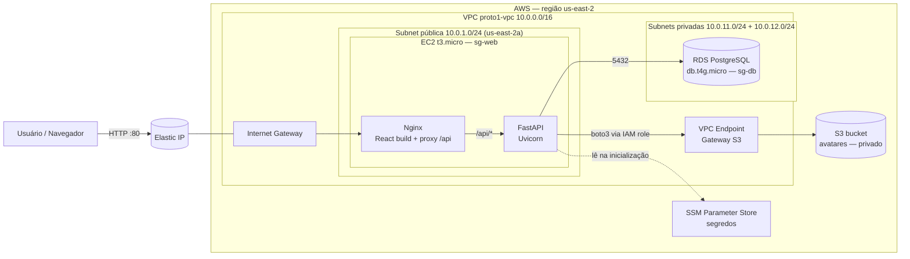
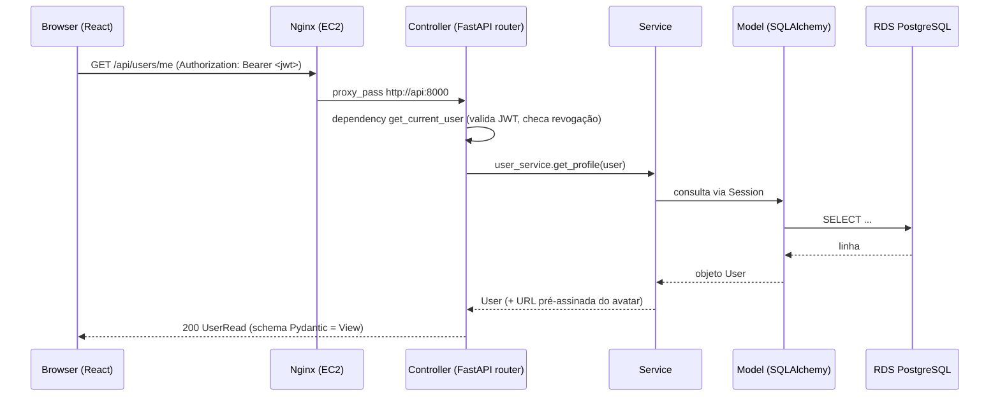

# Arquitetura e Decisões Técnicas — 1º Protótipo

> **Disciplina:** Tópicos em Engenharia de Software (Engenharia de Software aplicada à AWS) — UFPI
> **Equipe:** 5 integrantes (nomes e responsabilidades no `README.md`; tarefas nas [issues](https://github.com/vickminari/aws-prototype/issues)). Responsável pelo setup do repositório, pela conta AWS e pelo IAM: Victor.
> **Prazo:** 1 semana (7 dias). Ver seção 1.3 para a priorização e o que foi simplificado por causa disso.
> **Status deste documento:** fonte da verdade do projeto. Toda decisão nova ou alterada deve ser registrada aqui (seção 15) **no mesmo PR** que a implementa.
> **Revisão final (issue #25, 2026-11-15):** o documento foi conferido com o código, os scripts e os reports e descreve o que foi **entregue**. Onde o implementado difere do plano original, o texto foi atualizado e o motivo está num ADR da seção 15 (ADR-010 em diante).

---

## Sumário

1. Escopo e requisitos
2. Visão geral da arquitetura
3. Registro de decisões (resumo)
4. Estrutura do repositório
5. Backend
6. Estratégia de testes (TDD simplificado)
7. Frontend
8. Infraestrutura AWS
9. Deploy
10. Documentação do projeto (padrão comum, código, AWS)
11. Fluxo de trabalho Git e rastreabilidade
12. Segurança
13. Custos e cuidados com a conta
14. Fora do escopo / evoluções futuras
15. Log de decisões (ADRs)

---

## 1. Escopo e requisitos

### 1.1 Requisitos da especificação → como foram atendidos

| # | Requisito (especificação) | Solução |
|---|---|---|
| A1 | Login/Logout, autenticação e autorização | JWT em cookie `HttpOnly` + proteção CSRF (ADR-010) + hash Argon2 nas senhas; logout com revogação do token no servidor (tabela `revoked_tokens`) |
| A1 | Registro de novos usuários | `POST /api/auth/register` + página de cadastro |
| A2 | Dashboard para usuário autenticado | SPA React com rota protegida: menu lateral (Início, Meu perfil, Alterar senha, Sair) |
| A2 | Edição de perfil e troca de senha | `PATCH /api/users/me`, `PUT /api/users/me/password`, `POST` e `DELETE /api/users/me/avatar` |
| A2 | Propriedades: nome completo, username, password, email, imagem, descrição, data de criação | Modelo `User` (seção 5.4); imagem no **S3** |
| B | VPC | VPC própria `10.0.0.0/16` com subnets públicas e privadas em 2 AZs |
| B | EC2 para hospedar a aplicação | 1 instância `t3.micro` (Amazon Linux 2023) rodando Docker Compose |
| B | Grupos de segurança | `proto1-sg-web` (EC2) e `proto1-sg-db` (RDS, aceita só a EC2) |
| B | Tabela de rotas | Tabela pública (rota `0.0.0.0/0` → Internet Gateway) e tabela privada (só rota local + endpoint S3) |
| B | IP público | Elastic IP associado à EC2 |
| C | Repositório Git documentado | Monorepo no GitHub, README, este documento, `docs/aws/report_*.md`, scripts em `infra/` |
| C | Contribuição individual visível | Issues atribuídas, branches por issue, PRs revisados, merge que preserva commits, login individual na AWS (Builder ID de cada membro) + CloudTrail |

### 1.2 Serviços AWS utilizados

Obrigatórios: **VPC** (subnets, IGW, route tables, security groups), **EC2**, **Elastic IP**.
Adicionais (decisão da equipe): **RDS PostgreSQL** (banco), **S3** (imagens de perfil), **AWS Settings → Equipe** (acesso dos membros), **IAM** (role da EC2), **SSM Parameter Store** (segredos), **Systems Manager Session Manager** (acesso à EC2 sem SSH aberto), **VPC Gateway Endpoint para S3**, **AWS Budgets** e **CloudTrail** (controle de custo e auditoria).
Fora da AWS (gratuitos): **Let's Encrypt** (certificado HTTPS) e **sslip.io** (nome DNS que aponta para o Elastic IP), ver ADR-012.

### 1.3 Restrição de prazo (1 semana) e priorização

**Princípios para caber no prazo:**

1. **Contratos primeiro.** Os endpoints e schemas (seção 5.5) já estão definidos; backend e frontend trabalham em paralelo contra esse contrato desde o dia 1.
2. **Dependências quebradas por stubs.** O esqueleto do backend já nasce com `get_current_user` declarado em `dependencies.py` (stub que lança 401). Quem implementa perfil/avatar testa usando `app.dependency_overrides[get_current_user]` com um usuário de fixture — **não precisa esperar o login ficar pronto**.
3. **Deploy cedo ("walking skeleton").** Assim que a EC2 existir (dia 3), sobe-se o esqueleto (health + frontend placeholder). Do dia 4 em diante, cada merge na `main` é implantado. O dia 5 é só atualização, não "primeiro deploy".
4. **Feature freeze no fim do dia 5.** Dias 6 e 7 são para validação, correções, documentação e ensaio.
5. **PRs pequenos e revisão rápida.** Revisor responde em até 4 h; reunião diária de 15 min.

**Classificação do escopo:**

| Prioridade | Itens |
|---|---|
| **Obrigatório** (requisito do professor) | Registro, login, logout, dashboard, edição de perfil, troca de senha, imagem de perfil; VPC, subnets, route tables, SG, EC2, Elastic IP; repositório documentado com reports |
| **Planejado** (decisão da equipe, mantido) | RDS, S3, IAM role, Parameter Store, Session Manager, CI, TDD no backend, revogação de token no logout |
| **Simplificado pelo prazo** | Cobertura mínima de 70% (era 80%); testes de frontend limitados a 3 arquivos (seção 7.7); scripts AWS CLI lineares, sem idempotência (seção 10.5); diagrama em Mermaid (ícones oficiais da AWS só se sobrar tempo) |
| **Só se sobrar tempo (dia 6)** | Teardown automatizado (o report descreve a ordem manual), menu responsivo elaborado, prints do CloudTrail nos reports, testes de frontend adicionais |

**Resultado na entrega:**

| Situação | Itens |
|---|---|
| Entregue | Todo o escopo obrigatório e todo o planejado |
| Entregue além do plano | HTTPS com certificado confiável (ADR-012); JWT em cookie `HttpOnly` com proteção CSRF no lugar do `localStorage` (ADR-010); menu responsivo (botão no celular); modo escuro (#37) e transições entre telas (#53); 10 arquivos de teste no frontend em vez de 3 |
| Pendente | Report 08 de teardown (#26); prints do CloudTrail; `99_teardown.sh` (substituído pela ordem manual do report 08) |

Nenhum plano B foi acionado: o RDS (report 04) e o S3 com a role da EC2 (reports 03 e 07) funcionaram, e o swap de 2 GB bastou para o build do frontend na EC2 (report 06).

**Plano B (troca só de configuração, sem mudar código):**

| Risco | Gatilho | Plano B |
|---|---|---|
| RDS com problema de rede/conexão | Não conectado até o fim do dia 3 | Serviço `postgres:16` no `docker-compose.prod.yml` da EC2; só muda `DATABASE_URL`. Registrar no report 04 |
| S3/IAM role com problema | Upload falhando até o dia 4 | `STORAGE_BACKEND=local` com volume Docker na EC2 |
| Build do React estourando memória na EC2 | Build travando | Fazer `npm run build` localmente/CI e copiar `dist/`, ou aumentar o swap |
| Internet ruim na apresentação | — | Vídeo gravado da demo (issue de apresentação) |

---

## 2. Visão geral da arquitetura

### 2.1 Diagrama da infraestrutura



### 2.2 Fluxo de uma requisição autenticada



---

## 3. Registro de decisões (resumo)

| Tema | Decisão | Alternativas consideradas | Motivo |
|---|---|---|---|
| Repositório | Monorepo (`backend/`, `frontend/`, `infra/`, `docs/`) | Um repo por parte | Um único lugar para o professor avaliar; issues e PRs centralizados |
| Backend | FastAPI (Python 3.12) | Django, Flask | Pedido da equipe; tipagem, OpenAPI automático, ótimo suporte a testes |
| Arquitetura do código | MVC + Service (View–Controller–Service–Model) | Clean Architecture completa | Pedido da equipe; separa regra de negócio sem burocracia excessiva |
| Banco | **RDS PostgreSQL** + SQLAlchemy 2 + Alembic | DynamoDB, SQLite | Dados relacionais com unicidade (email/username); SQLAlchemy permite SQLite nos testes; RDS exige subnets privadas, SG e route tables → exercita os itens da especificação (ver ADR-001) |
| Autenticação | JWT HS256 via PyJWT, expiração 60 min, sem refresh token, entregue em cookie `HttpOnly` com proteção CSRF (ADR-010) | Bearer em `localStorage` (plano original), sessão no servidor, OAuth externo | Pedido da equipe; stateless; o cookie `HttpOnly` impede que um XSS leia o token |
| Logout | Revogação no servidor (lista de `jti` revogados) | Apenas apagar token no cliente | Mostra logout "de verdade" na apresentação; custo baixo |
| Hash de senha | Argon2id via `pwdlib` | bcrypt via passlib | `passlib` está sem manutenção; `pwdlib` é o recomendado pela documentação atual do FastAPI |
| Imagem de perfil | S3 privado + URL pré-assinada | Bucket público, salvar no disco da EC2 | Segurança (nada público) e desacoplamento da instância |
| Credenciais AWS na EC2 | IAM Role (instance profile) | Access keys no `.env` | Nunca existem chaves em arquivo; prática recomendada pela AWS |
| Segredos da aplicação | SSM Parameter Store (SecureString) | Secrets Manager, `.env` commitado | Parameter Store padrão é gratuito; Secrets Manager é pago |
| Frontend | React + TypeScript + Vite | CRA, Next.js | CRA está descontinuado; Next.js é desnecessário para uma SPA simples |
| Deploy | Docker Compose em 1 EC2: Nginx (React build + proxy) + API + certbot, atualizado pelo `infra/ec2/deploy.sh` (ADR-015) | React no S3, systemd, CD automático | Mesma origem (sem CORS), simples de explicar e reproduzir |
| HTTPS | Let's Encrypt (HTTP-01) para o nome `52-15-241-143.sslip.io` (ADR-012) | ALB + ACM, domínio próprio, só HTTP | O cookie de sessão é `Secure`; gratuito e sem domínio comprado |
| Infra como código | Reports `.md` + scripts AWS CLI | Terraform, só console | Equilíbrio entre aprendizado do console e reprodutibilidade |
| Região | `us-east-2` (Ohio) | — | **Imposta pela AWS**: na nova experiência a região é atribuída pelo país do cadastro (Brasil → Ohio) e não pode ser trocada (ADR-008) |
| Acesso à EC2 | SSM Session Manager pelo botão "Conectar" do console (porta 22 fechada) | SSH com chave | Sem porta aberta e sem chave compartilhada; cada acesso fica registrado no CloudTrail |
| Acesso humano à AWS | Membros convidados pela página **Equipe** do AWS Settings, cada um com seu AWS Builder ID | IAM users com senha de console (não existe mais nesta conta) | É o modelo da nova experiência: sem IAM users, sem senhas para distribuir (ADR-006) |
| Onde rodar AWS CLI | **AWS CloudShell** (terminal no navegador, já autenticado) | AWS CLI local com access keys | Ninguém instala nada nem cria access keys; nenhuma chave pode vazar |
| Visibilidade do repositório | Público | Privado | A EC2 clona sem credenciais; por design não há segredos no repo (ADR-007) |

---

## 4. Estrutura do repositório

```
.
├── README.md                     # visão geral, como rodar local, como fazer deploy, equipe
├── CONTRIBUTING.md               # fluxo git, padrão de commits, como abrir PR
├── .gitattributes                # finais de linha LF (scripts .sh funcionam vindos do Windows)
├── docs/
│   ├── ARQUITETURA.md            # este documento
│   ├── DECISAO_AUTENTICACAO.md   # contrato do JWT em cookie HttpOnly + CSRF (ADR-010)
│   ├── checklist_validacao.md    # testes manuais em produção (#24)
│   ├── aws/
│   │   ├── TEMPLATE_report.md
│   │   ├── report_00_conta_equipe_custos.md
│   │   ├── report_01_vpc_rede.md
│   │   ├── report_02_security_groups.md
│   │   ├── report_03_s3_iam_role.md
│   │   ├── report_04_rds.md
│   │   ├── report_05_ssm_parameters.md
│   │   ├── report_06_ec2_elastic_ip.md
│   │   ├── report_07_deploy.md
│   │   ├── report_08_teardown.md # issue #26
│   │   └── img/                  # prints (report_XX_descricao.png; validação em img/report_24/)
│   └── apresentacao/             # slides, roteiro da demo, tabela de contribuições
├── backend/
│   ├── app/
│   │   ├── main.py               # cria o app, registra routers e handlers de erro
│   │   ├── core/
│   │   │   ├── config.py         # Settings (pydantic-settings) e validações de produção
│   │   │   ├── database.py       # engine, SessionLocal, Base, tipo UTCDateTime
│   │   │   ├── security.py       # hash de senha e JWT (funções puras)
│   │   │   ├── csrf.py           # tokens CSRF assinados (HMAC), sem camada HTTP
│   │   │   ├── origins.py        # normalização de origens (CSRF e CORS)
│   │   │   └── exceptions.py     # exceções de domínio
│   │   ├── models/               # MODEL: entidades SQLAlchemy
│   │   │   ├── user.py
│   │   │   └── revoked_token.py
│   │   ├── schemas/              # VIEW: contratos de entrada/saída (Pydantic)
│   │   │   ├── auth.py
│   │   │   ├── user.py
│   │   │   ├── health.py
│   │   │   └── error.py          # formato padrão {"detail", "code"}
│   │   ├── services/             # SERVICE: regras de negócio
│   │   │   ├── auth_service.py
│   │   │   ├── user_service.py
│   │   │   ├── health_service.py
│   │   │   └── storage/
│   │   │       ├── base.py       # interface StorageService + validação da imagem
│   │   │       ├── local.py      # salva em disco (dev/testes)
│   │   │       └── s3.py         # boto3 (produção)
│   │   ├── controllers/          # CONTROLLER: routers FastAPI (finos)
│   │   │   ├── auth_controller.py
│   │   │   ├── user_controller.py
│   │   │   ├── health_controller.py
│   │   │   ├── auth_cookies.py   # nomes e atributos dos cookies de sessão
│   │   │   ├── auth_session.py   # início e fim da sessão HTTP
│   │   │   └── csrf_http.py      # pré-sessão CSRF e validação de origem
│   │   └── dependencies.py       # get_db, get_current_user, get_storage, require_csrf
│   ├── alembic/                  # migrações
│   ├── alembic.ini
│   ├── tests/
│   │   ├── conftest.py
│   │   ├── unit/
│   │   └── integration/
│   ├── Dockerfile
│   ├── entrypoint.sh             # roda `alembic upgrade head` e sobe o uvicorn
│   ├── pyproject.toml
│   ├── uv.lock
│   ├── README.md                 # como rodar/testar o backend (seção 10.3)
│   └── .env.example
├── frontend/
│   ├── src/                      # ver seção 7
│   ├── Dockerfile                # build multi-stage → Nginx
│   ├── nginx/                    # app.conf, http.conf, https.conf, http-redirect.conf, 40-https.sh (seção 9.1)
│   ├── vite.config.ts            # proxy /api → localhost:8000 em dev
│   ├── package.json
│   ├── README.md                 # como rodar/testar o frontend (seção 10.3)
│   └── .env.example
├── infra/
│   ├── scripts/
│   │   ├── 00_env.sh             # variáveis comuns (região, prefixo, CIDRs, tags)
│   │   ├── 01_vpc.sh
│   │   ├── 02_security_groups.sh
│   │   ├── 03_s3_iam_role.sh
│   │   ├── 04_rds.sh
│   │   ├── 05_ssm_parameters.sh
│   │   ├── 06_ec2.sh
│   │   └── lib.sh                # funções auxiliares (log, tags padrão, IDs em infra/.state/)
│   ├── ec2/
│   │   ├── user-data.sh          # bootstrap da instância
│   │   ├── load-env.sh           # lê SSM Parameter Store → gera .env
│   │   └── deploy.sh             # executado na EC2: git pull + .env + build + up + certificado
│   └── policies/
│       ├── ec2-trust-policy.json
│       └── ec2-app-policy.json   # acesso ao bucket + leitura dos parâmetros
├── docker-compose.yml            # desenvolvimento local (postgres + api)
├── docker-compose.prod.yml       # produção na EC2 (api + web + certbot; sem postgres, usa RDS)
├── .github/
│   ├── workflows/ci.yml
│   ├── ISSUE_TEMPLATE/
│   │   ├── feature.md
│   │   ├── aws_report.md
│   │   └── bug.md
│   └── pull_request_template.md
├── .gitignore
└── .editorconfig
```

---

## 5. Backend

### 5.1 Stack

| Item | Escolha |
|---|---|
| Linguagem | Python 3.12 |
| Framework | FastAPI + Uvicorn |
| ORM / migrações | SQLAlchemy 2.x (estilo `Mapped[]`) + Alembic |
| Driver PostgreSQL | `psycopg[binary]` (psycopg 3) |
| Validação / config | Pydantic v2, `pydantic-settings`, `email-validator` |
| Senha | `pwdlib[argon2]` |
| JWT | `PyJWT` |
| AWS | `boto3` |
| Upload | `python-multipart` |
| Testes | `pytest`, `pytest-cov`, `httpx2` (cliente do `TestClient` no Starlette 1.x), `moto[s3]` |
| Qualidade | `ruff` (lint + format) |
| Gerenciador | `uv` (com `pyproject.toml` e `uv.lock`; o CI usa `uv sync --locked`); `pip install -e .[dev]` também funciona |

### 5.2 Camadas e responsabilidades

A API não renderiza HTML; por isso a **View** do backend é a camada de **schemas Pydantic** (o que entra e o que sai da API), e a interface visual é o frontend React.

| Camada | Pasta | Pode | Não pode |
|---|---|---|---|
| **View** | `schemas/` | Definir formato e validação de entrada/saída (tamanhos, regex, `EmailStr`), serializar respostas | Acessar banco, conter regra de negócio |
| **Controller** | `controllers/` | Declarar rota, receber dependências (`db`, `current_user`, `storage`), chamar **um** método de service, devolver schema e status HTTP | Fazer query, fazer hash, chamar boto3, ter `if` de regra de negócio. Meta: cada handler com ≤ 10 linhas |
| **Service** | `services/` | Regras de negócio (unicidade, troca de senha, revogação, upload), orquestrar models e storage, lançar exceções de domínio | Importar `fastapi` (exceção aceita: o tipo `UploadFile` no upload do avatar, ADR-016), conhecer `Request`/`HTTPException`/status HTTP |
| **Model** | `models/` | Entidades SQLAlchemy, colunas, constraints, relacionamentos | Regra de negócio, chamadas externas |
| Core | `core/` | Config, conexão com banco, funções puras de segurança, exceções | Depender de controllers/services |

**Regras de dependência:** `controllers → services → models`; `services → core`; `schemas` são usados por controllers (e podem ser recebidos por services como DTO). Nunca no sentido contrário.

**Acesso a dados:** não haverá camada Repository separada; os services usam a `Session` do SQLAlchemy diretamente (o protótipo é pequeno). Se um service crescer demais, extrair queries para `models/` como métodos de classe.

**Exceções de domínio → HTTP:** services lançam exceções de `core/exceptions.py`; um handler global em `main.py` converte:

| Exceção | HTTP |
|---|---|
| `EmailAlreadyExistsError`, `UsernameAlreadyExistsError` | 409 |
| `InvalidCredentialsError` | 401 |
| `InvalidTokenError` | 401 |
| `InvalidCsrfTokenError` (`CSRF_INVALID`) | 403 |
| `WrongPasswordError` (senha atual incorreta) | 400 |
| `InvalidPasswordError` (nova senha inválida, ex.: igual à atual) | 422 |
| `InvalidImageError` (tipo/tamanho) | 422 |
| `NotFoundError` | 404 |
| `DatabaseUnavailableError` (health com banco fora, ADR-009) | 503 |

Formato padrão de erro: `{"detail": "mensagem legível", "code": "EMAIL_ALREADY_EXISTS"}`. Todo 401 traz `WWW-Authenticate: Cookie realm="api"` (ADR-010).

### 5.3 Exemplo do padrão (referência para implementação)

```python
# controllers/user_controller.py — fino
@router.put("/me/password", status_code=204)
def change_password(
    payload: PasswordChange,
    current_user: User = Depends(get_current_user),
    db: Session = Depends(get_db),
):
    user_service.change_password(db, current_user, payload.current_password, payload.new_password)

# services/user_service.py — regra de negócio
def change_password(db: Session, user: User, current: str, new: str) -> None:
    if not security.verify_password(current, user.hashed_password):
        raise WrongPasswordError()
    user.hashed_password = security.hash_password(new)
    db.commit()
```

### 5.4 Modelo de dados

**Tabela `users`**

| Coluna | Tipo | Regras |
|---|---|---|
| `id` | UUID (`sqlalchemy.Uuid`) | PK, gerado na aplicação (`uuid4`) |
| `full_name` | `String(120)` | obrigatório |
| `username` | `String(30)` | obrigatório, **único**, indexado, salvo em minúsculas (a entrada aceita `^[a-zA-Z0-9_.]{3,30}$` e o service converte) |
| `email` | `String(254)` | obrigatório, **único**, indexado, salvo em minúsculas |
| `hashed_password` | `String(255)` | obrigatório; **nunca** retornado pela API |
| `profile_image_key` | `String(512)` | opcional; chave do objeto no S3 (não a URL) |
| `description` | `String(500)` | opcional |
| `is_active` | `Boolean` | default `true` |
| `created_at` | `DateTime(timezone=True)` | default `now()` UTC; imutável |
| `updated_at` | `DateTime(timezone=True)` | atualizado a cada alteração |

**Tabela `revoked_tokens`**

| Coluna | Tipo | Regras |
|---|---|---|
| `jti` | `String(36)` | PK |
| `user_id` | UUID | FK → `users.id` |
| `expires_at` | `DateTime(timezone=True)` | expiração original do token (permite limpeza periódica) |
| `revoked_at` | `DateTime(timezone=True)` | default `now()` |

Usar apenas tipos genéricos do SQLAlchemy (sem recursos exclusivos do PostgreSQL) para que os testes rodem em SQLite.

### 5.5 Endpoints

Prefixo global: `/api`. Documentação automática em `/api/docs` (Swagger) e `/api/openapi.json`.

Toda escrita (`POST`, `PUT`, `PATCH`, `DELETE`), inclusive cadastro e login, exige o header `X-CSRF-Token` e uma origem confiável; sem isso a resposta é **403** `CSRF_INVALID` (ADR-010). "Auth = sim" significa o cookie de sessão `HttpOnly`.

| Método | Rota | Auth | Entrada | Saída | Códigos |
|---|---|---|---|---|---|
| GET | `/api/health` | não | — | `{"status":"ok","db":"ok"}` | 200, 503 |
| GET | `/api/auth/csrf` | não | — | `CsrfRead` (`{"csrf_token": "..."}`) + cookie de pré-sessão | 200 |
| POST | `/api/auth/register` | não | `UserCreate` (JSON) | `UserRead` | 201, 403, 409, 422 |
| POST | `/api/auth/login` | não | form `username` + `password` (OAuth2PasswordRequestForm; aceita username **ou** email) | `{"detail": "Login realizado"}` + `Set-Cookie` (o JWT **não** vai no JSON) | 200, 401, 403, 422 |
| POST | `/api/auth/logout` | sim | — | — (remove os cookies) | 204, 403 |
| GET | `/api/users/me` | sim | — | `UserProfileRead` | 200, 401 |
| PATCH | `/api/users/me` | sim | `UserUpdate` (parcial) | `UserProfileRead` | 200, 401, 403, 409, 422 |
| PUT | `/api/users/me/password` | sim | `PasswordChange` | — | 204, 400, 401, 403, 422 |
| POST | `/api/users/me/avatar` | sim | multipart `file` | `UserProfileRead` | 200, 401, 403, 422 |
| DELETE | `/api/users/me/avatar` | sim | — | `UserProfileRead` | 200, 401, 403 |

**Schemas (View):**

- `UserCreate`: `full_name`, `username`, `email`, `password` (mín. 8 caracteres, ao menos 1 letra e 1 número), `description?`
- `UserUpdate`: todos opcionais: `full_name`, `username`, `email`, `description` (senha e imagem têm rotas próprias)
- `UserRead`: `id`, `full_name`, `username`, `email`, `description`, `profile_image_url` (URL pré-assinada ou `null`), `created_at`
- `UserProfileRead`: `UserRead` + `is_active` e `updated_at` (respostas das rotas `/api/users/me*`)
- `CsrfRead`: `csrf_token`; `LoginResponse`: `detail` (substituíram o `Token` planejado, ADR-010)
- `PasswordChange`: `current_password`, `new_password` (mesmas regras de força; diferente da atual)

### 5.6 Autenticação e autorização

Contrato completo em [`docs/DECISAO_AUTENTICACAO.md`](DECISAO_AUTENTICACAO.md) (ADR-010).

- **Hash:** `pwdlib` com Argon2id (`PasswordHash.recommended()`). Funções `hash_password` e `verify_password` em `core/security.py`.
- **JWT:** HS256, segredo `JWT_SECRET` (mín. 32 caracteres aleatórios, vindo do Parameter Store em produção). Claims: `sub` (id do usuário), `jti` (uuid4), `iat`, `exp` (`JWT_EXPIRE_MINUTES`, padrão 60). Sem refresh token no protótipo.
- **Transporte:** o login devolve o JWT num cookie `HttpOnly`, `SameSite=Lax`, `Path=/`, sem `Domain`. Em produção o nome é `__Host-access_token` e o cookie é `Secure` (só HTTPS); em dev HTTP local, `access_token` sem `Secure`. O frontend nunca lê o JWT. Não há fallback para `Authorization: Bearer`.
- **CSRF:** double-submit assinado (HMAC-SHA256, segredo `CSRF_SECRET`, separado do JWT) e vinculado à sessão: antes do login, a uma pré-sessão aleatória; depois, ao `jti`. `require_csrf` é dependência global do app: valida `Origin` (ou `Referer`) contra `CSRF_TRUSTED_ORIGINS` e o header `X-CSRF-Token`. O token expira em `CSRF_EXPIRE_MINUTES` (padrão 60) e é renovado no login.
- **`get_current_user`** (em `dependencies.py`): lê o cookie, decodifica o JWT, exige `sub` UUID, rejeita se expirado, se o `jti` estiver em `revoked_tokens` ou se o usuário não existir/estiver inativo → 401 com `WWW-Authenticate: Cookie realm="api"`.
- **Logout:** insere o `jti` em `revoked_tokens` até a expiração original e remove os cookies de acesso e CSRF. Uma cópia do cookie revogado é rejeitada.
- **Autorização:** todas as rotas `/api/users/me*` operam somente sobre o usuário do token. Não há papéis (admin) no protótipo.
- **Mensagens de erro de login** genéricas ("usuário ou senha inválidos"), sem revelar se o usuário existe.

### 5.7 Armazenamento de imagens

- Interface `StorageService` (`services/storage/base.py`) com `upload(key, file: UploadFile) -> None`, `delete(key) -> None`, `get_url(key) -> str`. A validação da imagem fica em `read_image`, no mesmo arquivo (ADR-016).
- `LocalStorageService` (dev/testes): grava em `backend/media/` e serve via `StaticFiles` em `/api/media`.
- `S3StorageService` (produção): `boto3` usando credenciais da IAM Role da EC2 (nunca access keys). `get_url` gera **URL pré-assinada** de GET (validade 1 h).
- Seleção por `STORAGE_BACKEND=local|s3`.
- Regras: tipos aceitos JPEG, PNG e WebP, identificados pela assinatura real do arquivo (magic bytes), não pelo `content_type`; tamanho máx. 2 MB (o Nginx limita o corpo a 3 MB); chave `avatars/{user_id}/{uuid4}.{ext}`; ao trocar ou remover a imagem, a anterior é apagada.

### 5.8 Configuração (variáveis de ambiente)

| Variável | Exemplo (dev) | Produção |
|---|---|---|
| `ENVIRONMENT` | `dev` | `prod` |
| `DATABASE_URL` | `postgresql+psycopg://app:app@db:5432/app` | endpoint do RDS (SSM) |
| `JWT_SECRET` | `troque-me-...` | SSM SecureString; em `prod` a API recusa o padrão de dev ou menos de 32 caracteres |
| `JWT_EXPIRE_MINUTES` | `60` | `60` |
| `CSRF_SECRET` | omitido (padrão local) | SSM SecureString; ≥ 32 caracteres e diferente do `JWT_SECRET` |
| `CSRF_TRUSTED_ORIGINS` | `http://localhost:5173,http://127.0.0.1:5173` | `https://52-15-241-143.sslip.io` (obrigatório e só HTTPS em `prod`) |
| `CSRF_EXPIRE_MINUTES` | `60` | `60` |
| `STORAGE_BACKEND` | `local` | `s3` |
| `S3_BUCKET` | — | `proto1-avatars-grupob31641132` |
| `AWS_REGION` | `us-east-2` | `us-east-2` |
| `CORS_ORIGINS` | `http://localhost:5173` | vazio (mesma origem) |
| `LOG_LEVEL` | `DEBUG` | `INFO` |
| `PUBLIC_HOST` | — | `52-15-241-143.sslip.io`; lido só pelo `deploy.sh` (domínio do certificado), não pela API |

`.env` **nunca** é commitado; `.env.example` sim. Em produção o `.env` fica na raiz do repositório na EC2 e é gerado por `infra/ec2/load-env.sh` a partir do Parameter Store a cada deploy; `ENVIRONMENT=prod` é fixado no `docker-compose.prod.yml` para o `.env` não conseguir desligar as validações de produção.

### 5.9 Outros padrões

- Migrações: toda mudança de modelo gera migração Alembic (`alembic revision --autogenerate -m "..."`), revisada à mão. O container roda `alembic upgrade head` ao iniciar.
- Logs: módulo `logging` em formato texto simples, nível pela env. Nunca logar senha, token ou hash.
- Datas sempre em UTC no banco; o frontend formata para `America/Fortaleza`.
- Estilo: `ruff check` e `ruff format` sem erros (o CI bloqueia).

---

## 6. Estratégia de testes (TDD simplificado)

### 6.1 Ciclo obrigatório por funcionalidade

1. **Red:** escrever os testes da funcionalidade (caminho feliz + erros previstos nos critérios de aceite da issue). Rodar e ver falhar. Commit: `test(auth): adiciona testes do endpoint de registro`.
2. **Green:** implementar o mínimo para passar. Commit: `feat(auth): implementa registro de usuário`.
3. **Refactor:** melhorar o código com os testes verdes. Commit: `refactor(auth): extrai validação de unicidade`.

Essa sequência de commits fica visível no histórico (por isso o merge **não** pode ser squash — seção 11) e serve como evidência do processo na apresentação.

### 6.2 O que testar em cada camada

| Camada | Tipo | Como |
|---|---|---|
| `core/security.py` | Unitário | hash ≠ senha; verify verdadeiro/falso; token válido decodifica; token expirado/adulterado falha |
| `services/` | Unitário com banco | SQLite em memória; regras de negócio e exceções de domínio |
| `core/csrf.py`, `core/origins.py`, `core/config.py` | Unitário | assinatura e expiração do token CSRF; normalização de origens; validações de produção |
| `services/storage/s3.py` | — | Planejado com `moto`, mas não implementado: o upload para o S3 foi validado em produção (report 07, seção 7.3, e `docs/checklist_validacao.md`) |
| `controllers/` | Integração | `TestClient` + override de `get_db` e `get_storage`; status HTTP, formato da resposta, autenticação, cookies e CSRF |
| Fluxo de sessão | Integração | pré-sessão CSRF → login real (cookie) → `/me` → escritas → logout → cookie copiado rejeitado |

O fluxo completo em produção (cadastro, perfil, foto, senha, logout) foi validado manualmente na #24 (`docs/checklist_validacao.md`).

### 6.3 Infraestrutura de testes

- `tests/conftest.py` com fixtures: `engine` (SQLite em memória com `StaticPool`, **recriado a cada teste**, ADR-009), `db_session`, `app` (com `get_db` apontando para a sessão do teste), `client` (sem CSRF), `csrf_client` (com pré-sessão CSRF), `user_factory`, `logged_user`/`logged_client` (login real por cookie) e `auth_user` (override de `get_current_user`). A fixture `auth_headers` planejada foi substituída por `logged_client` (ADR-010). Detalhes em `backend/README.md`.
- Nomes: `test_<acao>_<cenario>_<resultado esperado>`, ex.: `test_register_with_existing_email_returns_409`.
- Cobertura mínima: **70%** no backend (`pytest --cov=app --cov-fail-under=70`) — reduzida de 80% por causa do prazo.
- Frontend: Vitest + React Testing Library (seção 7.7).
- CI (`.github/workflows/ci.yml`) roda em todo PR e push na `main`: **Backend** (`ruff check`, `ruff format --check`, `pytest` com cobertura mínima de 70%) e **Frontend** (ESLint, Prettier, Vitest, `tsc` + build). PR com CI vermelho não é mergeado (combinado da equipe; a proteção da `main` exige 1 aprovação, seção 11).

---

## 7. Frontend

### 7.1 Stack

| Item | Escolha | Por quê |
|---|---|---|
| Base | React 19 + TypeScript + Vite | Padrão atual; TypeScript pega erros cedo |
| Rotas | React Router v7 (modo biblioteca) | Rotas públicas/protegidas |
| HTTP | Axios com instância única e interceptors | Injeta o header CSRF nas escritas e trata 401/403 em um só lugar |
| Formulários | React Hook Form + Zod | Validação declarativa espelhando as regras do backend |
| Estilo | Tailwind CSS v4 | Produtivo para quem não domina CSS; consistente |
| Notificações | `sonner` (toasts) | Feedback de sucesso/erro |
| Testes | Vitest + React Testing Library | Integração nativa com Vite |
| Qualidade | ESLint + Prettier | CI bloqueia erros |

### 7.2 Estrutura

```
frontend/src/
├── main.tsx
├── App.tsx                    # providers (AuthProvider, Toaster) + router
├── index.css                  # Tailwind + variáveis do tema claro/escuro
├── routes/
│   ├── router.tsx             # definição das rotas
│   ├── ProtectedRoute.tsx     # redireciona para /login se não autenticado
│   └── PublicOnlyRoute.tsx    # redireciona para /dashboard se já logado
├── pages/
│   ├── LoginPage.tsx
│   ├── RegisterPage.tsx
│   ├── DashboardHomePage.tsx
│   ├── ProfilePage.tsx
│   ├── ChangePasswordPage.tsx
│   └── NotFoundPage.tsx
├── layouts/
│   ├── AuthLayout.tsx         # moldura das telas de login e cadastro
│   └── DashboardLayout.tsx    # sidebar (desktop) / menu por botão (celular) + topbar + <Outlet/>
├── components/
│   ├── ui/                    # Button, Input, Card, Spinner, Avatar
│   ├── forms/                 # FormField, PasswordRules (regras de senha ao vivo)
│   ├── profile/               # ProfileForm, AvatarUploader (preview + validação de 2 MB)
│   ├── ThemeToggle.tsx        # alterna tema claro/escuro (#37)
│   └── PageLoader.tsx         # spinner enquanto a sessão é verificada
├── contexts/
│   └── AuthContext.tsx        # user, isLoading, login(), logout(), refreshUser()
├── hooks/
│   ├── useAuth.ts
│   └── useTheme.ts            # tema salvo em localStorage (preferência visual, não sensível)
├── services/
│   ├── api.ts                 # axios instance + interceptors (CSRF, 401, 403 CSRF_INVALID)
│   ├── authService.ts         # register, login, logout
│   └── userService.ts         # getMe, updateMe, changePassword, uploadAvatar, deleteAvatar
├── schemas/                   # schemas Zod dos formulários (authSchemas, profileSchemas)
├── types/
│   └── user.ts                # tipos espelhando os schemas da API
├── test/                      # setup do Vitest e utilitários dos testes
└── utils/
    ├── apiError.ts            # extrai `detail`/`code` e erros por campo da resposta da API
    └── formatDate.ts          # datas em America/Fortaleza
```

### 7.3 Rotas

| Rota | Acesso | Página |
|---|---|---|
| `/login` | só deslogado | Login (username ou email + senha) |
| `/register` | só deslogado | Cadastro |
| `/dashboard` | protegida | Início: card de boas-vindas com avatar, nome, "membro desde" |
| `/dashboard/profile` | protegida | Ver/editar dados + trocar imagem |
| `/dashboard/password` | protegida | Alterar senha |
| `/` | — | redireciona para `/dashboard` ou `/login` |
| `*` | — | 404 |

Menu lateral do dashboard: **Início**, **Meu perfil**, **Alterar senha**, **Sair**.

### 7.4 Fluxo de autenticação no cliente

A sessão é um cookie `HttpOnly`: o frontend **nunca** lê, guarda ou envia o JWT (ADR-010).

1. Antes da primeira escrita, `api.ts` busca `GET /api/auth/csrf` e guarda o token CSRF **só em memória**; o interceptor de requisição o envia no header `X-CSRF-Token` em todo `POST`/`PUT`/`PATCH`/`DELETE`.
2. Login chama `POST /api/auth/login`; a API grava o cookie de sessão e renova o CSRF. O `AuthContext` descarta o token CSRF antigo e chama `GET /api/users/me` para carregar o usuário.
3. Interceptor de resposta: em **403 `CSRF_INVALID`**, busca um token novo e repete a requisição uma vez; em **401**, zera o contexto (as rotas protegidas redirecionam para `/login`) e mostra o toast "Sessão expirada" a quem estava logado.
4. Ao abrir a aplicação, chama `/me` para saber se há sessão antes de renderizar rotas protegidas (spinner enquanto isso).
5. Cadastro chama `POST /api/auth/register` e, em seguida, faz o login com os mesmos dados.
6. Logout chama `POST /api/auth/logout` (a API revoga o JWT e remove os cookies) e limpa o usuário e o CSRF locais.

> O plano original guardava o token em `localStorage`, vulnerável a XSS. Com o cookie `HttpOnly`, um script injetado não lê o token; a proteção CSRF cobre o envio automático do cookie. Continua proibido usar `dangerouslySetInnerHTML`. O único dado em `localStorage` é a preferência de tema (`proto1.theme`).

### 7.5 Comunicação com a API

- `baseURL` = `/api` (mesma origem). Em dev, o `vite.config.ts` faz proxy de `/api` para `http://localhost:8000`, então não há CORS nem URLs diferentes por ambiente. A mesma origem também é o que permite o cookie `SameSite=Lax` e a validação de `Origin` do CSRF.
- Login usa `application/x-www-form-urlencoded` (exigência do `OAuth2PasswordRequestForm`); upload usa `multipart/form-data`; o resto JSON.
- Erros da API exibem `detail` no toast ou embaixo do campo correspondente (409 de email → erro no campo email).

### 7.6 Boas práticas a seguir

- Componentes pequenos e de função única; páginas compõem componentes.
- Nenhuma chamada HTTP dentro de componentes de UI: sempre via `services/`.
- Estados de **carregando**, **erro** e **vazio** tratados em toda tela que busca dados.
- Botões de submit desabilitados durante o envio (evita duplo clique).
- Acessibilidade básica: `label` associado a cada input, `alt` na imagem, foco visível, navegação por teclado.
- Layout responsivo (sidebar vira menu no celular).
- Preview da imagem antes do upload; validação de tipo e tamanho (2 MB) também no cliente.
- Sem segredos no frontend; variáveis `VITE_*` são públicas.

- Tema claro/escuro (#37), com a preferência do sistema como padrão, e transições suaves entre telas (#53), respeitando `prefers-reduced-motion`.

### 7.7 Testes do frontend

O mínimo planejado eram 3 arquivos (por causa do prazo); foram entregues **10**, todos rodando no CI:

- Obrigatórios: `ProtectedRoute.test.tsx` (redireciona sem usuário; renderiza com usuário), `LoginPage.test.tsx` (validação, chamada ao service, erro em 401) e `RegisterPage.test.tsx` (senhas diferentes bloqueiam o envio; erro 409 no campo).
- Adicionais: `router.test.tsx`, `DashboardLayout.test.tsx`, `DashboardHomePage.test.tsx`, `ProfilePage.test.tsx`, `ChangePasswordPage.test.tsx`, `ThemeToggle.test.tsx` e `formatDate.test.ts`.

---

## 8. Infraestrutura AWS

### 8.1 Convenções

- **Região:** `us-east-2` (Ohio), atribuída automaticamente pela AWS (ADR-008). **AZs:** `us-east-2a` e `us-east-2b`. Confirmar em AWS Settings → Projeto → Visão geral → Informações adicionais → Região; se aparecer outra, trocar em `infra/scripts/00_env.sh` e nesta seção.
- **Tipo de conta:** criada pela **nova experiência da AWS** ("Sign up for AWS (new)"), no plano gratuito. Todos os serviços usados neste projeto (EC2, VPC, RDS, S3, Systems Manager, IAM, CloudShell, Budgets, CloudTrail) estão na lista de serviços suportados do plano gratuito.
- **Projeto no AWS Settings:** `proto-tes`. O nome do projeto é independente da convenção abaixo: `proto1` continua sendo o prefixo dos recursos e o valor da tag `Project`.
- **Prefixo de nomes:** `proto1-` (ex.: `proto1-vpc`, `proto1-sg-web`).
- **Tags obrigatórias em todo recurso:** `Project=proto1` e `Owner=<membro responsável>`.
- Ninguém usa o usuário **root** no dia a dia (seção 8.8).

### 8.2 Rede (VPC)

Criada por Gabriel Lopes na #17 ([report 01](aws/report_01_vpc_rede.md)).

| Recurso | Nome | Valor | ID |
|---|---|---|---|
| VPC | `proto1-vpc` | `10.0.0.0/16`, DNS hostnames e DNS resolution habilitados | `vpc-0e3944afb658f063f` |
| Subnet pública A | `proto1-public-a` | `10.0.1.0/24` — `us-east-2a` — auto-assign public IP **ligado** (o user data precisa de internet antes de o Elastic IP ser associado, ADR-011) | `subnet-020460f423e4aa900` |
| Subnet pública B | `proto1-public-b` | `10.0.2.0/24` — `us-east-2b` — auto-assign ligado (reserva para evolução: ALB/2ª instância) | `subnet-030019050f42c15e0` |
| Subnet privada A | `proto1-private-a` | `10.0.11.0/24` — `us-east-2a` | `subnet-023892d705296676b` |
| Subnet privada B | `proto1-private-b` | `10.0.12.0/24` — `us-east-2b` | `subnet-020a8aef6f5f3e5bd` |
| Internet Gateway | `proto1-igw` | anexado à VPC | `igw-032cab57d8414bfdf` |
| VPC Endpoint | `proto1-s3-endpoint` | Gateway endpoint `com.amazonaws.us-east-2.s3`, associado às duas route tables | `vpce-017bafa392c655d53` |

> O RDS exige um *DB subnet group* com subnets em **pelo menos 2 AZs**, por isso existem duas subnets privadas.
> **Sem NAT Gateway** (custo fixo por hora + tráfego). A subnet privada não precisa sair para a internet: o RDS é gerenciado e o acesso ao S3 é pelo endpoint.

### 8.3 Tabelas de rotas

| Tabela | Associada a | Rotas | ID |
|---|---|---|---|
| `proto1-rt-public` | `proto1-public-a`, `proto1-public-b` | `10.0.0.0/16 → local`; `0.0.0.0/0 → proto1-igw`; prefix list do S3 → endpoint | `rtb-082bbb531f4610e34` |
| `proto1-rt-private` | `proto1-private-a`, `proto1-private-b` | `10.0.0.0/16 → local`; prefix list do S3 → endpoint | `rtb-07c5cdf3e21c65d60` |
| `proto1-rt-main` (principal) | nenhuma | só `10.0.0.0/16 → local` | `rtb-02f51ef46ad431509` |

A tabela principal (main) da VPC fica sem associação explícita e sem rota para a internet (subnet nova sem associação nunca fica pública por acidente).

### 8.4 Security Groups

Criados por Thalys Yago na #18 ([report 02](aws/report_02_security_groups.md)).

**`proto1-sg-web`** (EC2) — `sg-09b1318a081965dfc`

| Direção | Protocolo/porta | Origem/destino | Motivo |
|---|---|---|---|
| Entrada | TCP 80 | `0.0.0.0/0` | HTTP: redireciona para HTTPS e atende o desafio do Let's Encrypt |
| Entrada | TCP 443 | `0.0.0.0/0` | HTTPS; obrigatório, porque o cookie de sessão é `Secure` (ADR-012) |
| Saída | Todos | `0.0.0.0/0` | atualizações, Docker Hub, GitHub, SSM, S3 |

Sem porta 22: o acesso administrativo é feito pelo **SSM Session Manager**. (Se a equipe precisar de SSH em algum momento, liberar 22 apenas para o IP `/32` de quem for usar, temporariamente, e registrar no report.)

**`proto1-sg-db`** (RDS) — `sg-035eab28e4158d2d8`

| Direção | Protocolo/porta | Origem | Motivo |
|---|---|---|---|
| Entrada | TCP 5432 | **`proto1-sg-web`** (referência ao SG, não a IP) | Só a EC2 fala com o banco |
| Saída | — | padrão | — |

O projeto usa só security groups (stateful); a NACL padrão da VPC (permite tudo) não foi alterada.

### 8.5 EC2

| Item | Valor |
|---|---|
| Nome | `proto1-app` (`i-0aef26cfc5b4bbb7f`), criada por Jailson Zarur na #22 ([report 06](aws/report_06_ec2_elastic_ip.md)) |
| AMI | Amazon Linux 2023 (x86_64), a mais recente no lançamento |
| Tipo | `t3.micro` (elegível ao free tier), CPU credits **`standard`** (sem cobrança extra por uso de CPU, ADR-013) |
| Subnet | `proto1-public-a` |
| SG | `proto1-sg-web` |
| Key pair | **nenhum** (acesso só pelo Session Manager, ADR-004) |
| Disco | 20 GB gp3, criptografado, apagado com a instância |
| IAM instance profile | `proto1-ec2-role` (seção 8.8) |
| IMDS | v2 obrigatório (`HttpTokens=required`), **hop limit 2**: a API roda em container e precisa alcançar o metadata para receber as credenciais da role (ADR-013) |
| User data | `infra/ec2/user-data.sh`: instala Docker, git e `nmap-ncat`, os plugins Compose e Buildx, cria **swap de 2 GB** (1 GB de RAM não basta para o build do React), habilita o Docker no boot, clona o repositório em `/opt/proto1` |
| IP público | **Elastic IP** `proto1-eip` = **`52.15.241.143`** (`eipalloc-0bb1bc42c86ae9f31`), fixo mesmo após stop/start |

### 8.6 RDS PostgreSQL

| Item | Valor |
|---|---|
| Identificador | `proto1-db`, criado por José Victor na #20 ([report 04](aws/report_04_rds.md)) |
| Engine | PostgreSQL 16.15 (a 16.x mais recente no momento da criação) |
| Classe | `db.t4g.micro` |
| AZ | `us-east-2a` (a mesma da EC2) |
| Armazenamento | 20 GB gp3, criptografado, **autoscaling desligado** |
| Multi-AZ | **Não** |
| DB subnet group | `proto1-db-subnets` (private-a + private-b) |
| Acesso público | **Não** |
| SG | `proto1-sg-db` |
| Banco inicial / usuário | `proto1` / `proto1_admin` |
| Senha | gerada pelo script (`openssl rand -hex 24`) e salva em `/proto1/rds/MASTER_PASSWORD` **antes** de criar o banco; fica fora de `/proto1/prod/` porque a API só precisa da `DATABASE_URL` (ADR-014) |
| Backup automático | 1 dia de retenção |
| Proteção contra exclusão | desligada (facilita o teardown) |

Para administrar o banco: abrir sessão na EC2 via Session Manager e rodar `docker run --rm -it postgres:16 psql "<DATABASE_URL>"`, ou usar port forwarding do Session Manager para a máquina local. O endpoint está no report 04; a URL com senha só existe no Parameter Store.

### 8.7 S3

| Item | Valor |
|---|---|
| Bucket | `proto1-avatars-grupob31641132` (nomes de bucket são globais), criado por Pedro Emanuel na #19 ([report 03](aws/report_03_s3_iam_role.md)) |
| Block Public Access | **todos ligados** |
| Object Ownership | Bucket owner enforced (ACLs desabilitadas) |
| Criptografia | SSE-S3 (padrão) |
| Versionamento | desligado |
| Prefixo usado | `avatars/` (a policy da role só libera esse prefixo) |
| Acesso | somente pela role da EC2; leitura no navegador via URL pré-assinada |
| CORS | não necessário (upload passa pela API) |

### 8.8 IAM

A conta usa a **nova experiência da AWS**, em que as pessoas **não** são IAM users. Nela, IAM users só servem para acesso programático (não têm senha de console). O acesso humano é feito pela página **Equipe** do AWS Settings (`https://settings.aws.com/team`). Ficam então duas coisas: o acesso das pessoas (pela Equipe) e a role da EC2 (no IAM).

**Pessoas — como funciona a Equipe:**

| Item | Como é |
|---|---|
| Proprietário | Victor (dono da conta). Único que vê faturamento, créditos e limites de gasto, e único que convida ou remove membros |
| Projeto | `proto-tes`. Um projeto da nova experiência é uma conta AWS gerenciada pela AWS; todos os recursos ficam nele |
| Convite | Settings → **Equipe** → *Convidar um novo membro* → email + projeto `proto-tes`. O membro tem **14 dias** para aceitar (pedir para olhar o spam) |
| Login dos membros | Cada membro cria o próprio **AWS Builder ID** (pode entrar com email, Google, GitHub ou Apple) e ativa MFA nele |
| Permissões dos membros | **Administrador do projeto**, definido pela AWS e sem como restringir: criam, editam e apagam qualquer recurso; **não** veem faturamento nem convidam pessoas |
| IAM users e access keys | **Nenhum.** A AWS CLI roda no **CloudShell** (ícone `>_` no console), que já vem autenticado. Para usar a CLI no próprio computador, o comando `aws login` gera credenciais temporárias de 12 h |
| "Recursos avançados" | **Não ativar.** A ativação é irreversível, remove os limites de gasto e muda o modelo da conta |

Por que isso continua sendo boa prática: cada pessoa tem identidade própria com MFA, o CloudTrail registra quem fez o quê (seção 8.10), não há senha compartilhada nem credencial de longo prazo e o faturamento fica restrito ao proprietário. Todos serem administradores do projeto é imposição do modelo da AWS. A regra da equipe compensa isso: cada um só mexe nos recursos da própria frente (tag `Owner`).

**Aplicação — role da EC2** `proto1-ec2-role` (instance profile de mesmo nome):

| Item | Configuração |
|---|---|
| Quem pode assumir (trust) | `ec2.amazonaws.com` (`infra/policies/ec2-trust-policy.json`) |
| Policy gerenciada | `AmazonSSMManagedInstanceCore` (permite o Session Manager) |
| Policy inline `proto1-ec2-app` | Só as duas permissões que a aplicação usa (`infra/policies/ec2-app-policy.json`, abaixo) |

```json
{
  "Version": "2012-10-17",
  "Statement": [
    {
      "Sid": "AvatarsNoBucket",
      "Effect": "Allow",
      "Action": ["s3:PutObject", "s3:GetObject", "s3:DeleteObject"],
      "Resource": "arn:aws:s3:::proto1-avatars-SUFIXO/avatars/*"
    },
    {
      "Sid": "LerSegredosDaAplicacao",
      "Effect": "Allow",
      "Action": ["ssm:GetParametersByPath", "ssm:GetParameter"],
      "Resource": "arn:aws:ssm:REGION:ACCOUNT_ID:parameter/proto1/*"
    }
  ]
}
```

`SUFIXO`, `REGION` e `ACCOUNT_ID` são substituídos pelo `infra/scripts/03_s3_iam_role.sh` (no protótipo: `grupob31641132` e `us-east-2`).

A nova experiência tem o *IAM role manager*, que cria roles automaticamente para alguns serviços. Para a EC2, usamos a nossa role, escolhida explicitamente no lançamento: se o console sugerir uma role automática, selecionar `proto1-ec2-role`.

Não é preciso permissão de KMS: SecureStrings criptografadas com a chave padrão da AWS (`aws/ssm`) são decifradas por quem tem permissão de leitura no parâmetro.

### 8.9 Segredos — SSM Parameter Store

Criados por Pedro Emanuel na #21 ([report 05](aws/report_05_ssm_parameters.md)), exceto os do RDS (#20). **Todos são `SecureString`** (chave gerenciada `aws/ssm`), inclusive os que não são segredo: um tipo só simplifica o script e o `load-env.sh`.

| Parâmetro | Origem do valor |
|---|---|
| `/proto1/prod/DATABASE_URL` | `04_rds.sh` (#20) |
| `/proto1/prod/JWT_SECRET` | `openssl rand -hex 32` |
| `/proto1/prod/CSRF_SECRET` | `openssl rand -hex 32` (separado do JWT) |
| `/proto1/prod/CSRF_TRUSTED_ORIGINS` | `https://52-15-241-143.sslip.io` |
| `/proto1/prod/S3_BUCKET` | `proto1-avatars-grupob31641132` |
| `/proto1/prod/STORAGE_BACKEND` | `s3` |
| `/proto1/prod/AWS_REGION` | `us-east-2` |
| `/proto1/prod/LOG_LEVEL` | `INFO` |
| `/proto1/prod/PUBLIC_HOST` | `52-15-241-143.sslip.io` (usado só pelo `deploy.sh`) |
| `/proto1/rds/MASTER_PASSWORD` | `04_rds.sh`; fora de `/proto1/prod/` de propósito (ADR-014) |

`infra/ec2/load-env.sh` lê `/proto1/prod/` com `aws ssm get-parameters-by-path --with-decryption` e escreve `/opt/proto1/.env` (permissão `600`). O `deploy.sh` roda o `load-env.sh` a cada deploy, então um parâmetro alterado entra sem passo manual (ADR-015).

### 8.10 Auditoria e evidência de contribuição na AWS

- Cada integrante opera com o **próprio login (Builder ID)**. O **CloudTrail Event history** já vem ligado (gratuito, 90 dias, nada a configurar). Na nova experiência, cada evento traz um campo `onBehalfOf` com o `userId` de quem agiu. Para descobrir o nome por trás do ID, rodar no CloudShell:

  ```bash
  aws sso-admin list-instances --region us-east-1   # anota o IdentityStoreId
  aws identitystore describe-user --region us-east-1 \
    --identity-store-id <IdentityStoreId> --user-id <userId>   # mostra nome e email
  ```

  (O exemplo da documentação da AWS usa `--region us-east-1` nesses dois comandos; se der erro, trocar por `us-east-2`.) Um print de um evento com o nome resolvido entra no report como evidência.
- Tag `Owner` em cada recurso indica o responsável.
- Cada report é commitado por quem fez o trabalho → o GitHub registra a autoria.

---

## 9. Deploy

### 9.1 Containers

**`docker-compose.yml` (dev local):** `db` (postgres:16) e `api` (build `backend/`, hot reload, porta 8000). O frontend roda fora do Compose, com `npm run dev` e o proxy do Vite.

**`docker-compose.prod.yml` (EC2):**

| Serviço | Imagem | Portas | Observações |
|---|---|---|---|
| `api` | build `backend/` (Python 3.12, usuário sem privilégios) | interna 8000 | `env_file: .env`; `ENVIRONMENT=prod` fixo; `restart: unless-stopped`; healthcheck em `/api/health` (inclui o banco) |
| `web` | build `frontend/` (multi-stage: `node` build → `nginx:alpine`) | **80:80** e **443:443** | serve `dist/`; `location /api/` → `proxy_pass http://api:8000`; `try_files $uri /index.html` para a SPA; `client_max_body_size 3m`; gzip e headers de segurança; reinicia junto quando a `api` é recriada |
| `certbot` | `certbot/certbot:v5.10.0` | — | tenta renovar o certificado a cada 12 h; o Nginx recarrega a cada 6 h |

Todos os containers usam logs `json-file` limitados a 10 MB × 3 (sem rotação, o disco de 20 GB encheria). O backend roda `alembic upgrade head` no `entrypoint.sh` antes do Uvicorn.

**Nginx em dois modos** (`frontend/nginx/`, ADR-012): o Nginx não sobe com configuração HTTPS sem certificado, e o Let's Encrypt só emite o certificado com o Nginx respondendo na porta 80. Por isso o `40-https.sh` escolhe o modo a cada início do container: sem certificado, `http.conf` (aplicação por HTTP + desafio HTTP-01); com certificado, `https.conf` (TLS 1.2/1.3, HTTP/2, HSTS de 1 dia) + `http-redirect.conf` (HTTP → HTTPS, exceto o desafio e o `/api/health`). O conteúdo comum fica em `app.conf`.

### 9.2 Passo a passo do deploy (resumo; detalhes no [report 07](aws/report_07_deploy.md))

1. Infra criada pelos scripts `01` a `06` (ou console, documentado nos reports 01 a 06).
2. Conectar na EC2: console → EC2 → selecionar `proto1-app` → **Conectar** → aba **Session Manager** → Conectar (abre um terminal no navegador).
3. `sudo -i`, `cd /opt/proto1 && ./infra/ec2/deploy.sh`, que faz em ordem:
   1. `git pull --ff-only` da `main`;
   2. roda o `load-env.sh` (gera o `.env` do Parameter Store);
   3. `docker compose -f docker-compose.prod.yml up -d --build --wait` (só termina com os healthchecks verdes);
   4. no primeiro deploy com `PUBLIC_HOST`, emite o certificado (`certbot certonly --webroot`) e reinicia o `web` em modo HTTPS;
   5. `docker image prune -f`;
   6. testa `/api/health` por HTTP e por HTTPS.
4. Smoke test externo em `https://52-15-241-143.sslip.io`: cadastro, login, perfil, foto, senha, logout (`docs/checklist_validacao.md`, #24).

Atualizações seguintes: merge na `main` → repetir os passos 2 e 3. Variáveis úteis: `SKIP_LOAD_ENV=1` (usa o `.env` atual) e `CERTBOT_STAGING=1` (certificado de teste, sem gastar o limite do Let's Encrypt).

### 9.3 Walking skeleton (planejado para o dia 3)

O plano era subir o esqueleto (API com `/api/health` + frontend com páginas placeholder) assim que EC2, RDS e Parameter Store existissem, para validar cedo rede, SG, role, segredos, Docker e Nginx. Na prática, a infraestrutura ficou pronta mais tarde que o previsto (VPC, SGs, RDS e EC2 em 2026-11-14) e o primeiro deploy já foi da aplicação completa, com HTTPS, em 2026-11-15 (report 07). Até lá, a integração foi validada localmente com o `docker-compose.yml` e o proxy do Vite.

---

## 10. Documentação do projeto

A documentação é responsabilidade de **todos**, em **toda** issue, e é escrita **junto** com o trabalho (no mesmo PR), nunca deixada para o fim. Ela tem três camadas:

| Camada | Responde | Onde |
|---|---|---|
| **O que foi feito e por quê** (por entrega) | O que mudou, por que, como testar, evidências | Descrição do PR (template abaixo) + mensagens de commit |
| **Como funciona** (permanente) | Como o sistema/infra funciona e como usar | READMEs, docstrings, Swagger, reports AWS, ADRs |
| **Como a equipe trabalhou** (processo) | Passos executados, dia a dia, quem fez o quê | Commits, PRs, issues e reports (seção 10.6) |

### 10.1 Definição de Pronto (DoD) — vale para todas as issues

Uma issue só é fechada quando:

- [ ] O trabalho está feito e os critérios de aceite da issue foram cumpridos.
- [ ] Testes escritos e passando (issues de código) / verificação colada no report (issues AWS).
- [ ] A documentação permanente foi atualizada no lugar certo (tabela da seção 10.2).
- [ ] O PR tem o template preenchido, incluindo evidências.
- [ ] Decisão nova ou mudança de decisão registrada como ADR (seção 15).
- [ ] Nenhum segredo em código, docs ou prints.
- [ ] Outro membro revisou e aprovou.

**Template de PR** (`.github/pull_request_template.md`, versão simplificada adotada no setup, #1):

```markdown
Closes #

## O que foi feito
<!-- 2 a 5 itens objetivos -->

## Como testar
<!-- comandos ou passos para o revisor reproduzir -->

## Evidências
<!-- saída dos testes, prints da tela ou do console AWS (sem segredos!) -->

## Checklist
- [ ] Critérios de aceite da issue cumpridos
- [ ] Testes passando / verificação colada no report
- [ ] README ou report atualizado (se aplicável)
- [ ] Nenhum segredo em código, docs ou prints
```

Decisões e alternativas descartadas vão no corpo do PR quando houver; decisões de arquitetura viram ADR (seção 15).

### 10.2 Onde documentar cada tipo de mudança

| Mudança | Onde documentar |
|---|---|
| Endpoint novo ou alterado | `summary`, `description` e `responses` na rota (aparecem no Swagger `/api/docs`) + exemplos no schema Pydantic (`json_schema_extra`) |
| Regra de negócio | Docstring do método no service |
| Variável de ambiente | `.env.example` + tabela da seção 5.8 |
| Como rodar, testar, estrutura de pastas do backend | `backend/README.md` |
| Como rodar, testar, estrutura de pastas do frontend | `frontend/README.md` |
| Componente, hook ou service do frontend não óbvio | Comentário JSDoc curto no topo |
| Recurso AWS criado ou alterado | Report `docs/aws/report_XX_*.md` + script (seção 10.4) |
| Decisão de arquitetura | ADR na seção 15 |
| Visão geral, deploy, equipe | `README.md` da raiz |

### 10.3 Documentação no código

- **Idioma:** português nos docs e comentários; nomes de código em inglês.
- **Docstrings** (estilo Google, curtas) são obrigatórias nos **services** e nas funções de `core/`. Exemplo:

  ```python
  def change_password(db: Session, user: User, current: str, new: str) -> None:
      """Troca a senha do usuário após conferir a senha atual.

      Raises:
          WrongPasswordError: se `current` não confere com a senha salva.
      """
  ```

- **Controllers** não precisam de docstring: a documentação deles é o `summary`/`responses` da rota, que vira o Swagger.
- **Comentários** explicam o **porquê**, não o quê (ex.: `# 2 MB: limite também aplicado no Nginx`).
- **Frontend:** os tipos TypeScript são a principal documentação; JSDoc de 1–2 linhas em `services/`, `hooks/` e `contexts/`.
- **READMEs de módulo** (`backend/README.md`, `frontend/README.md`) com: pré-requisitos, como rodar, como rodar os testes, estrutura de pastas com 1 linha por pasta, comandos úteis (ex.: criar migração).

### 10.4 Documentação da AWS (reports + scripts)

Como o GitHub não "vê" o console da AWS, cada recurso criado gera **evidência versionada**:

1. **Report** `docs/aws/report_XX_<tema>.md` (seguindo o template abaixo);
2. **Script** `infra/scripts/XX_<tema>.sh` com os comandos AWS CLI equivalentes (reprodutibilidade);
3. **Prints** em `docs/aws/img/` referenciados no report;
4. **Saídas de verificação** (comandos `aws ... describe-*` e o resultado esperado) coladas no report.

**Template de report** (`docs/aws/TEMPLATE_report.md`):

```markdown
# Report XX — <Tema>

| Campo | Valor |
|---|---|
| Responsável | <nome> |
| Issue | #<n> |
| Data | AAAA-MM-DD |
| Script relacionado | `infra/scripts/XX_<tema>.sh` |

## 1. Objetivo
O que este recurso resolve na arquitetura.

## 2. Pré-requisitos
Recursos/reports que precisam existir antes.

## 3. Decisões e configurações
Tabela com cada configuração escolhida e o porquê.

## 4. Passo a passo
Passos numerados (console ou script), com prints (``).

## 5. Equivalente via AWS CLI
Como rodar o script e o que ele faz.

## 6. Recursos criados
| Recurso | Nome | ID |
|---|---|---|

## 7. Verificação
Comandos de teste e saída esperada (ex.: `aws ec2 describe-route-tables ...`).

## 8. Como conectar / integrar
Como outros componentes usam este recurso.

## 9. Custos
Estimativa e o que está coberto pelo free tier/créditos.

## 10. Problemas encontrados e soluções

## 11. Como desfazer
Ordem de exclusão (a ordem completa fica no report 08).

## 12. Referências
Links da documentação oficial da AWS.
```

**Nunca** colocar em report ou print: senhas, access keys, `JWT_SECRET`, `DATABASE_URL` completa. IDs de recursos e o Account ID podem aparecer.

### 10.5 Convenções dos scripts

- Executados no **AWS CloudShell** (ADR-006): `git clone` do repositório público no CloudShell e `bash infra/scripts/XX_*.sh`. O diretório home do CloudShell persiste entre sessões, então `infra/.state/` continua lá.
- `#!/usr/bin/env bash` + `set -euo pipefail`; todos fazem `source 00_env.sh` e `lib.sh`.
- **Lineares e comentados** (simplificação pelo prazo): o script é o registro fiel dos comandos usados, na ordem, e recria o recurso numa conta limpa. Não precisa verificar se o recurso já existe.
- Fluxo recomendado: executar o script (em vez de clicar no console) e depois tirar os prints do console mostrando o resultado. Assim o script e o report nunca divergem.
- IDs criados são gravados em `infra/.state/outputs.env` (no `.gitignore`) para uso pelos scripts seguintes.
- `lib.sh` concentra o log de cada passo (`log`/`fail`), a checagem de variáveis (`require_env`), as tags padrão (`tag_spec`: `Name`, `Project`, `Owner`) e a gravação dos IDs em `infra/.state/outputs.env` (`save_output`). Alguns scripts (ex.: `05_ssm_parameters.sh`) conferem se o parâmetro já existe antes de gravar.
- Não há `99_teardown.sh`: a ordem de exclusão manual fica no report 08 (#26).

### 10.6 Registro do trabalho da equipe

O diário de bordo diário planejado (uma issue fixada com um comentário por membro por dia) **não foi adotado** (ADR-017). O registro do que cada um fez, e em que ordem, está no próprio GitHub:

- **Commits** pequenos, em Conventional Commits, com o número da issue e corpo explicando o porquê;
- **PRs** com o template preenchido (o que foi feito, como testar, evidências) e revisão de outro membro;
- **Issues** atribuídas a cada responsável, com tarefas e critérios de aceite;
- **Reports** em `docs/aws/`, com responsável e data no cabeçalho.

O roteiro da apresentação e a tabela de contribuições de cada membro ficam na #27.

---

## 11. Fluxo de trabalho Git e rastreabilidade

- **Modelo:** GitHub Flow. `main` protegida: só entra via PR, com **1 aprovação** de outro integrante (regra aplicada também aos administradores). O CI roda em todo PR; não mergear com CI vermelho é um combinado da equipe (os jobs não estão marcados como *required checks* na proteção da branch).
- **Branches:** `<tipo>/<n-issue>-<descricao-curta>`, ex.: `feat/8-registro`, `infra/17-vpc`, `docs/25-readme`.
- **Commits:** Conventional Commits em português: `feat`, `fix`, `test`, `refactor`, `docs`, `chore`, `ci`, `infra`, `deploy`. Escopo opcional: `feat(auth): ...`. A mensagem cita a issue (`(#n)` no título ou `Refs #n` no corpo).
- **PRs:** título igual ao da issue; descrição com `Closes #<n>`, o que foi feito, como testar, prints (se UI/AWS). Usar o `pull_request_template.md`.
- **Estratégia de merge:** **"Create a merge commit"** (desabilitar *Squash* e *Rebase* nas configurações do repo). Squash juntaria todos os commits em um só e apagaria a sequência test → feat → refactor de cada autor.
- **Identidade:** cada integrante configura `git config user.name` e `user.email` com o **mesmo email da conta GitHub** — senão os commits não contam no perfil nem em *Insights → Contributors*.
- **Pareamento:** quando duas pessoas trabalharem juntas, adicionar `Co-authored-by: Nome <email>` no final da mensagem do commit.
- **GitHub Projects:** quadro `aws-prototype-tes-issues` ligado às issues (Backlog → In progress → In review → Done).
- **Evidência para a apresentação:** `git shortlog -sne`, *Insights → Contributors* e a lista de issues fechadas por responsável.

---

## 12. Segurança (checklist)

Situação na entrega (conferida na revisão final, #25):

- [x] Senhas com Argon2id; nunca logadas nem retornadas.
- [x] JWT com segredo forte vindo do Parameter Store; expiração de 60 min; revogação no logout.
- [x] JWT em cookie `HttpOnly` + `Secure` (`__Host-`), fora do alcance de JavaScript; CSRF assinado em todas as escritas (ADR-010).
- [x] HTTPS com certificado confiável; HTTP redireciona para HTTPS; HSTS (ADR-012).
- [x] Mensagens de erro de login genéricas.
- [x] Validação de entrada em todos os schemas (tamanho máximo em todo campo texto).
- [x] Upload: tipo verificado por magic bytes, limite de 2 MB na API (3 MB no corpo, no Nginx).
- [x] `.env`, `infra/.state/` e `*.pem` no `.gitignore`; *secret scanning* e *push protection* do GitHub ligados.
- [x] RDS sem acesso público, SG aceitando só o SG da EC2.
- [x] S3 com Block Public Access; acesso por role; URLs pré-assinadas de 1 h.
- [x] EC2 sem porta 22 aberta e sem key pair; IMDSv2 obrigatório; disco criptografado.
- [x] Nenhum IAM user nem access key de pessoa (CLI via CloudShell); recursos avançados não ativados (report 00).
- [x] Headers de segurança no Nginx (`X-Content-Type-Options`, `X-Frame-Options`, `Referrer-Policy`, HSTS).
- [x] Reports e prints revisados: nenhuma senha, chave, `JWT_SECRET`/`CSRF_SECRET`, `DATABASE_URL` com senha ou valor decifrado do Parameter Store (#25).

---

## 13. Custos e cuidados com a conta

A conta está no **plano gratuito da nova experiência**: créditos iniciais (US$ 100, segundo o anúncio da AWS) mais bônus por atividades concluídas no console. No plano gratuito não há cobrança enquanto houver créditos e a conta não for convertida para o plano pago (só o proprietário pode fazer isso). Saldo e validade dos créditos: AWS Settings → Faturamento. Se um dia a conta for para o plano pago, definir um **limite de gasto mensal** no projeto (opção que existe na nova experiência): ao atingi-lo, a AWS pausa o projeto em vez de cobrar mais.

| Recurso | Custo aproximado | Cuidado |
|---|---|---|
| EC2 `t3.micro` | coberto (free tier/créditos) | **Parar** a instância quando não estiver em uso |
| RDS `db.t4g.micro` single-AZ 20 GB | coberto (free tier/créditos) | Nunca ligar Multi-AZ; parar quando não usar (o RDS religa sozinho após 7 dias parado) |
| IPv4 público / Elastic IP | ~US$ 0,005/h | Cobrado também com a instância parada. Liberar o EIP no teardown |
| S3 | centavos | — |
| Parameter Store (padrão), VPC, IGW, Endpoint Gateway S3, SG, route tables, CloudTrail event history | grátis | — |
| **NAT Gateway** | ~US$ 32/mês + tráfego | **Não criar** |

- Criar um **AWS Budget** de US$ 10 com alertas por email em 50%, 80% e 100% (report 00). Mesmo sem cobrança, ele avisa se algum recurso esquecido estiver consumindo os créditos.
- Seguir a ordem de exclusão do report 08 (#26) ao final da disciplina. Até lá, parar a EC2 e o RDS quando não estiverem em uso (o Elastic IP continua cobrando).
- HTTPS (Let's Encrypt) e DNS (sslip.io) não têm custo.

---

## 14. Fora do escopo / evoluções futuras

Antecipados e entregues neste protótipo: HTTPS com Let's Encrypt (ADR-012) e JWT em cookie `HttpOnly` (ADR-010).

Continuam fora do escopo: domínio próprio (no lugar do sslip.io) ou ALB + ACM; refresh token; recuperação de senha por email (SES); papéis/admin; ECR + pipeline de deploy automático (GitHub Actions + SSM Run Command); Auto Scaling Group + ALB usando a subnet pública B; CloudFront na frente do S3; logs no CloudWatch Logs; Terraform; `99_teardown.sh`; testes do `S3StorageService` com `moto`; jobs do CI como *required checks* da `main`; remover o `UploadFile` dos services (ADR-016).

---

## 15. Log de decisões (ADRs)

Formato: `ADR-NNN — Título | Data | Status | Contexto | Decisão | Consequências`.

**ADR-001 — RDS PostgreSQL em vez de DynamoDB** | 2026-11-04 | Aceita
*Contexto:* a disciplina incentiva serviços AWS; DynamoDB foi cogitado. *Decisão:* RDS PostgreSQL. *Motivos:* o domínio é relacional e precisa de unicidade em `email` e `username` — no DynamoDB isso exige transações com itens auxiliares; SQLAlchemy/Alembic não funcionam com DynamoDB; com SQLAlchemy os testes rodam em SQLite em memória; o RDS obriga a desenhar subnets privadas, DB subnet group e SG por referência, o que exercita diretamente os requisitos de VPC, SG e route tables. *Consequências:* custo por hora (coberto pelo free tier/créditos) e necessidade de parar a instância quando não estiver em uso.

**ADR-002 — Logout com revogação de token** | 2026-11-04 | Aceita
JWT é stateless; para que o logout invalide o token no servidor, os `jti` revogados ficam em `revoked_tokens` e são checados em `get_current_user`. Custo: uma consulta por requisição autenticada (aceitável no protótipo).

**ADR-003 — Merge commit em vez de squash** | 2026-11-04 | Aceita
Preserva a autoria e a sequência TDD dos commits, que são critérios de avaliação.

**ADR-004 — Session Manager em vez de SSH** | 2026-11-04 | Aceita
Nenhuma porta administrativa exposta, nenhuma chave `.pem` compartilhada, e cada sessão fica registrada no CloudTrail com a identidade de quem acessou.

**ADR-005 — Ajustes de escopo pelo prazo de 1 semana** | 2026-11-04 | Aceita
*Contexto:* o prazo de entrega é de 7 dias. *Decisão:* manter todos os requisitos e serviços planejados, mas trabalhar por contrato e stubs (seção 1.3), fazer deploy do esqueleto no dia 3, congelar funcionalidades no dia 5, reduzir cobertura para 70%, limitar testes de frontend a 3 arquivos e escrever scripts AWS CLI lineares. *Consequências:* menos garantias automatizadas no frontend e scripts menos robustos; compensado pelo checklist de validação manual em produção. Plano B documentado para RDS e S3.

**ADR-006 — Acesso da equipe pela página Equipe do AWS Settings + CloudShell** | 2026-11-04 (revisada em 2026-11-05) | Aceita
*Contexto:* a conta foi criada pela nova experiência da AWS (lançada em set/2026). Nela não dá para criar IAM users com senha de console; o acesso humano é por convite na página Equipe, e cada membro entra com o próprio AWS Builder ID. A versão anterior deste ADR (grupo de IAM users administradores) ficou inviável. *Decisão:* convidar os 4 membros para o projeto `proto1` pela página Equipe; nenhum IAM user nem access key para pessoas; CLI via CloudShell (ou `aws login`, com credenciais temporárias); a role da EC2 continua com mínimo privilégio; não ativar os recursos avançados. *Consequências:* configuração mais simples que a planejada (não há usuários, grupos nem senhas para gerenciar). Todos os membros são administradores do projeto, sem como restringir; isso é mitigado pela tag `Owner`, pelo CloudTrail (`onBehalfOf`) e pelo combinado de cada um mexer só na própria frente.

**ADR-007 — Repositório público** | 2026-11-04 | Aceita
A EC2 clona o repositório no user data; com repositório público isso dispensa deploy keys/tokens. Exige que nenhum segredo vá para o repo (já garantido por `.gitignore`, Parameter Store e *secret scanning*). Se a disciplina exigir repositório privado, usar uma *deploy key* somente leitura na EC2 e registrar no report 06.

**ADR-008 — Região us-east-2 (Ohio)** | 2026-11-05 | Aceita
Na nova experiência, a AWS atribui a região do projeto pelo país do cadastro (Brasil → `us-east-2`), e ela não pode ser trocada sem ativar os recursos avançados (irreversível). Todos os recursos, scripts, ARNs e o endpoint do S3 usam `us-east-2`. Impacto para o protótipo: nenhum, além de uma latência um pouco maior a partir do Brasil.

<!-- Novas decisões: adicionar abaixo, numeração sequencial -->

**ADR-009 — Detalhes da camada de banco (issue #5)** | 2026-11-06 | Aceita
*Contexto:* a §5.4/§6.3 não definiam o corpo do 503 do health, o tratamento de fuso no SQLite nem o isolamento entre testes. *Decisão:* (1) `/api/health` com banco fora do ar lança `DatabaseUnavailableError` → 503 no formato padrão `{"detail", "code": "DATABASE_UNAVAILABLE"}`, mantendo o controller fino; (2) colunas de data usam o tipo `UTCDateTime` (`core/database.py`), que devolve datas com fuso UTC também no SQLite, evitando `TypeError` ao comparar com `datetime.now(UTC)`; (3) o fixture `engine` recria o SQLite em memória a cada teste (em vez de rollback de transação aninhada, que exige ajustes no driver `pysqlite`); (4) `connect_timeout=5` no PostgreSQL, para o health responder 503 em segundos se o RDS estiver inacessível; (5) teste que aplica as migrações num SQLite e compara com os modelos, acusando migração faltante. *Consequências:* testes isolados e simples; recriar as tabelas a cada teste custa poucos milissegundos.
