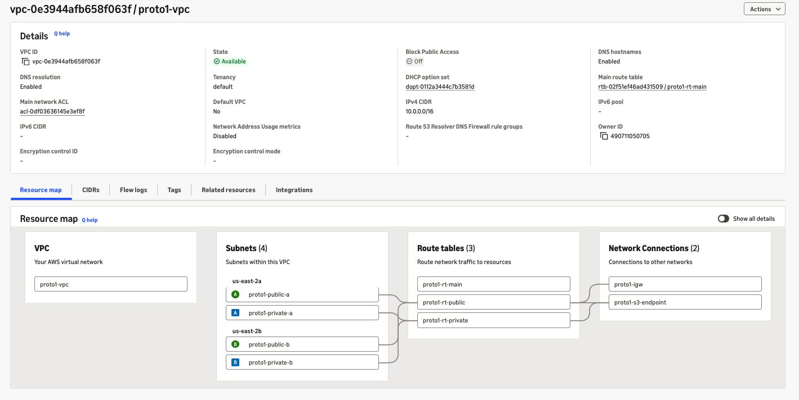
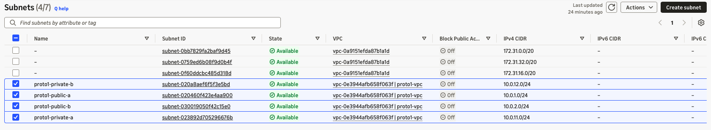
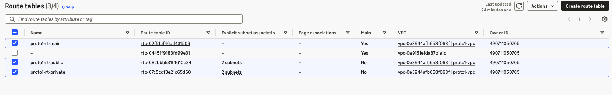
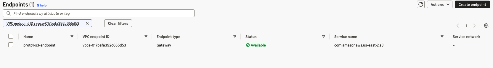

# Report 01 — VPC, subnets, IGW e tabelas de rotas

| Campo | Valor |
|---|---|
| Responsável | Gabriel |
| Issue | #17 |
| Data | 2026-11-14 |
| Projeto (AWS Settings) | `proto-tes` |
| Região | `us-east-2` (Ohio) |
| Como foi criado | Console da AWS (seção 4) |
| Script relacionado | `infra/scripts/01_vpc.sh` (equivalente CLI; usa `00_env.sh` e `lib.sh`) |

## 1. Objetivo

Criar a rede isolada onde rodam a EC2 (aplicação) e o RDS (banco). A rede
separa o que pode receber tráfego da internet (subnets públicas) do que nunca
deve ser alcançável de fora (subnets privadas). Os demais recursos (security
groups, RDS, EC2) dependem dos IDs criados aqui.

## 2. Pré-requisitos

- Report 00 (#2): acesso ao projeto `proto-tes` pelo próprio AWS Builder ID, com MFA.
- Região do projeto confirmada como `us-east-2`. Na nova experiência não há
  seletor de região no console: ela é fixa por projeto (ADR-008) e aparece em
  AWS Settings → Projeto → Visão geral.
- CloudShell (ícone `>_`) para a verificação.

## 3. Decisões e configurações

| Configuração | Valor | Por quê |
|---|---|---|
| CIDR da VPC | `10.0.0.0/16` | Faixa privada (RFC 1918) com espaço de sobra para novas subnets |
| DNS resolution / hostnames | habilitados | O endpoint do RDS é um nome DNS que precisa resolver dentro da VPC |
| Subnets públicas | `10.0.1.0/24` (2a), `10.0.2.0/24` (2b) | A da 2a recebe a EC2; a da 2b fica reservada para um ALB ou 2ª instância |
| Subnets privadas | `10.0.11.0/24` (2a), `10.0.12.0/24` (2b) | O *DB subnet group* do RDS exige subnets em pelo menos 2 AZs |
| Auto-assign IP público | **ligado nas públicas**, desligado nas privadas | Sem NAT, a EC2 só tem internet com IP público. O user data (Docker, git clone) roda no primeiro boot, antes de o Elastic IP ser associado; sem auto-assign ele falharia. Ao associar o EIP (report 06), o IP automático é substituído, sem custo extra. **Diverge da ARQ §8.2**, que previa desligado |
| Internet Gateway | `proto1-igw` | Única porta de entrada/saída da VPC para a internet |
| NAT Gateway | **não criado** | Custa ~US$ 32/mês + tráfego. A subnet privada não precisa sair para a internet: o RDS é gerenciado pela AWS e o S3 é acessado pelo endpoint |
| Endpoint do S3 | Gateway, nas duas route tables | Gratuito; o tráfego da aplicação para o bucket fica na rede da AWS |
| Tabela principal (main) | `proto1-rt-main`: sem associações e sem rota para a internet | Uma subnet criada sem associação explícita nunca fica pública por engano |
| Faixas reservadas | `10.0.21.0/24` e `10.0.22.0/24` (futura camada privada de aplicação); `.3`, `.13`, `.23` (3ª AZ) | Nada criado; só evita conflito se a rede crescer (ALB + app em subnet privada) |
| Tags | `Name`, `Project=proto1`, `Owner=Gabriel` em todos os recursos | Convenção da ARQ §8.1; `proto1` é o prefixo da equipe, independente do nome do projeto na AWS (`proto-tes`) |

### Por que duas AZs

Uma *Availability Zone* é um datacenter (ou grupo deles) isolado dos outros da
região. O RDS só aceita um *DB subnet group* com subnets em pelo menos duas
AZs, mesmo rodando em single-AZ, para poder ser movido ou promovido a Multi-AZ
no futuro. Por simetria, também há uma subnet pública em cada AZ.

### O que torna uma subnet pública

Nenhuma configuração da subnet em si: é a **tabela de rotas** associada a ela.
Uma subnet é pública quando a tabela tem a rota `0.0.0.0/0 → Internet Gateway`.
`proto1-rt-public` tem essa rota; `proto1-rt-private` não, então um recurso nas
subnets privadas não alcança a internet e não pode ser alcançado por ela, mesmo
que tivesse IP público.

## 4. Passo a passo

A rede foi criada pelo console (serviço **VPC**), na ordem abaixo. Em todos os
recursos foram adicionadas as tags `Project=proto1` e `Owner=Gabriel`.

> A conta já vem com uma **VPC default** (`172.31.0.0/16`). Ela não foi usada nem
> alterada. Atenção nos assistentes de EC2 e RDS: eles selecionam a default
> automaticamente; é preciso escolher `proto1-vpc`.

1. **Your VPCs → Create VPC** → *VPC only*; nome `proto1-vpc`; IPv4 manual `10.0.0.0/16`;
   sem IPv6; tenancy *Default*. Encryption control e Block Public Access ficaram
   desligados. Depois, **Actions → Edit VPC settings** → *DNS resolution* e
   *DNS hostnames* habilitados.
2. **Subnets → Create subnet** → VPC `proto1-vpc`; as 4 subnets no mesmo
   formulário (*Add new subnet*), com nome, AZ e CIDR da seção 3.
3. **Edit subnet settings** em `proto1-public-a` e `proto1-public-b` →
   *Enable auto-assign public IPv4 address*.
4. **Internet gateways → Create** `proto1-igw` → **Attach to a VPC** → `proto1-vpc`.
5. **Route tables → Create** `proto1-rt-public` → *Routes* → `0.0.0.0/0` →
   Internet Gateway `proto1-igw` → *Subnet associations* (explícitas) →
   `public-a` e `public-b`.
6. **Route tables → Create** `proto1-rt-private` (sem rotas adicionais) →
   associada a `private-a` e `private-b`.
7. A route table principal criada junto com a VPC recebeu o nome
   `proto1-rt-main` e as tags, sem rotas nem associações.
8. **Endpoints → Create endpoint** `proto1-s3-endpoint` → *AWS services* →
   `com.amazonaws.us-east-2.s3` com **Type = Gateway** (o tipo Interface é pago) →
   VPC `proto1-vpc` → route tables `proto1-rt-public` e `proto1-rt-private` →
   policy *Full access*. Cross-region desligado. A AWS adicionou sozinha a rota
   `pl-7ba54012 → vpce-...` nas duas tabelas.









## 5. Equivalente via AWS CLI

O script recria exatamente a mesma rede numa conta limpa. Ele **não** foi usado
para criar os recursos deste report (criados pelo console) e aborta se a
`proto1-vpc` já existir.

```bash
git clone <url-do-repositório> && cd <repositório>
export OWNER=<SeuNome>
bash infra/scripts/01_vpc.sh
```

| Bloco | O que faz |
|---|---|
| `00_env.sh` | Região, AZs, prefixo `proto1`, CIDRs e caminho do `infra/.state/outputs.env` |
| `lib.sh` | `require_env` (CLI, sessão e `OWNER`), `tag_spec` (tags Name/Project/Owner) e `save_output` |
| Proteção inicial | Aborta se já existir uma VPC `proto1-vpc`, para não duplicar a rede |
| 1/6 | `create-vpc` + `modify-vpc-attribute` (DNS) |
| 2/6 | `create-subnet` ×4; auto-assign de IP público ligado nas públicas e desligado nas privadas |
| 3/6 | `create-internet-gateway` + `attach-internet-gateway` |
| 4/6 | `proto1-rt-public`: rota `0.0.0.0/0 → IGW`, associada às públicas |
| 5/6 | `proto1-rt-private`: só rota local, associada às privadas; tag `proto1-rt-main` na tabela principal |
| 6/6 | `create-vpc-endpoint` tipo Gateway para `com.amazonaws.us-east-2.s3` nas duas tabelas |
| Verificação | `describe-subnets` e `describe-route-tables` |

Os IDs ficam em `infra/.state/outputs.env` (fora do Git) e são lidos pelos
scripts seguintes através do `00_env.sh`.

## 6. Recursos criados

| Recurso | Nome | ID |
|---|---|---|
| VPC | `proto1-vpc` | `vpc-0e3944afb658f063f` |
| Subnet pública A (us-east-2a) | `proto1-public-a` | `subnet-020460f423e4aa900` |
| Subnet pública B (us-east-2b) | `proto1-public-b` | `subnet-030019050f42c15e0` |
| Subnet privada A (us-east-2a) | `proto1-private-a` | `subnet-023892d705296676b` |
| Subnet privada B (us-east-2b) | `proto1-private-b` | `subnet-020a8aef6f5f3e5bd` |
| Internet Gateway | `proto1-igw` | `igw-032cab57d8414bfdf` |
| Route table pública | `proto1-rt-public` | `rtb-082bbb531f4610e34` |
| Route table privada | `proto1-rt-private` | `rtb-07c5cdf3e21c65d60` |
| Route table principal | `proto1-rt-main` | `rtb-02f51ef46ad431509` |
| VPC Endpoint (Gateway) | `proto1-s3-endpoint` | `vpce-017bafa392c655d53` |

## 7. Verificação

Executado no CloudShell em 2026-11-14. O Account ID (`OwnerId`) foi mascarado.

```bash
VPC_ID=$(aws ec2 describe-vpcs --filters Name=tag:Name,Values=proto1-vpc --query 'Vpcs[0].VpcId' --output text)
```

**Subnets** (`MapPublicIpOnLaunch` deve ser `True` nas públicas e `False` nas privadas):

```bash
aws ec2 describe-subnets --filters Name=vpc-id,Values=$VPC_ID \
  --query 'Subnets[].{Nome:Tags[?Key==`Name`]|[0].Value,ID:SubnetId,CIDR:CidrBlock,AZ:AvailabilityZone,IpPublicoAuto:MapPublicIpOnLaunch}' --output table
```

```text
+------------+---------------+----------------------------+----------------+--------------------+
|     AZ     |     CIDR      |            ID              | IpPublicoAuto  |       Nome         |
+------------+---------------+----------------------------+----------------+--------------------+
|  us-east-2b|  10.0.12.0/24 |  subnet-020a8aef6f5f3e5bd  |  False         |  proto1-private-b  |
|  us-east-2a|  10.0.1.0/24  |  subnet-020460f423e4aa900  |  True          |  proto1-public-a   |
|  us-east-2b|  10.0.2.0/24  |  subnet-030019050f42c15e0  |  True          |  proto1-public-b   |
|  us-east-2a|  10.0.11.0/24 |  subnet-023892d705296676b  |  False         |  proto1-private-a  |
+------------+---------------+----------------------------+----------------+--------------------+
```

**Internet Gateway e endpoint do S3:**

```bash
aws ec2 describe-internet-gateways --filters Name=attachment.vpc-id,Values=$VPC_ID \
  --query 'InternetGateways[].{ID:InternetGatewayId,Estado:Attachments[0].State}' --output table
aws ec2 describe-vpc-endpoints --filters Name=vpc-id,Values=$VPC_ID \
  --query 'VpcEndpoints[].{ID:VpcEndpointId,Tipo:VpcEndpointType,Servico:ServiceName,Estado:State}' --output table
```

```text
+------------+-------------------------+
|   Estado   |           ID            |
+------------+-------------------------+
|  available |  igw-032cab57d8414bfdf  |
+------------+-------------------------+

+-----------+--------------------------+------------------------------+----------+
|  Estado   |           ID             |           Servico            |  Tipo    |
+-----------+--------------------------+------------------------------+----------+
|  available|  vpce-017bafa392c655d53  |  com.amazonaws.us-east-2.s3  |  Gateway |
+-----------+--------------------------+------------------------------+----------+
```

`available` no anexo do IGW significa que ele está anexado à VPC.

**Route tables** (comando pedido na issue):

```bash
aws ec2 describe-route-tables --filters Name=vpc-id,Values=$VPC_ID
```

```json
{
    "RouteTables": [
        {
            "Associations": [
                {
                    "Main": true,
                    "RouteTableAssociationId": "rtbassoc-03626b343689355a0",
                    "RouteTableId": "rtb-02f51ef46ad431509",
                    "AssociationState": { "State": "associated" }
                }
            ],
            "PropagatingVgws": [],
            "RouteTableId": "rtb-02f51ef46ad431509",
            "Routes": [
                { "DestinationCidrBlock": "10.0.0.0/16", "GatewayId": "local", "Origin": "CreateRouteTable", "State": "active" }
            ],
            "Tags": [
                { "Key": "Owner", "Value": "Gabriel" },
                { "Key": "Project", "Value": "proto1" },
                { "Key": "Name", "Value": "proto1-rt-main" }
            ],
            "VpcId": "vpc-0e3944afb658f063f",
            "OwnerId": "XXXXXXXXXXXX"
        },
        {
            "Associations": [
                {
                    "Main": false,
                    "RouteTableAssociationId": "rtbassoc-037b5ee327c17a4c9",
                    "RouteTableId": "rtb-082bbb531f4610e34",
                    "SubnetId": "subnet-020460f423e4aa900",
                    "AssociationState": { "State": "associated" }
                },
                {
                    "Main": false,
                    "RouteTableAssociationId": "rtbassoc-090cb1de24b9c9f7c",
                    "RouteTableId": "rtb-082bbb531f4610e34",
                    "SubnetId": "subnet-030019050f42c15e0",
                    "AssociationState": { "State": "associated" }
                }
            ],
            "PropagatingVgws": [],
            "RouteTableId": "rtb-082bbb531f4610e34",
            "Routes": [
                { "DestinationCidrBlock": "10.0.0.0/16", "GatewayId": "local", "Origin": "CreateRouteTable", "State": "active" },
                { "DestinationCidrBlock": "0.0.0.0/0", "GatewayId": "igw-032cab57d8414bfdf", "Origin": "CreateRoute", "State": "active" },
                { "DestinationPrefixListId": "pl-7ba54012", "GatewayId": "vpce-017bafa392c655d53", "Origin": "CreateRoute", "State": "active" }
            ],
            "Tags": [
                { "Key": "Name", "Value": "proto1-rt-public" },
                { "Key": "Project", "Value": "proto1" },
                { "Key": "Owner", "Value": "Gabriel" }
            ],
            "VpcId": "vpc-0e3944afb658f063f",
            "OwnerId": "XXXXXXXXXXXX"
        },
        {
            "Associations": [
                {
                    "Main": false,
                    "RouteTableAssociationId": "rtbassoc-0fbfaa03cc3f73d98",
                    "RouteTableId": "rtb-07c5cdf3e21c65d60",
                    "SubnetId": "subnet-020a8aef6f5f3e5bd",
                    "AssociationState": { "State": "associated" }
                },
                {
                    "Main": false,
                    "RouteTableAssociationId": "rtbassoc-0834a516703cc8ecb",
                    "RouteTableId": "rtb-07c5cdf3e21c65d60",
                    "SubnetId": "subnet-023892d705296676b",
                    "AssociationState": { "State": "associated" }
                }
            ],
            "PropagatingVgws": [],
            "RouteTableId": "rtb-07c5cdf3e21c65d60",
            "Routes": [
                { "DestinationCidrBlock": "10.0.0.0/16", "GatewayId": "local", "Origin": "CreateRouteTable", "State": "active" },
                { "DestinationPrefixListId": "pl-7ba54012", "GatewayId": "vpce-017bafa392c655d53", "Origin": "CreateRoute", "State": "active" }
            ],
            "Tags": [
                { "Key": "Name", "Value": "proto1-rt-private" },
                { "Key": "Owner", "Value": "Gabriel" },
                { "Key": "Project", "Value": "proto1" }
            ],
            "VpcId": "vpc-0e3944afb658f063f",
            "OwnerId": "XXXXXXXXXXXX"
        }
    ]
}
```

Leitura da saída:

| Tabela | Rotas | Subnets associadas | Resultado |
|---|---|---|---|
| `proto1-rt-public` | `local`, `0.0.0.0/0 → igw`, `pl-7ba54012 → vpce` | public-a, public-b | ✅ subnets públicas |
| `proto1-rt-private` | `local`, `pl-7ba54012 → vpce` | private-a, private-b | ✅ subnets privadas, sem internet |
| `proto1-rt-main` | só `local` | nenhuma (`Main: true`) | ✅ padrão seguro |

`pl-7ba54012` é a *prefix list* gerenciada pela AWS com as faixas de IP do S3 em
`us-east-2`; a rota para ela foi criada automaticamente pelo endpoint.

## 8. Como conectar / integrar

| Quem usa | O quê |
|---|---|
| Report 02 — Security groups (#18) | `VPC_ID` |
| Report 04 — RDS (#20) | `SUBNET_PRIVATE_A_ID` e `SUBNET_PRIVATE_B_ID` no *DB subnet group* |
| Report 06 — EC2 (#22) | `SUBNET_PUBLIC_A_ID`; o Elastic IP funciona por causa da rota para o IGW |
| Report 03 — S3 (#19) | O tráfego da EC2 para o bucket passa pelo `proto1-s3-endpoint` |

Como a rede foi criada pelo console, o `infra/.state/outputs.env` não é gerado
automaticamente. Quem for rodar os scripts seguintes no CloudShell cria o arquivo
com os IDs da seção 6 (eles não são segredos):

```bash
mkdir -p infra/.state && cat > infra/.state/outputs.env <<'EOF'
VPC_ID=vpc-0e3944afb658f063f
SUBNET_PUBLIC_A_ID=subnet-020460f423e4aa900
SUBNET_PUBLIC_B_ID=subnet-030019050f42c15e0
SUBNET_PRIVATE_A_ID=subnet-023892d705296676b
SUBNET_PRIVATE_B_ID=subnet-020a8aef6f5f3e5bd
IGW_ID=igw-032cab57d8414bfdf
RT_PUBLIC_ID=rtb-082bbb531f4610e34
RT_PRIVATE_ID=rtb-07c5cdf3e21c65d60
RT_MAIN_ID=rtb-02f51ef46ad431509
S3_ENDPOINT_ID=vpce-017bafa392c655d53
EOF
```

Depois disso, `source infra/scripts/00_env.sh` carrega as variáveis.

> **Para o RDS (#20):** escolher a AZ `us-east-2a`, a mesma da EC2. Tráfego entre
> AZs diferentes é cobrado (US$ 0,01/GB em cada sentido).

## 9. Custos

VPC, subnets, Internet Gateway, route tables e Gateway Endpoint do S3 não são
cobrados. O único item de rede pago é o IPv4 público (Elastic IP), tratado no
report 06. O NAT Gateway, que seria o maior custo de rede, não foi criado.

## 10. Problemas encontrados e soluções

| Problema | Solução |
|---|---|
| O console da nova experiência não tem seletor de região no canto superior (só o nome do projeto e do usuário) | A região é fixa por projeto (ADR-008); confirmada como `us-east-2` em AWS Settings e pelas AZs oferecidas ao criar as subnets |
| O projeto na AWS se chama `proto-tes`, não `proto1` como na ARQ | Confirmado que `proto-tes` é o projeto oficial da equipe. Os recursos mantêm o prefixo e a tag `proto1` (convenção da equipe, já usada no report 03) |
| A ARQ §8.2 previa auto-assign de IP desligado, o que deixaria a EC2 sem internet no primeiro boot (sem NAT, antes do Elastic IP) | Auto-assign ligado só nas subnets públicas (seção 3). Combinar com o responsável pela EC2 (#22) |
| Depois do *Edit VPC settings*, os detalhes da VPC ainda mostravam **DNS hostnames: Disabled** (a opção não foi salva) | Percebido no print do resource map; refeito o *Edit VPC settings* marcando *Enable DNS hostnames*. Conferir sempre na aba *Details* depois de salvar. Sem isso, o endpoint do RDS não resolve dentro da VPC |

## 11. Como desfazer

Ordem inversa da criação (depois de apagar EC2, RDS e security groups):

1. `aws ec2 delete-vpc-endpoints --vpc-endpoint-ids $S3_ENDPOINT_ID`
2. Desassociar e apagar `proto1-rt-public` e `proto1-rt-private` (`disassociate-route-table`, `delete-route-table`)
3. `aws ec2 detach-internet-gateway` e `delete-internet-gateway`
4. `aws ec2 delete-subnet` nas 4 subnets
5. `aws ec2 delete-vpc --vpc-id $VPC_ID` (a tabela principal vai junto)

O procedimento completo fica no report 08 (#26).

## 12. Referências

- [How Amazon VPC works](https://docs.aws.amazon.com/vpc/latest/userguide/how-it-works.html)
- [Subnets for your VPC](https://docs.aws.amazon.com/vpc/latest/userguide/configure-subnets.html)
- [Route tables](https://docs.aws.amazon.com/vpc/latest/userguide/VPC_Route_Tables.html)
- [Gateway endpoints for Amazon S3](https://docs.aws.amazon.com/vpc/latest/privatelink/vpc-endpoints-s3.html)
- [Working with a DB instance in a VPC (DB subnet groups)](https://docs.aws.amazon.com/AmazonRDS/latest/UserGuide/USER_VPC.WorkingWithRDSInstanceinaVPC.html)
- [NAT gateway pricing](https://aws.amazon.com/vpc/pricing/)
