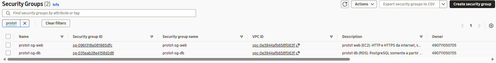
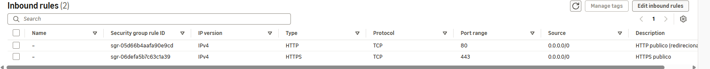
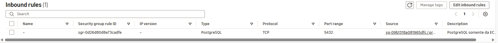

# Report 02 — Security groups

| Campo | Valor |
|---|---|
| Responsável | Thalys Yago |
| Issue | #18 |
| Data | 2026-11-14 |
| Projeto (AWS Settings) | `proto-tes` |
| Região | `us-east-2` (Ohio) |
| Como foi criado | Script `infra/scripts/02_security_groups.sh` no CloudShell (seção 4) |
| Script relacionado | `infra/scripts/02_security_groups.sh` (usa `00_env.sh` e `lib.sh` do report 01) |

## 1. Objetivo

Definir quem pode falar com quem dentro da `proto1-vpc`. São dois *security groups* (SG), que funcionam como firewalls ligados a cada recurso:

- **`proto1-sg-web`** fica na EC2 (report 06): recebe o tráfego da internet para a aplicação, só em HTTP e HTTPS.
- **`proto1-sg-db`** fica no RDS (report 04): aceita conexões ao PostgreSQL **somente** de quem está no `proto1-sg-web`, ou seja, da aplicação. Nada da internet chega ao banco.

## 2. Pré-requisitos

- Report 01 (#17): `proto1-vpc` criada (`vpc-0e3944afb658f063f`). O script a encontra pela tag `Name`.
- Acesso ao projeto `proto-tes` pelo próprio login, com MFA (report 00).
- CloudShell (ícone `>_`) para rodar o script e a verificação.

## 3. Decisões e configurações

### `proto1-sg-web` (EC2)

| Direção | Protocolo/porta | Origem/destino | Por quê |
|---|---|---|---|
| Entrada | TCP 80 | `0.0.0.0/0` | HTTP da aplicação; com o HTTPS ativo (#23), o Nginx redireciona para 443 |
| Entrada | TCP 443 | `0.0.0.0/0` | HTTPS. Obrigatório: o cookie de sessão é `Secure` em produção (`docs/DECISAO_AUTENTICACAO.md`) |
| Entrada | TCP 22 (SSH) | **não liberada** | O acesso administrativo é pelo Session Manager (ADR-004), que não precisa de porta de entrada |
| Saída | Todos | `0.0.0.0/0` (regra padrão) | A EC2 baixa imagens Docker, clona o repositório e fala com SSM, S3 e Parameter Store |

### `proto1-sg-db` (RDS)

| Direção | Protocolo/porta | Origem/destino | Por quê |
|---|---|---|---|
| Entrada | TCP 5432 | **`proto1-sg-web`** (`sg-09b1318a081965dfc`) | Só a aplicação fala com o banco. A origem é o SG, não um IP |
| Saída | Todos | regra padrão | O banco só responde a conexões; o SG é *stateful* (ver abaixo) |

| Configuração | Valor | Por quê |
|---|---|---|
| VPC | `proto1-vpc` | Os SGs pertencem a uma VPC; a *default* (`172.31.0.0/16`) não é usada |
| Tags | `Name`, `Project=proto1`, `Owner=Thalys` | Convenção da ARQ §8.1 |
| Descrição das regras | Em cada regra de entrada | O console mostra o motivo de cada porta aberta |

### SG (stateful) × NACL (stateless)

| | Security group | Network ACL |
|---|---|---|
| Onde atua | Em cada recurso (interface de rede da EC2, RDS) | Na subnet inteira |
| Estado | **Stateful**: a resposta de uma conexão permitida volta sozinha, sem regra de saída | **Stateless**: cada pacote é avaliado; ida e volta precisam de regra, inclusive as portas efêmeras (1024–65535) |
| Regras | Só de **permissão**; o que não está permitido é negado | Permissão **e negação**, avaliadas em ordem numérica |

O projeto usa só SGs e mantém a NACL padrão da VPC (permite tudo). Por serem stateful, os SGs dispensam as regras de portas efêmeras e são suficientes para isolar a EC2 e o RDS. Uma NACL acrescentaria uma camada por subnet, útil para bloquear faixas de IP, o que o protótipo não precisa.

### Referência a SG × referência a IP

A regra do `proto1-sg-db` aponta para o **`proto1-sg-web`**, e não para o IP da EC2:

- **O IP pode mudar** (nova instância, troca de Elastic IP) e a regra continuaria apontando para o endereço antigo. Com a referência, qualquer recurso que receba o `proto1-sg-web` passa a ter acesso, e quem o perde deixa de ter, sem editar o `proto1-sg-db`.
- **Fica explícito quem pode acessar:** "a aplicação", e não "um número". Um IP também poderia, por engano, pertencer a outro recurso.

### Por que sem SSH (ADR-004)

Abrir a porta 22 exporia a EC2 a tentativas de login vindas da internet e obrigaria a compartilhar uma chave `.pem` entre a equipe. Com o **Session Manager**, o acesso é feito pelo console (EC2 → Conectar → Session Manager), usando o login de cada membro: não há porta aberta nem chave, e cada sessão fica registrada no CloudTrail com quem acessou.

## 4. Passo a passo

Os SGs foram criados **pelo script**, executado no CloudShell do projeto `proto-tes`, seguindo a recomendação da ARQ §10.5 (rodar o script e depois conferir no console). Assim, o script e os recursos não divergem.

```bash
git clone https://github.com/vickminari/aws-prototype.git
cd aws-prototype
git switch infra/18-security-groups

# Confere que a VPC do report 01 está visível
aws ec2 describe-vpcs --filters "Name=tag:Name,Values=proto1-vpc" --query 'Vpcs[0].VpcId' --output text
# vpc-0e3944afb658f063f

export OWNER=Thalys
bash infra/scripts/02_security_groups.sh
```

Saída do script:

```text
==> 0/3 Localizando a proto1-vpc
    VPC_ID=vpc-0e3944afb658f063f
Região: us-east-2 · VPC: vpc-0e3944afb658f063f · Owner: Thalys

==> 1/3 Criando proto1-sg-web
    SG_WEB_ID=sg-09b1318a081965dfc

==> 2/3 Criando proto1-sg-db
    SG_DB_ID=sg-035eab28e4158d2d8

==> 3/3 Verificação
(regras de entrada: ver seção 7)
```

No console, em **EC2 → Security Groups**, os dois SGs aparecem na `proto1-vpc` com as regras da seção 3:







## 5. Equivalente via AWS CLI

O script recria os dois SGs numa conta limpa (com a `proto1-vpc` já existente) e aborta se algum deles já existir.

```bash
export OWNER=<SeuNome>
bash infra/scripts/02_security_groups.sh
```

| Bloco | O que faz |
|---|---|
| `00_env.sh` / `lib.sh` | Os mesmos do report 01: região, prefixo `proto1`, `require_env`, `tag_spec` e `save_output` |
| 0/3 | Localiza a `proto1-vpc` pela tag `Name` (não depende do `infra/.state` de quem criou a rede) e aborta se `proto1-sg-web` ou `proto1-sg-db` já existirem |
| 1/3 | `create-security-group proto1-sg-web` + `authorize-security-group-ingress` para 80 e 443 de `0.0.0.0/0` |
| 2/3 | `create-security-group proto1-sg-db` + `authorize-security-group-ingress` para 5432 com origem no `proto1-sg-web` |
| 3/3 | `describe-security-groups` com as regras de entrada dos dois SGs |

Os IDs ficam em `infra/.state/outputs.env` (`SG_WEB_ID`, `SG_DB_ID`), fora do Git, para os scripts do RDS e da EC2.

## 6. Recursos criados

| Recurso | Nome | ID |
|---|---|---|
| Security group da EC2 | `proto1-sg-web` | `sg-09b1318a081965dfc` |
| Security group do RDS | `proto1-sg-db` | `sg-035eab28e4158d2d8` |

Ambos na VPC `proto1-vpc` (`vpc-0e3944afb658f063f`).

## 7. Verificação

Executado no CloudShell em 2026-11-14.

**Regras de entrada** (saída do bloco 3/3 do script):

```json
[
    {
        "Nome": "proto1-sg-db",
        "ID": "sg-035eab28e4158d2d8",
        "Entrada": [
            { "Porta": 5432, "Origem_CIDR": "", "Origem_SG": "sg-09b1318a081965dfc" }
        ]
    },
    {
        "Nome": "proto1-sg-web",
        "ID": "sg-09b1318a081965dfc",
        "Entrada": [
            { "Porta": 80, "Origem_CIDR": "0.0.0.0/0", "Origem_SG": "" },
            { "Porta": 443, "Origem_CIDR": "0.0.0.0/0", "Origem_SG": "" }
        ]
    }
]
```

Não há regra para a porta 22, e o `proto1-sg-db` só aceita origem no `proto1-sg-web`.

**SGs na VPC certa** (comando pedido na issue):

```bash
aws ec2 describe-security-groups --filters "Name=group-name,Values=proto1-sg-web,proto1-sg-db" \
  --query 'SecurityGroups[].{Nome:GroupName,ID:GroupId,VPC:VpcId}' --output table
```

```text
--------------------------------------------------------------------
|                      DescribeSecurityGroups                      |
+----------------------+-----------------+-------------------------+
|          ID          |      Nome       |           VPC           |
+----------------------+-----------------+-------------------------+
|  sg-09b1318a081965dfc|  proto1-sg-web  |  vpc-0e3944afb658f063f  |
|  sg-035eab28e4158d2d8|  proto1-sg-db   |  vpc-0e3944afb658f063f  |
+----------------------+-----------------+-------------------------+
```

### Teste de conexão (pendente: depende do RDS e da EC2)

A issue pede, depois que o RDS (#20) e a EC2 (#22) existirem, o teste que comprova o isolamento. Ele será colado aqui:

1. **Da EC2** (Session Manager): `nc -zv <endpoint-do-rds> 5432` → deve **conectar** (`succeeded`).
2. **Da internet** (CloudShell, que fica fora da VPC): o mesmo comando → deve **falhar** por timeout. O RDS não tem acesso público e o `proto1-sg-db` não aceita origem fora do `proto1-sg-web`.

## 8. Como conectar / integrar

- **EC2 (report 06, #22):** ao criar a instância, escolher a `proto1-vpc`, a subnet `proto1-public-a` e o security group **`proto1-sg-web`**, e remover o *default*. O script pode ler o `SG_WEB_ID` do `infra/.state/outputs.env`.
- **RDS (report 04, #20):** no *DB subnet group* das subnets privadas, escolher o security group **`proto1-sg-db`** (remover o *default*) e manter **Public access = No**.
- **HTTPS (#23):** a porta 443 já está liberada para a terminação TLS no Nginx da EC2.

> Os assistentes de EC2 e RDS selecionam a VPC e o SG *default* automaticamente. É preciso trocar para `proto1-vpc` e para os SGs deste report.

## 9. Custos

Security groups são **gratuitos**, e não há cobrança por regra.

## 10. Problemas encontrados e soluções

| Problema | Solução |
|---|---|
| Ao colar um bloco de comandos no CloudShell, a última linha não executava | A última linha colada fica esperando **Enter**; apertar Enter após cada bloco |
| A saída longa do `describe-security-groups` abriu um visualizador terminado em `:` | É o paginador da AWS CLI: **Espaço** avança e **`q`** sai. `export AWS_PAGER=""` desliga o paginador na sessão |

## 11. Como desfazer

Ordem (o report 08 consolida o teardown de todo o projeto):

1. Remover os SGs do RDS e da EC2, ou excluir esses recursos antes (reports 04 e 06). Um SG em uso não pode ser apagado.
2. Apagar o **`proto1-sg-db`** primeiro: a regra dele referencia o `proto1-sg-web`, o que impede apagar o web antes.
3. Apagar o **`proto1-sg-web`**.

```bash
aws ec2 delete-security-group --group-id sg-035eab28e4158d2d8   # proto1-sg-db
aws ec2 delete-security-group --group-id sg-09b1318a081965dfc   # proto1-sg-web
```

## 12. Referências

- [Security groups da VPC](https://docs.aws.amazon.com/vpc/latest/userguide/vpc-security-groups.html)
- [Regras de security group](https://docs.aws.amazon.com/vpc/latest/userguide/security-group-rules.html)
- [Network ACLs](https://docs.aws.amazon.com/vpc/latest/userguide/vpc-network-acls.html)
- [Acesso a uma instância de banco de dados RDS em uma VPC](https://docs.aws.amazon.com/AmazonRDS/latest/UserGuide/USER_VPC.Scenarios.html)
- [AWS Systems Manager Session Manager](https://docs.aws.amazon.com/systems-manager/latest/userguide/session-manager.html)
