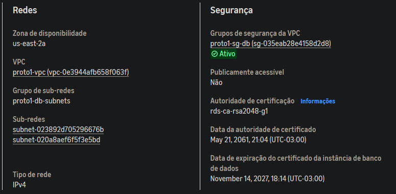
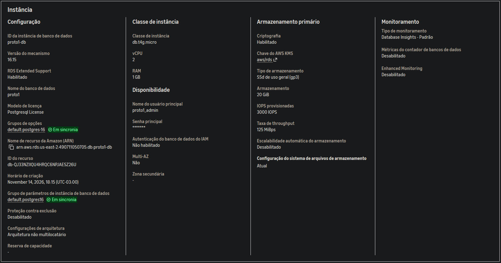
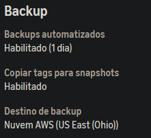
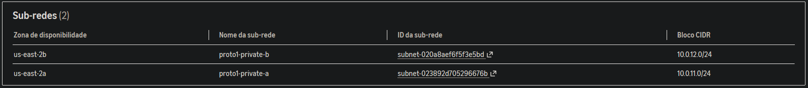
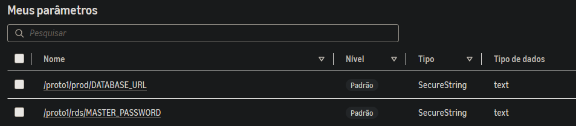
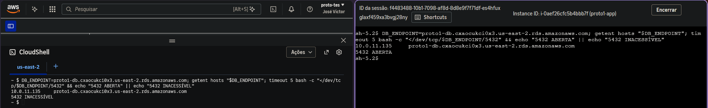
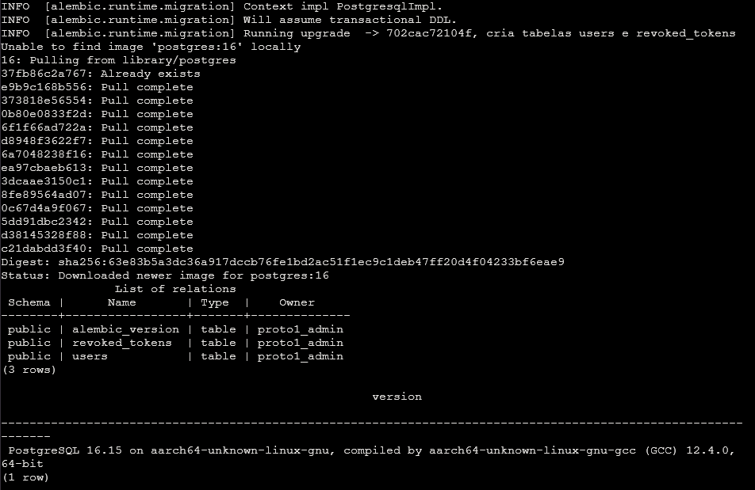

# Report 04 — RDS PostgreSQL

| Campo | Valor |
|---|---|
| Responsável | José Victor |
| Issue | #20 |
| Data | 2026-11-14 |
| Projeto (AWS Settings) | `proto-tes` |
| Região | `us-east-2` (Ohio) |
| Como foi criado | Script `infra/scripts/04_rds.sh` no CloudShell (seção 4) |
| Script relacionado | `infra/scripts/04_rds.sh` (usa `00_env.sh` e `lib.sh` do report 01) |

## 1. Objetivo

Criar o banco da aplicação: a instância **`proto1-db`** (RDS PostgreSQL), nas **subnets privadas** da `proto1-vpc`, acessível somente pela EC2 `proto1-app`. A senha do usuário administrador é gerada pelo script e vai direto para o **Parameter Store**, junto com a `DATABASE_URL` que a API lê no deploy.

### Por que RDS PostgreSQL (resumo do ADR-001)

DynamoDB foi cogitado, mas o domínio é relacional e precisa de **unicidade** em `email` e `username`. No DynamoDB isso exige transações com itens auxiliares, e o SQLAlchemy/Alembic do backend não funcionam com ele. Com PostgreSQL, os testes rodam em SQLite em memória e as migrações são as mesmas em dev e em produção. Além disso, o RDS obriga a desenhar subnets privadas, DB subnet group e security group por referência, o que exercita os requisitos de VPC, SG e route tables da disciplina. O custo é a cobrança por hora (coberta pelos créditos) e a necessidade de parar a instância quando não estiver em uso (seção 9).

### Por que subnet privada

As subnets `proto1-private-a` e `proto1-private-b` usam a `proto1-rt-private`, que **não tem rota para o Internet Gateway** (report 01). Somado a `PubliclyAccessible = false`, o banco recebe só um IP privado (`10.0.11.x`): mesmo que o security group fosse aberto por engano, não existe caminho da internet até ele. O RDS é gerenciado pela AWS, então não precisa sair para a internet (por isso não há NAT Gateway).

São três barreiras independentes:

| Camada | Configuração | Efeito |
|---|---|---|
| Rede | subnets privadas, sem rota para o IGW | Nenhum pacote da internet chega ao banco |
| RDS | `PubliclyAccessible = false` | O endpoint resolve para um IP privado, nunca público |
| Security group | `proto1-sg-db`: 5432 só do `proto1-sg-web` | Dentro da VPC, só a EC2 conecta |

## 2. Pré-requisitos

- Report 01 (#17): `proto1-vpc` e as subnets `proto1-private-a` (`us-east-2a`) e `proto1-private-b` (`us-east-2b`).
- Report 02 (#18): `proto1-sg-db`, que aceita 5432 somente do `proto1-sg-web`. Atende ao pedido da seção 8 do report 02: o banco usa o `proto1-sg-db` **no lugar do SG default**.
- Report 06 (#22): EC2 `proto1-app` com Session Manager e Docker, usada só na verificação (seção 7). Não é pré-requisito para criar o banco.
- CloudShell (ícone `>_`), na raiz do repositório clonado, na branch `infra/20-rds`.

## 3. Decisões e configurações

| Configuração | Valor | Por quê |
|---|---|---|
| Identificador | `proto1-db` | Convenção `proto1-` (ARQ §8.1) |
| Engine | PostgreSQL 16 (a 16.x mais recente, resolvida pelo script) | Mesma versão major do `postgres:16` do `docker-compose.yml` de dev |
| Classe | `db.t4g.micro` (2 vCPU, 1 GB) | Menor classe Graviton; elegível ao plano gratuito |
| Armazenamento | 20 GB gp3, **criptografado** (chave `aws/rds`) | gp3 tem 3.000 IOPS de base sem custo extra; criptografia sem custo |
| Autoscaling de disco | **desligado** (sem `--max-allocated-storage`) | Evita crescimento e cobrança inesperados |
| Multi-AZ | **Não** | Dobraria o custo; não é necessário num protótipo |
| AZ | `us-east-2a` | A mesma da EC2: menor latência e sem cobrança de tráfego entre AZs |
| DB subnet group | `proto1-db-subnets` (private-a + private-b) | O RDS exige subnets em 2 AZs, mesmo em single-AZ |
| Acesso público | **Não** | Seção 1 |
| Security group | `proto1-sg-db` (o default **não** é usado) | 5432 só da EC2 (report 02) |
| Banco / usuário | `proto1` / `proto1_admin` | ARQ §8.6 |
| Senha | `openssl rand -hex 24` (48 caracteres hexadecimais) | Aleatória; hexadecimal não precisa de escape na URL e respeita as restrições do RDS (sem `/ ' " @` e espaço) |
| Onde a senha fica | `/proto1/rds/MASTER_PASSWORD` (SecureString) | Gravada **antes** de criar o banco: se o CloudShell cair durante a espera, ela não se perde. Fica fora de `/proto1/prod/` porque o `load-env.sh` (#21) copia tudo desse caminho para o `.env`, e a API só precisa da URL |
| URL da aplicação | `/proto1/prod/DATABASE_URL` (SecureString), formato `postgresql+psycopg://proto1_admin:***@<endpoint>:5432/proto1` | Só o script conhece senha e endpoint juntos; assim a URL nunca é digitada nem impressa. Driver psycopg 3, igual ao `backend/.env.example` |
| Backup automático | 1 dia | ARQ §8.6; o armazenamento de backup até o tamanho do banco não é cobrado |
| Proteção contra exclusão | desligada | Facilita o teardown (report 08) |
| Tags | `Name`, `Project=proto1`, `Owner=Victor` (copiadas para os snapshots) | Convenção da ARQ §8.1 |

## 4. Passo a passo

### 4.1 Execução do script (CloudShell)

```bash
cd ~/aws-prototype            # ou: git clone https://github.com/vickminari/aws-prototype.git && cd aws-prototype
git fetch && git switch infra/20-rds && git pull
export OWNER=<SeuNome>
export AWS_PAGER=""
bash infra/scripts/04_rds.sh
```

O script tem 6 blocos (`0/5` a `5/5`):

| Bloco | O que faz |
|---|---|
| 0/5 | Busca a VPC, as subnets privadas e o `proto1-sg-db` pelos nomes; aborta se o banco, o subnet group ou os parâmetros já existirem |
| 1/5 | Cria o DB subnet group `proto1-db-subnets` |
| 2/5 | Gera a senha e grava em `/proto1/rds/MASTER_PASSWORD` (não exibe) |
| 3/5 | Descobre a versão 16.x, cria o `proto1-db` e espera ficar `available` (10 a 15 min) |
| 4/5 | Lê a senha do SSM e grava `/proto1/prod/DATABASE_URL` (não exibe) |
| 5/5 | Mostra a configuração da instância e os parâmetros (sem valores) |

```text
==> 0/5 Localizando VPC, subnets privadas e proto1-sg-db
    VPC_ID=vpc-0e3944afb658f063f
    SUBNET_PRIVATE_A_ID=subnet-023892d705296676b
    SUBNET_PRIVATE_B_ID=subnet-020a8aef6f5f3e5bd
    SG_DB_ID=sg-035eab28e4158d2d8
Região: us-east-2 · VPC: vpc-0e3944afb658f063f · SG: sg-035eab28e4158d2d8 · Owner: Victor

==> 1/5 Criando o DB subnet group proto1-db-subnets
    DB_SUBNET_GROUP=proto1-db-subnets

==> 2/5 Gerando a senha e gravando em /proto1/rds/MASTER_PASSWORD (SecureString)
    Senha gravada (não é exibida).

==> 3/5 Criando a instância proto1-db (db.t4g.micro)
    DB_ENGINE_VERSION=16.15
    DB_INSTANCE_ID=proto1-db

==>     Aguardando a instância ficar available (10 a 15 min; não feche o CloudShell)
    DB_ENDPOINT=proto1-db.cxaocukci0x3.us-east-2.rds.amazonaws.com

==> 4/5 Gravando /proto1/prod/DATABASE_URL (SecureString)
    DATABASE_URL gravada (não é exibida).
```

### 4.2 Conferência no console (prints)

1. **Aurora and RDS → Databases → `proto1-db`**, aba **Connectivity & security**: VPC `proto1-vpc`, subnet group `proto1-db-subnets`, SG `proto1-sg-db`, *Publicly accessible* **No**.
   
2. Aba **Configuration**: engine 16.x, classe `db.t4g.micro`, 20 GB gp3, *Encryption* **Enabled**, *Storage autoscaling* **Disabled**, Multi-AZ **No**.
   
3. Aba **Maintenance & backups**: *Automated backups* **1 day**, *Deletion protection* **Disabled**.
   
4. **Subnet groups → `proto1-db-subnets`**: as duas subnets privadas, em `us-east-2a` e `us-east-2b`.
   
5. **Systems Manager → Parameter Store**: `/proto1/rds/MASTER_PASSWORD` e `/proto1/prod/DATABASE_URL` como **SecureString**. **Não** clicar em *Show decrypted value* antes do print.
   

## 5. Equivalente via AWS CLI

O script **é** o equivalente via CLI (seção 4.1). Comandos principais, na ordem:

```bash
aws rds create-db-subnet-group --db-subnet-group-name proto1-db-subnets \
  --subnet-ids <PRIVATE_A> <PRIVATE_B> ...
aws ssm put-parameter --name /proto1/rds/MASTER_PASSWORD --type SecureString --value "<gerada>" ...
aws rds create-db-instance --db-instance-identifier proto1-db --engine postgres \
  --db-instance-class db.t4g.micro --allocated-storage 20 --storage-type gp3 --storage-encrypted \
  --db-subnet-group-name proto1-db-subnets --vpc-security-group-ids <SG_DB> \
  --no-publicly-accessible --no-multi-az --backup-retention-period 1 ...
aws rds wait db-instance-available --db-instance-identifier proto1-db
aws ssm put-parameter --name /proto1/prod/DATABASE_URL --type SecureString --value "<url>" ...
```

## 6. Recursos criados

| Recurso | Nome | ID / valor |
|---|---|---|
| DB subnet group | `proto1-db-subnets` | `subnet-023892d705296676b` (private-a), `subnet-020a8aef6f5f3e5bd` (private-b) |
| Instância RDS | `proto1-db` | PostgreSQL 16.15, `db.t4g.micro`, us-east-2a |
| Endpoint | — | `proto1-db.cxaocukci0x3.us-east-2.rds.amazonaws.com:5432` |
| Parâmetro SSM | `/proto1/rds/MASTER_PASSWORD` | SecureString |
| Parâmetro SSM | `/proto1/prod/DATABASE_URL` | SecureString |

## 7. Verificação

### 7.1 Configuração da instância (bloco 5/5 do script)

```text
==> 5/5 Verificação
------------------------------------------------------------------------------
|                             DescribeDBInstances                            |
+---------------------+------------------------------------------------------+
|  AZ                 |  us-east-2a                                          |
|  BackupDias         |  1                                                   |
|  Classe             |  db.t4g.micro                                        |
|  Criptografado      |  True                                                |
|  Disco              |  gp3                                                 |
|  Endpoint           |  proto1-db.cxaocukci0x3.us-east-2.rds.amazonaws.com  |
|  Engine             |  postgres                                            |
|  Estado             |  available                                           |
|  GB                 |  20                                                  |
|  ID                 |  proto1-db                                           |
|  MaxStorage         |  None                                                |
|  MultiAZ            |  False                                               |
|  Porta              |  5432                                                |
|  ProtecaoExclusao   |  False                                               |
|  PubliclyAccessible |  False                                               |
|  SG                 |  sg-035eab28e4158d2d8                                |
|  SubnetGroup        |  proto1-db-subnets                                   |
|  Subnets            |  subnet-023892d705296676b,subnet-020a8aef6f5f3e5bd   |
|  Versao             |  16.15                                               |
+---------------------+------------------------------------------------------+
```

### 7.2 Parâmetros sem valores (bloco 5/5 do script)

```text
-----------------------------------------------------------
|                   GetParametersByPath                   |
+------------------------------+----------------+---------+
|             Nome             |     Tipo       | Versao  |
+------------------------------+----------------+---------+
|  /proto1/prod/DATABASE_URL   |  SecureString  |  1      |
|  /proto1/rds/MASTER_PASSWORD |  SecureString  |  1      |
+------------------------------+----------------+---------+

==> Pronto. IDs salvos em infra/.state/outputs.env (DB_INSTANCE_ID, DB_ENDPOINT, DB_SUBNET_GROUP).
```

### 7.3 Teste de conexão: acessível da EC2, inacessível da internet

Este teste também é o pendente do report 02 (#18, seção 7) e do report 06 (#22, seção 7). Usa o `/dev/tcp` do bash porque o `nc` não vem instalado no Amazon Linux 2023.

**Da internet** (CloudShell, fora da VPC):

```bash
DB_ENDPOINT=<endpoint-da-seção-6>
getent hosts "$DB_ENDPOINT"     # resolve para um IP privado 10.0.11.x
timeout 5 bash -c "</dev/tcp/$DB_ENDPOINT/5432" && echo "5432 ABERTA" || echo "5432 INACESSÍVEL"
```

```text
10.0.11.135     proto1-db.cxaocukci0x3.us-east-2.rds.amazonaws.com
5432 INACESSÍVEL
```

**Da EC2** (Session Manager: **EC2 → proto1-app → Connect → Session Manager**):

```bash
DB_ENDPOINT=<endpoint-da-seção-6>
getent hosts "$DB_ENDPOINT"
timeout 5 bash -c "</dev/tcp/$DB_ENDPOINT/5432" && echo "5432 ABERTA" || echo "5432 INACESSÍVEL"
```

```text
10.0.11.135     proto1-db.cxaocukci0x3.us-east-2.rds.amazonaws.com
5432 ABERTA
```



### 7.4 `psql` da EC2 listando as tabelas

Ainda na sessão da EC2. A URL é lida do Parameter Store pela role da instância e **nunca** é exibida (não rodar `echo` nela). O `psql` não aceita o `+psycopg` do SQLAlchemy, por isso ele é removido na chamada.

```bash
DB_URL="$(aws ssm get-parameter --name /proto1/prod/DATABASE_URL --with-decryption \
  --query Parameter.Value --output text)"

# Migrações do Alembic (as mesmas que o entrypoint da API roda no deploy da #23;
# rodar de novo não muda nada)
cd /opt/proto1 && sudo git pull --ff-only
sudo docker build -t proto1-api ./backend
sudo docker run --rm -e DATABASE_URL="$DB_URL" --entrypoint alembic proto1-api upgrade head

# Tabelas e versão do servidor
sudo docker run --rm postgres:16 psql "${DB_URL/+psycopg/}" -c '\dt' -c 'select version();'
unset DB_URL
```

```text
INFO  [alembic.runtime.migration] Running upgrade  -> 702cac72104f, cria tabelas users e revoked_tokens
...
                List of relations
 Schema |      Name       | Type  |    Owner     
--------+-----------------+-------+--------------
 public | alembic_version | table | proto1_admin
 public | revoked_tokens  | table | proto1_admin
 public | users           | table | proto1_admin
(3 rows)

 PostgreSQL 16.15 on aarch64-unknown-linux-gnu, compiled by aarch64-unknown-linux-gnu-gcc (GCC) 12.4.0, 64-bit
(1 row)
```

A EC2 conectou no RDS pela rede privada, aplicou as migrações e listou as tabelas da aplicação. O servidor é o PostgreSQL 16.15 em Graviton (`aarch64`), como esperado para a classe `db.t4g.micro`.



## 8. Como conectar / integrar

- **API (#23):** a `DATABASE_URL` está em `/proto1/prod/DATABASE_URL`. O `load-env.sh` da #21 copia esse caminho para o `.env` da EC2 e o `docker-compose.prod.yml` entrega para a API. O entrypoint roda `alembic upgrade head` antes de subir a API.
- **Parameter Store (#21):** o `05_ssm_parameters.sh` **não** deve criar nem sobrescrever a `DATABASE_URL`, que já foi gravada aqui. Ele cuida dos outros parâmetros de `/proto1/prod/` (`JWT_SECRET`, `S3_BUCKET`, `STORAGE_BACKEND`, `AWS_REGION`). A role da EC2 já pode lê-los (`ssm:GetParameter*` em `/proto1/*`, report 03).
- **Administrar o banco:** pela EC2, com o `psql` em container da seção 7.4 (sem `-c`, abre o prompt interativo). Não existe acesso direto da máquina de ninguém: o banco não tem IP público.
- **Senha do admin**, se precisar (nunca colar em report, print ou chat):

  ```bash
  aws ssm get-parameter --name /proto1/rds/MASTER_PASSWORD --with-decryption --query Parameter.Value --output text
  ```

## 9. Custos

Valores sob demanda em `us-east-2`, consumidos dos créditos do plano gratuito:

| Item | Preço | Por mês (24/7) |
|---|---|---|
| `db.t4g.micro` single-AZ | ~US$ 0,016/hora | ~US$ 11,70 |
| Armazenamento gp3 20 GB | ~US$ 0,115/GB-mês | ~US$ 2,30 |
| Backup (1 dia, até 20 GB) | grátis | — |
| Parameter Store (parâmetros padrão) | grátis | — |

**Como parar quando não estiver em uso** (o disco continua cobrando, a hora da instância não):

```bash
aws rds stop-db-instance --db-instance-identifier proto1-db    # parar
aws rds start-db-instance --db-instance-identifier proto1-db   # ligar de novo (5 a 10 min)
aws rds describe-db-instances --db-instance-identifier proto1-db --query 'DBInstances[0].DBInstanceStatus'
```

Atenção: o RDS **liga sozinho depois de 7 dias parado**. Com o banco parado, a API responde 503 no `/api/health`. O endpoint não muda ao parar e ligar.

## 10. Problemas encontrados e soluções

| Problema | Solução |
|---|---|
| (Prevenção) O CloudShell fecha a sessão após ~20 min sem interação, e a espera do bloco 3/5 leva até 15 min | Apertar uma tecla de vez em quando. Se a sessão cair, o banco continua sendo criado e a senha já está no SSM: **não** rodar o script de novo (ele aborta porque o banco existe); usar o bloco de recuperação abaixo |

**Recuperação** (só se a sessão caiu no bloco 3/5): grava a `DATABASE_URL` como o bloco 4/5, sem exibir nada.

```bash
aws rds wait db-instance-available --db-instance-identifier proto1-db
DB_ENDPOINT="$(aws rds describe-db-instances --db-instance-identifier proto1-db \
  --query 'DBInstances[0].Endpoint.Address' --output text)"
DB_PASSWORD="$(aws ssm get-parameter --name /proto1/rds/MASTER_PASSWORD --with-decryption \
  --query Parameter.Value --output text)"
aws ssm put-parameter --name /proto1/prod/DATABASE_URL --type SecureString \
  --description "proto1: conexao da API com o RDS proto1-db" \
  --value "postgresql+psycopg://proto1_admin:${DB_PASSWORD}@${DB_ENDPOINT}:5432/proto1" \
  --tags Key=Project,Value=proto1 "Key=Owner,Value=${OWNER}" >/dev/null
unset DB_PASSWORD
```

Depois, rodar só os dois comandos do bloco 5/5 do script para a verificação.

> **Plano B (ARQ §1.3):** se o banco não estiver conectado até o fim do D3, usar um serviço `postgres:16` no `docker-compose.prod.yml` da EC2, trocando só a `DATABASE_URL`, e registrar aqui.

## 11. Como desfazer

Ordem (o report 08 consolida o teardown de todo o projeto). Apagar o banco **antes** do `proto1-sg-db` (report 02), que não pode ser removido enquanto estiver em uso:

```bash
aws rds delete-db-instance --db-instance-identifier proto1-db \
  --skip-final-snapshot --delete-automated-backups
aws rds wait db-instance-deleted --db-instance-identifier proto1-db
aws rds delete-db-subnet-group --db-subnet-group-name proto1-db-subnets
aws ssm delete-parameters --names /proto1/rds/MASTER_PASSWORD /proto1/prod/DATABASE_URL
```

## 12. Referências

- `ARQUITETURA.md`: §8.6 (RDS), §8.9 (Parameter Store), §1.3 (Plano B) e ADR-001
- [Criar uma instância de banco de dados no RDS](https://docs.aws.amazon.com/AmazonRDS/latest/UserGuide/USER_CreateDBInstance.html)
- [DB subnet groups e VPC](https://docs.aws.amazon.com/AmazonRDS/latest/UserGuide/USER_VPC.WorkingWithRDSInstanceinaVPC.html)
- [Cenários de acesso a um banco RDS em uma VPC](https://docs.aws.amazon.com/AmazonRDS/latest/UserGuide/USER_VPC.Scenarios.html)
- [Armazenamento gp3 no RDS](https://docs.aws.amazon.com/AmazonRDS/latest/UserGuide/CHAP_Storage.html)
- [Parar uma instância RDS temporariamente](https://docs.aws.amazon.com/AmazonRDS/latest/UserGuide/USER_StopInstance.html)
- [Parameter Store — SecureString](https://docs.aws.amazon.com/systems-manager/latest/userguide/systems-manager-parameter-store.html)
- [Preços do RDS para PostgreSQL](https://aws.amazon.com/rds/postgresql/pricing/)
