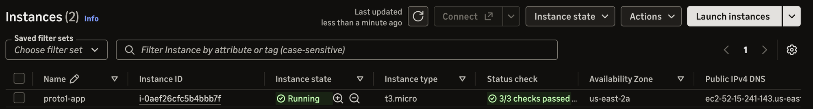
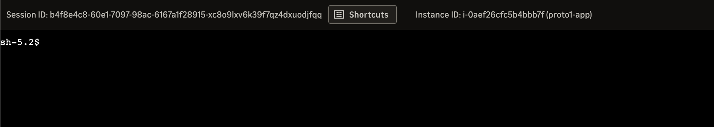

# Report 06 — EC2, Elastic IP e Session Manager

| Campo | Valor |
|---|---|
| Responsável | Jailson Zarur |
| Issue | #22 |
| Data | 2026-11-14 |
| Projeto (AWS Settings) | `proto-tes` |
| Região | `us-east-2` (Ohio) |
| Como foi criado | Script `infra/scripts/06_ec2.sh` no CloudShell (seção 4) |
| Script relacionado | `infra/scripts/06_ec2.sh` e `infra/ec2/user-data.sh` (usam `00_env.sh` e `lib.sh` do report 01) |

## 1. Objetivo

Criar a máquina onde a aplicação roda: a EC2 **`proto1-app`**, na subnet pública, com um endereço fixo na internet (**Elastic IP `proto1-eip`**). No primeiro boot, o *user data* deixa a máquina pronta para o deploy da #23: Docker, Docker Compose, git, swap e o repositório clonado em `/opt/proto1`.

A instância não tem porta 22 nem chave SSH. O acesso administrativo é pelo **Session Manager**, que abre um terminal no navegador ou no CloudShell usando a role da EC2 (report 03) e o login de cada membro.

## 2. Pré-requisitos

- Report 01 (#17): `proto1-vpc` (`vpc-0e3944afb658f063f`) e a subnet `proto1-public-a` (`subnet-020460f423e4aa900`), com rota para o Internet Gateway.
- Report 02 (#18): `proto1-sg-web` (`sg-09b1318a081965dfc`), com 80 e 443 abertos e sem 22.
- Report 03 (#19): instance profile `proto1-ec2-role`, com `AmazonSSMManagedInstanceCore` (Session Manager) e a policy `proto1-ec2-app` (S3 e Parameter Store). O script aborta se ele não existir.
- CloudShell (ícone `>_`), na raiz do repositório clonado.

O RDS (#20) **não** é pré-requisito para criar a EC2; só para o teste `nc -zv` da seção 7.

## 3. Decisões e configurações

| Configuração | Valor | Por quê |
|---|---|---|
| AMI | Amazon Linux 2023 (x86_64), a mais recente | Mantida pela AWS, já traz o agente do SSM e o AWS CLI. O script lê o ID no parâmetro público `/aws/service/ami-amazon-linux-latest/al2023-ami-kernel-default-x86_64` |
| Tipo | `t3.micro` (2 vCPU, 1 GB RAM) | Suficiente para Nginx + API de um protótipo; elegível ao plano gratuito |
| CPU credits | `standard` | O padrão da família T3 é `unlimited`, que cobra à parte se a CPU ficar muito tempo acima da linha de base. Com `standard`, no pior caso a máquina fica lenta, mas não gera custo extra |
| Subnet | `proto1-public-a` (us-east-2a) | Precisa receber tráfego da internet. O RDS fica nas privadas |
| Security group | `proto1-sg-web` | 80 e 443 da internet, sem SSH (report 02) |
| IAM | instance profile `proto1-ec2-role` | Credenciais temporárias para Session Manager, S3 e Parameter Store; nenhuma chave fica na máquina |
| Key pair | **nenhum** | Sem SSH: acesso só pelo Session Manager (ADR-004) |
| Disco | 20 GB gp3, **criptografado**, apagado com a instância | Espaço para imagens Docker e logs; gp3 é mais barato que gp2 |
| Metadata (IMDS) | **IMDSv2 obrigatório**, hop limit **2** | O IMDSv2 exige token e protege contra SSRF. O hop limit 2 é necessário porque a API roda **dentro de um container**: a resposta do metadata precisa atravessar dois "pulos" de rede. Com o padrão (1), a API não recebe as credenciais da role e o upload para o S3 falha |
| Endereço público | Elastic IP `proto1-eip` | IP fixo: não muda ao parar e ligar a EC2. É o endereço do deploy e do HTTPS da #23 |
| User data | `infra/ec2/user-data.sh` | Prepara a máquina no primeiro boot, sem acesso manual (abaixo) |

### User data

O `infra/ec2/user-data.sh` roda uma vez, como root, no primeiro boot:

1. Instala `docker`, `git` e `nmap-ncat` (o `nc` do teste com o RDS) e habilita o Docker no boot.
2. Instala os plugins **Docker Compose** e **Buildx**, que não vêm no pacote do Amazon Linux 2023.
3. Cria **2 GB de swap**: com 1 GB de RAM, o build do frontend (`npm ci` + Vite) poderia ser encerrado por falta de memória.
4. Clona o repositório (público) em **`/opt/proto1`**.

Log em `/var/log/proto1-user-data.log`; ao terminar, cria `/var/lib/proto1/user-data.done`.

### Acesso sem SSH (Session Manager)

| | SSH tradicional | Session Manager |
|---|---|---|
| Porta de entrada | 22 aberta para a internet | **Nenhuma**: o agente na EC2 abre a conexão de saída para a AWS |
| Credencial | Arquivo `.pem` compartilhado entre a equipe | Login individual de cada membro, com MFA |
| Auditoria | Nenhuma por padrão | Cada sessão aparece no CloudTrail com quem abriu |

O agente usa a permissão `AmazonSSMManagedInstanceCore` da role (report 03) e precisa de saída para a internet, que a EC2 tem pela subnet pública.

## 4. Passo a passo

Executado no CloudShell em 2026-11-14, na raiz do repositório:

```bash
git clone -b infra/22-ec2 https://github.com/vickminari/aws-prototype.git && cd aws-prototype
export AWS_PAGER=""
export OWNER=Jailson
bash infra/scripts/06_ec2.sh
```

Foram duas execuções:

1. **Primeira:** criou a instância `i-068c9a02124239df8` e o Elastic IP `3.139.221.121`, mas parou no bloco 4/5 porque a `proto1-ec2-role` estava **sem policies** (report 03 incompleto) e o user data abortou no meio. Os dois problemas e as correções estão na seção 10.

   ```text
   ==> 0/5 Localizando VPC, subnet, security group e instance profile
       VPC_ID=vpc-0e3944afb658f063f
       SUBNET_PUBLIC_A_ID=subnet-020460f423e4aa900
       SG_WEB_ID=sg-09b1318a081965dfc
   Região: us-east-2 · Subnet: subnet-020460f423e4aa900 · SG: sg-09b1318a081965dfc · Role: proto1-ec2-role · Owner: Jailson

   ==> 1/5 Buscando a AMI mais recente do Amazon Linux 2023
       AMI_ID=ami-0df8a753693e6366d

   ==> 2/5 Criando a instância proto1-app (t3.micro)
       INSTANCE_ID=i-068c9a02124239df8

   ==>     Aguardando a instância ficar running

   ==> 3/5 Alocando o proto1-eip e associando à instância
       EIP_ALLOCATION_ID=eipalloc-0e2b9422822470f9d
       ELASTIC_IP=3.139.221.121

   ==> 4/5 Aguardando a instância aparecer no Session Manager (até 10 min)
   Erro: A instância não ficou Online no Session Manager. Veja a seção 10 do report 06.
   ```

2. **Correção e segunda execução:** o `03_s3_iam_role.sh` foi rodado de novo para anexar as policies da role; a instância e o Elastic IP da primeira tentativa foram apagados (comandos da seção 11); e o `06_ec2.sh` corrigido foi rodado de novo, agora até o fim. Resultado: instância **`i-0aef26cfc5b4bbb7f`** com o Elastic IP **`52.15.241.143`** (seções 6 e 7).

No console, em **EC2 → Instances** e **EC2 → Elastic IPs**:

<!-- Prints a anexar em docs/aws/img/:



-->

## 5. Equivalente via AWS CLI

O script cria a EC2 e o Elastic IP numa conta limpa (com os recursos dos reports 01, 02 e 03) e aborta se `proto1-app` ou `proto1-eip` já existirem.

| Bloco | O que faz |
|---|---|
| 0/5 | Localiza `proto1-vpc`, `proto1-public-a` e `proto1-sg-web` pelo nome; confere se o instance profile `proto1-ec2-role` existe e tem role; aborta se a instância ou o EIP já existirem |
| 1/5 | `ssm get-parameter` da AMI mais recente do Amazon Linux 2023 |
| 2/5 | `run-instances` com as configurações da seção 3 e o `user-data.sh`; espera o estado `running` |
| 3/5 | `allocate-address` (com a tag `proto1-eip`) e `associate-address` |
| 4/5 | Espera a instância ficar `Online` no Session Manager (até 10 min) |
| 5/5 | `describe-instances` com tipo, AMI, rede, IPs, role e metadata |

Os IDs ficam em `infra/.state/outputs.env` (`INSTANCE_ID`, `EIP_ALLOCATION_ID`, `ELASTIC_IP`, `AMI_ID`), fora do Git.

## 6. Recursos criados

| Recurso | Nome | ID |
|---|---|---|
| Instância EC2 | `proto1-app` | `i-0aef26cfc5b4bbb7f` |
| Volume raiz (EBS) | `proto1-app-root` | `vol-0e402bc3f8b4f7395` (20 GB, gp3, criptografado) |
| Elastic IP | `proto1-eip` | `eipalloc-0bb1bc42c86ae9f31` / **`52.15.241.143`** |
| AMI usada | Amazon Linux 2023 | `ami-0df8a753693e6366d` |

## 7. Verificação

Executado no CloudShell em 2026-11-14.

**Instância** (mesma consulta do bloco 5/5 do script):

```text
-----------------------------------------------------------------------------
|                             DescribeInstances                             |
+-----------+---------------------------------------------------------------+
|  AMI      |  ami-0df8a753693e6366d                                        |
|  Estado   |  running                                                      |
|  HopLimit |  2                                                            |
|  ID       |  i-0aef26cfc5b4bbb7f                                          |
|  IMDSv2   |  required                                                     |
|  IpPrivado|  10.0.1.241                                                   |
|  IpPublico|  52.15.241.143                                                |
|  Role     |  arn:aws:iam::490711050705:instance-profile/proto1-ec2-role   |
|  SG       |  proto1-sg-web                                                |
|  Subnet   |  subnet-020460f423e4aa900                                     |
|  Tipo     |  t3.micro                                                     |
+-----------+---------------------------------------------------------------+
```

`IMDSv2 = required`, `HopLimit = 2`, `SG = proto1-sg-web` e o `IpPublico` é o Elastic IP.

**Elastic IP e disco:**

```bash
aws ec2 describe-addresses --filters "Name=tag:Name,Values=proto1-eip" \
  --query 'Addresses[].{EIP:PublicIp,Allocation:AllocationId,Instancia:InstanceId}' --output table
aws ec2 describe-volumes --filters "Name=attachment.instance-id,Values=i-0aef26cfc5b4bbb7f" \
  --query 'Volumes[].{Volume:VolumeId,GB:Size,Tipo:VolumeType,Criptografado:Encrypted}' --output table
```

```text
+-----------------------------+----------------+-----------------------+
|         Allocation          |      EIP       |       Instancia       |
+-----------------------------+----------------+-----------------------+
|  eipalloc-0bb1bc42c86ae9f31 |  52.15.241.143 |  i-0aef26cfc5b4bbb7f  |
+-----------------------------+----------------+-----------------------+
+----------------+-----+-------+-------------------------+
|  Criptografado | GB  | Tipo  |         Volume          |
+----------------+-----+-------+-------------------------+
|  True          |  20 |  gp3  |  vol-0e402bc3f8b4f7395  |
+----------------+-----+-------+-------------------------+
```

**Dentro da EC2**, pelo Session Manager (`aws ssm start-session --target <INSTANCE_ID>` no CloudShell, ou **Connect → Session Manager** no console):

```bash
sudo cloud-init status --wait          # espera o user data terminar
ls /var/lib/proto1/user-data.done      # existe = user data concluído
docker compose version
free -h                                # deve mostrar Swap: 2.0Gi
aws sts get-caller-identity            # Arn com assumed-role/proto1-ec2-role
ls /opt/proto1                         # repositório clonado
```

```text
sh-5.2$ sudo cloud-init status --wait
status: done
sh-5.2$ ls /var/lib/proto1/user-data.done
/var/lib/proto1/user-data.done
sh-5.2$ docker compose version
Docker Compose version v5.7.1
sh-5.2$ docker buildx version
github.com/docker/buildx v0.39.0 360040a78d6113dc84e5d4dcdf0f438e1be7a41f
sh-5.2$ free -h
               total        used        free      shared  buff/cache   available
Mem:           913Mi       254Mi        69Mi       0.0Ki       588Mi       497Mi
Swap:          2.0Gi       0.0Ki       2.0Gi
sh-5.2$ aws sts get-caller-identity
{
    "UserId": "AROAXEQFINHIZKTDA3V4B:i-0aef26cfc5b4bbb7f",
    "Account": "490711050705",
    "Arn": "arn:aws:sts::490711050705:assumed-role/proto1-ec2-role/i-0aef26cfc5b4bbb7f"
}
sh-5.2$ ls /opt/proto1
CONTRIBUTING.md  README.md  backend  docker-compose.prod.yml  docker-compose.yml  docs  frontend  infra
```

O user data terminou (`status: done`), com Compose, Buildx e 2 GB de swap instalados e o repositório clonado. A instância usa a role `proto1-ec2-role` sem nenhuma chave guardada na máquina.

**Credenciais da role dentro de um container** (comprova o hop limit 2, necessário para a API acessar o S3):

```bash
sudo docker run --rm public.ecr.aws/aws-cli/aws-cli sts get-caller-identity
```

```text
{
    "UserId": "AROAXEQFINHIZKTDA3V4B:i-0aef26cfc5b4bbb7f",
    "Account": "490711050705",
    "Arn": "arn:aws:sts::490711050705:assumed-role/proto1-ec2-role/i-0aef26cfc5b4bbb7f"
}
```

O container recebe o mesmo `assumed-role/proto1-ec2-role` da máquina: a API, que também roda em container, consegue usar a role para acessar o S3.

**Privilégio mínimo:** de dentro da EC2, a role não consegue nem listar recursos da conta. Se a máquina fosse invadida, as credenciais dela só serviriam para o bucket de avatares e os parâmetros `/proto1/*`:

```text
sh-5.2$ aws ec2 describe-instances --instance-ids i-0aef26cfc5b4bbb7f
aws: [ERROR]: An error occurred (UnauthorizedOperation) when calling the DescribeInstances operation:
You are not authorized to perform this operation. User: arn:aws:sts::490711050705:assumed-role/proto1-ec2-role/i-0aef26cfc5b4bbb7f
is not authorized to perform: ec2:DescribeInstances because no identity-based policy allows the ec2:DescribeInstances action
```

### Teste de conexão com o RDS (pendente: depende da #20)

```bash
nc -zv <endpoint-do-rds> 5432          # da EC2: deve conectar (succeeded)
```

O mesmo comando no CloudShell, fora da VPC, deve falhar por timeout (report 02, seção 7).

## 8. Como conectar / integrar

- **Terminal na EC2:** `aws ssm start-session --target <INSTANCE_ID>` no CloudShell, ou **EC2 → proto1-app → Connect → Session Manager**. A sessão abre como `ssm-user`; use `sudo` para o Docker.
- **Deploy (#23):** com o `.env` de produção na raiz do repositório (gerado a partir do Parameter Store, #21), rodar `cd /opt/proto1 && sudo ./infra/ec2/deploy.sh`.
- **Aplicação:** `http://<ELASTIC_IP>` após o deploy. O HTTPS (cookie `Secure`, `docs/DECISAO_AUTENTICACAO.md`) é configurado na #23 sobre este mesmo IP.
- **RDS (#20):** a EC2 está no `proto1-sg-web`, a única origem aceita pelo `proto1-sg-db` na porta 5432.

## 9. Custos

Valores sob demanda em `us-east-2`, consumidos dos créditos do plano gratuito:

| Item | Preço | Por mês (24/7) |
|---|---|---|
| EC2 `t3.micro` | ~US$ 0,0104/hora | ~US$ 7,60 |
| EBS gp3 20 GB | ~US$ 0,08/GB-mês | ~US$ 1,60 |
| IPv4 público (Elastic IP) | US$ 0,005/hora | ~US$ 3,60 |

Desde 2024 a AWS cobra **todo IPv4 público**, associado ou não. O Elastic IP **continua sendo cobrado com a EC2 parada**; para zerar o custo é preciso liberá-lo (seção 11).

**Como parar quando não estiver em uso** (o disco e o Elastic IP continuam cobrando, a hora da EC2 não):

```bash
aws ec2 stop-instances --instance-ids <INSTANCE_ID>    # parar
aws ec2 start-instances --instance-ids <INSTANCE_ID>   # ligar de novo (o Elastic IP é mantido)
```

Os containers sobem sozinhos ao ligar (`restart: unless-stopped` no `docker-compose.prod.yml`).

## 10. Problemas encontrados e soluções

| Problema | Solução |
|---|---|
| 1ª execução: o script parou em 4/5 (instância não ficou `Online` no Session Manager). `aws iam list-attached-role-policies --role-name proto1-ec2-role` veio **vazio**: a role existia e estava associada à EC2, mas sem nenhuma policy | O report 03 não tinha sido concluído. Anexar as policies rodando o `03_s3_iam_role.sh`. O `06_ec2.sh` passou a conferir a `AmazonSSMManagedInstanceCore` no bloco 0/5, **antes** de criar qualquer recurso |
| 1ª execução: o user data parou no meio (`curl: (23) Failure writing output` no `get-console-output`): Docker e Compose instalados, mas sem Buildx, swap e clone | A versão do Buildx era lida com `curl \| grep -m1`; o `grep` fecha o pipe ao achar a 1ª linha, o `curl` falha e o `pipefail` aborta o script. A versão passou a ser lida do redirecionamento de `/releases/latest`, sem pipe |
| `UnauthorizedOperation` ao rodar `aws ec2 describe-*` | Os comandos foram rodados **dentro da EC2** (prompt `sh-5.2$` do Session Manager), onde valem as permissões da `proto1-ec2-role`. Consultas à conta rodam no **CloudShell** (fora da EC2), com o login de cada membro. O erro é esperado (seção 7, privilégio mínimo) |
| A instância não fica `Online` no Session Manager | Conferir se o `proto1-ec2-role` tem a policy `AmazonSSMManagedInstanceCore` (report 03) e se a instância recebeu IP público (sem ele não há saída para a internet, pois não existe NAT) |
| `permission denied` ao usar o Docker pelo Session Manager | A sessão abre como `ssm-user`, que não está no grupo `docker`. Usar `sudo docker ...` |
| User data falhou | Ver `sudo cat /var/log/proto1-user-data.log`. O user data só roda no primeiro boot; para repetir, corrigir e rodar o script como root: `sudo bash /opt/proto1/infra/ec2/user-data.sh` |

## 11. Como desfazer

Ordem (o report 08 consolida o teardown de todo o projeto):

1. Desassociar e **liberar** o Elastic IP (sem isso ele continua sendo cobrado).
2. Terminar a instância. O volume raiz é apagado junto (`DeleteOnTermination=true`).

```bash
aws ec2 disassociate-address --association-id "$(aws ec2 describe-addresses \
  --allocation-ids <EIP_ALLOCATION_ID> --query 'Addresses[0].AssociationId' --output text)"
aws ec2 release-address --allocation-id <EIP_ALLOCATION_ID>
aws ec2 terminate-instances --instance-ids <INSTANCE_ID>
```

## 12. Referências

- [Amazon Linux 2023 — AMIs no Parameter Store](https://docs.aws.amazon.com/linux/al2023/ug/ec2.html)
- [User data na inicialização da EC2](https://docs.aws.amazon.com/AWSEC2/latest/UserGuide/user-data.html)
- [IMDSv2 e hop limit](https://docs.aws.amazon.com/AWSEC2/latest/UserGuide/configuring-IMDS-existing-instances.html)
- [Instâncias T3: modos standard e unlimited](https://docs.aws.amazon.com/AWSEC2/latest/UserGuide/burstable-performance-instances-unlimited-mode.html)
- [Elastic IP addresses](https://docs.aws.amazon.com/AWSEC2/latest/UserGuide/elastic-ip-addresses-eip.html)
- [Cobrança de IPv4 público](https://aws.amazon.com/blogs/aws/new-aws-public-ipv4-address-charge-public-ip-insights/)
- [AWS Systems Manager Session Manager](https://docs.aws.amazon.com/systems-manager/latest/userguide/session-manager.html)
