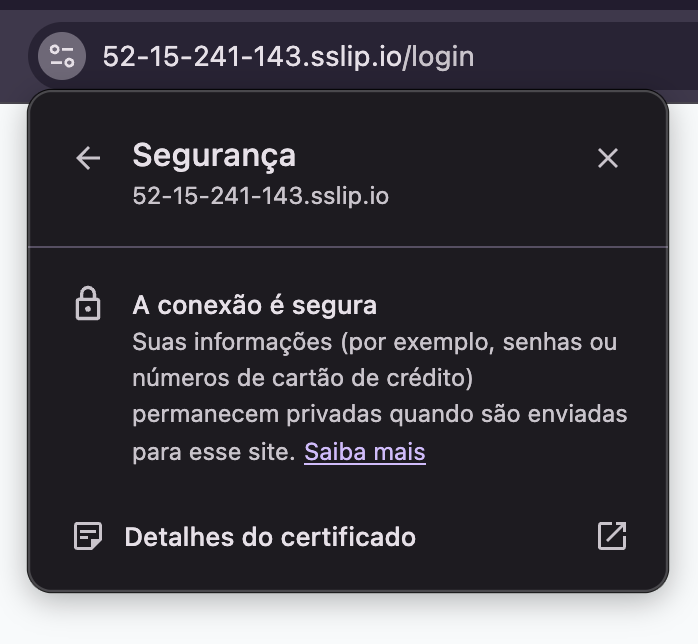
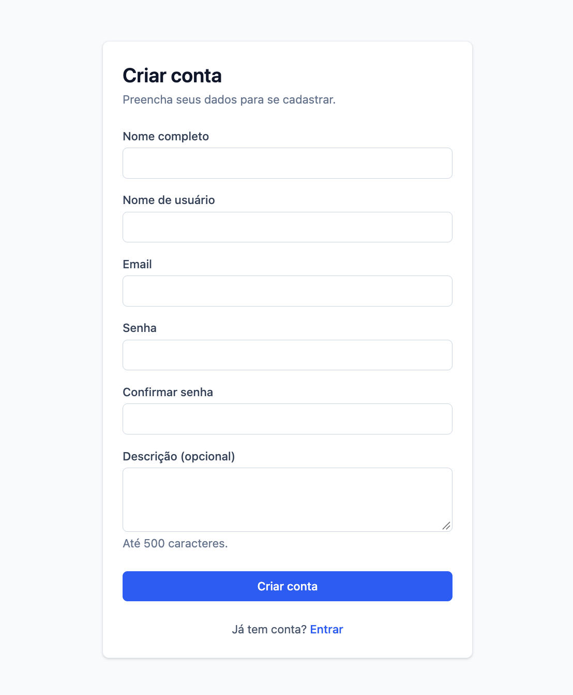
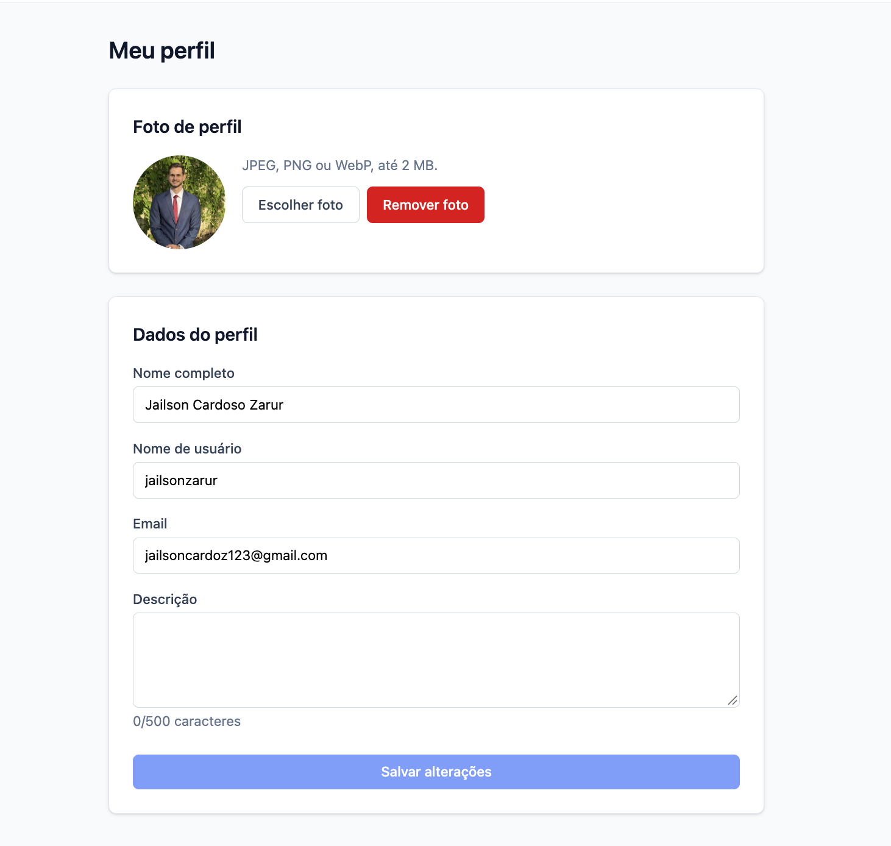
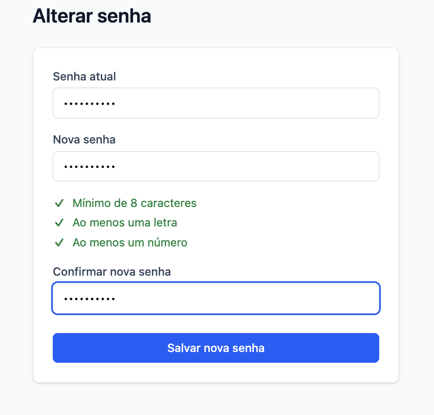

# Report 07 — Deploy em produção (containers, HTTPS e atualização)

| Campo | Valor |
|---|---|
| Responsável | Jailson Zarur |
| Issue | #23 |
| Data | 2026-11-15 |
| Projeto (AWS Settings) | `proto-tes` |
| Região | `us-east-2` (Ohio) |
| Endereço público | **https://52-15-241-143.sslip.io** |
| Como foi feito | `infra/ec2/deploy.sh` na EC2 `proto1-app`, pelo Session Manager (seção 4) |
| Arquivos relacionados | `docker-compose.prod.yml`, `frontend/nginx/`, `frontend/Dockerfile`, `backend/Dockerfile`, `infra/ec2/deploy.sh`, `infra/ec2/load-env.sh` (#21) |

## 1. Objetivo

Colocar a aplicação no ar na EC2 do report 06: frontend e API em containers Docker, banco no RDS (report 04), imagens no S3 (report 03) e configuração no Parameter Store (report 05), tudo atrás de **HTTPS com certificado confiável**.

O HTTPS não é opcional: o cookie de sessão é `Secure` (`docs/DECISAO_AUTENTICACAO.md`), e o navegador não o guarda por HTTP. Sem HTTPS o login não funciona, e a API recusa subir em produção sem `CSRF_TRUSTED_ORIGINS` com `https://`.

## 2. Pré-requisitos

| Report | O que este deploy usa |
|---|---|
| 03 (#19) | Bucket `proto1-avatars-grupob31641132` e a role `proto1-ec2-role`, que dá à API acesso ao S3 e ao Parameter Store sem chave guardada |
| 04 (#20) | RDS `proto1-db` e o parâmetro `/proto1/prod/DATABASE_URL` |
| 05 (#21) | Parâmetros `/proto1/prod/*` e o `infra/ec2/load-env.sh`, que gera o `.env` |
| 06 (#22) | EC2 `proto1-app` com Docker, Compose e o repositório em `/opt/proto1`; Elastic IP `52.15.241.143`; IMDSv2 com hop limit 2 (a API em container recebe as credenciais da role) |

## 3. Decisões e configurações

### Arquitetura na EC2

```
Navegador ──HTTPS 443──► web (Nginx) ──/api/──► api (FastAPI) ──► RDS proto1-db (subnet privada)
          ──HTTP 80───►   │ SPA (React)             │
                          │                         └──────────► S3 proto1-avatars-* (role da EC2)
          certbot ─────── certificado do Let's Encrypt (volume compartilhado)
```

| Container | Imagem | Papel |
|---|---|---|
| `api` | `backend/Dockerfile` (Python 3.12, usuário sem privilégios) | API FastAPI; roda as migrações do Alembic ao iniciar. Não expõe porta para fora da EC2 |
| `web` | `frontend/Dockerfile` (build do React + `nginx:alpine`) | Serve a SPA e encaminha `/api/` para a `api` na mesma origem (sem CORS). Única porta exposta: 80 e 443 |
| `certbot` | `certbot/certbot:v5.10.0` | Renova o certificado HTTPS |

| Configuração | Valor | Por quê |
|---|---|---|
| Banco | RDS, sem container de banco | Backups, criptografia e rede privada gerenciados pela AWS (report 04) |
| Configuração e segredos | `.env` gerado do Parameter Store a cada deploy (`load-env.sh`) | Nada de segredo no Git nem digitado à mão; `ENVIRONMENT=prod` fica fixo no compose para o `.env` não desligar as validações de produção |
| Endereço público | `52-15-241-143.sslip.io` | O sslip.io resolve o nome para o IP contido nele (o Elastic IP), sem cadastro nem custo. O certificado precisa de um nome: certificado de IP dura só ~6 dias |
| Certificado | Let's Encrypt, desafio HTTP-01 (webroot), 90 dias | Gratuito e confiável nos navegadores. O certbot tenta renovar a cada 12 h (renova quando faltam menos de 30 dias); o Nginx recarrega a cada 6 h |
| HTTP | Redireciona para HTTPS (301), exceto o desafio do Let's Encrypt e o `/api/health` | O cookie só funciona em HTTPS; o health por HTTP serve ao Docker e ao `deploy.sh` |
| HTTPS | TLS 1.2/1.3, HTTP/2, HSTS de 1 dia | HSTS curto de propósito: se o certificado falhar, o acesso volta no dia seguinte |
| Reinício | `restart: unless-stopped` em todos os containers | Sobem sozinhos após reboot da EC2 ou falha |
| Healthchecks | `api`: `/api/health` (inclui o banco); `web`: `/api/health` via Nginx | O `deploy.sh` usa `up --wait`: só termina com tudo saudável |
| Logs | `json-file`, 10 MB × 3 por container | Sem rotação os logs encheriam o disco de 20 GB |
| Deploy | Manual, pelo `deploy.sh` (ver seção 8) | Definido na #23 (deploy diário no D4). CD automático fica como melhoria |

### Nginx: modo HTTP × modo HTTPS

O Nginx não sobe com uma configuração HTTPS se o certificado ainda não existe, e o Let's Encrypt só emite o certificado se o Nginx já responde na porta 80. Por isso o `frontend/nginx/40-https.sh` escolhe o modo a cada início do container:

| Situação | Configuração ativa |
|---|---|
| Sem certificado (primeiro deploy) | `http.conf`: aplicação inteira por HTTP + desafio do Let's Encrypt |
| Com certificado | `https.conf` (443) + `http-redirect.conf` (HTTP → HTTPS) |

O conteúdo comum (SPA, proxy da API, limite de 3 MB, gzip, headers de segurança) fica em `app.conf`.

## 4. Passo a passo

Na EC2, pelo Session Manager (`aws ssm start-session --target i-0aef26cfc5b4bbb7f`, ou **Connect → Session Manager** no console):

```bash
sudo -i
cd /opt/proto1
./infra/ec2/deploy.sh
```

O `deploy.sh` faz, em ordem:

| Etapa | O que faz |
|---|---|
| Atualizar | `git pull --ff-only` da `main` |
| `.env` | Roda o `load-env.sh` (#21): lê `/proto1/prod/*` com a role da EC2 e grava `/opt/proto1/.env` com permissão 600 |
| Subir | `docker compose -f docker-compose.prod.yml up -d --build --wait`: build das imagens na EC2 e espera os healthchecks |
| Certificado | Só se houver `PUBLIC_HOST` no `.env` e ainda não houver certificado: `certbot certonly --webroot` e reinício do `web` em modo HTTPS |
| Limpar | `docker image prune -f` (imagens antigas) |
| Verificar | `curl` em `http://localhost/api/health` e em `https://<PUBLIC_HOST>/api/health` (com `--resolve`, sem sair da EC2) |

No primeiro deploy, o build numa `t3.micro` leva de 5 a 15 minutos (o swap de 2 GB do report 06 evita falta de memória no build do frontend). Nos seguintes, o cache do Docker reduz bastante.

Executado em 2026-11-15. O primeiro deploy com `PUBLIC_HOST` emitiu o certificado (seção 7.1) e o script terminou com as duas verificações de health, por HTTP e por HTTPS. A saída completa do terminal não foi guardada; o resultado está comprovado pelas verificações da seção 7.

## 5. Como atualizar a produção

Depois de um merge na `main`:

```bash
sudo -i
cd /opt/proto1 && ./infra/ec2/deploy.sh
```

| Situação | Comando |
|---|---|
| Atualização normal (código ou parâmetros) | `./infra/ec2/deploy.sh` |
| Mudou um parâmetro no Parameter Store | O mesmo: o `deploy.sh` regenera o `.env`, e o Compose recria a `api` com os valores novos |
| Usar o `.env` atual sem consultar o Parameter Store | `SKIP_LOAD_ENV=1 ./infra/ec2/deploy.sh` |
| Testar a emissão do certificado sem gastar o limite do Let's Encrypt | `CERTBOT_STAGING=1 ./infra/ec2/deploy.sh` |

## 6. Recursos criados

| Recurso | Nome | Onde |
|---|---|---|
| Containers | `proto1-api-1`, `proto1-web-1`, `proto1-certbot-1` | EC2 `proto1-app` (`i-0aef26cfc5b4bbb7f`) |
| Volumes Docker | `proto1_letsencrypt` (certificado), `proto1_certbot-www` (desafio HTTP-01) | EC2 |
| Certificado | `CN=52-15-241-143.sslip.io`, emissor Let's Encrypt (`YE2`) | Volume `proto1_letsencrypt`, `--cert-name proto1` |
| `.env` de produção | `/opt/proto1/.env` (root, 600) | Gerado do Parameter Store; fora do Git |

Nenhum recurso novo da AWS: o deploy usa só o que os reports 03 a 06 criaram.

## 7. Verificação

### 7.1 Endereço público (de fora da AWS)

Executado de uma máquina externa em 2026-11-15:

```bash
H=52-15-241-143.sslip.io
curl -s https://$H/api/health
curl -s -o /dev/null -w "[%{http_code}] -> %{redirect_url}\n" http://$H/dashboard
curl -s -o /dev/null -w "[%{http_code}] HTTP/%{http_version}\n" https://$H/
echo | openssl s_client -connect $H:443 -servername $H 2>/dev/null | openssl x509 -noout -issuer -subject -dates
```

```text
{"status":"ok","db":"ok"}
[301] -> https://52-15-241-143.sslip.io/dashboard
[200] HTTP/2
issuer=C=US, O=Let's Encrypt, CN=YE2
subject=CN=52-15-241-143.sslip.io
notBefore=Nov 15 12:33:09 2026 GMT
notAfter=Feb 13 12:33:08 2027 GMT
```

API e banco respondendo pela internet, HTTP redirecionando para HTTPS, HTTP/2 e certificado do Let's Encrypt válido até 13/02/2027 (renovação automática a partir de janeiro).



### 7.2 Configuração vinda do Parameter Store

O container não lê o Parameter Store diretamente: o caminho é Parameter Store → `load-env.sh` → `/opt/proto1/.env` → `env_file` do Compose → variáveis da `api`. A comparação abaixo usa o **hash** de cada valor, então nenhum segredo aparece:

```bash
cd /opt/proto1
for name in $(aws ssm get-parameters-by-path --path /proto1/prod/ --query 'Parameters[].Name' --output text); do
  var="${name##*/}"
  ssm=$(aws ssm get-parameter --name "$name" --with-decryption --query Parameter.Value --output text | sha256sum | cut -c1-12)
  ctr=$(docker compose -f docker-compose.prod.yml exec -T api printenv "$var" | sha256sum | cut -c1-12)
  [ "$ssm" = "$ctr" ] && echo "OK      $var" || echo "DIFERE  $var"
done
```

Executado na EC2 em 2026-11-15, depois de gerar o `.env` com o `load-env.sh`: **todas as variáveis de `/proto1/prod/` resultaram em `OK`**, ou seja, o container da API usa exatamente os valores do Parameter Store. A saída não foi anexada.

### 7.3 Fluxo completo pelo navegador

Em https://52-15-241-143.sslip.io: cadastro, login, edição do perfil, upload da foto, troca de senha, logout e novo login com a senha nova.







A foto do perfil acima foi enviada pela aplicação em produção, que usa `STORAGE_BACKEND=s3`: ela é gravada no bucket `proto1-avatars-grupob31641132` e servida a partir dele. Para listar os objetos (CloudShell):

```bash
aws s3 ls s3://proto1-avatars-grupob31641132/avatars/ --recursive
```

### 7.4 Reboot da EC2

Testado em 2026-11-15: após `reboot` na EC2, a aplicação voltou sozinha, sem nenhum comando manual. Os containers sobem pelo `restart: unless-stopped` e o Docker é habilitado no boot pelo user data (report 06). Para conferir depois de um reboot:

```bash
sudo docker ps --format 'table {{.Names}}\t{{.Status}}'    # api, web e certbot "Up"
curl -s https://52-15-241-143.sslip.io/api/health          # de fora da EC2
```

## 8. Como operar

**Logs** (na EC2, como root, em `/opt/proto1`):

```bash
docker compose -f docker-compose.prod.yml ps                      # estado e saúde dos containers
docker compose -f docker-compose.prod.yml logs -f api             # logs da API (Ctrl+C sai)
docker compose -f docker-compose.prod.yml logs --tail 100 web     # acessos e erros do Nginx
docker compose -f docker-compose.prod.yml logs certbot            # renovações do certificado
```

**Reiniciar** um container: `docker compose -f docker-compose.prod.yml restart api`.

**Certificado**: `docker compose -f docker-compose.prod.yml run --rm --entrypoint certbot certbot certificates` mostra a validade.

Evite `docker inspect` e `printenv` sem argumentos no container da API: eles exibem todos os valores do `.env`, inclusive os segredos.

### Troubleshooting

| Sintoma | Causa provável | O que fazer |
|---|---|---|
| `deploy.sh` para com "containers não ficaram saudáveis" | API não sobe: configuração inválida ou banco fora | Ver os logs que o próprio script mostra. Com `ValueError` sobre `JWT_SECRET`, `CSRF_SECRET` ou `CSRF_TRUSTED_ORIGINS`, conferir os parâmetros do report 05 |
| `/api/health` com 503 (`db` fora) | RDS parado ou inacessível | `aws rds describe-db-instances --db-instance-identifier proto1-db --query 'DBInstances[0].DBInstanceStatus'` no CloudShell; se `stopped`, ligar (report 04) |
| Login não mantém a sessão | Acesso por HTTP ou por outro endereço | Usar sempre `https://52-15-241-143.sslip.io` (o cookie é `Secure` e o CSRF só aceita essa origem) |
| Erro 403 `CSRF_INVALID` em todas as escritas | `CSRF_TRUSTED_ORIGINS` diferente do endereço usado | Corrigir o parâmetro `/proto1/prod/CSRF_TRUSTED_ORIGINS` e rodar o `deploy.sh` |
| Upload de foto falha | API sem credenciais da role ou bucket errado | Teste do container do report 06 (seção 7) e o parâmetro `S3_BUCKET` |
| Emissão do certificado falha com `rateLimited` | Limite semanal do Let's Encrypt para o domínio | A aplicação continua por `http://52.15.241.143`; tentar de novo depois ou usar `CERTBOT_STAGING=1` para testar |
| `load-env.sh: Permission denied` | Arquivo sem permissão de execução | Rodar com `bash ./infra/ec2/load-env.sh` (o `deploy.sh` já faz assim) |

## 9. Custos

O deploy não cria recursos novos na AWS. Let's Encrypt e sslip.io são gratuitos. Os custos são os da EC2 (report 06), do RDS (report 04) e do S3 (report 03).

## 10. Problemas encontrados e soluções

| Problema | Solução |
|---|---|
| A API não sobe em produção sem `CSRF_TRUSTED_ORIGINS` com `https://` (validação da #9) | O HTTPS passou a fazer parte do deploy (seção 3), com o endereço do sslip.io |
| `load-env.sh: No such file or directory` na EC2 | A EC2 estava numa `main` desatualizada (`git checkout main` só troca de branch). Rodar `git pull --ff-only` antes; o `deploy.sh` faz o pull primeiro |
| `deploy.sh` antigo rodava sem a parte de HTTPS | Mesmo motivo: o script em execução é o da versão atual do disco. Atualizar com `git pull` antes do primeiro deploy após mudanças no próprio script |
| `load-env.sh` sem permissão de execução no Git | O `deploy.sh` chama com `bash`, e o arquivo passou a ser executável |

## 11. Como desfazer

Na EC2, como root, em `/opt/proto1`:

```bash
docker compose -f docker-compose.prod.yml down        # para e remove os containers (mantém o certificado)
docker compose -f docker-compose.prod.yml down -v     # também apaga os volumes, inclusive o certificado
rm -f .env
```

Apagar o certificado só se for necessário: emitir de novo conta para o limite semanal do Let's Encrypt. A EC2, o RDS, o S3 e os parâmetros são removidos no report 08 (teardown).

## 12. Referências

- [Docker Compose: `restart`, `healthcheck` e `depends_on`](https://docs.docker.com/reference/compose-file/services/)
- [Let's Encrypt: como funciona](https://letsencrypt.org/how-it-works/) e [tipos de desafio](https://letsencrypt.org/docs/challenge-types/)
- [Let's Encrypt: limites de emissão](https://letsencrypt.org/docs/rate-limits/)
- [Certbot: modo webroot e renovação](https://eff-certbot.readthedocs.io/en/stable/using.html)
- [sslip.io](https://sslip.io/)
- [Nginx: módulo SSL](https://nginx.org/en/docs/http/ngx_http_ssl_module.html)
- [MDN: cookies `Secure` e prefixo `__Host-`](https://developer.mozilla.org/en-US/docs/Web/HTTP/Reference/Headers/Set-Cookie)
- [AWS Systems Manager Session Manager](https://docs.aws.amazon.com/systems-manager/latest/userguide/session-manager.html)
