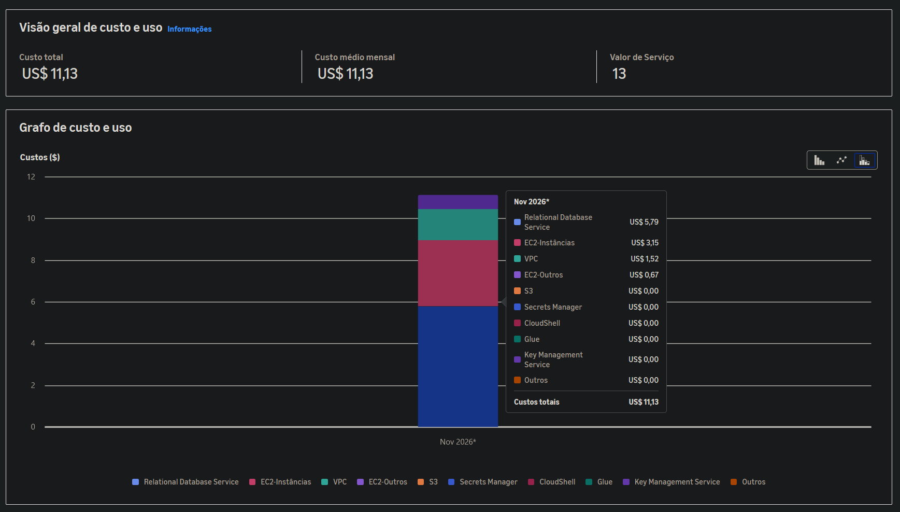
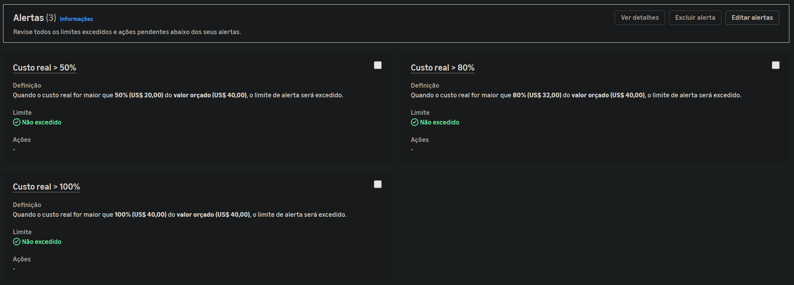
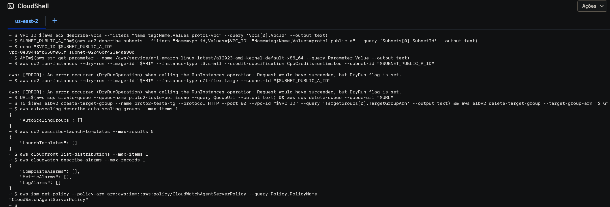

# Report 09 — Plano gratuito, créditos e orçamento da sprint 2

| Campo | Valor |
|---|---|
| Responsável | José Victor |
| Issue | #63 |
| Data | 2026-11-28 |
| Script relacionado | `infra/scripts/00_env.sh` e `infra/scripts/lib.sh` (alterados); testes e Budget feitos no CloudShell e no console |

## 1. Objetivo

Confirmar, antes de qualquer recurso da sprint 2 ser criado, que a conta tem créditos para a sprint e que o plano gratuito permite os serviços e os tipos de instância da arquitetura (ALB, Auto Scaling, SQS, CloudFront, `t3.small` *unlimited*, `c7i-flex.large`, CloudWatch). Também cria o orçamento da sprint 2 e prepara os scripts para a regra de tags proto1/proto2 (ADR-019).

## 2. Pré-requisitos

- Report 00 (conta, equipe e `proto1-budget`).
- Recursos da sprint 1 de pé (`proto1-vpc`, `proto1-public-a`), usados nos testes de permissão.

## 3. Decisões e configurações

| Configuração | Valor | Por quê |
|---|---|---|
| Budget da sprint 2 | `proto2-budget`, custo mensal de US$ 40, alertas por email em 50%, 80% e 100% | Cobre a estimativa da sprint (seção 9) com folga e avisa cedo se algo ficar ligado sem uso |
| Créditos e reembolsos no Budget | **Desmarcados** (*Credits* e *Refunds*) | Assim o Budget mede o consumo bruto, que é o que gasta os créditos. Com eles marcados, o custo líquido fica sempre em US$ 0 e nenhum alerta dispara (seção 10) |
| Escopo do Budget | Projeto inteiro (sem filtro por tag) | Soma também os recursos da sprint 1 ainda ligados, que gastam os mesmos créditos |
| `proto1-budget` | Mantido como está até o teardown (#26) | Registro da sprint 1; o controle de gasto passa a ser o `proto2-budget` |
| `PROJECT` no `00_env.sh` | `PROJECT="${PROJECT:-proto1}"` | Scripts da sprint 1 continuam iguais; os da sprint 2 fazem `export PROJECT=proto2` antes do `source` |
| Recursos modificados | `retag_as_proto2` no `lib.sh` | Aplica `Project=proto2`, `PreviousProject=proto1` e `Owner` sem trocar o nome (ADR-019) |

## 4. Passo a passo

### 4.1 Créditos e gasto da sprint 1

AWS Settings → **Faturamento** (créditos) e **Cost Explorer** (gasto por serviço, de 06/11 até 28/11).

| Item | Valor |
|---|---|
| Créditos restantes | **US$ 148,55** |
| Validade dos créditos | **04/05/2027** |
| Gasto bruto de novembro (sprint 1) | **US$ 11,13** |

| Serviço | Gasto em novembro | Origem |
|---|---|---|
| RDS | US$ 5,79 | `proto1-db` (`db.t4g.micro`) ligado |
| EC2 — instâncias | US$ 3,15 | `proto1-app` (`t3.micro`) |
| VPC | US$ 1,52 | IPv4 público (Elastic IP) |
| EC2 — outros | US$ 0,67 | Disco EBS da `proto1-app` |
| S3, Secrets Manager, CloudShell, Glue, KMS e outros | US$ 0,00 | Dentro das cotas gratuitas |
| **Total** | **US$ 11,13** | ≈ US$ 0,50 por dia com a sprint 1 ligada |



### 4.2 Budget `proto2-budget`

1. Billing → **Budgets** → *Create budget* → *Customize* → *Cost budget*.
2. Nome `proto2-budget`, período mensal, valor fixo de US$ 40.
3. Em *Advanced options*, desmarcar **Credits** e **Refunds**.
4. Alertas de custo real em 50% (US$ 20), 80% (US$ 32) e 100% (US$ 40), por email ao proprietário.



### 4.3 Testes de permissão do plano gratuito

Feitos no CloudShell (`us-east-2`). Os IDs foram buscados pela tag `Name`, sem precisar do `.state`:

```bash
VPC_ID=$(aws ec2 describe-vpcs --filters "Name=tag:Name,Values=proto1-vpc" --query 'Vpcs[0].VpcId' --output text)
SUBNET_PUBLIC_A_ID=$(aws ec2 describe-subnets --filters "Name=vpc-id,Values=$VPC_ID" "Name=tag:Name,Values=proto1-public-a" --query 'Subnets[0].SubnetId' --output text)
AMI=$(aws ssm get-parameter --name /aws/service/ami-amazon-linux-latest/al2023-ami-kernel-default-x86_64 --query Parameter.Value --output text)

# EC2: os dois tipos de instância da sprint 2 (dry-run, nada é criado)
aws ec2 run-instances --dry-run --image-id "$AMI" --instance-type t3.small --credit-specification CpuCredits=unlimited --subnet-id "$SUBNET_PUBLIC_A_ID"
aws ec2 run-instances --dry-run --image-id "$AMI" --instance-type c7i-flex.large --subnet-id "$SUBNET_PUBLIC_A_ID"

# SQS e ELB: criar e apagar na hora
URL=$(aws sqs create-queue --queue-name proto2-teste-permissao --query QueueUrl --output text) && aws sqs delete-queue --queue-url "$URL"
TG=$(aws elbv2 create-target-group --name proto2-teste-tg --protocol HTTP --port 80 --vpc-id "$VPC_ID" --query 'TargetGroups[0].TargetGroupArn' --output text) && aws elbv2 delete-target-group --target-group-arn "$TG"

# Leitura dos demais serviços
aws autoscaling describe-auto-scaling-groups --max-items 1
aws ec2 describe-launch-templates --max-results 5
aws cloudfront list-distributions --max-items 1
aws cloudwatch describe-alarms --max-records 1
aws iam get-policy --policy-arn arn:aws:iam::aws:policy/CloudWatchAgentServerPolicy --query Policy.PolicyName
```

| Requisito da arquitetura | Teste | Resultado |
|---|---|---|
| EC2 `t3.small` com CPU *unlimited* (app, ADR-028) | `run-instances --dry-run` | **Permitido** (`DryRunOperation: Request would have succeeded`) |
| EC2 `c7i-flex.large` (workers) | `run-instances --dry-run` | **Permitido** (`DryRunOperation`) |
| SQS | criar e apagar `proto2-teste-permissao` | **Permitido** (sem erro) |
| Application Load Balancer | criar e apagar o target group `proto2-teste-tg` | **Permitido** (sem erro) |
| Auto Scaling Group | `describe-auto-scaling-groups` | Acessível (lista vazia) |
| Launch template | `describe-launch-templates` | Acessível (lista vazia) |
| CloudFront | `list-distributions` | Acessível (nenhuma distribuição) |
| Alarmes do CloudWatch | `describe-alarms` | Acessível (lista vazia) |
| CloudWatch Agent | `iam get-policy CloudWatchAgentServerPolicy` | Política gerenciada disponível |



**Conclusão:** nada foi bloqueado. O plano B do ADR-028 (`t3.small` também nos workers) não é necessário.

## 5. Equivalente via AWS CLI

### 5.1 `00_env.sh`

```bash
export PROJECT="${PROJECT:-proto1}"
```

Os scripts da sprint 2 começam assim:

```bash
export PROJECT=proto2
source "$(dirname "$0")/00_env.sh"
source "$(dirname "$0")/lib.sh"
```

Quem rodar um script da sprint 1 depois de um da sprint 2 na mesma aba do CloudShell deve fazer `unset PROJECT` antes. Senão, nomes derivados de `PROJECT` (ex.: `DB_INSTANCE_ID="${PROJECT}-db"` no `04_rds.sh`) apontariam para `proto2-*`.

### 5.2 `retag_as_proto2` (`lib.sh`)

```bash
export OWNER=SeuNome
retag_as_proto2 sg-035eab28e4158d2d8                          # EC2/VPC: pelo ID
retag_as_proto2 arn:aws:rds:us-east-2:<conta>:db:proto1-db   # demais: pelo ARN
```

- ID (EC2/VPC): `aws ec2 create-tags`.
- ARN (RDS, S3, SSM, IAM etc.): `aws resourcegroupstaggingapi tag-resources`. Essa API responde com sucesso mesmo quando a AWS recusa o recurso, então a função confere o `FailedResourcesMap` e para o script se ele não estiver vazio.
- O `Name` não muda; `Owner` passa a ser quem modificou.

## 6. Recursos criados

| Recurso | Nome | ID | Tags |
|---|---|---|---|
| AWS Budget | `proto2-budget` | — | Budgets não recebem as tags do projeto |
| Fila SQS de teste | `proto2-teste-permissao` | — | Apagada no mesmo comando |
| Target group de teste | `proto2-teste-tg` | — | Apagado no mesmo comando |

Nenhum recurso da sprint 1 foi modificado neste report.

## 7. Verificação

- Print do Budget: seção 4.2.
- Saída dos testes de permissão: seção 4.3.
- Scripts alterados, sem erro de sintaxe:

  ```bash
  bash -n infra/scripts/00_env.sh && bash -n infra/scripts/lib.sh && echo OK
  # OK
  ```

- `retag_as_proto2` testada com um `aws` falso: monta o `create-tags` para IDs e o `tag-resources` para ARNs, para o script quando `FailedResourcesMap` não está vazio e quando o recurso não é informado.

## 8. Como os outros usam isto

- **Antes de criar qualquer recurso da sprint 2:** ler este report. Os serviços e tipos de instância da ARQUITETURA §8 estão liberados.
- **Script novo:** `export PROJECT=proto2` antes do `source 00_env.sh`; `tag_spec` já aplica `Project=proto2`.
- **Recurso da sprint 1 modificado** (ex.: regra nova no `proto1-sg-db`): chamar `retag_as_proto2 <ID ou ARN>` no mesmo script.
- **Alertas do Budget:** chegam ao proprietário, que repassa no grupo da equipe.
- **Regras de economia (seção 9.3):** valem para todos.

## 9. Custos

### 9.1 Créditos e orçamento

Saldo de **US$ 148,55** até **04/05/2027**. No plano gratuito não há cobrança enquanto houver créditos e a conta não for convertida para o plano pago (só o proprietário pode fazer isso).

O `proto2-budget` é mensal e soma tudo o que está ligado no projeto. Como a sprint 1 não passou pelo teardown, novembro já começa com ~US$ 11 de gasto bruto. Em dezembro, o valor zera e passa a contar sprint 1 + sprint 2 até a entrega (09/12) e o teardown.

### 9.2 Preços de referência (`us-east-2`, on-demand) e estimativa

Preços das páginas públicas da AWS em novembro de 2026. O gasto de novembro (seção 4.1) bate com eles: RDS ~US$ 0,016/h, `t3.micro` ~US$ 0,0104/h e IPv4 US$ 0,005/h por cerca de 300 h ligados.

| Recurso | Preço de tabela | Uso previsto (~3 semanas ≈ 500 h) | Estimativa |
|---|---|---|---|
| ALB `proto2-alb` | US$ 0,0225/h + US$ 0,008 por LCU-hora | 1 ALB, tráfego baixo | ~US$ 12 |
| IPv4 público | US$ 0,005/h por endereço | 2 do ALB + 1 por instância + EIP até o cutover (~4 em média) | ~US$ 8–10 |
| EC2 app `t3.small` *unlimited* | US$ 0,0208/h; excedente de CPU US$ 0,05 por vCPU-hora | 1–2 instâncias, com escala agendada | ~US$ 5–10 (~US$ 10–20 se 24/7) |
| EC2 workers `c7i-flex.large` | ~US$ 0,085/h | ~30 h ligados (demo e teste de carga) | ~US$ 3 |
| RDS `db.t4g.micro` (já existe) | US$ 0,016/h + US$ 0,115/GB-mês (20 GB gp3) | Ligado na sprint | ~US$ 9–10 |
| EBS gp3 das instâncias | US$ 0,08/GB-mês (20 GB cada) | 2–3 discos | ~US$ 2 |
| CloudWatch | 10 métricas e 10 alarmes grátis; depois US$ 0,30/métrica-mês e US$ 0,10/alarme-mês; logs US$ 0,50/GB (5 GB grátis) | Métricas do CloudWatch Agent, alarmes de escala, logs com 7 dias de retenção | ~US$ 2 |
| SQS | 1 milhão de requisições/mês grátis | Poucos milhares | US$ 0 |
| CloudFront | 1 TB de saída e 10 milhões de requisições/mês grátis | Só o frontend | US$ 0 |
| S3 | US$ 0,023/GB-mês | Poucos GB de mídia de teste | < US$ 1 |
| `proto1-app` parada até o teardown | Só o disco (20 GB gp3) | — | ~US$ 1 |
| **NAT Gateway** | US$ 0,045/h + US$ 0,045/GB | **Não criar** (ADR-026) | ~US$ 32/mês |
| **VPC endpoint de interface** | US$ 0,01/h por AZ | **Não criar** (ADR-026) | ~US$ 7/mês por AZ |
| **Total** | | **Com escala agendada (padrão da sprint)** | **~US$ 30–35** |
| *Referência* | | *Tudo ligado 24/7 (não fazer)* | *~US$ 50–60* |

**A equipe adota a escala agendada como padrão (ADR-032).** Ela mantém a sprint em ~US$ 30–35, abaixo do `proto2-budget` de US$ 40. Com tudo ligado 24/7, o gasto passaria do Budget, embora ainda coubesse nos US$ 148,55 de créditos.

### 9.3 Regras de economia

- **Escala agendada (padrão, ADR-032):** ações agendadas obrigatórias no `proto2-asg-app` (#85), com desejada 0 de madrugada e 1 de manhã, e 0 nos dias sem uso. O grupo dos workers fica com mínimo 0 e só sobe para 1 na demo e no teste de carga. Quem precisar do app fora do horário sobe a desejada para 1 manualmente e devolve a 0 ao terminar.
- **Parar o RDS** quando ninguém for usar por dias. Ele religa sozinho depois de 7 dias parado; parar de novo se for o caso.
- **Nada de NAT Gateway nem de VPC endpoint de interface** (ADR-026). O S3 continua pelo endpoint gateway, que é gratuito.
- **Liberar o `proto1-eip`** no cutover para o ALB.
- **Logs do CloudWatch** com retenção de 7 dias.
- **Teste de carga curto** e sem baixar vídeos (tráfego de saída). Vídeos de teste curtos, porque a transcodificação é cobrada pelo tempo de instância.
- **Teardown (#26) logo depois da nota**, conferindo o Budget 48 h depois.

### 9.4 Regra de tags (ADR-019)

| Situação do recurso | Nome | Tags |
|---|---|---|
| Novo | prefixo `proto2-` | `Project=proto2`, `Owner=<membro>` |
| Modificado | mantém o nome original | `Project=proto2`, `PreviousProject=proto1`, `Owner=<membro que modificou>` |
| Intocado | não muda | continua `Project=proto1` |

O teardown (#26) filtra pela tag `Project` das duas sprints.

## 10. Problemas encontrados e soluções

- **O `proto1-budget` nunca saiu de US$ 0.** Ele estava com as opções padrão, que descontam os créditos. Como os créditos cobrem todo o gasto, o custo líquido ficou em zero e nenhum alerta disparou, embora o gasto bruto de novembro já passe de US$ 10. **Solução:** o `proto2-budget` foi criado com *Credits* e *Refunds* desmarcados, medindo o consumo bruto.
- **Os testes de permissão não dependem do `.state`.** O CloudShell não tinha o `infra/.state/outputs.env` da sprint 1, então os IDs da VPC e da subnet foram buscados pela tag `Name`, como já fazem o `02_security_groups.sh` e o `04_rds.sh`.

## 11. Como desfazer

- Budget: Billing → Budgets → `proto2-budget` → *Delete* (fazer no teardown, depois de conferir o gasto 48 h após apagar os recursos).
- Fila e target group de teste: já foram apagados no próprio comando.
- Scripts: voltar `PROJECT="proto1"` no `00_env.sh` e remover `retag_as_proto2` do `lib.sh`.

## 12. Referências

- AWS Budgets: https://docs.aws.amazon.com/cost-management/latest/userguide/budgets-managing-costs.html
- Plano gratuito da AWS: https://aws.amazon.com/free/
- Preços do EC2 on-demand: https://aws.amazon.com/ec2/pricing/on-demand/
- Créditos de CPU *unlimited* (T3): https://docs.aws.amazon.com/AWSEC2/latest/UserGuide/burstable-performance-instances-unlimited-mode.html
- Preços do Elastic Load Balancing: https://aws.amazon.com/elasticloadbalancing/pricing/
- Preços do VPC (IPv4 público, NAT, endpoints): https://aws.amazon.com/vpc/pricing/
- Preços do RDS PostgreSQL: https://aws.amazon.com/rds/postgresql/pricing/
- Preços do CloudWatch: https://aws.amazon.com/cloudwatch/pricing/
- Tagging API: https://docs.aws.amazon.com/resourcegroupstagging/latest/APIReference/API_TagResources.html
