# Checklist de validação em produção — fluxo do aplicativo

| Campo | Valor |
|---|---|
| Issue | #24 |
| Data | 2026-11-15 |
| Ambiente | Produção |
| Endereço | `https://52-15-241-143.sslip.io` |

## 1. Objetivo

Registrar a validação do fluxo principal do aplicativo em produção, incluindo
cadastro, perfil, upload de imagem, alteração de dados, troca de senha e logout.

## 2. Fluxo validado

### 2.1 Cadastro de usuário

| Passo | Resultado esperado | Resultado obtido |
|---|---|---|
| Preencher nome, usuário, e-mail, senha e descrição | Formulário aceitar os dados válidos | Aprovado |
| Criar a conta | Usuário ser direcionado para a aplicação autenticada | Aprovado |

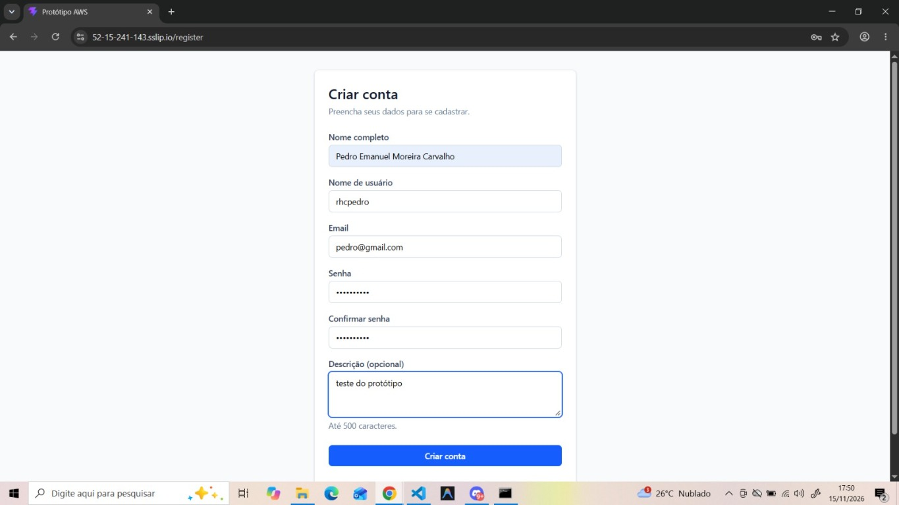

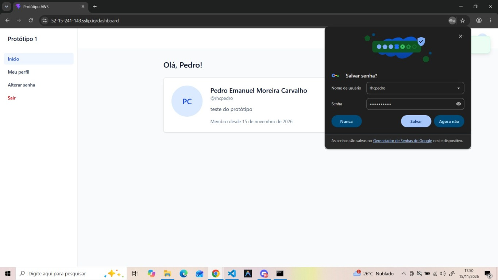

### 2.2 Alteração da foto de perfil

| Passo | Resultado esperado | Resultado obtido |
|---|---|---|
| Selecionar uma imagem válida | Exibir pré-visualização e permitir envio | Aprovado |
| Enviar a imagem | Foto aparecer no perfil e confirmação ser exibida | Aprovado |

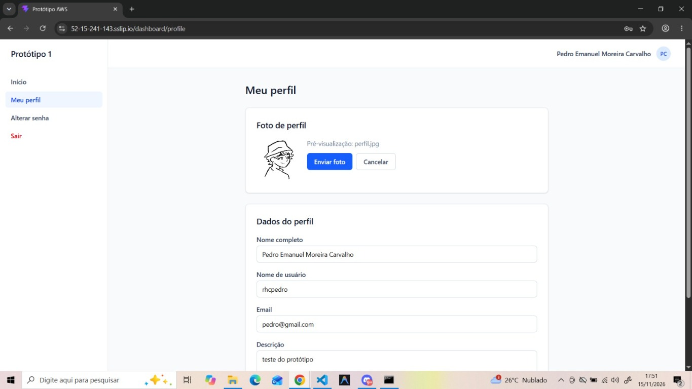

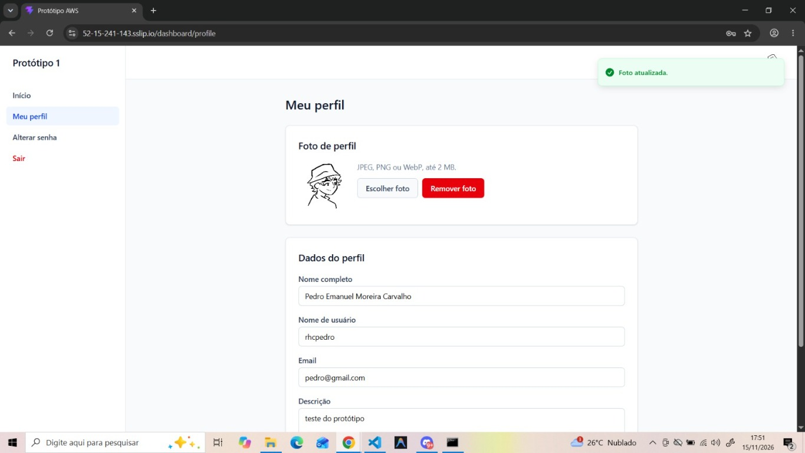

### 2.3 Alteração dos dados do usuário

| Passo | Resultado esperado | Resultado obtido |
|---|---|---|
| Editar dados do perfil | Permitir alterar os campos editáveis | Aprovado |
| Salvar as alterações | Exibir confirmação de atualização | Aprovado |

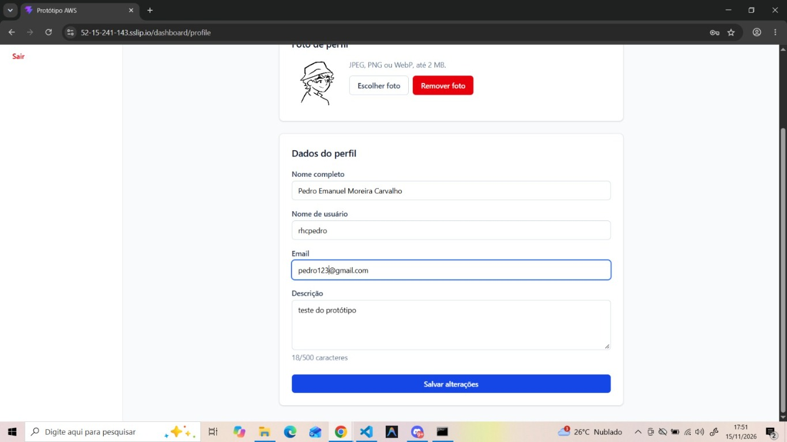

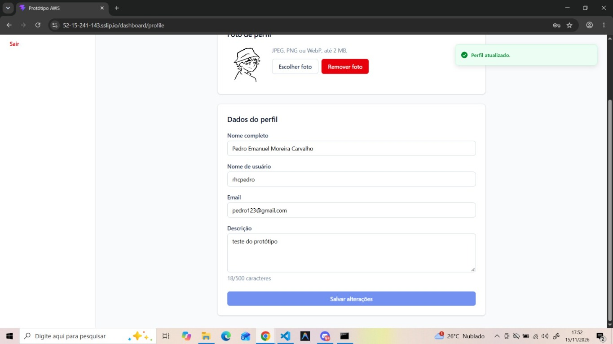

### 2.4 Validação de imagem inválida

| Passo | Resultado esperado | Resultado obtido |
|---|---|---|
| Selecionar imagem com mais de 2 MB | Impedir o upload e informar o limite | Aprovado |

A aplicação exibiu a mensagem **“A imagem deve ter no máximo 2 MB.”** e não
permitiu o envio da imagem.

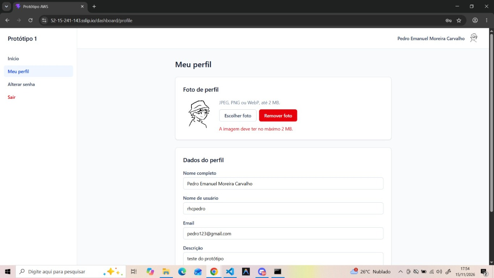

### 2.5 Alteração de senha

| Passo | Resultado esperado | Resultado obtido |
|---|---|---|
| Informar senha atual e nova senha válida | Validar os requisitos da nova senha | Aprovado |
| Salvar a nova senha | Atualizar a senha da conta | Aprovado |

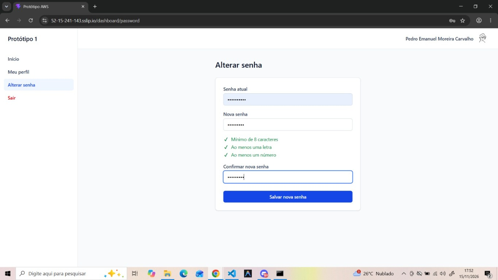

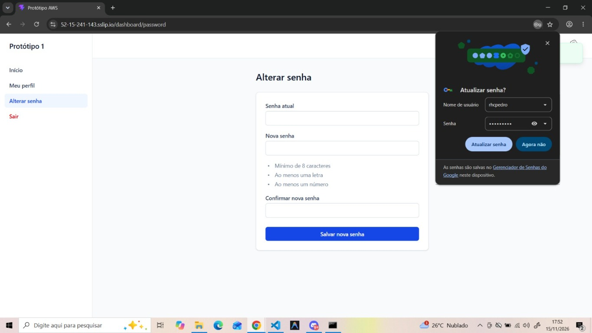

### 2.6 Logout

| Passo | Resultado esperado | Resultado obtido |
|---|---|---|
| Selecionar “Sair” | Encerrar a sessão e redirecionar para o login | Aprovado |

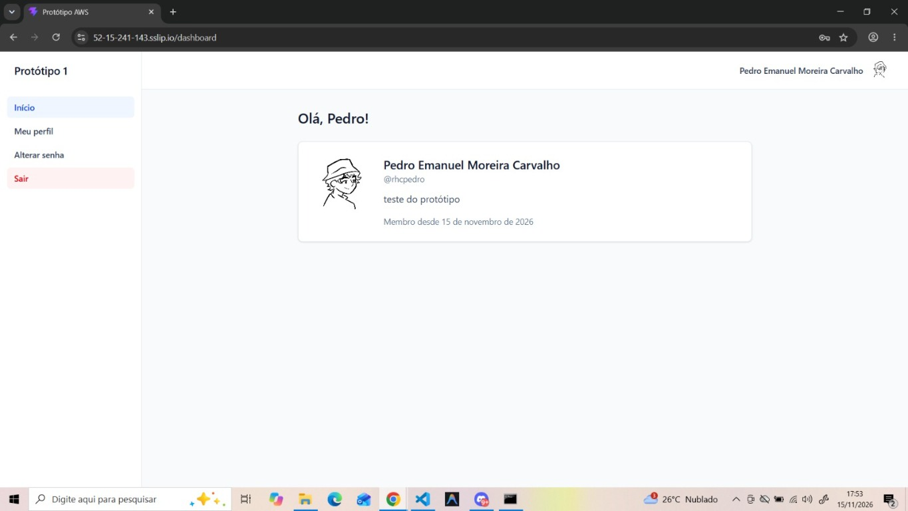

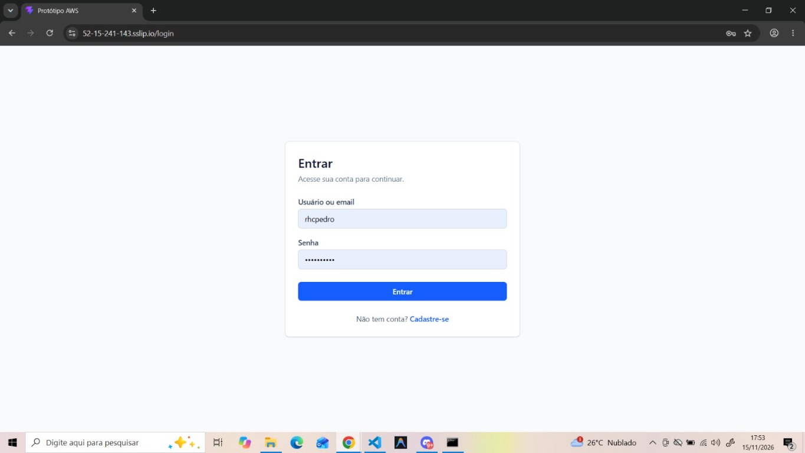

## 3. Verificações complementares

As verificações abaixo fazem parte do escopo da issue #24 e devem ser registradas
com seus respectivos resultados antes do fechamento da issue:

- [ ] Cadastro duplicado rejeitado.
- [ ] Login com credenciais incorretas rejeitado.
- [ ] Rota protegida sem autenticação rejeitada.
- [ ] Token invalidado após logout rejeitado pela API.
- [ ] Acesso direto ao objeto no S3 negado.
- [ ] Porta 5432 inacessível a partir da internet.

## 4. Resultado

O fluxo principal do aplicativo foi executado com sucesso em produção: cadastro,
autenticação, edição do perfil, upload de foto, rejeição de imagem acima de 2 MB,
troca de senha e logout. As verificações complementares devem ser concluídas e
anexadas antes do encerramento da task.
